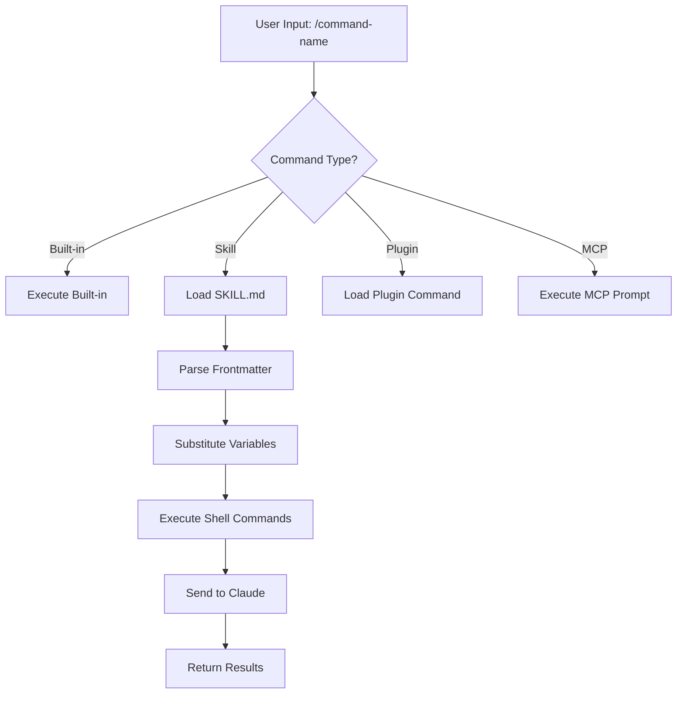
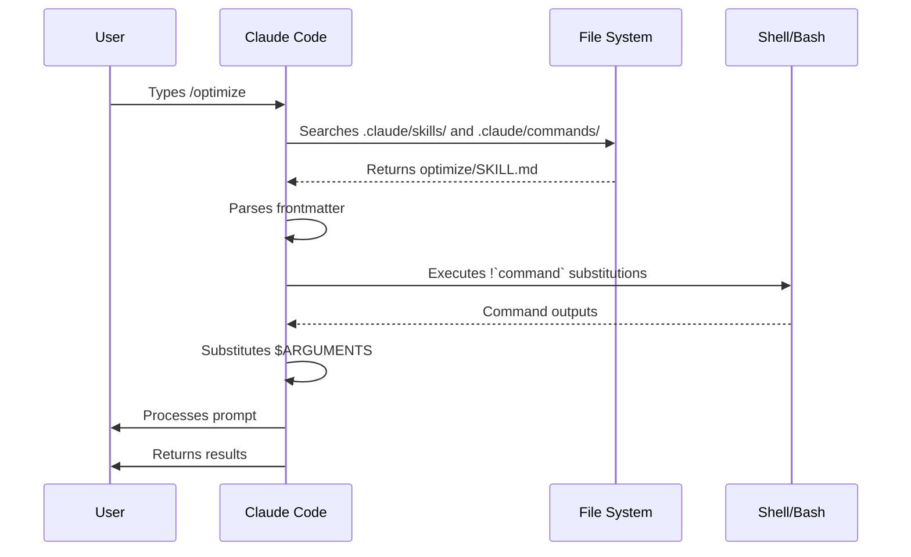
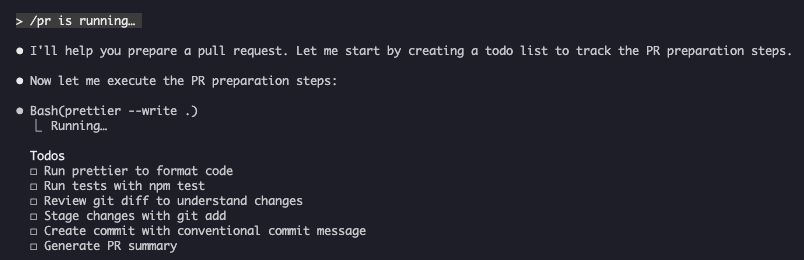

<!-- i18n-source: 01-slash-commands/README.md -->
<!-- i18n-source-sha: 188f468 -->
<!-- i18n-status: translated -->
<!-- i18n-date: 2026-10-26 -->

<picture>
  <source media="(prefers-color-scheme: dark)" srcset="../resources/logos/claude-howto-logo-dark.svg">
  
</picture>

# 슬래시 커맨드

## 개요

슬래시 커맨드는 대화형 세션에서 Claude의 동작을 제어하는 단축 명령입니다. 종류는 다음과 같습니다.

- **내장 커맨드**: Claude Code가 제공합니다(`/help`, `/clear`, `/model`).
- **스킬**: 사용자가 `SKILL.md` 파일로 만든 커맨드입니다(`/optimize`, `/pr`).
- **플러그인 커맨드**: 설치된 플러그인이 제공합니다(`/frontend-design:frontend-design`).
- **MCP 프롬프트**: MCP 서버가 제공합니다(`/mcp__github__list_prs`).

> **참고**: 사용자 정의 슬래시 커맨드는 스킬로 통합되었습니다. `.claude/commands/`의 파일도 계속 동작하지만, 이제는 스킬(`.claude/skills/`) 방식이 권장됩니다. 둘 다 `/커맨드이름` 단축을 만듭니다. 전체 레퍼런스는 [스킬 가이드](../03-skills/)를 보세요.

## 내장 커맨드 레퍼런스

내장 커맨드는 자주 쓰는 동작의 단축입니다. **60개 이상의 내장 커맨드**와 **약 20개의 번들 스킬**(일부는 기능 플래그로 제한)이 있습니다. Claude Code에서 `/`를 입력하면 전체 목록이 나오고, `/` 뒤에 글자를 입력하면 필터링됩니다.

> **참고**: v2.1.236부터 오타가 있는 슬래시 커맨드나 현재 세션에서 사용할 수 없는 커맨드에서 Enter를 누르면, 가장 비슷한 퍼지 매칭을 조용히 실행하지 않고 오류로 알려 줍니다. 모호하지 않은 접두사와 정의된 별칭은 이전처럼 동작합니다.

| 커맨드 | 용도 |
|---------|---------|
| `/add-dir <path>` | 작업 디렉터리 추가 |
| `/advisor [model\|off]` | 어드바이저 설정. 대화형 다이얼로그로 열리며, 데스크톱 앱·Remote Control·헤드리스(`-p` / Agent SDK) 세션에서는 텍스트 형식을 씁니다 — `/advisor`, `/advisor <model>`, `/advisor off` (v2.1.260+) |
| `/agents` | 더 이상 동작하는 커맨드가 아님: 대화형 마법사는 v2.1.198에서 제거되었고, v2.1.281부터 `/agents`는 `/` 메뉴와 `/help`에 나오지 않습니다. 입력하면 마법사가 어디로 갔는지만 알려 줍니다. 서브에이전트 생성·관리는 Claude에게 요청하거나 `.claude/agents/` 파일을 직접 편집하세요 |
| `/branch [name]` | 지금 이 지점에서 대화의 사본으로 전환하고 원본은 보존합니다(`/resume`으로 돌아오기) |
| `/fork [prompt]` | 현재 대화를 새 **백그라운드 세션**으로 복사하고 이쪽에서 계속 작업합니다. 두 세션은 그 시점부터 독립적이며 사본은 `claude agents`에 별도 행으로 표시됩니다(v2.1.212+). 사본이 제자리에서 편집하는 경우가 아니면, Claude Code는 코드를 변경하기 전에 자체 워크트리를 만들도록 지시합니다(격리 지시는 v2.1.221+) |
| `/subtask <task>` | 전체 대화를 이어받는 **포크된 서브에이전트**를 띄워 작업을 맡기고 나는 계속 진행합니다. 끝나면 결과가 이 대화로 돌아옵니다(v2.1.212+) |
| `/btw [question]` | Claude가 주 작업을 하는 동안 곁가지 질문을 던집니다. 메인 대화 컨텍스트를 오염시키지 않습니다. 인자 없이 `/btw`만 쓰면 직전 곁가지 질문을 다시 엽니다(v2.1.212+) |
| `/cd <path>` | 프롬프트 캐시를 깨지 않고 세션의 작업 디렉터리를 옮깁니다(v2.1.169 추가) |
| `/chrome` | Chrome 브라우저 통합 설정 |
| `/clear` | 대화 비우기(별칭: `/reset`, `/new`) |
| `/color [color\|default]` | 프롬프트 바 색상 지정. 인자 없는 `/color`는 세션 색을 무작위로 고릅니다(v2.1.128+). 색이름이나 헥스를 주면 그 값으로 지정 |
| `/compact [instructions]` | 대화 압축(선택적으로 초점 지시 전달). 압축 실패 시 이제 아무것도 하지 않고 넘어가지 않고 UI에 오류로 표시됩니다(v2.1.216) |
| `/config` | 설정 열기(별칭: `/settings`) |
| `/context` | 컨텍스트 사용량을 색 격자로 시각화. 사용량이 컨텍스트 창 한도를 넘으면 명시적 경고를 표시합니다(v2.1.216) |
| `/copy [N]` | 어시스턴트 응답을 클립보드로 복사. `w`는 파일로 저장 |
| `/cost` | `/usage`의 타이핑 단축 별칭 — 비용 탭을 엽니다(v2.1.118+) |
| `/desktop` | 데스크톱 앱에서 이어서 작업(별칭: `/app`) |
| `/diff` | 커밋하지 않은 변경의 대화형 diff 뷰어. 전체화면 렌더링에서는 대화 옆에 diff 패널이 열려 작업하는 동안 유지되며, 변경 파일과 추가/삭제 줄 수를 보여 주고 Claude가 파일을 편집하거나 셸 명령을 실행할 때마다 갱신됩니다. 다시 `/diff`를 실행하거나 `✕`를 클릭해 닫습니다(v2.1.260+). 클래식 렌더러에서는 프롬프트 자리에 뷰어가 열립니다 |
| `/doctor` | 설치 상태 진단 — Claude가 응답 중에도 열 수 있습니다. 번들 스킬로, Claude가 설정을 점검하고 수정안을 제안하며 확인 후 적용합니다(`claude doctor`는 읽기 전용 진단을 실행). `/doctor prompt-audit`(`/checkup prompt-audit`도 동일)은 CLAUDE.md·스킬·에이전트·커맨드에 남은 구모델용 프롬프팅 패턴을 감사합니다(v2.1.283) |
| `/effort [low\|medium\|high\|xhigh\|max\|auto\|ultracode [on\|off]]` | 방향키 슬라이더로 노력 수준을 설정. 단계: `low` → `medium` → `high` → `xhigh`(v2.1.111 신규) → `max`. 기본값은 Opus 5.5(v2.1.280부터 기본 모델)·Sonnet 5.5·Haiku 5.5에서 `medium`, Opus 5·Sonnet 5·Opus 4.8에서 `high`, Opus 4.7에서 `xhigh`입니다. `xhigh`는 Fable 5.1·Fable 5·Opus 5.5·Sonnet 5.5·Haiku 5.5·Opus 5·Sonnet 5·Opus 4.8·Opus 4.7에서, `max`는 Fable 5.1·Fable 5·Opus 5.5·Sonnet 5.5·Haiku 5.5·Opus 5·Sonnet 5·Opus 4.8/4.7/4.6·Sonnet 4.6에서 지원됩니다. `/effort`가 모델별 설정이 되기 전에 저장한 값은 Opus 5.5처럼 새로 나온 모델에 적용되지 않습니다(v2.1.280). 슬라이더에는 **Ultracode** 토글도 있습니다(Tab 또는 `/effort ultracode [on\|off]`). 이는 모델 노력 수준이 아니라, 세션이 도는 노력 수준에서 Claude가 동적 워크플로를 조율하게 하는 기능입니다. v2.1.284부터는 `xhigh`를 강제하지 않고 수준을 바꿔도 켜진 상태를 유지합니다. `/effort ultracode`는 세션 동안만 유지되고, `ultracode` 설정으로 영구화할 수 있습니다 |
| `/exit` | REPL 종료(별칭: `/quit`) |
| `/export [filename]` | 현재 대화를 파일이나 클립보드로 내보내기 |
| `/usage-credits` | 사용 한도 초과분 설정(v2.1.144에서 `/extra-usage`에서 개명, `/extra-usage`는 별칭으로 계속 동작) |
| `/fast [on\|off]` | 패스트 모드 토글. Opus 5.5(v2.1.280부터 패스트 모드 기본)·Opus 5·Opus 4.8에 적용 |
| `/feedback` | 피드백 제출. v2.1.141부터 최근 세션(24시간 또는 7일)을 첨부할 수 있어 여러 세션에 걸친 보고에도 맥락이 담깁니다. v2.1.178부터 `/bug`는 설명을 넣어야 제출됩니다 |
| `/focus` | 포커스 뷰 토글(v2.1.110 추가, 포커스 토글에서 `Ctrl+O`를 대체) |
| `/goal <statement>` | 세션 수준 완료 조건 등록. 조건을 만족할 때까지 Claude가 계속 작업합니다. `/goal clear`로 해제. 활성 목표는 상태 줄에 표시되고, 경과 시간·턴 수·토큰 사용량을 보여 주는 라이브 오버레이 패널이 뜹니다(v2.1.139 추가) |
| `/help` | 도움말 보기 |
| `/hooks` | 훅 설정 보기 |
| `/ide` | IDE 통합 관리 |
| `/init` | `CLAUDE.md` 초기화. `CLAUDE_CODE_NEW_INIT=1`을 설정하면 대화형 흐름 |
| `/insights` | 세션 분석 보고서 생성 |
| `/install-github-app` | GitHub Actions 앱 설정 |
| `/install-slack-app` | Slack 앱 설치 |
| `/keybindings` | 키바인딩 설정 열기 |
| `/fewer-permission-prompts` | 최근 Bash/MCP 도구 호출을 분석해 우선순위 허용목록을 `.claude/settings.json`에 추가하여 권한 프롬프트를 줄입니다(v2.1.111 추가) |
| `/login` | Anthropic 계정 전환 |
| `/logout` | Anthropic 계정 로그아웃 |
| `/mcp` | MCP 서버와 OAuth 관리 |
| `/memory` | `CLAUDE.md` 편집, 자동 메모리 토글 |
| `/mobile` | 모바일 앱용 QR 코드(별칭: `/ios`, `/android`) |
| `/model [model]` | 좌우 방향키로 모델을 고르고 노력 수준을 조정. v2.1.153부터 선택이 새 세션의 **기본값으로 저장**됩니다(IDE와 동일). 이번 세션에만 적용하려면 선택 후 `s`를 누릅니다. (키바인딩 `modelPicker:setAsDefault`는 `modelPicker:thisSessionOnly`로 이름이 바뀌었고, 기존 `d` 동작은 이제 `s`입니다.) v2.1.219부터 피커는 병합된 Opus 행을 "Opus (1M context)"로 표시했고, v2.1.283은 Opus가 이미 1M 창을 가진 Opus·Default 행에서 이 라벨을 제거합니다(창 크기 자체는 그대로) |
| `/output-style [name]` | 출력 스타일 목록·전환(v2.1.91에서 제거된 뒤 v2.1.269에서 복귀). 인자 없이 쓰면 스타일을 나열하고 현재 것을 표시합니다. 헤드리스·Remote Control 세션에서도 동작하며 선택은 `.claude/settings.local.json`에 저장됩니다 |
| `/passes` | Claude Code 무료 1주 공유 |
| `/permissions` | 권한 보기·변경(별칭: `/allowed-tools`) |
| `/plan [description]` | 플랜 모드 진입 |
| `/plugin` | 플러그인 관리 |
| `/proactive` | `/loop`의 별칭(v2.1.105 추가) |
| `/powerup` | 애니메이션 데모가 있는 대화형 레슨으로 기능을 익히기 |
| `/privacy-settings` | 개인정보 설정(Pro/Max 전용) |
| `/release-notes` | 변경 이력 보기 |
| `/recap` | 세션으로 돌아올 때 세션 요약 표시(v2.1.108 추가) |
| `/reload-plugins` | 활성 플러그인 재로드. v2.1.221부터 대부분의 설치는 즉시 활성화되므로 설치 요약에 `Run /reload-plugins to activate.`가 나올 때만 필요합니다. v2.1.260부터 헤드리스 세션에서도 사용 가능해 Claude Code Desktop·SDK 커맨드 목록에도 나타납니다 |
| `/reload-skills` | 세션을 재시작하지 않고 스킬 디렉터리 재스캔(v2.1.152 추가). 전체 스킬 목록을 Claude에게 다시 보내며, 압축 후 스킬을 복구합니다(v2.1.299) |
| `/remote-control` | claude.ai에서 원격 제어(별칭: `/rc`) |
| `/remote-env` | 기본 원격 환경 설정 |
| `/rename [name]` | 세션 이름 변경 |
| `/resume [session]` | 대화 이어서 하기(별칭: `/continue`) |
| `/review [low\|medium\|high\|xhigh\|max\|ultra] [--fix] [--comment] [pr#\|branch\|path]` | `/code-review`의 별칭(v2.1.223). 현재 diff 또는 인자로 준 PR 번호·브랜치·경로를 리뷰합니다(예: `/review 1234`). 노력 수준과 플래그도 동일합니다. 수준을 생략하면 마지막으로 입력한 `low`~`max` 수준을 재사용합니다 |
| `/rewind` | 대화 및/또는 코드 되감기(별칭: `/checkpoint`, `/undo`) |
| `/sandbox` | 샌드박스 모드 토글 |
| `/schedule [description]` | Cloud 예약 작업 생성·관리 |
| `/scroll-speed` | 전체화면 모드의 마우스 휠 스크롤 속도를 조정하는 대화형 다이얼로그. ←/→로 조정, `r`로 초기화, Enter로 저장. `~/.claude/settings.json`에 저장됩니다(v2.1.139 추가) |
| `/security-review` | 브랜치의 보안 취약점 분석 |
| `/skill-doctor` | 로드된 스킬 중 쓰이지 않는 것과 각 스킬이 컨텍스트에서 차지하는 비용을 보여 주어, 무엇을 끌지 결정할 수 있게 합니다. 보고서는 `/plugin` 관리자의 **Stats** 탭에서 열리고, 비대화형 `-p` 모드에서는 텍스트로 출력됩니다. Remote Control에서는 `Skill usage reports are not available on this connection.`라고 응답하므로, 세션을 호스팅하는 기기 터미널에서 실행하세요(v2.1.252+ 필요) |
| `/skills` | 사용 가능한 스킬 목록 |
| `/stats` | `/usage`의 타이핑 단축 별칭 — 통계 탭(일별 사용량·세션·연속 기록)을 엽니다(v2.1.118+) |
| `/stickers` | Claude Code 스티커 주문 |
| `/status` | 버전·모델·계정과 `Session kind` 행(`background job · attached`, `background job · unattended`, `interactive`)을 표시합니다(행은 v2.1.221 추가). Claude가 응답 중에도 열 수 있습니다 |
| `/statusline` | 상태 줄 설정 |
| `/tasks` | 백그라운드 작업 목록·관리 |
| `/team-onboarding` | 최근 30일의 Claude Code 세션·커맨드·MCP 사용 기록에서 팀원 온보딩 가이드를 생성하고 공유 링크를 돌려줍니다(v2.1.101 신규) |
| `/teleport` | Claude Code on the web 세션을 이 터미널에서 이어받습니다. 웹 세션 선택기가 열립니다(별칭: `/tp`). claude.ai 구독 필요 |
| `/terminal-setup` | 터미널 키바인딩 설정 |
| `/theme` | 테마 선택기 열기 / 사용자 테마 관리(v2.1.118). `~/.claude/themes/<name>.json`에 JSON으로 사용자 테마를 정의할 수 있습니다 |
| `/tui [default\|fullscreen]` | 터미널 UI 렌더러를 지정하고 그 모드로 재시작합니다(`fullscreen`은 깜빡임 없는 렌더링). 인자 없는 `/tui`는 현재 렌더러를 출력합니다(v2.1.110 추가) |
| `/ultrareview` | 클라우드 기반 종합 멀티 에이전트 코드 리뷰(v2.1.111 추가). 이제는 `/code-review ultra`를 권장하며 `/ultrareview`는 별칭으로 남아 있습니다. Pro·Max에서 3회 무료 후 사용 크레딧이 필요합니다 |
| `/upgrade` | 상위 플랜 업그레이드 페이지 열기 |
| `/usage` | 표준 사용량 대시보드(v2.1.118) — 플랜 사용 한도, 레이트 리밋, 비용, 일별 세션 통계를 함께 보여 줍니다. `/cost`와 `/stats`는 특정 탭을 여는 타이핑 단축 별칭입니다. 최대 노력 수준, 워크플로, 상시 켜진 컨텍스트, 큰 도구 결과에 대해 경고합니다(v2.1.299) |
| `/voice` | 누르고 말하기 방식 음성 받아쓰기 토글 |
| `/workflows` | 실행 중·완료된 동적 워크플로 실행 보기(v2.1.154 추가). [동적 워크플로](../09-advanced-features/README.md#동적-워크플로) 참고 |

> **`/cd`가 중요한 이유:** 디렉터리를 옮기면 예전에는 캐시가 식어 다음 턴이 느려지고 비싸졌습니다. `/cd`는 전환 후에도 프롬프트 캐시를 유지합니다.

### 번들 스킬

다음 스킬은 Claude Code에 포함되어 있으며 슬래시 커맨드처럼 호출합니다.

| 스킬 | 용도 |
|-------|---------|
| `/batch <instruction>` | 워크트리를 사용해 대규모 병렬 변경 조율 |
| `/claude-api` | 프로젝트 언어에 맞는 Claude API 레퍼런스 로드 |
| `/dataviz` | 차트·대시보드 디자인 가이드와 실행 가능한 색 팔레트 검증기(v2.1.198) |
| `/debug [description]` | 디버그 로그 켜기 |
| `/design [description]` | **디자인 캔버스** 생성 — 여러 아트보드로 된 시각 디자인(UI 목업·화면 흐름·랜딩 페이지·포스터)을 아티팩트로 발행하고, 코드가 아니라 시각적으로 다듬는 작업입니다. 레이아웃을 반복 개선하려는 상황에서 HTML을 손으로 쓰는 대신 사용하세요. v2.1.265+, 아티팩트를 쓸 수 있는 세션, Design 템플릿이 있는 계정이 필요합니다. Bedrock·Vertex·Foundry·Claude Platform on AWS에서는 사용할 수 없습니다. 독립형 Claude Design(claude.ai/design)은 2026년 12월 14일 종료됩니다 |
| `/loop [interval] [prompt]` | 지정 간격으로 프롬프트 반복 실행 |
| `/code-review [low\|medium\|high\|xhigh\|max\|ultra] [--fix] [--comment] [--max-findings n\|all\|default] [pr#\|branch\|path]` | 현재 diff, 또는 인자로 준 PR 번호·브랜치·경로를 정확성 버그 관점에서 리뷰합니다. `--fix`는 발견 사항 적용, `--comment`는 GitHub PR 인라인 코멘트로 게시, `ultra`는 깊은 클라우드 리뷰입니다. `github.com` PR에 `ultra`를 쓰고 `--post`를 주면 발견 사항 게시가 미리 선택됩니다. 노력 수준을 생략하면 마지막으로 입력한 수준을 재사용합니다(v2.1.223). 원래 `/simplify`를 흡수했지만(v2.1.147) `/simplify`는 v2.1.154에 별도 커맨드로 돌아왔습니다. `--max-findings <n>\|all`로 평소 한도보다 많거나 적게 보고할 수 있고, 이 선택은 `--max-findings default`를 줄 때까지 유지됩니다(v2.1.288) |
| `/simplify` | 정리 전용 리뷰(재사용·단순화·효율·수준)를 수행하고 수정을 적용합니다. **버그를 찾지는 않습니다** — 그건 `/code-review`를 쓰세요. v2.1.152에 잠깐 `/code-review --fix`의 별칭이었고, v2.1.154에 정리 전용으로 바뀌었습니다 |

### 사용 중단된 커맨드

| 커맨드 | 상태 |
|---------|--------|
| `/pr-comments` | v2.1.91에서 제거 — PR 코멘트는 Claude에게 직접 물어보세요 |
| `/vim` | v2.1.92에서 제거 — `/config` → Editor mode를 사용하세요 |

### 최근 변경 사항

- **v2.1.212**에서 `/fork`와 `/subtask`의 역할이 바뀌었습니다. 이제 `/fork`는 대화를 새 독립 백그라운드 세션으로 복사하고, 예전의 포크형 서브에이전트 동작은 새 `/subtask` 커맨드로 옮겼습니다. 이력: `/fork`는 v2.1.77~v2.1.161 동안 `/branch`의 별칭이었고, v2.1.161~v2.1.211 동안 포크 서브에이전트를 띄웠습니다(지금 `/subtask`가 하는 일). 에이전트 뷰를 끄면 `/subtask`는 쓸 수 없고 `/fork`가 포크 서브에이전트 동작을 유지합니다
- `/resume`(인자 없음)은 과거 세션 선택기를 열어 보이는 목록에서 빠진 세션까지 고를 수 있게 하고, 고른 세션을 백그라운드 세션으로 다시 엽니다(v2.1.212)
- 백그라운드에서 실행 중인 세션에 `/resume`이나 `claude --resume`을 쓰면 거부하지 않고 그 세션을 엽니다. `claude --resume <id> "prompt"`는 해당 프롬프트를 다음 턴으로 보냅니다(v2.1.285)
- `/output-style`은 v2.1.73에 사용 중단 예고, v2.1.91에 제거되었다가 **v2.1.269에 복귀**했습니다. v2.1.278에서 다시 살아 있는 커맨드가 되었고 헤드리스·Remote Control 세션에서도 동작합니다. 출력 스타일은 `/config` → Output style이나 `outputStyle` 설정으로도 쓸 수 있으며, 기본 제공 스타일은 Default·Proactive·Explanatory·Learning·Concise입니다(v2.1.237 추가)
- `/review`는 `/code-review`의 완전한 별칭이 되었습니다 — 대상·노력 수준·플래그가 같습니다(v2.1.223). 이력: v2.1.186에서 `/code-review medium` 엔진으로 옮겨졌지만 PR 전용이었습니다
- `/effort` 커맨드 추가. `max` 수준은 Opus 4.6 이상에서 사용 가능(원래는 Opus 4.6 전용)
- 누르고 말하기 음성 받아쓰기용 `/voice` 커맨드 추가
- 예약 작업 생성·관리용 `/schedule` 커맨드 추가
- 프롬프트 바 커스터마이즈용 `/color` 커맨드 추가
- v2.1.91에서 /pr-comments 제거 — PR 코멘트는 Claude에게 직접 물어보세요
- v2.1.92에서 /vim 제거 — 대신 /config → Editor mode를 쓰세요
- `/ultraplan`은 v2.1.222에서 제거 — 플랜 모드를 쓰세요
- 대화형 기능 레슨용 /powerup 추가
- 샌드박스 모드 토글용 /sandbox 추가
- `/model` 선택기가 이제 원시 모델 ID 대신 사람이 읽기 쉬운 라벨(예: "Sonnet 4.6")을 표시합니다
- `/resume`이 `/continue` 별칭을 지원합니다
- MCP 프롬프트를 `/mcp__<server>__<prompt>` 커맨드로 사용할 수 있습니다([MCP 프롬프트를 커맨드로](#mcp-프롬프트를-커맨드로) 참고)
- 팀원 온보딩 가이드 자동 생성용 `/team-onboarding` 추가(v2.1.101)
- 깜빡임 없는 전체화면 TUI 렌더링용 `/tui` 커맨드 추가(v2.1.110)
- 포커스 뷰 토글용 `/focus` 커맨드 추가. `Ctrl+O`는 이제 상세 트랜스크립트 토글만 합니다(v2.1.110)
- 세션 컨텍스트 요약을 수동으로 부르는 `/recap` 커맨드 추가(v2.1.108)
- `/undo`가 `/rewind`의 별칭으로 추가(v2.1.108). `/checkpoint`와 함께 계속 `/rewind`의 별칭입니다
- `/proactive`가 `/loop`의 별칭으로 추가(v2.1.105)
- `/effort`에 방향키 슬라이더와 `high`와 `max` 사이의 새 `xhigh` 수준 추가. Opus 4.7 플랜의 기본 노력 수준이 `xhigh`로 상향(v2.1.111). Opus 4.8의 기본값은 `high`(v2.1.154), Opus 5도 `high`가 기본(v2.1.219)
- 클라우드 기반 종합 멀티 에이전트 코드 리뷰용 `/ultrareview` 추가(v2.1.111)
- Bash/MCP 도구 호출을 분석해 `.claude/settings.json` 허용목록으로 권한 프롬프트를 줄이는 `/fewer-permission-prompts` 추가(v2.1.111)
- Opus 4.7의 Max 구독자는 오토 모드에 `--enable-auto-mode` 플래그가 더 이상 필요 없습니다(v2.1.112)
- `/goal` 추가 — Claude가 턴을 넘어 추진하는 세션 수준 완료 조건. 라이브 오버레이에 경과 시간·턴 수·토큰 사용량이 표시됩니다(v2.1.139)
- `/scroll-speed` 추가 — TUI 라이브 프리뷰 창의 마우스 휠 스크롤 속도를 조정하며 기기별로 유지됩니다(v2.1.139)
- `/reload-skills` 추가 — 세션을 재시작하지 않고 스킬 디렉터리 재스캔(v2.1.152)
- `/model`이 선택한 모델을 새 세션의 기본값으로 저장합니다. 이번 세션에만 적용하려면 `s`를 누릅니다(키바인딩 `modelPicker:setAsDefault` → `modelPicker:thisSessionOnly`)(v2.1.153)
- `/workflows` 추가 — 실행 중·완료된 동적 워크플로 실행 보기(v2.1.154)
- `/simplify`가 `/code-review`의 버그 사냥과 분리된 정리 전용 리뷰 커맨드로 복귀(재사용·단순화·효율·수준)(v2.1.154)
- `/status`에 `Session kind` 행이 추가되어 attached/unattended 백그라운드 작업과 대화형 세션을 구분합니다(v2.1.221)
- 플러그인 설치는 안전할 때 즉시 활성화됩니다. `/reload-plugins`는 설치 요약이 요청할 때만 필요합니다(v2.1.221)
- `/ultraplan` 제거 — 플랜 모드를 사용하세요(v2.1.222)
- `/code-review`와 `/review`는 노력 수준을 생략하면 마지막으로 입력한 수준을 기억합니다(v2.1.223)
- 클라우드 멀티 에이전트 리뷰의 권장 진입점이 `/code-review ultra`가 되었고 `/ultrareview`는 별칭으로 남습니다(v2.1.223)
- `high`·`xhigh`·`max` 노력 수준의 `/code-review`도 다른 수준처럼 백그라운드 에이전트에서 실행됩니다(v2.1.232)
- 사용자 정의 서브에이전트 생성을 권하던 시작 팁과 `/powerup` 투어의 같은 안내가 제거되었습니다(v2.1.232)
- `/permissions`를 Claude가 작업하는 중에도 열 수 있으며, 규칙 변경은 현재 턴의 남은 부분에 적용됩니다(v2.1.234)
- `/add-dir <path>`를 Claude가 작업하는 중에도 쓸 수 있습니다. `/add-dir`·`/autocompact`·`/theme`·`/help`·`/config`·`/advisor` 다이얼로그가 **전체화면 TUI**에서 Claude 응답이 끝날 때까지 대기하지 않고 턴 중간에 열립니다(`/bug`는 v2.1.232부터 이미 즉시 열렸습니다)(v2.1.234)

### `/goal` — 세션 수준 완료 조건

> **v2.1.139 신규**

`/goal`로 현재 세션의 완료 조건을 등록합니다. Claude는 턴을 넘어 그 목표를 향해 일하고, 오버레이 패널이 경과 시간·턴 수·사용 토큰을 보여 줍니다. `/goal clear`로 해제합니다. 대화형 모드, `claude -p`, Remote Control에서 모두 동작합니다.

```
User: /goal Migrate the payments service from REST to gRPC and get the integration tests passing.
Claude: Goal registered. I'll work toward this until you clear it.
[Goal panel: ⏱ 0s · turns 0 · tokens 0]

User: start by listing the REST endpoints
Claude: [does the work, panel updates]
```

**정체된 백그라운드 작업 점검(v2.1.234):** 목표가 활성인 동안 백그라운드 작업이 30분 넘게 진척이 없으면, Claude가 조용히 계속하지 않고 상태 업데이트로 점검합니다. 임계값(분)은 `CLAUDE_CODE_GOAL_CHECKIN_MINUTES` 환경변수로 조정하고, `0`으로 두면 점검을 완전히 끕니다.

### `/team-onboarding` — 팀원 온보딩 가이드

> **v2.1.101 신규**

`/team-onboarding`으로 프로젝트의 로컬 Claude Code 사용 기록에서 팀원 온보딩 가이드를 만듭니다. Claude가 최근 30일의 세션·커맨드·MCP 서버 사용을 분석해 새 개발자가 빨리 적응하도록 돕는 가이드를 만들고, 공유 링크를 돌려줍니다.

내장 커맨드라 따로 설치할 것이 없습니다.

**사용법:**

```bash
claude /team-onboarding
```

생성된 가이드는 다음을 근거로 합니다.

- 최근 세션에서 되풀이되는 워크플로
- 가장 자주 쓰는 커맨드
- 사용하는 [MCP 서버](../05-mcp/README.md)

**제공 시점:** Claude Code v2.1.101(2026년 4월 11일)에 포함.

## 사용자 정의 커맨드(이제 스킬)

사용자 정의 슬래시 커맨드는 **스킬로 통합**되었습니다. 두 방식 모두 `/커맨드이름`으로 호출하는 커맨드를 만듭니다.

| 방식 | 위치 | 상태 |
|----------|----------|--------|
| **스킬(권장)** | `.claude/skills/<name>/SKILL.md` | 현재 표준 |
| **레거시 커맨드** | `.claude/commands/<name>.md` | 계속 동작 |

스킬과 커맨드가 같은 이름이면 **스킬이 우선**합니다. 예를 들어 `.claude/commands/review.md`와 `.claude/skills/review/SKILL.md`가 모두 있으면 스킬 버전이 쓰입니다.

### 이전 경로

기존 `.claude/commands/` 파일은 수정 없이 계속 동작합니다. 스킬로 옮기려면:

**이전(커맨드):**
```
.claude/commands/optimize.md
```

**이후(스킬):**
```
.claude/skills/optimize/SKILL.md
```

### 왜 스킬인가?

스킬은 레거시 커맨드보다 많은 기능을 제공합니다.

- **디렉터리 구조**: 스크립트·템플릿·참고 파일을 함께 묶을 수 있습니다
- **자동 호출**: 관련 상황에서 Claude가 스킬을 스스로 트리거할 수 있습니다
- **호출 제어**: 사용자만, Claude만, 또는 둘 다 호출하도록 정할 수 있습니다
- **서브에이전트 실행**: `context: fork`로 격리된 컨텍스트에서 실행합니다
- **점진적 노출**: 필요한 시점에만 추가 파일을 로드합니다

### 사용자 정의 커맨드를 스킬로 만들기

`SKILL.md` 파일이 있는 디렉터리를 만듭니다.

```bash
mkdir -p .claude/skills/my-command
```

**파일:** `.claude/skills/my-command/SKILL.md`

```yaml
---
name: my-command
description: What this command does and when to use it
---

# My Command

Instructions for Claude to follow when this command is invoked.

1. First step
2. Second step
3. Third step
```

### 프론트매터 레퍼런스

| 필드 | 용도 | 기본값 |
|-------|---------|---------|
| `name` | 커맨드 이름(`/name`이 됨) | 디렉터리 이름 |
| `description` | 짧은 설명(Claude가 언제 쓸지 판단하는 데 도움) | 첫 번째 비어 있지 않은 줄 |
| `argument-hint` | 자동완성용 인자 힌트 | 없음 |
| `allowed-tools` | 권한 없이 쓸 수 있는 도구 | 상속 |
| `model` | 사용할 특정 모델 | 상속 |
| `disable-model-invocation` | `true`면 사용자만 호출 가능(Claude 불가) | `false` |
| `user-invocable` | `false`면 `/` 메뉴에서 숨김 | `true` |
| `context` | `fork`로 지정하면 격리된 서브에이전트에서 실행 | 없음 |
| `agent` | `context: fork`일 때의 에이전트 유형 | `general-purpose` |
| `hooks` | 스킬 실행 시 등록되는 훅(모든 훅 이벤트 가능, 세션 남은 시간 동안 유지) | 없음 |

### 인자

커맨드는 인자를 받을 수 있습니다.

**`$ARGUMENTS`로 모든 인자 받기:**

```yaml
---
name: fix-issue
description: Fix a GitHub issue by number
---

Fix issue #$ARGUMENTS following our coding standards
```

사용: `/fix-issue 123` → `$ARGUMENTS`가 "123"이 됩니다

**`$0`, `$1` 등으로 개별 인자 받기:**

```yaml
---
name: review-pr
description: Review a PR with priority
---

Review PR #$0 with priority $1
```

사용: `/review-pr 456 high` → `$0`="456", `$1`="high"

`${CLAUDE_PROJECT_DIR}`는 프로젝트 루트의 절대 경로로 치환됩니다(v2.1.196).

### 셸 명령으로 동적 컨텍스트 넣기

프롬프트 앞에서 bash 명령을 실행하려면 `` !`command` ``를 씁니다.

> **참고(v2.1.299)**: `UserPromptSubmit` 훅은 명령 확장 전에 실행되므로, 프롬프트를 막는 훅이 있으면 이 `!` 명령도 실행되지 않습니다.

```yaml
---
name: commit
description: Create a git commit with context
allowed-tools: Bash(git *)
---

## Context

- Current git status: !`git status`
- Current git diff: !`git diff HEAD`
- Current branch: !`git branch --show-current`
- Recent commits: !`git log --oneline -5`

## Your task

Based on the above changes, create a single git commit.
```

### 파일 참조

`@`로 파일 내용을 포함합니다.

```markdown
Review the implementation in @src/utils/helpers.js
Compare @src/old-version.js with @src/new-version.js
```

## 플러그인 커맨드

플러그인도 사용자 정의 커맨드를 제공할 수 있습니다.

```
/plugin-name:command-name
```

이름 충돌이 없으면 `/command-name`만으로도 됩니다.

**예시:**
```bash
/frontend-design:frontend-design
/commit-commands:commit
```

## MCP 프롬프트를 커맨드로

MCP 서버는 프롬프트를 슬래시 커맨드로 노출할 수 있습니다.

```
/mcp__<server-name>__<prompt-name> [arguments]
```

**예시:**
```bash
/mcp__github__list_prs
/mcp__github__pr_review 456
/mcp__jira__create_issue "Bug title" high
```

### MCP 권한 문법

권한에서 MCP 서버 접근을 제어합니다.

- `mcp__github` - GitHub MCP 서버 전체 접근
- `mcp__github__*` - 모든 도구에 와일드카드 접근
- `mcp__github__get_issue` - 특정 도구 접근

> **v2.1.299+:** 규칙은 이름이 정확히 일치하는 서버에만 적용됩니다 — `mcp__github`는 더 이상 `github__x`나 `github_`라는 서버에 걸리지 않습니다. 정규화된 이름에 `__`가 포함된 서버라면 `mcp__<정규화된 전체 이름>__*`으로 써야 합니다(서브에이전트의 `tools:` 목록도 같습니다).

## 커맨드 아키텍처



## 커맨드 생명주기



## 이 폴더의 예제 커맨드

아래 예제 커맨드는 스킬 또는 레거시 커맨드로 설치할 수 있습니다.

### 1. `/optimize` - 코드 최적화

성능 문제, 메모리 누수, 최적화 기회를 코드에서 찾아냅니다.

**사용법:**
```
/optimize
[Paste your code]
```

### 2. `/pr` - 풀 리퀘스트 준비

린트·테스트·커밋 포맷을 포함한 PR 준비 체크리스트를 안내합니다.

**사용법:**
```
/pr
```

**스크린샷:**


### 3. `/generate-api-docs` - API 문서 생성기

소스 코드에서 종합적인 API 문서를 생성합니다.

**사용법:**
```
/generate-api-docs
```

### 4. `/commit` - 컨텍스트를 담은 git 커밋

저장소의 동적 컨텍스트를 담아 git 커밋을 만듭니다.

**사용법:**
```
/commit [optional message]
```

### 5. `/push-all` - 스테이징·커밋·푸시

모든 변경을 스테이징하고 커밋한 뒤 안전 점검과 함께 원격으로 푸시합니다.

**사용법:**
```
/push-all
```

**안전 점검:**
- 비밀값: `.env*`, `*.key`, `*.pem`, `credentials.json`
- API 키: 실제 키와 플레이스홀더 구분
- 대용량 파일: Git LFS 없이 `>10MB`
- 빌드 산출물: `node_modules/`, `dist/`, `__pycache__/`

### 6. `/doc-refactor` - 문서 구조 개편

프로젝트 문서를 더 명확하고 접근하기 쉽게 재구성합니다.

**사용법:**
```
/doc-refactor
```

### 7. `/setup-ci-cd` - CI/CD 파이프라인 설정

품질 보증을 위한 pre-commit 훅과 GitHub Actions를 구성합니다.

**사용법:**
```
/setup-ci-cd
```

### 8. `/unit-test-expand` - 테스트 커버리지 확장

테스트되지 않은 분기와 경계 사례를 겨냥해 커버리지를 높입니다.

**사용법:**
```
/unit-test-expand
```

## 설치

### 스킬로 설치(권장)

스킬 디렉터리에 복사합니다.

```bash
# Create skills directory
mkdir -p .claude/skills

# For each command file, create a skill directory
for cmd in optimize pr commit; do
  mkdir -p .claude/skills/$cmd
  cp 01-slash-commands/$cmd.md .claude/skills/$cmd/SKILL.md
done
```

### 레거시 커맨드로 설치

커맨드 디렉터리에 복사합니다.

```bash
# Project-wide (team)
mkdir -p .claude/commands
cp 01-slash-commands/*.md .claude/commands/ && rm .claude/commands/README.md

# Personal use
mkdir -p ~/.claude/commands
cp 01-slash-commands/*.md ~/.claude/commands/ && rm ~/.claude/commands/README.md
```

## 내 커맨드 만들기

### 스킬 템플릿(권장)

`.claude/skills/my-command/SKILL.md`를 만듭니다.

```yaml
---
name: my-command
description: What this command does. Use when [trigger conditions].
argument-hint: [optional-args]
allowed-tools: Bash(npm *), Read, Grep
---

# Command Title

## Context

- Current branch: !`git branch --show-current`
- Related files: @package.json

## Instructions

1. First step
2. Second step with argument: $ARGUMENTS
3. Third step

## Output Format

- How to format the response
- What to include
```

### 사용자 전용 커맨드(자동 호출 없음)

부작용이 있어 Claude가 스스로 트리거하면 안 되는 커맨드에 씁니다.

```yaml
---
name: deploy
description: Deploy to production
disable-model-invocation: true
allowed-tools: Bash(npm *), Bash(git *)
---

Deploy the application to production:

1. Run tests
2. Build application
3. Push to deployment target
4. Verify deployment
```

## 모범 사례

| 권장 | 비권장 |
|------|---------|
| 명확하고 행동 지향적인 이름을 쓴다 | 일회성 작업용으로 커맨드를 만든다 |
| `description`에 트리거 조건을 포함한다 | 커맨드 안에 복잡한 로직을 넣는다 |
| 커맨드는 단일 작업에 집중시킨다 | 민감한 정보를 하드코딩한다 |
| 부작용이 있으면 `disable-model-invocation`을 쓴다 | `description` 필드를 생략한다 |
| 동적 컨텍스트에는 `!` 접두사를 쓴다 | Claude가 현재 상태를 안다고 가정한다 |
| 관련 파일은 스킬 디렉터리로 묶는다 | 모든 것을 한 파일에 넣는다 |

## 문제 해결

### 커맨드를 찾을 수 없음

**해결:**
- 파일이 `.claude/skills/<name>/SKILL.md` 또는 `.claude/commands/<name>.md`에 있는지 확인합니다.
- 프론트매터의 `name` 필드가 기대한 커맨드 이름과 일치하는지 확인합니다.
- Claude Code 세션을 재시작합니다.
- `/help`로 사용 가능한 커맨드를 확인합니다.

### 커맨드가 의도대로 실행되지 않음

**해결:**
- 더 구체적인 지시를 넣습니다.
- 스킬 파일에 예시를 포함합니다.
- bash 명령을 쓴다면 `allowed-tools`를 확인합니다.
- 먼저 단순한 입력으로 테스트합니다.

### 스킬과 커맨드 충돌

같은 이름으로 둘 다 있으면 **스킬이 우선**합니다. 하나를 지우거나 이름을 바꾸세요.

## 관련 가이드

- **[스킬](../03-skills/)** - 스킬 전체 레퍼런스(자동 호출 기능)
- **[메모리](../02-memory/)** - CLAUDE.md를 통한 영속 컨텍스트
- **[서브에이전트](../04-subagents/)** - 위임형 AI 에이전트
- **[플러그인](../07-plugins/)** - 묶음으로 배포되는 커맨드 모음
- **[훅](../06-hooks/)** - 이벤트 기반 자동화

## 추가 자료

- [공식 대화형 모드 문서](https://code.claude.com/docs/en/interactive-mode) - 내장 커맨드 레퍼런스
- [공식 스킬 문서](https://code.claude.com/docs/en/skills) - 스킬 전체 레퍼런스
- [CLI 레퍼런스](https://code.claude.com/docs/en/cli-reference) - 커맨드라인 옵션

---

**최종 갱신**: 2026년 10월 18일
**Claude Code 버전**: 2.1.302
**출처**:
- https://code.claude.com/docs/en/output-styles
- https://code.claude.com/docs/en/skills
- https://code.claude.com/docs/en/slash-commands
- https://code.claude.com/docs/en/interactive-mode
- https://code.claude.com/docs/en/interactive-mode#review-changes-with-diff
- https://code.claude.com/docs/en/changelog
- https://code.claude.com/docs/en/commands
- https://code.claude.com/docs/en/whats-new/2026-w34
- https://code.claude.com/docs/en/model-config
- https://github.com/anthropics/claude-code/blob/main/CHANGELOG.md
- https://github.com/anthropics/claude-code/releases/tag/v2.1.139
- https://github.com/anthropics/claude-code/releases/tag/v2.1.144
- https://github.com/anthropics/claude-code/releases/tag/v2.1.152
- https://github.com/anthropics/claude-code/releases/tag/v2.1.153
- https://github.com/anthropics/claude-code/releases/tag/v2.1.154
- https://github.com/anthropics/claude-code/releases/tag/v2.1.281
- https://code.claude.com/docs/en/fast-mode
- https://github.com/anthropics/claude-code/releases/tag/v2.1.283
- https://code.claude.com/docs/en/workflows#let-claude-decide-with-ultracode
- https://github.com/anthropics/claude-code/releases/tag/v2.1.285
- https://code.claude.com/docs/en/hooks#hooks-in-skills-and-agents
- https://code.claude.com/docs/en/permissions#mcp
- https://code.claude.com/docs/en/changelog#2-1-299
- https://code.claude.com/docs/en/hooks#hook-lifecycle
- https://code.claude.com/docs/en/fullscreen
- https://support.claude.com/en/articles/17440474-migrate-from-standalone-claude-design-to-claude
**호환 모델**: Claude Fable 5, Claude Opus 5, Claude Sonnet 5, Claude Sonnet 4.6, Claude Opus 4.8, Claude Haiku 4.5

*[Claude How To](../) 가이드 시리즈의 일부*
