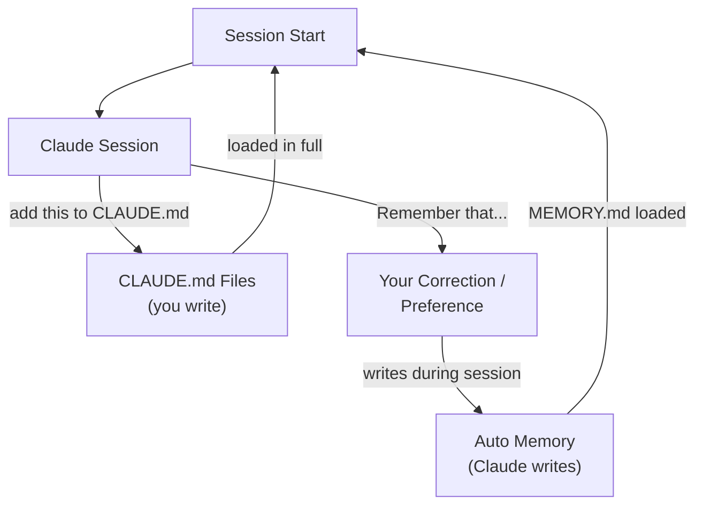
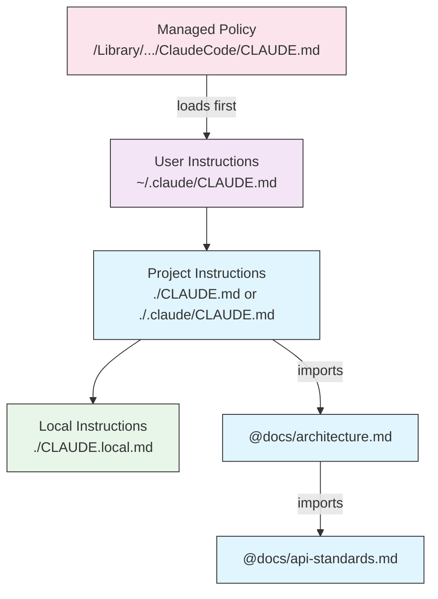
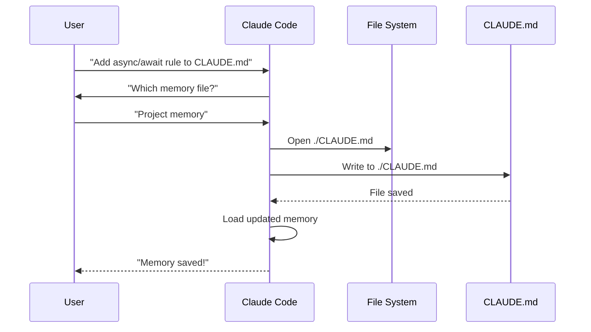
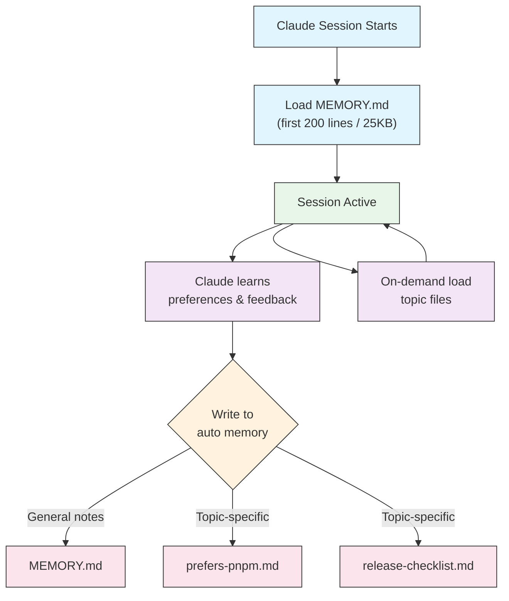

<!-- i18n-source: 02-memory/README.md -->
<!-- i18n-source-sha: 188f468 -->
<!-- i18n-status: translated -->
<!-- i18n-date: 2026-10-26 -->

<picture>
  <source media="(prefers-color-scheme: dark)" srcset="../resources/logos/claude-howto-logo-dark.svg">
  
</picture>

# 메모리 가이드

메모리는 Claude가 세션과 대화를 넘어 컨텍스트를 유지하도록 해 줍니다. 메모리는 두 가지 형태로 존재합니다. claude.ai의 자동 합성과, Claude Code의 파일 시스템 기반 `CLAUDE.md`입니다.

## 개요

Claude Code의 메모리는 여러 세션과 대화에 걸쳐 이어지는 지속적 컨텍스트를 제공합니다. 일시적인 컨텍스트 창과 달리 메모리 파일을 사용하면 다음이 가능합니다.

- 팀 전체가 프로젝트 표준을 공유
- 개인 개발 선호도 저장
- 디렉터리별 규칙과 구성 유지
- 외부 문서 가져오기
- 메모리를 프로젝트의 일부로 버전 관리

메모리 시스템은 전역 개인 선호도부터 특정 하위 디렉터리까지 여러 계층으로 동작하므로, Claude가 무엇을 기억하고 그 지식을 어떻게 적용할지 세밀하게 제어할 수 있습니다.

## 메모리 명령 빠른 참조

| 명령 | 목적 | 사용법 | 사용 시점 |
|---------|---------|-------|-------------|
| `/init` | 프로젝트 메모리 초기화 | `/init` | 새 프로젝트 시작, 최초 CLAUDE.md 설정 |
| `/memory` | 편집기에서 메모리 파일 편집 | `/memory` | 대규모 수정, 재구성, 내용 검토 |
| `#` 접두사 | ~~한 줄 메모리 빠른 추가~~ **지원 중단** | — | 대신 `/memory`를 사용하거나 대화로 요청 |
| `@path/to/file` | 외부 콘텐츠 가져오기 | `@README.md` 또는 `@docs/api.md` | CLAUDE.md에서 기존 문서 참조 |

## 빠른 시작: 메모리 초기화

### `/init` 명령

`/init` 명령은 Claude Code에서 프로젝트 메모리를 설정하는 가장 빠른 방법입니다. 기초 프로젝트 문서와 함께 CLAUDE.md 파일을 초기화합니다.

**사용법:**

```bash
/init
```

**수행 내용:**

- 프로젝트에 새 CLAUDE.md 파일을 생성합니다(보통 `./CLAUDE.md` 또는 `./.claude/CLAUDE.md`)
- 프로젝트 관례와 가이드라인을 정립합니다
- 세션 전반에 걸친 컨텍스트 지속성의 기반을 마련합니다
- 프로젝트 표준을 문서화할 템플릿 구조를 제공합니다

**향상된 대화형 모드:** `CLAUDE_CODE_NEW_INIT=1`을 설정하면 프로젝트 설정을 단계별로 안내하는 다단계 대화형 흐름이 활성화됩니다.

```bash
CLAUDE_CODE_NEW_INIT=1 claude
/init
```

**`/init`을 사용할 시점:**

- Claude Code로 새 프로젝트를 시작할 때
- 팀 코딩 표준과 관례를 정립할 때
- 코드베이스 구조에 대한 문서를 만들 때
- 협업 개발을 위한 메모리 계층을 설정할 때

**예제 워크플로:**

```markdown
# In your project directory
/init

# Claude creates CLAUDE.md with structure like:
# Project Configuration
## Project Overview
- Name: Your Project
- Tech Stack: [Your technologies]
- Team Size: [Number of developers]

## Development Standards
- Code style preferences
- Testing requirements
- Git workflow conventions
```

### 빠른 메모리 업데이트

> **참고**: 인라인 메모리용 `#` 단축키는 지원이 중단되었습니다. 메모리 파일을 직접 편집하려면 `/memory`를 사용하거나, Claude에게 대화로 기억해 달라고 요청하세요(예: "remember that we always use TypeScript strict mode").

메모리에 정보를 추가하는 권장 방법은 다음과 같습니다.

**방법 1: `/memory` 명령 사용**

```bash
/memory
```

메모리 파일을 시스템 편집기에서 열어 직접 편집합니다.

**방법 2: 대화로 요청**

```
Remember that we always use TypeScript strict mode in this project.
Please add to memory: prefer async/await over promise chains.
```

Claude에게 기억해 달라고 요청하면 자동 메모리에 저장됩니다. 대신 CLAUDE.md를 변경하려면 "add this to CLAUDE.md"라고 말하거나 `/memory`로 파일을 직접 편집하세요.

**과거 참고 사항**(더 이상 동작하지 않음):

`#` 접두사 단축키는 예전에 규칙을 인라인으로 추가할 수 있었습니다.

```markdown
# Always use TypeScript strict mode in this project  ← no longer works
```

이 방식을 사용해 왔다면 `/memory` 명령이나 대화형 요청으로 전환하세요.

### `/memory` 명령

`/memory` 명령은 Claude Code 세션 안에서 CLAUDE.md 메모리 파일을 직접 편집할 수 있게 해 줍니다. 메모리 파일을 시스템 편집기에서 열어 폭넓게 편집합니다. 파일이 GUI 편집기에서 열리면 파일이 열려 있는 동안 세션이 더 이상 차단되지 않으므로 병행 작업을 계속할 수 있습니다(v2.1.216). Vim 같은 터미널 편집기는 종료할 때까지 여전히 터미널을 점유합니다.

**사용법:**

```bash
/memory
```

**수행 내용:**

- 시스템 기본 편집기에서 메모리 파일을 엽니다
- 대규모 추가, 수정, 재구성을 수행할 수 있습니다
- 계층의 모든 메모리 파일에 직접 접근할 수 있습니다
- 세션 전반의 지속적 컨텍스트를 관리할 수 있습니다

**`/memory`를 사용할 시점:**

- 기존 메모리 내용을 검토할 때
- 프로젝트 표준을 대규모로 수정할 때
- 메모리 구조를 재구성할 때
- 상세한 문서나 가이드라인을 추가할 때
- 프로젝트가 발전함에 따라 메모리를 유지·갱신할 때

**비교: `/memory` vs `/init`**

| 관점 | `/memory` | `/init` |
|--------|-----------|---------|
| **목적** | 기존 메모리 파일 편집 | 새 CLAUDE.md 초기화 |
| **사용 시점** | 프로젝트 컨텍스트 갱신·수정 | 새 프로젝트 시작 |
| **동작** | 편집기를 열어 변경 | 시작용 템플릿 생성 |
| **워크플로** | 지속적 유지보수 | 일회성 설정 |

**예제 워크플로:**

```markdown
# Open memory for editing
/memory

# Claude presents options:
# 1. Managed Policy Memory
# 2. Project Memory (./CLAUDE.md)
# 3. User Memory (~/.claude/CLAUDE.md)
# 4. Local Project Memory

# Choose option 2 (Project Memory)
# Your default editor opens with ./CLAUDE.md content

# Make changes, save, and close editor
# Claude automatically reloads the updated memory
```

**메모리 가져오기 사용:**

CLAUDE.md 파일은 `@path/to/file` 구문으로 외부 콘텐츠를 포함할 수 있습니다.

```markdown
# Project Documentation
See @README.md for project overview
See @package.json for available npm commands
See @docs/architecture.md for system design

# Import from home directory using absolute path
@~/.claude/my-project-instructions.md
```

**가져오기 기능:**

- 상대 경로와 절대 경로를 모두 지원합니다(예: `@docs/api.md` 또는 `@~/.claude/my-project-instructions.md`)
- 재귀 가져오기를 지원하며 최대 깊이는 4홉입니다
- 외부 위치에서 처음 가져올 때는 보안을 위해 승인 대화상자가 나타납니다
- 가져오기 지시문은 마크다운 코드 스팬이나 코드 블록 안에서는 평가되지 않습니다(따라서 예제에 적어 두어도 안전합니다)
- 기존 문서를 참조하므로 중복을 피할 수 있습니다
- 참조된 콘텐츠를 Claude의 컨텍스트에 자동으로 포함합니다

## 메모리 아키텍처

Claude Code의 메모리는 서로 다른 스코프가 서로 다른 목적을 수행하는 계층 시스템을 따릅니다. Claude Web/Desktop의 24시간 합성 주기(아래 [Claude Web/Desktop의 메모리](#claude-webdesktop의-메모리) 참조)와 달리, Claude Code에는 두 가지 메모리 시스템이 있으며 둘 다 모든 세션 시작 시 로드되고 타이머가 아니라 지속적으로 갱신됩니다.



## Claude Code의 메모리 계층

Claude Code에는 상호 보완적인 두 가지 메모리 시스템이 있고, 둘 다 모든 대화 시작 시 로드됩니다. 바로 **CLAUDE.md 파일**(직접 작성하는 지시사항)과 **자동 메모리**(Claude가 스스로 작성하는 노트)입니다. CLAUDE.md 파일은 서로를 덮어쓰지 않고 **컨텍스트에 이어 붙여집니다(concatenate)**. 상위 계층이 하위 계층을 대체하는 엄격한 우선순위 체인이 아닙니다. `.claude/rules/*.md` 파일은 주제별·경로별 지시사항을 위한 별개의 관련 메커니즘입니다.

**CLAUDE.md 파일 위치(로드 순서, 가장 넓은 스코프에서 가장 좁은 스코프로):**

| 스코프 | 위치 | 목적 |
|-------|----------|---------|
| 관리형 정책 | macOS: `/Library/Application Support/ClaudeCode/CLAUDE.md`<br>Linux/WSL: `/etc/claude-code/CLAUDE.md`<br>Windows: `C:\Program Files\ClaudeCode\CLAUDE.md` | IT/DevOps가 관리하는 조직 전체 지시사항. 개별 설정으로 제외할 수 없습니다. |
| 사용자 지시사항 | `~/.claude/CLAUDE.md` | 모든 프로젝트에 적용되는 개인 선호도 |
| 프로젝트 지시사항 | `./CLAUDE.md` 또는 `./.claude/CLAUDE.md` | 팀이 공유하는 지시사항, 버전 관리 대상. v2.1.277부터는 작업 디렉터리 또는 그 상위에 `CLAUDE.md`나 `CLAUDE.local.md`가 없을 때 `./AGENTS.md`가 같은 계층에서 대신 로드됩니다. `/config`의 **Project instructions** 설정으로 제어합니다 |
| 로컬 지시사항 | `./CLAUDE.local.md` | 개인 프로젝트별 선호도. `.gitignore`에 추가하세요 |

디렉터리 트리 안에서 Claude Code는 작업 디렉터리에서 위로 올라갑니다. `foo/bar/`에서 실행했다면 `foo/CLAUDE.md`가 `foo/bar/CLAUDE.md`보다 먼저 로드되므로, 실행 위치에 가까운 지시사항이 *마지막*에 읽힙니다. 덮어쓰기 의미의 "최고 우선순위"가 아니라 컨텍스트에서 가장 나중이라는 뜻입니다. 각 디렉터리 안에서는 `CLAUDE.local.md`가 `CLAUDE.md` 뒤에 덧붙습니다. 작업 디렉터리 *아래* 하위 디렉터리의 CLAUDE.md와 CLAUDE.local.md 파일은 실행 시점이 아니라 Claude가 해당 하위 디렉터리의 파일을 읽을 때 요청에 따라 로드됩니다.

조직은 별도 파일을 배포하는 대신 `claudeMd` 키를 통해 관리형 CLAUDE.md 내용을 `managed-settings.json` 안에 직접 넣을 수도 있습니다. 이는 관리형/정책 설정에서만 적용되며, 사용자 설정이나 프로젝트 설정에 `claudeMd`를 지정해도 효과가 없습니다.

**`.claude/rules/*.md`** — 모듈형 주제별 지시사항이며, 선택적으로 `paths` 프론트매터로 파일 경로에 스코프를 지정할 수 있습니다. `paths` 필드가 없는 규칙은 `.claude/CLAUDE.md`와 같은 우선순위로 무조건 로드되고, 경로 스코프 규칙은 Claude가 일치하는 파일을 읽거나 쓰거나 편집할 때 요청에 따라 로드됩니다. 여기에는 `cat`, `head`, `tail`, `sed -n`, `grep` 같은 단일 파일 Bash 읽기로 파일을 보는 경우도 포함됩니다(Write/Edit는 v2.1.288부터, Bash 읽기는 v2.1.293부터). 사용자 수준 규칙(`~/.claude/rules/`)은 프로젝트 규칙보다 먼저 로드됩니다.

**자동 메모리**(`~/.claude/projects/<project>/memory/`)는 별개의 시스템입니다. CLAUDE.md 내용이 아니라 Claude 자신의 노트이며, 위의 이어 붙이기 순서에 포함되지 않습니다. 아래 [자동 메모리](#자동-메모리)를 참조하세요.

> **참고**: `CLAUDE.local.md`는 완전히 지원되며 [공식 문서](https://code.claude.com/docs/en/memory)에 설명되어 있습니다. 버전 관리에 커밋되지 않는 개인 프로젝트별 선호도를 제공합니다. `.gitignore`에 `CLAUDE.local.md`를 추가하세요.

**메모리 탐색 동작:**



표시된 모든 파일은 덮어쓰기로 선택되는 것이 아니라 하나의 컨텍스트로 이어 붙여집니다. 뒤의 박스는 앞의 박스를 "대신해서"가 아니라 컨텍스트에서 더 뒤에 나타납니다.

## AGENTS.md

`AGENTS.md`는 도구 간 프로젝트 컨텍스트 파일입니다. CLAUDE.md와 같은 *범주*의 문서이며, 여러 코딩 에이전트가 하나의 프로젝트 관례 집합을 공유할 수 있도록 작성합니다. **v2.1.277**부터 Claude Code는 별도로 가져올 필요 없이 이 파일을 프로젝트 지시사항으로 직접 읽습니다.

**기본 동작**(`claude-md-or-agents-md`):

| 프로젝트에 있는 파일 | Claude Code가 읽는 파일 |
|---------------------------|------------------------|
| `AGENTS.md`만 있고 `CLAUDE.md` 없음 | `AGENTS.md` |
| `AGENTS.md`와 `CLAUDE.md` 모두 있음 | `CLAUDE.md`만 |
| `@AGENTS.md`로 `AGENTS.md`를 가져오는 `CLAUDE.md` | `CLAUDE.md`, 가져온 내용이 확장된 상태 |

**AGENTS.md를 억제하는 파일.** Claude Code는 작업 디렉터리와 그 위의 모든 디렉터리에서 `CLAUDE.md`, `.claude/CLAUDE.md`, `CLAUDE.local.md`를 확인합니다. 이 중 하나라도 발견되면 `AGENTS.md`는 읽히지 않습니다. `~/.claude/CLAUDE.md`, 관리형 CLAUDE.md, `.claude/rules/`는 이 검사에 **포함되지 않으며**, 어떤 프로젝트 파일이 선택되든 함께 계속 로드됩니다.

> **경고**: `CLAUDE.local.md`를 추가하면 `AGENTS.md`가 조용히 읽히지 않게 됩니다. 로컬 오버라이드를 만든 뒤 프로젝트 지시사항이 사라진 것처럼 보인다면 보통 이 때문입니다.

**읽히는 파일.** 작업 디렉터리 및 그 상위의 모든 `AGENTS.md`와 `.claude/AGENTS.md`는 세션 시작 시 로드되고, 하위 디렉터리의 파일은 Claude가 그곳의 파일을 읽을 때 요청에 따라 로드됩니다. `@path` 가져오기는 CLAUDE.md에서와 같은 방식으로 확장되며, `claudeMdExcludes`가 적용됩니다.

**절대 읽지 않는 파일**: `AGENTS.local.md`, `AGENTS.override.md`, 그리고 `.agents/` 아래의 모든 것.

**동작 선택.** **Project instructions** 설정은 네 가지 값을 가집니다.

| 값 | 효과 |
|-------|--------|
| `claude-md-or-agents-md` | 기본값 — CLAUDE.md 파일이 발견되지 않을 때만 `AGENTS.md` 사용 |
| `claude-md-and-agents-md` | 둘 다 존재하면 둘 다 읽음 |
| `claude-md` | CLAUDE.md 파일만, `AGENTS.md`는 무시 |
| `managed-only` | 관리형 정책 지시사항만 |

`/config`에서 설정하거나 설정 파일에서 지정하세요.

```jsonc
{
  "pluginConfigs": {
    "agents-md@builtin": {
      "options": {
        "instructionFiles": "claude-md-and-agents-md"
      }
    }
  }
}
```

이 키는 사용자 설정과 관리형 설정에서만 적용되며, 프로젝트 설정이나 로컬 설정에 지정해도 효과가 없습니다.

**직접 읽기를 사용할 수 없는 경우.** v2.1.277 이전 버전(Bedrock/Vertex/Foundry에서, LLM 게이트웨이 뒤에서, 또는 텔레메트리가 비활성화된 경우에는 v2.1.281 이전), 업그레이드 후 첫 세션 중, 또는 내장 `agents-md` 플러그인이 비활성화된 경우에는 Claude Code가 `AGENTS.md`를 스스로 인식하지 않습니다. 이런 경우 CLAUDE.md에서 가져오세요.

```markdown
@AGENTS.md
```

## `claudeMdExcludes`로 CLAUDE.md 파일 제외

대규모 모노레포에서는 일부 CLAUDE.md 파일이 현재 작업과 무관할 수 있습니다. `claudeMdExcludes` 설정을 사용하면 특정 CLAUDE.md 파일을 건너뛰어 컨텍스트에 로드되지 않게 할 수 있습니다.

```jsonc
// In ~/.claude/settings.json or .claude/settings.json
{
  "claudeMdExcludes": [
    "**/packages/legacy-app/CLAUDE.md",
    "**/vendors/**/CLAUDE.md"
  ]
}
```

패턴은 절대 파일 경로에 glob 문법으로 매칭되므로, 저장소 기준 상대 패턴은 `**/`로 시작해야 합니다. 특히 다음과 같은 경우에 유용합니다.

- 하위 프로젝트가 많고 그중 일부만 관련 있는 모노레포
- 벤더링되었거나 서드파티 CLAUDE.md 파일을 포함한 저장소
- 오래되었거나 무관한 지시사항을 제외해 Claude의 컨텍스트 창에서 잡음을 줄이기

## 설정 파일 계층

Claude Code 설정(`autoMemoryDirectory`, `claudeMdExcludes` 및 기타 구성 포함)은 우선순위로 해석됩니다. 위의 CLAUDE.md 파일과 달리 설정은 이어 붙이지 않고 실제로 덮어씁니다. 같은 설정이 여러 스코프에 나타나면 상위 수준이 이깁니다.

| 수준 | 위치 | 스코프 |
|-------|----------|-------|
| 1 (최상위) | 관리형 — `managed-settings.json`, plist/레지스트리, 또는 서버 관리 | 조직 전체 강제, 재정의 불가 |
| 2 | 명령줄 인수 | 임시 세션 오버라이드 |
| 3 | `.claude/settings.local.json` | 로컬 오버라이드(git 무시) |
| 4 | `.claude/settings.json` | 프로젝트 수준(git에 커밋) |
| 5 (최하위) | `~/.claude/settings.json` | 사용자 선호도 |

관리형 설정은 `managed-settings.json`과 함께 드롭인 디렉터리 `managed-settings.d/`도 지원합니다. 기본 파일이 먼저 병합되고, 드롭인 디렉터리의 `*.json` 파일이 알파벳 순으로 그 위에 병합됩니다(스칼라는 덮어쓰고, 배열은 이어 붙이며 중복을 제거하고, 객체는 깊은 병합). 이렇게 하면 여러 팀이 공유 파일을 편집하지 않고 독립적인 정책 조각을 배포할 수 있습니다. 이는 **settings.json** 메커니즘이며 CLAUDE.md용이 아니므로, 위에서 설명한 CLAUDE.md 파일 위치에는 적용되지 않습니다.

권한 규칙(`allow`/`ask`/`deny`)은 다른 설정과 다르게 동작합니다. 상위 수준이 하위 수준을 대체하는 대신 스코프를 가로질러 병합됩니다.

**플랫폼별 구성(v2.1.51+):**

설정은 다음을 통해서도 구성할 수 있습니다.
- **macOS**: 프로퍼티 리스트(plist) 파일
- **Windows**: Windows 레지스트리

이 플랫폼 고유 메커니즘은 JSON 설정 파일과 함께 읽히며 같은 우선순위 규칙을 따릅니다.

> **참고(v2.1.119)**: `/config` 변경 사항이 이제 `~/.claude/settings.json`에 유지됩니다. `/config`로 기록한 값은 위에서 설명한 일반적인 정책/로컬/프로젝트 우선순위 체인에 참여하며, 더 이상 세션 한정이 아닙니다. 대화형 편집에는 `/config`를 사용하고, 스크립트나 관리형 구성에는 `settings.json` 파일을 직접 편집하세요.

### 보존 및 정리 설정

| 설정 | 유형 | 기본값 | 설명 |
|---------|------|---------|-------------|
| `cleanupPeriodDays` | 정수(일) | 30 | `~/.claude/` 아래 세션 트랜스크립트 및 기타 애플리케이션 데이터의 보존 기간. `file-history/`(체크포인트 스냅샷), `plans/`, `debug/`, `tasks/`, `shell-snapshots/`, `backups/`를 포함합니다. `~/.claude/checkpoints/` 폴더는 존재하지 않습니다. 기간을 넘긴 파일은 시작 시 정리됩니다. |

```jsonc
// ~/.claude/settings.json
{
  "cleanupPeriodDays": 14
}
```

### 어트리뷰션, 음성, PR URL 설정

| 설정 | 유형 | 설명 |
|---------|------|-------------|
| `attribution.commit` | 문자열 | Claude가 만든 커밋에 덧붙는 텍스트(기본값은 `Co-Authored-By: Claude` 트레일러). `""`이면 숨깁니다. 사용 중단된 `includeCoAuthoredBy` 플래그를 대체합니다. |
| `attribution.pr` | 문자열 | Claude가 만든 PR 설명에 덧붙는 텍스트. `""`이면 숨깁니다. PR에 대해 사용 중단된 `includeCoAuthoredBy` 플래그를 대체합니다. |
| `attribution.sessionUrl` | 불리언 | 웹 및 Remote Control 세션에서 만든 커밋과 PR에서 claude.ai 세션 링크를 생략합니다(v2.1.183+). |
| `voice.enabled` | 불리언 | 푸시투토크 음성 받아쓰기(`/voice`)를 활성화합니다. 사용 중단된 `voiceEnabled` 플래그를 대체합니다. |
| `prUrlTemplate` | 문자열 | **v2.1.119 신규.** 푸터 PR 배지용 사용자 지정 URL 템플릿. GitLab, Bitbucket, 사내 코드 리뷰 플랫폼에 유용합니다. `{host}`, `{owner}`, `{repo}`, `{number}`, `{url}` 자리표시자를 지원하며, GitLab 머지 리퀘스트 링크는 그대로 유지됩니다. |

```jsonc
// ~/.claude/settings.json
{
  "attribution": {
    "commit": "",
    "pr": ""
  },
  "voice": {
    "enabled": true
  },
  "prUrlTemplate": "https://reviews.example.com/{owner}/{repo}/pull/{number}"
}
```

빈 문자열(`""`)은 해당 어트리뷰션을 숨기고, `"attribution": false`는 모두 숨깁니다(v2.1.281+).

#### 사용 중단된 설정 이름

다음 레거시 설정 키는 여전히 동작하지만 사용이 중단되었습니다. 위의 대체 설정을 사용하세요.

| 사용 중단된 키 | 대체 | 비고 |
|----------------|-------------|-------|
| `includeCoAuthoredBy` | `attribution.commit` / `attribution.pr` | 기존 단일 플래그가 커밋과 PR용 스위치로 분리되었습니다. 이전 설치를 쓰는 사용자는 레거시 키를 유지해도 되지만, 새 프로젝트는 중첩 형식을 사용해야 합니다. |
| `voiceEnabled` | `voice.enabled` | 향후 음성 관련 옵션과 함께 `voice` 네임스페이스 아래로 묶였습니다. |

## 모듈형 규칙 시스템

`.claude/rules/` 디렉터리 구조로 정리된 경로별 규칙을 만들 수 있습니다. 규칙은 프로젝트 수준과 사용자 수준 모두에서 정의할 수 있습니다.

```
your-project/
├── .claude/
│   ├── CLAUDE.md
│   └── rules/
│       ├── code-style.md
│       ├── testing.md
│       ├── security.md
│       └── api/                  # Subdirectories supported
│           ├── conventions.md
│           └── validation.md

~/.claude/
├── CLAUDE.md
└── rules/                        # User-level rules (all projects)
    ├── personal-style.md
    └── preferred-patterns.md
```

규칙은 `rules/` 디렉터리 안에서 하위 디렉터리를 포함해 재귀적으로 탐색됩니다. `~/.claude/rules/`의 사용자 수준 규칙은 프로젝트 수준 규칙보다 먼저 로드되므로, 프로젝트가 재정의할 수 있는 개인 기본값을 둘 수 있습니다.

### YAML 프론트매터로 경로별 규칙 지정

특정 파일 경로에만 적용되는 규칙을 정의합니다.

```markdown
---
paths: src/api/**/*.ts
---

# API Development Rules

- All API endpoints must include input validation
- Use Zod for schema validation
- Document all parameters and response types
- Include error handling for all operations
```

**Glob 패턴 예:**

- `**/*.ts` - 모든 TypeScript 파일
- `src/**/*` - src/ 아래 모든 파일
- `src/**/*.{ts,tsx}` - 여러 확장자
- `{src,lib}/**/*.ts, tests/**/*.test.ts` - 여러 패턴

### 하위 디렉터리와 심볼릭 링크

`.claude/rules/`의 규칙은 두 가지 정리 기능을 지원합니다.

- **하위 디렉터리**: 규칙이 재귀적으로 탐색되므로 주제별 폴더로 정리할 수 있습니다(예: `rules/api/`, `rules/testing/`, `rules/security/`)
- **심볼릭 링크**: 여러 프로젝트에서 규칙을 공유하기 위한 심볼릭 링크를 지원합니다. 예를 들어 중앙 위치의 공유 규칙 파일을 각 프로젝트의 `.claude/rules/` 디렉터리에 심볼릭 링크할 수 있습니다. v2.1.284부터 프로젝트 외부에서 심볼릭 링크된 규칙이나 프로젝트 외부에서 심볼릭 링크된 `.claude` 디렉터리는 `@path` 가져오기와 같은 외부 가져오기 승인 프롬프트를 표시합니다

## 메모리 위치 표

CLAUDE.md 파일과 규칙은 엄격한 덮어쓰기로 선택되는 것이 아니라 컨텍스트에 이어 붙여집니다. 아래의 "로드 순서"는 *어느 것이 이기는가*가 아니라 *컨텍스트 어디에 나타나는가*를 뜻합니다. 자동 메모리는 자체 저장 위치를 가진 별개의 메커니즘입니다.

| 위치 | 유형 | 로드 순서 | 공유 | 접근 | 적합한 용도 |
|----------|------|-------------|--------|--------|----------|
| `/Library/Application Support/ClaudeCode/CLAUDE.md` (macOS) | 관리형 정책 | 1번째(가장 먼저 로드) | 조직 | 시스템 | 회사 전체 정책 |
| `/etc/claude-code/CLAUDE.md` (Linux/WSL) | 관리형 정책 | 1번째(가장 먼저 로드) | 조직 | 시스템 | 조직 표준 |
| `C:\Program Files\ClaudeCode\CLAUDE.md` (Windows) | 관리형 정책 | 1번째(가장 먼저 로드) | 조직 | 시스템 | 기업 가이드라인 |
| `~/.claude/rules/*.md` | 사용자 규칙 | 2번째 | 개인 | 파일 시스템 | 개인 규칙(모든 프로젝트) |
| `~/.claude/CLAUDE.md` | 사용자 메모리 | 3번째 | 개인 | 파일 시스템 | 개인 선호도(모든 프로젝트) |
| `./.claude/rules/*.md` | 프로젝트 규칙 | 4번째 | 팀 | Git | 경로별 모듈형 규칙 |
| `./CLAUDE.md` 또는 `./.claude/CLAUDE.md` | 프로젝트 메모리 | 5번째 | 팀 | Git | 팀 표준, 공유 아키텍처 |
| `./CLAUDE.local.md` | 프로젝트 로컬 | 6번째(가장 나중에 로드) | 개인 | Git(무시됨) | 개인 프로젝트별 선호도 |
| `~/.claude/projects/<project>/memory/` | 자동 메모리 | 해당 없음 — 별개 메커니즘 | 개인 | 파일 시스템 | Claude의 자동 노트와 학습 내용 |

## 메모리 업데이트 수명 주기

메모리 업데이트가 Claude Code 세션에서 흐르는 방식은 다음과 같습니다.



## 자동 메모리

자동 메모리는 Claude가 프로젝트를 다루면서 유형이 지정된 노트(`user`, `feedback`, `project`, `reference`)를 자동으로 저장하는 지속적 디렉터리입니다. 아키텍처, 파일 경로, 디버깅 수정 사항처럼 코드베이스에서 유추할 수 있는 내용은 건너뜁니다. 직접 작성하고 유지하는 CLAUDE.md 파일과 달리, 자동 메모리는 세션 중에 Claude 자신이 작성합니다.

### 자동 메모리 동작 방식

- **위치**: `~/.claude/projects/<project>/memory/`
- **진입점**: `MEMORY.md`가 자동 메모리 디렉터리의 주 파일 역할을 합니다
- **주제 파일**: 선택적인 추가 파일로, 메모리당 하나씩입니다(예: `prefers-pnpm.md`, `release-checklist.md`)
- **로드 동작**: `MEMORY.md`의 처음 200줄(또는 처음 25KB 중 먼저 오는 것)이 세션 시작 시 컨텍스트에 로드됩니다. 주제 파일은 시작 시가 아니라 요청에 따라 로드됩니다.
- **읽기/쓰기**: Claude는 선호도, 피드백, 프로젝트 컨텍스트를 학습하면서 세션 중에 메모리 파일을 읽고 씁니다
- **프론트매터**: YAML 프론트매터로 시작하는 파일에는 Claude Code가 파일을 쓸 때마다 기록하는 ISO 8601 타임스탬프인 `modified` 필드가 부여됩니다(v2.1.214)

### 자동 메모리 아키텍처



### 자동 메모리 디렉터리 구조

```
~/.claude/projects/<project>/memory/
├── MEMORY.md              # Entrypoint (first 200 lines / 25KB loaded at startup)
├── prefers-pnpm.md        # Topic file (loaded on demand)
├── release-checklist.md   # Topic file (loaded on demand)
└── team-contacts.md       # Topic file (loaded on demand)
```

### 버전 요구 사항

자동 메모리는 **Claude Code v2.1.59 이상**이 필요합니다. 이전 버전을 사용 중이라면 먼저 업그레이드하세요.

```bash
npm install -g @anthropic-ai/claude-code@latest
```

### 자동 메모리 켜기/끄기

자동 메모리는 **기본적으로 켜져 있습니다**. `autoMemoryEnabled` 설정(기본값 `true`)이 이를 제어하며, `false`이면 Claude는 자동 메모리 디렉터리를 읽지도 쓰지도 않습니다. 세션 중에 `/memory`로 전환할 수도 있습니다.

```json
{
  "autoMemoryEnabled": false
}
```

환경 변수로 비활성화하려면 `CLAUDE_CODE_DISABLE_AUTO_MEMORY=1`을 설정하세요. `0`으로 설정하면 `--bare` 모드나 `autoMemoryEnabled: false`로 인해 비활성화될 상황에서도 자동 메모리를 **켜진 상태로** 강제합니다.

### 사용자 지정 자동 메모리 디렉터리

기본적으로 자동 메모리는 `~/.claude/projects/<project>/memory/`에 저장됩니다. `autoMemoryDirectory` 설정으로 이 위치를 변경할 수 있습니다(**v2.1.74**부터 사용 가능).

```jsonc
// In any settings file: user, project, local, or managed policy
{
  "autoMemoryDirectory": "/path/to/custom/memory/directory"
}
```

> **참고**: `autoMemoryDirectory`는 사용자, 프로젝트, 로컬, 관리형 정책, `--settings` 등 모든 설정 스코프에서 읽힙니다. 값은 절대 경로이거나 `~/`로 시작해야 합니다.

다음과 같은 경우에 유용합니다.

- 자동 메모리를 공유 또는 동기화되는 위치에 저장
- 자동 메모리를 기본 Claude 구성 디렉터리와 분리
- 기본 계층 밖의 프로젝트별 경로 사용

### 워크트리와 저장소 공유

같은 git 저장소 안의 모든 워크트리와 하위 디렉터리는 하나의 자동 메모리 디렉터리를 공유합니다. 따라서 워크트리를 전환하거나 같은 저장소의 다른 하위 디렉터리에서 작업해도 동일한 메모리 파일을 읽고 씁니다.

### 서브에이전트 메모리

서브에이전트(Agent 도구로 생성)는 자체 지속 메모리를 유지할 수 있습니다. 서브에이전트 정의의 `memory` 프론트매터 필드가 그 메모리 디렉터리의 위치를 정합니다.

```yaml
memory: user      # ~/.claude/agent-memory/<agent-name>/
memory: project   # .claude/agent-memory/<agent-name>/ (shareable via git)
memory: local     # .claude/agent-memory-local/<agent-name>/ (not checked in)
```

서브에이전트는 시작 시 해당 디렉터리 `MEMORY.md`의 처음 200줄/25KB를 읽고, 이를 유지하기 위한 Read/Write/Edit 권한을 가집니다. 자동 메모리가 비활성화된 경우에는 효과가 없습니다.

> **참고**: 서브에이전트는 자체 자동 메모리도 유지할 수 있습니다. 자세한 내용은 [공식 서브에이전트 메모리 문서](https://code.claude.com/docs/en/sub-agents#enable-persistent-memory)를 참조하세요.

### 자동 메모리 제어

자동 메모리는 `CLAUDE_CODE_DISABLE_AUTO_MEMORY` 환경 변수로 제어할 수 있습니다.

| 값 | 동작 |
|-------|----------|
| `0` | 자동 메모리 **켜짐** 강제 |
| `1` | 자동 메모리 **꺼짐** 강제 |
| *(설정 안 함)* | 기본 동작(자동 메모리 활성화) |

```bash
# Disable auto memory for a session
CLAUDE_CODE_DISABLE_AUTO_MEMORY=1 claude

# Force auto memory on explicitly
CLAUDE_CODE_DISABLE_AUTO_MEMORY=0 claude
```

## `--add-dir`로 추가 디렉터리 지정

`--add-dir` 플래그를 사용하면 Claude Code가 현재 작업 디렉터리 외의 추가 디렉터리에서 CLAUDE.md 파일을 로드할 수 있습니다. 다른 디렉터리의 컨텍스트가 관련 있는 모노레포나 다중 프로젝트 구성에 유용합니다.

이 기능을 활성화하려면 환경 변수를 설정하세요.

```bash
CLAUDE_CODE_ADDITIONAL_DIRECTORIES_CLAUDE_MD=1
```

그다음 플래그와 함께 Claude Code를 실행합니다.

```bash
claude --add-dir /path/to/other/project
```

Claude는 현재 작업 디렉터리의 메모리 파일과 함께 지정된 추가 디렉터리의 CLAUDE.md를 로드합니다.

## 실전 예제

### 예제 1: 프로젝트 메모리 구조

**파일:** `./CLAUDE.md`

```markdown
# Project Configuration

## Project Overview
- **Name**: E-commerce Platform
- **Tech Stack**: Node.js, PostgreSQL, React 18, Docker
- **Team Size**: 5 developers
- **Deadline**: Q4 2025

## Architecture
@docs/architecture.md
@docs/api-standards.md
@docs/database-schema.md

## Development Standards

### Code Style
- Use Prettier for formatting
- Use ESLint with airbnb config
- Maximum line length: 100 characters
- Use 2-space indentation

### Naming Conventions
- **Files**: kebab-case (user-controller.js)
- **Classes**: PascalCase (UserService)
- **Functions/Variables**: camelCase (getUserById)
- **Constants**: UPPER_SNAKE_CASE (API_BASE_URL)
- **Database Tables**: snake_case (user_accounts)

### Git Workflow
- Branch names: `feature/description` or `fix/description`
- Commit messages: Follow conventional commits
- PR required before merge
- All CI/CD checks must pass
- Minimum 1 approval required

### Testing Requirements
- Minimum 80% code coverage
- All critical paths must have tests
- Use Jest for unit tests
- Use Cypress for E2E tests
- Test filenames: `*.test.ts` or `*.spec.ts`

### API Standards
- RESTful endpoints only
- JSON request/response
- Use HTTP status codes correctly
- Version API endpoints: `/api/v1/`
- Document all endpoints with examples

### Database
- Use migrations for schema changes
- Never hardcode credentials
- Use connection pooling
- Enable query logging in development
- Regular backups required

### Deployment
- Docker-based deployment
- Kubernetes orchestration
- Blue-green deployment strategy
- Automatic rollback on failure
- Database migrations run before deploy

## Common Commands

| Command | Purpose |
|---------|---------|
| `npm run dev` | Start development server |
| `npm test` | Run test suite |
| `npm run lint` | Check code style |
| `npm run build` | Build for production |
| `npm run migrate` | Run database migrations |

## Team Contacts
- Tech Lead: Sarah Chen (@sarah.chen)
- Product Manager: Mike Johnson (@mike.j)
- DevOps: Alex Kim (@alex.k)

## Known Issues & Workarounds
- PostgreSQL connection pooling limited to 20 during peak hours
- Workaround: Implement query queuing
- Safari 14 compatibility issues with async generators
- Workaround: Use Babel transpiler

## Related Projects
- Analytics Dashboard: `/projects/analytics`
- Mobile App: `/projects/mobile`
- Admin Panel: `/projects/admin`
```

### 예제 2: 디렉터리별 메모리

**파일:** `./src/api/CLAUDE.md`

````markdown
# API Module Standards

This file supplements root CLAUDE.md for everything in /src/api/. Memory files are
concatenated, not overridden — the root CLAUDE.md still applies, and Claude Code
loads this file on demand when it reads, writes, or edits files in this subtree.

## API-Specific Standards

### Request Validation
- Use Zod for schema validation
- Always validate input
- Return 400 with validation errors
- Include field-level error details

### Authentication
- All endpoints require JWT token
- Token in Authorization header
- Token expires after 24 hours
- Implement refresh token mechanism

### Response Format

All responses must follow this structure:

```json
{
  "success": true,
  "data": { /* actual data */ },
  "timestamp": "2025-11-06T10:30:00Z",
  "version": "1.0"
}
```

Error responses:
```json
{
  "success": false,
  "error": {
    "code": "VALIDATION_ERROR",
    "message": "User message",
    "details": { /* field errors */ }
  },
  "timestamp": "2025-11-06T10:30:00Z"
}
```

### Pagination
- Use cursor-based pagination (not offset)
- Include `hasMore` boolean
- Limit max page size to 100
- Default page size: 20

### Rate Limiting
- 1000 requests per hour for authenticated users
- 100 requests per hour for public endpoints
- Return 429 when exceeded
- Include retry-after header

### Caching
- Use Redis for session caching
- Cache duration: 5 minutes default
- Invalidate on write operations
- Tag cache keys with resource type
````

### 예제 3: 개인 메모리

**파일:** `~/.claude/CLAUDE.md`

```markdown
# My Development Preferences

## About Me
- **Experience Level**: 8 years full-stack development
- **Preferred Languages**: TypeScript, Python
- **Communication Style**: Direct, with examples
- **Learning Style**: Visual diagrams with code

## Code Preferences

### Error Handling
I prefer explicit error handling with try-catch blocks and meaningful error messages.
Avoid generic errors. Always log errors for debugging.

### Comments
Use comments for WHY, not WHAT. Code should be self-documenting.
Comments should explain business logic or non-obvious decisions.

### Testing
I prefer TDD (test-driven development).
Write tests first, then implementation.
Focus on behavior, not implementation details.

### Architecture
I prefer modular, loosely-coupled design.
Use dependency injection for testability.
Separate concerns (Controllers, Services, Repositories).

## Debugging Preferences
- Use console.log with prefix: `[DEBUG]`
- Include context: function name, relevant variables
- Use stack traces when available
- Always include timestamps in logs

## Communication
- Explain complex concepts with diagrams
- Show concrete examples before explaining theory
- Include before/after code snippets
- Summarize key points at the end

## Project Organization
I organize my projects as:

   project/
   ├── src/
   │   ├── api/
   │   ├── services/
   │   ├── models/
   │   └── utils/
   ├── tests/
   ├── docs/
   └── docker/

## Tooling
- **IDE**: VS Code with vim keybindings
- **Terminal**: Zsh with Oh-My-Zsh
- **Format**: Prettier (100 char line length)
- **Linter**: ESLint with airbnb config
- **Test Framework**: Jest with React Testing Library
```

_나의 테스트_
Claude에게 새 규칙 저장 요청


내 어디에도 `Claude.md` 파일이 없었기 때문에 Claude가 규칙을 저장하지 않았습니다. 그래서 Claude에게 위치를 확인해 달라고 요청했습니다.


### 예제 4: 세션 중 메모리 업데이트

진행 중인 Claude Code 세션에서 Claude에게 직접 요청해 CLAUDE.md에 새 규칙을 추가할 수 있습니다(단, *기억해 두라*고 요청하면 대신 자동 메모리에 저장됩니다).

```markdown
User: Add this to CLAUDE.md: I prefer using React hooks instead of class components
     for all new components.

Claude: I'm adding that to your memory. Which memory file should this go in?
        1. Project memory (./CLAUDE.md)
        2. Personal memory (~/.claude/CLAUDE.md)

User: Project memory

Claude: ✅ Memory saved!

Added to ./CLAUDE.md:
---

### Component Development
- Use functional components with React Hooks
- Prefer hooks over class components
- Custom hooks for reusable logic
- Use useCallback for event handlers
- Use useMemo for expensive computations
```

대규모 수정이나 재구성이 필요하면 `/memory`로 메모리 파일을 직접 편집하세요.

#### 메모리 추가 요령

- 규칙은 구체적이고 실행 가능하게 작성하세요
- 관련 규칙은 섹션 헤더 아래에 묶으세요
- 내용을 중복하지 말고 기존 섹션을 갱신하세요
- 적절한 메모리 스코프를 선택하세요(프로젝트 vs 개인)

## 메모리 기능 비교

| 기능 | Claude Web/Desktop | Claude Code (CLAUDE.md) |
|---------|-------------------|------------------------|
| 자동 합성 | ✅ 24시간마다 | ✅ 자동 메모리 |
| 프로젝트 간 공유 | ✅ 공유됨 | ❌ 프로젝트별 |
| 팀 접근 | ✅ 공유 프로젝트 | ✅ Git 추적 |
| 검색 가능 | ✅ 기본 제공 | ✅ `/memory`를 통해 |
| 편집 가능 | ✅ 채팅 내에서 | ✅ 파일 직접 편집 |
| 가져오기/내보내기 | ✅ 지원 | ✅ 복사/붙여넣기 |
| 지속성 | ✅ 24시간 이상 | ✅ 무기한 |

### Claude Web/Desktop의 메모리

#### 메모리 합성 타임라인


**메모리 요약 예:**

```markdown
## Claude's Memory of User

### Professional Background
- Senior full-stack developer with 8 years experience
- Focus on TypeScript/Node.js backends and React frontends
- Active open source contributor
- Interested in AI and machine learning

### Project Context
- Currently building e-commerce platform
- Tech stack: Node.js, PostgreSQL, React 18, Docker
- Working with team of 5 developers
- Using CI/CD and blue-green deployments

### Communication Preferences
- Prefers direct, concise explanations
- Likes visual diagrams and examples
- Appreciates code snippets
- Explains business logic in comments

### Current Goals
- Improve API performance
- Increase test coverage to 90%
- Implement caching strategy
- Document architecture
```

## 모범 사례

### 권장 사항 - 포함할 내용

- **구체적이고 상세하게**: 모호한 안내 대신 명확하고 상세한 지시사항을 사용하세요
  - ✅ 좋음: "Use 2-space indentation for all JavaScript files"
  - ❌ 피함: "Follow best practices"

- **정리된 상태 유지**: 메모리 파일을 명확한 마크다운 섹션과 헤딩으로 구조화하세요

- **적절한 계층 수준 사용**:
  - **관리형 정책**: 회사 전체 정책, 보안 표준, 컴플라이언스 요구 사항
  - **프로젝트 메모리**: 팀 표준, 아키텍처, 코딩 관례(git에 커밋)
  - **사용자 메모리**: 개인 선호도, 커뮤니케이션 스타일, 도구 선택
  - **디렉터리 메모리**: 모듈별 규칙과 오버라이드

- **가져오기 활용**: `@path/to/file` 구문으로 기존 문서를 참조하세요
  - 재귀 가져오기는 최대 4홉 깊이를 지원합니다
  - 메모리 파일 간 중복을 피합니다
  - 예: `See @README.md for project overview`

- **자주 쓰는 명령 문서화**: 반복해서 사용하는 명령을 적어 시간을 절약하세요

- **프로젝트 메모리 버전 관리**: 프로젝트 수준 CLAUDE.md 파일을 git에 커밋해 팀이 활용하게 하세요

- **주기적 검토**: 프로젝트가 발전하고 요구 사항이 바뀌면 메모리를 정기적으로 갱신하세요

- **구체적 예시 제공**: 코드 조각과 구체적 시나리오를 포함하세요

### 금지 사항 - 피할 내용

- **비밀 정보 저장 금지**: API 키, 비밀번호, 토큰, 자격 증명을 절대 포함하지 마세요

- **민감 데이터 포함 금지**: PII, 사적 정보, 독점 비밀을 넣지 마세요

- **내용 중복 금지**: 기존 문서를 참조하려면 가져오기(`@path`)를 사용하세요

- **모호한 표현 금지**: "follow best practices"나 "write good code" 같은 일반적인 문구는 피하세요

- **너무 길게 만들지 말 것**: CLAUDE.md당 **200줄 미만**을 목표로 하세요. 더 긴 파일도 여전히 전체가 로드되지만 준수율이 떨어집니다. 아래 [CLAUDE.md를 작게 유지하기](#claudemd를-작게-유지하기)를 참조하세요

- **과도한 구조화 금지**: 계층을 전략적으로 사용하고, 하위 디렉터리 오버라이드를 과도하게 만들지 마세요

- **갱신을 잊지 말 것**: 오래된 메모리는 혼란과 구식 관행을 초래할 수 있습니다

- **중첩 한도 초과 금지**: 메모리 가져오기는 최대 4홉 깊이를 지원합니다

### CLAUDE.md를 작게 유지하기

Anthropic의 현행 지침은 "모든 것을 CLAUDE.md에 넣으라"는 것과 반대입니다. 이 파일은 **모든** 세션에 로드되므로, 추가하는 모든 줄은 무관한 작업에서도 주의를 두고 경쟁하는 줄이 됩니다.

**경험칙: CLAUDE.md는 200줄 미만으로 유지하세요.** 더 긴 파일도 전체가 로드되지만, 파일이 커질수록 지시사항 준수율이 떨어집니다.

파일이 커지기 시작하면 문장을 줄이는 대신 내용을 밖으로 옮기세요.

| 내용 | 적합한 위치 | 이유 |
|---------|------------------|-----|
| 다단계 절차 | [스킬](../03-skills/) | 필요할 때만 요청에 따라 로드 |
| 디렉터리별 또는 파일 형식별 규칙 | `paths:` 프론트매터가 있는 `.claude/rules/*.md` | glob으로 스코프가 지정되어, 일치하는 파일을 다룰 때만 로드 |
| 참고 자료와 긴 예제 | 스킬의 `references/` 디렉터리 | 스킬이 필요로 할 때만 읽음 |
| Claude가 *당신*에 대해 기억해야 할 것 | 자동 메모리(기본 활성화) | 자동으로 작성·로드됨 |

> **참고**: `@path` 가져오기는 큰 CLAUDE.md를 정리해 주지만 컨텍스트를 **절약하지는 않습니다**. 가져온 파일도 로드 시점에 똑같이 끌어옵니다. 실제로 로드량을 줄이는 것은 경로 스코프 규칙으로 분할하는 것입니다.

`/doctor`(v2.1.206+)는 구성을 검사하고 CLAUDE.md가 유용한 한계를 넘어 커졌을 때 축소를 제안합니다.

### 검증 알림 문구를 쓰지 마세요

예전 지침은 "작업을 마쳤다고 말하기 전에 항상 테스트를 실행하라"거나 "작업을 다시 확인하라" 같은 문구를 권장했습니다. **Claude Opus 5와 Fable 5에서는 이런 문구가 이제 과잉 검증을 유발합니다.** Claude가 이미 올바른 작업을 다시 확인하느라 턴과 토큰을 낭비합니다.

Anthropic은 Claude 5 세대를 위해 Claude Code 자체 시스템 프롬프트의 80% 이상을 제거했고, 측정된 성능 저하는 없었습니다. 같은 원칙이 CLAUDE.md에도 적용됩니다. 수행해야 할 검사를 나열하기보다 목표를 서술하고 Claude의 판단에 맡기는 편이 좋습니다.

Opus 5나 Fable 5를 대상으로 하는 기존 CLAUDE.md에서는 검증 알림 문구를 삭제하세요. 정말로 자명하지 않은 프로젝트 요구 사항은 남기세요. "integration tests need Docker running"은 알림이 아니라 정보입니다.

### 메모리 관리 요령

**적절한 메모리 수준 선택:**

| 사용 사례 | 메모리 수준 | 근거 |
|----------|-------------|-----------|
| 회사 보안 정책 | 관리형 정책 | 조직 전체의 모든 프로젝트에 적용 |
| 팀 코드 스타일 가이드 | 프로젝트 | git으로 팀과 공유 |
| 선호하는 편집기 단축키 | 사용자 | 개인 선호도, 공유 불필요 |
| API 모듈 표준 | 디렉터리 | 해당 모듈에만 적용 |

**빠른 업데이트 워크플로:**

1. 단일 규칙: `/memory`로 편집기를 열거나 대화로 요청하세요
2. 여러 변경: `/memory`로 편집기를 여세요
3. 최초 설정: `/init`으로 템플릿을 만드세요

**가져오기 모범 사례:**

```markdown
# Good: Reference existing docs
@README.md
@docs/architecture.md
@package.json

# Avoid: Copying content that exists elsewhere
# Instead of copying README content into CLAUDE.md, just import it
```

## 설치 안내

### 프로젝트 메모리 설정

#### 방법 1: `/init` 명령 사용(권장)

프로젝트 메모리를 설정하는 가장 빠른 방법입니다.

1. **프로젝트 디렉터리로 이동:**
   ```bash
   cd /path/to/your/project
   ```

2. **Claude Code에서 init 명령 실행:**
   ```bash
   /init
   ```

3. **Claude가 템플릿 구조와 함께 CLAUDE.md를 생성하고 채웁니다**

4. **생성된 파일을 프로젝트 요구에 맞게 사용자 지정하세요**

5. **git에 커밋:**
   ```bash
   git add CLAUDE.md
   git commit -m "Initialize project memory with /init"
   ```

#### 방법 2: 수동 생성

수동 설정을 선호한다면 다음과 같이 하세요.

1. **프로젝트 루트에 CLAUDE.md 생성:**
   ```bash
   cd /path/to/your/project
   touch CLAUDE.md
   ```

2. **프로젝트 표준 추가:**
   ```bash
   cat > CLAUDE.md << 'EOF'
   # Project Configuration

   ## Project Overview
   - **Name**: Your Project Name
   - **Tech Stack**: List your technologies
   - **Team Size**: Number of developers

   ## Development Standards
   - Your coding standards
   - Naming conventions
   - Testing requirements
   EOF
   ```

3. **git에 커밋:**
   ```bash
   git add CLAUDE.md
   git commit -m "Add project memory configuration"
   ```

### 개인 메모리 설정

1. **~/.claude 디렉터리 생성:**
   ```bash
   mkdir -p ~/.claude
   ```

2. **개인 CLAUDE.md 생성:**
   ```bash
   touch ~/.claude/CLAUDE.md
   ```

3. **선호도 추가:**
   ```bash
   cat > ~/.claude/CLAUDE.md << 'EOF'
   # My Development Preferences

   ## About Me
   - Experience Level: [Your level]
   - Preferred Languages: [Your languages]
   - Communication Style: [Your style]

   ## Code Preferences
   - [Your preferences]
   EOF
   ```

### 디렉터리별 메모리 설정

1. **특정 디렉터리에 메모리 생성:**
   ```bash
   mkdir -p /path/to/directory/.claude
   touch /path/to/directory/CLAUDE.md
   ```

2. **디렉터리별 규칙 추가:**
   ```bash
   cat > /path/to/directory/CLAUDE.md << 'EOF'
   # [Directory Name] Standards

   This file supplements root CLAUDE.md for this directory. Memory files are
   concatenated, not overridden — Claude Code loads this file on demand when it
   reads, writes, or edits files in this directory.

   ## [Specific Standards]
   EOF
   ```

3. **버전 관리에 커밋:**
   ```bash
   git add /path/to/directory/CLAUDE.md
   git commit -m "Add [directory] memory configuration"
   ```

### 설정 확인

1. **메모리 위치 확인:**
   ```bash
   # Project root memory
   ls -la ./CLAUDE.md

   # Personal memory
   ls -la ~/.claude/CLAUDE.md
   ```

2. **Claude Code가 세션 시작 시 이 파일들을 자동으로 로드합니다**

3. **프로젝트에서 새 세션을 시작해 Claude Code로 테스트하세요**

## 공식 문서

최신 정보는 공식 Claude Code 문서를 참조하세요.

- **[메모리 문서](https://code.claude.com/docs/en/memory)** - 메모리 시스템 전체 참조
- **[슬래시 커맨드 참조](https://code.claude.com/docs/en/interactive-mode)** - `/init`, `/memory`를 포함한 모든 내장 명령
- **[CLI 참조](https://code.claude.com/docs/en/cli-reference)** - 명령줄 인터페이스 문서

### 공식 문서의 핵심 기술 세부 사항

**메모리 로딩:**

- 모든 메모리 파일은 Claude Code 실행 시 자동으로 로드됩니다
- Claude는 현재 작업 디렉터리에서 위로 탐색하며 CLAUDE.md 파일을 찾습니다
- 하위 트리 파일은 해당 디렉터리에 접근할 때 상황에 따라 탐색·로드됩니다

**가져오기 구문:**

- `@path/to/file`로 외부 콘텐츠를 포함합니다(예: `@~/.claude/my-project-instructions.md`)
- 상대 경로와 절대 경로를 모두 지원합니다(상대 경로는 작업 디렉터리가 아니라 가져오기를 포함한 파일 기준으로 해석됩니다)
- 재귀 가져오기를 지원하며 최대 깊이는 4홉입니다
- 외부에서 처음 가져올 때는 승인 대화상자가 나타납니다
- 마크다운 코드 스팬이나 코드 블록 안에서는 평가되지 않습니다
- 참조된 콘텐츠를 Claude의 컨텍스트에 자동으로 포함합니다

**CLAUDE.md 로드 순서**(엄격한 덮어쓰기가 아니라 컨텍스트에 이어 붙임 — 위의 [Claude Code의 메모리 계층](#claude-code의-메모리-계층) 참조):

1. 관리형 정책(가장 먼저 로드)
2. 사용자 수준 규칙(`~/.claude/rules/`)
3. 사용자 메모리
4. 프로젝트 규칙(`.claude/rules/`)
5. 프로젝트 메모리
6. 로컬 프로젝트 메모리(가장 나중에 로드)

자동 메모리는 별개 메커니즘(`~/.claude/projects/<project>/memory/`)이며 이 이어 붙이기 순서에 포함되지 않습니다.

## 관련 개념 링크

### 통합 지점
- [MCP 프로토콜](../05-mcp/) - 메모리와 함께 쓰는 실시간 데이터 접근
- [슬래시 커맨드](../01-slash-commands/) - 세션별 단축 명령
- [스킬](../03-skills/) - 메모리 컨텍스트를 활용하는 자동화 워크플로

### 관련 Claude 기능
- [Claude Web 메모리](https://claude.ai) - 자동 합성
- [공식 메모리 문서](https://code.claude.com/docs/en/memory) - Anthropic 문서

---

**최종 업데이트**: 2026년 10월 18일
**Claude Code 버전**: 2.1.302
**출처**:
- https://code.claude.com/docs/en/memory
- https://code.claude.com/docs/en/memory#agents-md
- https://code.claude.com/docs/en/memory#when-agents-md-support-is-unavailable
- https://github.com/anthropics/claude-code/releases/tag/v2.1.284
- https://github.com/anthropics/claude-code/releases/tag/v2.1.288
- https://github.com/anthropics/claude-code/releases/tag/v2.1.293
- https://code.claude.com/docs/en/sub-agents#enable-persistent-memory
- https://code.claude.com/docs/en/settings-reference
- https://code.claude.com/docs/en/claude-directory
**호환 모델**: Claude Fable 5, Claude Opus 5, Claude Sonnet 5, Claude Sonnet 4.6, Claude Opus 4.8, Claude Haiku 4.5
