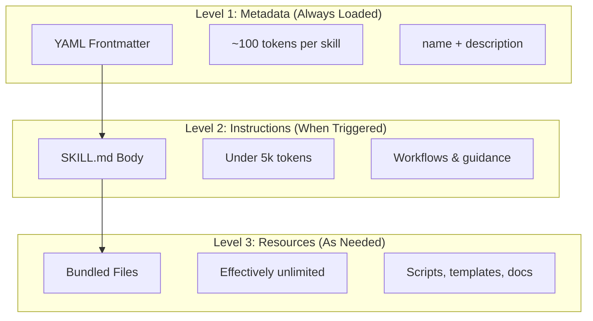
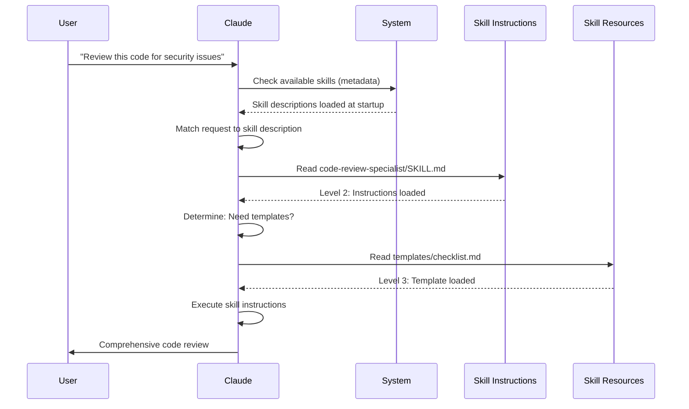

<!-- i18n-source: 03-skills/README.md -->
<!-- i18n-source-sha: 188f468 -->
<!-- i18n-status: translated -->
<!-- i18n-date: 2026-10-26 -->

<picture>
  <source media="(prefers-color-scheme: dark)" srcset="../resources/logos/claude-howto-logo-dark.svg">
  
</picture>

# 에이전트 스킬 가이드

에이전트 스킬(Agent Skills)은 Claude의 기능을 확장하는 재사용 가능한 파일시스템 기반 역량입니다. 도메인별 전문 지식, 워크플로, 모범 사례를 발견 가능한 컴포넌트로 묶어 두면, Claude가 필요할 때 자동으로 사용합니다.

## 개요

**에이전트 스킬**은 범용 에이전트를 전문가로 바꾸는 모듈식 역량입니다. 프롬프트(일회성 작업을 위한 대화 수준의 지시)와 달리, 스킬은 필요할 때 온디맨드로 로드되므로 여러 대화에서 같은 지침을 반복해서 제공할 필요가 없습니다.

### 주요 이점

- **Claude 전문화**: 도메인별 작업에 맞게 역량을 조정합니다
- **반복 감소**: 한 번 만들면 여러 대화에서 자동으로 사용됩니다
- **역량 조합**: 스킬을 조합해 복잡한 워크플로를 구성합니다
- **워크플로 확장**: 여러 프로젝트와 팀에서 스킬을 재사용합니다
- **품질 유지**: 모범 사례를 워크플로에 직접 내장합니다

스킬은 여러 AI 도구에서 동작하는 [Agent Skills](https://agentskills.io) 공개 표준을 따릅니다. Claude Code는 호출 제어, 서브에이전트 실행, 동적 컨텍스트 주입 같은 추가 기능으로 이 표준을 확장합니다.

> **참고**: 사용자 정의 슬래시 커맨드는 스킬로 통합되었습니다. `.claude/commands/` 파일은 여전히 동작하며 같은 프론트매터 필드를 지원합니다. 새로 개발할 때는 스킬을 권장합니다. 같은 경로에 둘 다 존재하면(예: `.claude/commands/review.md`와 `.claude/skills/review/SKILL.md`) 스킬이 우선합니다.

## 스킬 동작 방식: 점진적 공개

스킬은 **점진적 공개**(progressive disclosure) 아키텍처를 활용합니다. Claude가 컨텍스트를 미리 소비하는 대신 필요에 따라 단계적으로 정보를 로드합니다. 덕분에 무제한 확장성을 유지하면서 컨텍스트를 효율적으로 관리할 수 있습니다.

### 세 단계 로딩



| 레벨 | 로드 시점 | 토큰 비용 | 내용 |
|-------|------------|------------|---------|
| **레벨 1: 메타데이터** | 항상 (시작 시) | 스킬당 약 100 토큰 | YAML 프론트매터의 `name`과 `description` |
| **레벨 2: 지시사항** | 스킬이 트리거될 때 | 5k 토큰 미만 | 지시사항과 가이드가 담긴 SKILL.md 본문 |
| **레벨 3+: 리소스** | 필요할 때 | 사실상 무제한 | 내용을 컨텍스트에 로드하지 않고 bash로 실행되는 번들 파일 |

덕분에 스킬은 가볍게 유지됩니다. 실제로 트리거되기 전까지 Claude는 각 스킬이 존재한다는 사실과 사용 시점만 알 뿐입니다. 다만 공짜는 아닙니다. 나열된 모든 스킬의 설명이 매 턴 컨텍스트에 추가됩니다.

## 스킬 로딩 과정



## 스킬 유형과 위치

| 유형 | 위치 | 범위 | 공유 | 적합한 용도 |
|------|----------|-------|--------|----------|
| **엔터프라이즈** | 관리 설정(Managed settings) | 조직의 모든 사용자 | 예 | 조직 전체 표준 |
| **개인** | `~/.claude/skills/<skill-name>/SKILL.md` | 개인 | 아니요 | 개인 워크플로 |
| **프로젝트** | `.claude/skills/<skill-name>/SKILL.md` | 팀 | 예 (git 통해) | 팀 표준 |
| **플러그인** | `<plugin>/skills/<skill-name>/SKILL.md` | 활성화된 곳 | 경우에 따라 | 플러그인에 번들 |

여러 레벨에 같은 이름의 스킬이 있으면 우선순위가 높은 위치가 이깁니다: **엔터프라이즈 > 개인 > 프로젝트**. `~/.claude/skills/`와 `.claude/skills/`에 같은 이름이 있으면 개인 스킬이 실행됩니다. 스킬의 노출 여부(우선순위가 아님)를 바꾸려면 `skillOverrides` 설정(v2.1.129+)을 사용하세요 — [스킬 재정의 동작 제어](#스킬-재정의-동작-제어-skilloverrides)를 참고하세요. 플러그인 스킬은 `plugin-name:skill-name` 네임스페이스를 사용하므로 충돌할 수 없습니다.

> **서브에이전트 스킬 탐색(v2.1.133+)**: 서브에이전트도 이제 메인 세션과 같은 방식으로 Skill 도구를 통해 프로젝트·사용자·플러그인 스킬을 탐색합니다. 이전 버전에서는 서브에이전트가 자체 내장 세트로 제한되어 스킬+서브에이전트 워크플로가 조용히 약화되었습니다. v2.1.133부터는 같은 스킬 카탈로그가 양쪽에 보입니다.

### 자동 탐색

**중첩 디렉터리**: 하위 디렉터리의 파일을 다루면 Claude Code가 중첩된 `.claude/skills/` 디렉터리에서 스킬을 자동으로 탐색합니다. 예를 들어 `packages/frontend/`의 파일을 편집하면 Claude Code는 `packages/frontend/.claude/skills/`의 스킬도 찾습니다. 패키지마다 자체 스킬을 두는 모노레포 구성에 적합합니다. 중첩 스킬이 저장소 루트 스킬과 같은 이름이면 **둘 다 로드됩니다**. 루트와 `apps/web/.claude/skills/`에 각각 `deploy` 스킬이 있으면 `/deploy`는 루트 것을, `/apps/web:deploy`는 중첩된 것을 실행합니다.

**`--add-dir` 디렉터리**: `--add-dir`로 추가한 디렉터리의 스킬은 실시간 변경 감지와 함께 자동으로 로드됩니다. 해당 디렉터리의 스킬 파일을 편집하면 Claude Code를 재시작하지 않아도 즉시 반영됩니다.

**스킬 다시 로드**: `/reload-skills` 명령(v2.1.152 추가)은 세션을 재시작하지 않고 모든 스킬 디렉터리를 다시 스캔합니다. 실시간 감지가 잡지 못하는 스킬을 추가하거나 편집한 뒤에 유용합니다. `SessionStart` 훅이 `reloadSkills: true`를 반환해 같은 재스캔을 유발할 수도 있습니다([훅](../06-hooks/README.md) 참고).

**설명 예산**: 스킬 설명(레벨 1 메타데이터)은 **컨텍스트 창의 1%**(대체값: **8,000자**)로 제한됩니다. 스킬을 많이 설치했다면 설명이 짧아질 수 있습니다. 스킬 이름은 항상 모두 포함되지만 설명은 예산에 맞게 잘립니다. 설명 앞부분에 핵심 사용 사례를 배치하세요. 예산은 `SLASH_COMMAND_TOOL_CHAR_BUDGET` 환경변수로 재정의할 수 있습니다.

## 사용자 정의 스킬 만들기

### 기본 디렉터리 구조

```
my-skill/
├── SKILL.md           # Main instructions (required)
├── template.md        # Template for Claude to fill in
├── examples/
│   └── sample.md      # Example output showing expected format
└── scripts/
    └── validate.sh    # Script Claude can execute
```

### SKILL.md 형식

```yaml
---
name: your-skill-name
description: Brief description of what this Skill does and when to use it
---

# Your Skill Name

## Instructions
Provide clear, step-by-step guidance for Claude.

## Examples
Show concrete examples of using this Skill.
```

### 권장 필드

- **description**(권장): 스킬이 무엇을 하며 언제 사용해야 하는지를 기술합니다. 생략하면 Claude Code는 마크다운 내용의 첫 번째 비어 있지 않은 줄을 사용합니다. `description` + `when_to_use` 텍스트를 합친 길이는 스킬 목록에서 **1,536자**로 잘립니다(`skillListingMaxDescChars`로 설정 가능). Claude는 이 텍스트를 기준으로 스킬 활성화 여부를 판단합니다.
- **name**(선택): 기본값은 스킬의 **디렉터리 이름**입니다. 지정하면 표시 이름이 됩니다. 소문자·숫자·하이픈만 사용하는 형태(최대 64자)가 이식성 면에서 권장되며, claude.ai와 Skills API에서는 필수입니다. Claude Code 자체(v2.1.299+)는 이름에 보이지 않는 문자, 방향 변경 문자, 공백류 문자, `<`, `>`가 포함되거나 256자를 넘는 스킬·커맨드를 이름을 바꿀 때까지 건너뜁니다. Claude Code에서 `anthropic-skills`와 `synced`는 예약어이며 플러그인 밖에서는 로드되지 않습니다. "anthropic" 또는 "claude"에 대한 더 엄격한 금지는 claude.ai나 Skills API에 업로드하는 스킬에 적용됩니다. 플러그인 스킬에서는 `name`이 커맨드의 마지막 세그먼트도 결정합니다.

SKILL.md 프론트매터의 모든 필드는 선택 사항이며, `description`만 권장됩니다.

### 선택적 프론트매터 필드

```yaml
---
name: my-skill
description: What this skill does and when to use it
argument-hint: "[filename] [format]"        # Hint for autocomplete
disable-model-invocation: true              # Only user can invoke
user-invocable: false                       # Hide from slash menu
allowed-tools: Read, Grep, Glob             # Pre-approve these tools (no permission prompts) while the skill runs
disallowed-tools: Write, Edit               # Remove specific tools while active (v2.1.152)
model: opus                                 # Specific model to use
effort: high                                # Effort level override (low, medium, high, xhigh, max)
context: fork                               # Run in isolated subagent
agent: Explore                              # Which agent type (with context: fork)
background: false                           # Fork skills run in background (default true); false = foreground
shell: bash                                 # Shell for commands: bash (default) or powershell
hooks:                                      # Hooks registered when the skill is invoked
  PreToolUse:
    - matcher: "Bash"
      hooks:
        - type: command
          command: "./scripts/validate.sh"
paths: "src/api/**/*.ts"               # Glob patterns limiting when skill activates
---
```

| 필드 | 설명 |
|-------|-------------|
| `name` | 권장(이식성): 소문자·숫자·하이픈만(최대 64자). Claude Code에서 `anthropic-skills`와 `synced`는 예약어입니다. |
| `description` | 스킬이 무엇을 하며 언제 사용하는지. `description` + `when_to_use`를 합친 텍스트는 스킬 목록에서 1,536자로 잘립니다(`skillListingMaxDescChars`로 설정 가능). 자동 호출 매칭에 결정적입니다. |
| `when_to_use` | Claude가 스킬을 호출해야 하는 시점에 대한 추가 컨텍스트. 스킬 목록에서 `description` 뒤에 덧붙으며 1,536자 한도에 포함됩니다. |
| `argument-hint` | `/` 자동완성 메뉴에 표시되는 힌트(예: `"[filename] [format]"`). |
| `disable-model-invocation` | `true` = 사용자만 `/name`으로 호출할 수 있습니다. Claude는 절대 자동 호출하지 않습니다. |
| `user-invocable` | `false` = `/` 메뉴에서 숨깁니다. Claude만 자동으로 호출할 수 있습니다. |
| `allowed-tools` | 스킬이 권한 프롬프트 없이 사용할 수 있는 도구의 쉼표 구분 목록. |
| `disallowed-tools` | 스킬이 활성인 동안 제거할 도구의 쉼표 구분 목록(`allowed-tools`를 보완). v2.1.152 추가. |
| `model` | 스킬이 활성인 동안의 모델 재정의(예: `opus`, `sonnet`). |
| `effort` | 스킬 활성 중 노력 수준 재정의: `low`, `medium`, `high`, `xhigh`, `max` — 다섯 단계 모두 Fable 5.1, Fable 5, Opus 5.5, Sonnet 5.5, Haiku 5.5, Opus 5, Sonnet 5, Opus 4.8, Opus 4.7에서 지원됩니다. effort를 지원하는 모든 모델의 기본값은 `high`이며, 예외적으로 Opus 5.5, Sonnet 5.5, Haiku 5.5는 `medium`, Opus 4.7은 `xhigh`가 기본입니다. |
| `context` | `fork`로 지정하면 자체 컨텍스트 창을 가진 포크된 서브에이전트 컨텍스트에서 스킬을 실행합니다. |
| `agent` | `context: fork`일 때의 서브에이전트 유형(예: `Explore`, `Plan`, `general-purpose`). |
| `background` | `context: fork`와 함께일 때만 의미가 있습니다. `context: fork` 스킬의 기본값은 `true`라 백그라운드에서 실행되며, 포그라운드에서 실행하려면 `false`로 설정합니다. v2.1.218 추가. |
| `shell` | `` !`command` `` 치환과 스크립트에 사용할 셸: `bash`(기본) 또는 `powershell`. |
| `hooks` | 스킬 호출 시 등록되는 훅(설정 훅과 같은 형식, 모든 이벤트). 세션이 끝날 때까지 활성 상태로 유지됩니다. |
| `paths` | 스킬 자동 활성화 시점을 제한하는 Glob 패턴. 쉼표 구분 문자열 또는 YAML 목록. 경로별 규칙과 같은 형식입니다. |
| `arguments` | 자동완성과 인자 치환을 위해 스킬이 받는 인자를 선언합니다. 처음 64개 이름, 각 최대 64자까지만 채워집니다(v2.1.301). |
| `metadata` | 자체 기록용 자유 형식 키/값 맵(예: `version`, `author`). Claude Code는 이를 그대로 전달합니다. |
| `license` | 스킬의 라이선스 식별자(예: `MIT`). |
| `compatibility` | 최대 500자까지의 자유 텍스트 호환성 설명. Claude Code는 이를 받아들이지만 동작에 사용하지는 않습니다. |

> **참고**: claude.ai에 업로드하거나 Skills API로 만드는 스킬에는 `name`, `description`, `license`, `compatibility`, `metadata`, `allowed-tools`만 유효합니다. 이 표의 나머지 필드는 Claude Code 전용입니다.

v2.1.218부터 불리언 프론트매터 필드는 `true`/`false` 외에 `yes`/`no`, `on`/`off`, `1`/`0`(대소문자 무시)도 허용합니다.

## 스킬 콘텐츠 유형

스킬에는 두 가지 유형의 콘텐츠를 담을 수 있으며, 각각 다른 용도에 적합합니다.

### 참조 콘텐츠

현재 작업에 적용할 지식을 추가합니다. 관례, 패턴, 스타일 가이드, 도메인 지식 등이 여기에 해당합니다. 대화 컨텍스트 안에서 인라인으로 실행됩니다.

```yaml
---
name: api-conventions
description: API design patterns for this codebase
---

When writing API endpoints:
- Use RESTful naming conventions
- Return consistent error formats
- Include request validation
```

### 작업 콘텐츠

특정 작업을 위한 단계별 지시사항입니다. 주로 `/skill-name`으로 직접 호출합니다.

```yaml
---
name: deploy
description: Deploy the application to production
context: fork
disable-model-invocation: true
---

Deploy the application:
1. Run the test suite
2. Build the application
3. Push to the deployment target
```

## 스킬 호출 제어

기본적으로 사용자와 Claude 모두 어떤 스킬이든 호출할 수 있습니다. 두 개의 프론트매터 필드가 세 가지 호출 모드를 제어합니다:

| 프론트매터 | 사용자 호출 | Claude 호출 |
|---|---|---|
| (기본값) | 가능 | 가능 |
| `disable-model-invocation: true` | 가능 | 불가 |
| `user-invocable: false` | 불가 | 가능 |

**부수 효과가 있는 워크플로에는 `disable-model-invocation: true`를 사용하세요**: `/commit`, `/deploy`, `/send-slack-message` 같은 작업입니다. 코드가 준비된 것처럼 보인다는 이유로 Claude가 배포를 결정하게 두고 싶지는 않을 것입니다.

**커맨드로 실행할 성격이 아닌 배경 지식에는 `user-invocable: false`를 사용하세요**. `legacy-system-context` 스킬은 오래된 시스템이 어떻게 동작하는지 설명합니다. Claude에게는 유용하지만 사용자가 실행할 액션은 아닙니다.

## 문자열 치환

스킬은 스킬 콘텐츠가 Claude에 도달하기 전에 해석되는 동적 값을 지원합니다:

| 변수 | 설명 |
|----------|-------------|
| `$ARGUMENTS` | 스킬 호출 시 전달된 모든 인자 |
| `$ARGUMENTS[N]` 또는 `$N` | 인덱스(0부터 시작)로 특정 인자에 접근 |
| `${CLAUDE_SESSION_ID}` | 현재 세션 ID |
| `${CLAUDE_SKILL_DIR}` | 스킬의 SKILL.md 파일이 있는 디렉터리 |
| `${CLAUDE_PROJECT_DIR}` | 프로젝트 루트의 절대 경로. 스킬 본문과 `allowed-tools`에서 사용할 수 있습니다(v2.1.196) |
| `${CLAUDE_EFFORT}` | 현재 effort 수준(`low`, `medium`, `high`, `xhigh`, `max`). 스킬 동작을 분기할 때 유용합니다: 예: `[ "${CLAUDE_EFFORT}" = "max" ] && deep_analysis` (v2.1.120+) |
| `` !`command` `` | 동적 컨텍스트 주입 — 셸 명령을 실행하고 출력을 인라인으로 삽입합니다 |

**예시:**

```yaml
---
name: fix-issue
description: Fix a GitHub issue
---

Fix GitHub issue $ARGUMENTS following our coding standards.
1. Read the issue description
2. Implement the fix
3. Write tests
4. Create a commit
```

`/fix-issue 123`을 실행하면 `$ARGUMENTS`가 `123`으로 치환됩니다.

### 스킬 쌓기

터미널 프롬프트에서 `/write-tests /fix-issue 123`처럼 슬래시 스킬을 한 번의 호출로 쌓을 수 있습니다. v2.1.199부터는 앞쪽 스킬을 전부(첫 번째에 최대 5개 추가) 로드하고 뒤따르는 인자(`123`)를 각각에 전달합니다. 이전에는 첫 번째 스킬만 로드되었습니다. `/code-review`처럼 포크된 서브에이전트로 실행되는 스킬에서 확장이 멈추며, Agent SDK나 `claude -p`를 통해서는 첫 번째 스킬만 로드됩니다. 같은 스킬을 두 번 이상 호출하면 동일한 내용은 두 번 덧붙이지 않고 중복 제거됩니다(v2.1.202).

## 동적 컨텍스트 주입

`` !`command` `` 문법은 스킬 콘텐츠가 Claude로 전송되기 전에 셸 명령을 실행합니다:

> **참고(v2.1.299)**: `UserPromptSubmit` 훅은 명령이 확장되기 전에 실행되므로, 프롬프트를 차단하는 훅은 이 `!` 명령 실행도 막습니다.

```yaml
---
name: pr-summary
description: Summarize changes in a pull request
context: fork
agent: Explore
---

## Pull request context
- PR diff: !`gh pr diff`
- PR comments: !`gh pr view --comments`
- Changed files: !`gh pr diff --name-only`

## Your task
Summarize this pull request...
```

명령은 즉시 실행되며 Claude는 최종 출력만 봅니다. 기본적으로 명령은 `bash`에서 실행됩니다. 대신 PowerShell을 쓰려면 프론트매터에 `shell: powershell`을 설정하세요.

## 서브에이전트에서 스킬 실행

`context: fork`를 추가하면 격리된 서브에이전트 컨텍스트에서 스킬을 실행합니다. 스킬 콘텐츠가 자체 컨텍스트 창을 가진 전용 서브에이전트의 작업이 되어 메인 대화가 깔끔하게 유지됩니다. v2.1.218부터 `context: fork` 스킬의 `background` 기본값은 `true`라 백그라운드에서 실행되며, 포크 스킬을 포그라운드에서 실행하려면 프론트매터에 `background: false`를 설정하세요.

> **v2.1.145 수정**: `context: fork`를 쓰는 스킬이 드물게 무한 재호출 루프를 유발할 수 있었습니다. 포크 스킬을 작성하거나 사용한다면 v2.1.145 이상으로 업그레이드하세요.

`agent` 필드는 사용할 에이전트 유형을 지정합니다:

| 에이전트 유형 | 적합한 용도 |
|---|---|
| `Explore` | 읽기 전용 조사, 코드베이스 분석 |
| `Plan` | 구현 계획 수립 |
| `general-purpose` | 모든 도구가 필요한 광범위한 작업 |
| 사용자 정의 에이전트 | 설정에 정의한 특화 에이전트 |

**프론트매터 예시:**

```yaml
---
context: fork
agent: Explore
---
```

**전체 스킬 예시:**

```yaml
---
name: topic-research
description: Research a topic thoroughly
context: fork
agent: Explore
---

Research $ARGUMENTS thoroughly:
1. Find relevant files using Glob and Grep
2. Read and analyze the code
3. Summarize findings with specific file references
```

## 실전 예제

### 예제 1: 코드 리뷰 스킬

**디렉터리 구조:**

```
~/.claude/skills/code-review-specialist/
├── SKILL.md
├── templates/
│   ├── review-checklist.md
│   └── finding-template.md
└── scripts/
    ├── analyze-metrics.py
    └── compare-complexity.py
```

**파일:** `~/.claude/skills/code-review-specialist/SKILL.md`

```yaml
---
name: code-review-specialist
description: Comprehensive code review with security, performance, and quality analysis. Use when users ask to review code, analyze code quality, evaluate pull requests, or mention code review, security analysis, or performance optimization.
---

# Code Review Skill

This skill provides comprehensive code review capabilities focusing on:

1. **Security Analysis**
   - Authentication/authorization issues
   - Data exposure risks
   - Injection vulnerabilities
   - Cryptographic weaknesses

2. **Performance Review**
   - Algorithm efficiency (Big O analysis)
   - Memory optimization
   - Database query optimization
   - Caching opportunities

3. **Code Quality**
   - SOLID principles
   - Design patterns
   - Naming conventions
   - Test coverage

4. **Maintainability**
   - Code readability
   - Function size (should be < 50 lines)
   - Cyclomatic complexity
   - Type safety

## Review Template

For each piece of code reviewed, provide:

### Summary
- Overall quality assessment (1-5)
- Key findings count
- Recommended priority areas

### Critical Issues (if any)
- **Issue**: Clear description
- **Location**: File and line number
- **Impact**: Why this matters
- **Severity**: Critical/High/Medium
- **Fix**: Code example

For detailed checklists, see [templates/review-checklist.md](templates/review-checklist.md).
```

### 예제 2: 코드베이스 시각화 스킬

대화형 HTML 시각화를 생성하는 스킬입니다:

**디렉터리 구조:**

```
~/.claude/skills/codebase-visualizer/
├── SKILL.md
└── scripts/
    └── visualize.py
```

**파일:** `~/.claude/skills/codebase-visualizer/SKILL.md`

````yaml
---
name: codebase-visualizer
description: Generate an interactive collapsible tree visualization of your codebase. Use when exploring a new repo, understanding project structure, or identifying large files.
allowed-tools: Bash(python *)
---

# Codebase Visualizer

Generate an interactive HTML tree view showing your project's file structure.

## Usage

Run the visualization script from your project root:

```bash
python ~/.claude/skills/codebase-visualizer/scripts/visualize.py .
```

This creates `codebase-map.html` and opens it in your default browser.

## What the visualization shows

- **Collapsible directories**: Click folders to expand/collapse
- **File sizes**: Displayed next to each file
- **Colors**: Different colors for different file types
- **Directory totals**: Shows aggregate size of each folder
````

번들된 Python 스크립트가 무거운 작업을 처리하고 Claude는 오케스트레이션을 맡습니다.

### 예제 3: 배포 스킬 (사용자 전용 호출)

```yaml
---
name: deploy
description: Deploy the application to production
disable-model-invocation: true
allowed-tools: Bash(npm *), Bash(git *)
---

Deploy $ARGUMENTS to production:

1. Run the test suite: `npm test`
2. Build the application: `npm run build`
3. Push to the deployment target
4. Verify the deployment succeeded
5. Report deployment status
```

### 예제 4: 브랜드 보이스 스킬 (배경 지식)

```yaml
---
name: brand-voice
description: Ensure all communication matches brand voice and tone guidelines. Use when creating marketing copy, customer communications, or public-facing content.
user-invocable: false
---

## Tone of Voice
- **Friendly but professional** - approachable without being casual
- **Clear and concise** - avoid jargon
- **Confident** - we know what we're doing
- **Empathetic** - understand user needs

## Writing Guidelines
- Use "you" when addressing readers
- Use active voice
- Keep sentences under 20 words
- Start with value proposition

For templates, see [templates/](templates/).
```

### 예제 5: CLAUDE.md 생성기 스킬

```yaml
---
name: claude-md
description: Create or update CLAUDE.md files following best practices for optimal AI agent onboarding. Use when users mention CLAUDE.md, project documentation, or AI onboarding.
---

## Core Principles

**LLMs are stateless**: CLAUDE.md is the main project file loaded into every conversation (alongside auto memory and unscoped rules).

### The Golden Rules

1. **Less is More**: Keep each CLAUDE.md under 200 lines
2. **Universal Applicability**: Only include information relevant to EVERY session
3. **Don't Use Claude as a Linter**: Use deterministic tools instead
4. **Never Auto-Generate**: Craft it manually with careful consideration

## Essential Sections

- **Project Name**: Brief one-line description
- **Tech Stack**: Primary language, frameworks, database
- **Development Commands**: Install, test, build commands
- **Critical Conventions**: Only non-obvious, high-impact conventions
- **Known Issues / Gotchas**: Things that trip up developers
```

### 예제 6: 스크립트가 있는 리팩터링 스킬

**디렉터리 구조:**

```
refactor/
├── SKILL.md
├── references/
│   ├── code-smells.md
│   └── refactoring-catalog.md
├── templates/
│   └── refactoring-plan.md
└── scripts/
    ├── analyze-complexity.py
    └── detect-smells.py
```

**파일:** `refactor/SKILL.md`

```yaml
---
name: refactor
description: Systematic code refactoring based on Martin Fowler's methodology. Use when users ask to refactor code, improve code structure, reduce technical debt, or eliminate code smells.
---

# Code Refactoring Skill

A phased approach emphasizing safe, incremental changes backed by tests.

## Workflow

Phase 1: Research & Analysis → Phase 2: Test Coverage Assessment →
Phase 3: Code Smell Identification → Phase 4: Refactoring Plan Creation →
Phase 5: Incremental Implementation → Phase 6: Review & Iteration

## Core Principles

1. **Behavior Preservation**: External behavior must remain unchanged
2. **Small Steps**: Make tiny, testable changes
3. **Test-Driven**: Tests are the safety net
4. **Continuous**: Refactoring is ongoing, not a one-time event

For code smell catalog, see [references/code-smells.md](references/code-smells.md).
For refactoring techniques, see [references/refactoring-catalog.md](references/refactoring-catalog.md).
```

## 지원 파일

스킬 디렉터리에는 `SKILL.md` 외에 여러 파일을 둘 수 있습니다. 이런 지원 파일(템플릿, 예제, 스크립트, 참조 문서)을 활용하면 메인 스킬 파일을 간결하게 유지하면서 Claude가 필요할 때 로드할 수 있는 추가 리소스를 제공할 수 있습니다.

```
my-skill/
├── SKILL.md              # Main instructions (required, keep under 500 lines)
├── templates/            # Templates for Claude to fill in
│   └── output-format.md
├── examples/             # Example outputs showing expected format
│   └── sample-output.md
├── references/           # Domain knowledge and specifications
│   └── api-spec.md
└── scripts/              # Scripts Claude can execute
    └── validate.sh
```

지원 파일 작성 지침:

- `SKILL.md`는 **500줄** 미만으로 유지하세요. 상세 참조 자료, 큰 예제, 명세는 별도 파일로 옮기세요.
- `SKILL.md`에서 다른 파일을 **상대 경로**로 참조하세요(예: `[API reference](references/api-spec.md)`).
- 지원 파일은 레벨 3(필요할 때)에서 로드되므로 Claude가 실제로 읽기 전까지 컨텍스트를 소비하지 않습니다.

## 스킬 관리

### 사용 가능한 스킬 확인

Claude에게 직접 물어보세요:

```
What Skills are available?
```

또는 파일시스템에서 확인하세요:

```bash
# List personal Skills
ls ~/.claude/skills/

# List project Skills
ls .claude/skills/
```

> **팁(v2.1.121+)**: `/skills` 대화형 메뉴에서 입력해 필터링할 수 있습니다 — 스킬을 많이 설치했을 때 유용합니다.

### 스킬 테스트

테스트하는 방법은 두 가지입니다:

**Claude가 자동으로 호출하게 하려면** 설명과 맞는 요청을 하세요:

```
Can you help me review this code for security issues?
```

**또는 스킬 이름으로 직접 호출하세요:**

```
/code-review-specialist src/auth/login.ts
```

> **참고**: 이 로컬 스킬은 `code-review-specialist`로 설치되어 번들 `/code-review` 스킬(버그 중심 리뷰, 별칭 `/review`)과 **충돌하지 않습니다**. 대신 `~/.claude/skills/code-review/`로 복사하면 번들 `/code-review`를 대체합니다(`/review`는 여전히 번들 것을 실행). 이를 피하려면 `-specialist` 접미사를 유지하세요.

### 스킬 업데이트

`SKILL.md` 파일을 직접 편집한 뒤 `/reload-skills`(v2.1.152+)를 실행해 스킬 디렉터리를 다시 스캔하세요. Claude Code를 재시작해도 되지만 필수는 아닙니다. `--add-dir` 디렉터리의 스킬은 실시간으로 반영되고, `SessionStart` 훅이 `reloadSkills: true`를 반환해도 같은 재스캔이 일어납니다.

```bash
# Personal Skill
code ~/.claude/skills/my-skill/SKILL.md

# Project Skill
code .claude/skills/my-skill/SKILL.md
```

### Claude의 스킬 접근 제한

Claude가 호출할 수 있는 스킬을 제어하는 방법은 세 가지입니다:

**모든 스킬 비활성화** — `/permissions`에서:

```
# Add to deny rules:
Skill
```

**특정 스킬 허용 또는 거부**:

```
# Allow only specific skills
Skill(commit)
Skill(review-pr *)

# Deny specific skills
Skill(deploy *)
```

**개별 스킬 숨기기** — 프론트매터에 `disable-model-invocation: true`를 추가하세요.

### 스킬 재정의 동작 제어 (`skillOverrides`)

`skillOverrides`(v2.1.129+)는 스킬별 노출 맵이며 우선순위 스위치가 아닙니다. SKILL.md를 편집하지 않고 설정에서 각 스킬이 어떻게 보일지 지정합니다. 각 키는 스킬 이름이며 `/skills` 메뉴가 대신 기록합니다(`.claude/settings.local.json`에 저장). 우선순위는 그대로입니다. 같은 이름이면 개인 스킬이 프로젝트 스킬을 여전히 이깁니다. `~/.claude/settings.json` 또는 프로젝트의 `.claude/settings.json`에 추가하세요:

```json
{
  "skillOverrides": {
    "deploy": "off",
    "legacy-helper": "name-only"
  }
}
```

허용되는 값:

| 값 | 동작 |
|-------|----------|
| `"on"` (기본값) | 이름과 설명이 Claude에 나열되고 `/` 메뉴에 표시됩니다. |
| `"name-only"` | 이름만 Claude에 나열되고 `/` 메뉴에 표시됩니다. |
| `"user-invocable-only"` | Claude에게는 숨기고 `/` 메뉴에는 표시합니다. |
| `"off"` | Claude와 `/` 메뉴 모두에서 숨깁니다. |

플러그인 스킬은 `skillOverrides`의 영향을 받지 않습니다. `/plugin`으로 관리하세요.

## 모범 사례

### 1. 설명을 구체적으로 작성하세요

- **나쁜 예(모호함)**: "Helps with documents"
- **좋은 예(구체적)**: "Extract text and tables from PDF files, fill forms, merge documents. Use when working with PDF files or when the user mentions PDFs, forms, or document extraction."

### 2. 스킬을 집중시키세요

- 스킬 하나 = 역량 하나
- ✅ "PDF form filling"
- ❌ "Document processing" (너무 광범위함)

### 3. 트리거 용어를 포함하세요

사용자 요청과 일치하는 키워드를 설명에 넣으세요:

```yaml
description: Analyze Excel spreadsheets, generate pivot tables, create charts. Use when working with Excel files, spreadsheets, or .xlsx files.
```

### 4. SKILL.md를 500줄 미만으로 유지하세요

상세 참조 자료는 Claude가 필요할 때 로드하는 별도 파일로 옮기세요.

### 5. 지원 파일을 참조하세요

```markdown
## Additional resources

- For complete API details, see [reference.md](reference.md)
- For usage examples, see [examples.md](examples.md)
```

### 권장 사항

- 명확하고 설명적인 이름을 사용하세요
- 포괄적인 지시사항을 포함하세요
- 구체적인 예제를 넣으세요
- 관련 스크립트와 템플릿을 함께 패키징하세요
- 실제 시나리오로 테스트하세요
- 의존성을 문서화하세요

### 피해야 할 것

- 일회성 작업을 위한 스킬을 만들지 마세요
- 기존 기능을 중복하지 마세요
- 스킬을 너무 광범위하게 만들지 마세요
- description 필드를 생략하지 마세요
- 검토 없이 신뢰할 수 없는 출처의 스킬을 설치하지 마세요

## 문제 해결

### 빠른 참조

| 문제 | 해결 |
|-------|----------|
| Claude가 스킬을 사용하지 않음 | 트리거 용어를 넣어 설명을 더 구체적으로 만드세요 |
| 스킬 파일을 찾을 수 없음 | 경로 확인: `~/.claude/skills/name/SKILL.md` |
| YAML 오류 | `---` 마커, 들여쓰기, 탭 미사용 여부를 확인하세요 |
| 스킬 충돌 | 설명에 서로 다른 트리거 용어를 사용하세요 |
| 스크립트가 실행되지 않음 | 권한 확인: `chmod +x scripts/*.py` |
| Claude가 모든 스킬을 보지 못함 | 스킬이 너무 많습니다. `/context`에서 경고를 확인한 뒤 `/skill-doctor`(v2.1.252+)를 실행해 사용되지 않는 스킬과 그 비용을 확인하세요 |

### 스킬이 트리거되지 않을 때

Claude가 예상한 때에 스킬을 쓰지 않는다면:

1. 사용자가 자연스럽게 말할 키워드가 설명에 포함되어 있는지 확인하세요
2. "What skills are available?"라고 물었을 때 스킬이 나타나는지 확인하세요
3. 설명과 맞도록 요청을 바꿔 표현해 보세요
4. `/skill-name`으로 직접 호출해 테스트하세요

### 스킬이 너무 자주 트리거될 때

원하지 않는데 Claude가 스킬을 쓴다면:

1. 설명을 더 구체적으로 만드세요
2. 수동 호출만 허용하려면 `disable-model-invocation: true`를 추가하세요

### Claude가 모든 스킬을 보지 못할 때

스킬 설명은 **컨텍스트 창의 1%**(대체값: **8,000자**)로 로드됩니다. 각 항목의 `description` + `when_to_use`는 기본적으로 1,536자로 제한됩니다(`skillListingMaxDescChars`). `/context`를 실행해 제외된 스킬에 대한 경고를 확인하세요. 예산은 `SLASH_COMMAND_TOOL_CHAR_BUDGET` 환경변수로 재정의할 수 있습니다.

## 보안 고려사항

**신뢰할 수 있는 출처의 스킬만 사용하세요.** 스킬은 지시와 코드를 통해 Claude에 역량을 부여합니다. 악의적인 스킬은 Claude가 유해한 방식으로 도구를 호출하거나 코드를 실행하도록 유도할 수 있습니다.

**주요 보안 고려사항:**

- **철저히 검토하세요**: 스킬 디렉터리의 모든 파일을 확인하세요
- **외부 출처는 위험합니다**: 외부 URL에서 가져오는 스킬은 훼손될 수 있습니다
- **도구 오용**: 악의적인 스킬은 유해한 방식으로 도구를 호출할 수 있습니다
- **소프트웨어 설치처럼 취급하세요**: 신뢰할 수 있는 출처의 스킬만 사용하세요

### 스킬의 셸 치환 비활성화

스킬은 `` !`command` `` 문법으로 셸 명령의 출력을 Claude가 보기 전에 프롬프트에 주입합니다. 보안에 민감한 환경(공유 엔터프라이즈 배포, 잠긴 CI 러너)에서는 `disableSkillShellExecution` 설정(**v2.1.91** 추가)으로 이 치환을 완전히 끌 수 있습니다:

```jsonc
// ~/.claude/settings.json or managed policy
{
  "disableSkillShellExecution": true
}
```

`disableSkillShellExecution`이 `true`이면 스킬의 각 `` !`command` `` 마커가 실행되는 대신 `[shell command execution disabled by policy]`로 대체됩니다. 스킬 자체를 비활성화하지 않고 스킬 수준의 셸 주입 공격 표면을 제거하는 방식입니다. 심층 방어를 위해 `allowedTools` 허용 목록과 함께 쓰는 것을 고려하세요.

### 번들 스킬 숨기기 (`disableBundledSkills`)

`disableBundledSkills` 설정(**v2.1.169** 추가)은 Claude Code에 포함된 번들 스킬, 워크플로, 커맨드를 모델에게서 숨깁니다. 특정 프로젝트에서 내장 스킬이 소음이 되거나 모델의 스킬 표면을 줄이고 싶을 때 사용하세요:

```jsonc
// ~/.claude/settings.json or project .claude/settings.json
{
  "disableBundledSkills": true
}
```

동등한 환경변수 형태는 다음과 같습니다:

```bash
export CLAUDE_CODE_DISABLE_BUNDLED_SKILLS=1
```

## 스킬과 다른 기능 비교

| 기능 | 호출 방식 | 적합한 용도 |
|---------|------------|----------|
| **스킬** | 자동 또는 `/name` | 재사용 가능한 전문성, 워크플로 |
| **슬래시 커맨드** | 사용자가 시작하는 `/name` | 빠른 지름길(스킬로 통합됨) |
| **서브에이전트** | 자동 위임 | 격리된 작업 실행 |
| **메모리 (CLAUDE.md)** | 항상 로드 | 지속되는 프로젝트 컨텍스트 |
| **MCP** | 실시간 | 외부 데이터·서비스 접근 |
| **훅** | 이벤트 기반 | 자동화된 부수 효과 |

## 번들 스킬

Claude Code에는 설치 없이 항상 사용할 수 있는 내장 스킬이 포함되어 있습니다. 아래에는 가장 유용한 것들을 정리했으며, 전체 목록은 [커맨드 레퍼런스](https://code.claude.com/docs/en/commands)를 참고하세요:

| 스킬 | 설명 |
|-------|-------------|
| `/batch <instruction>` | git 워크트리를 사용해 코드베이스 전반의 대규모 병렬 변경을 오케스트레이션합니다 |
| `/claude-api` | Claude API/SDK 레퍼런스를 로드하며, `anthropic`/`@anthropic-ai/sdk` 임포트 시 자동 활성화됩니다 |
| `/dataviz` | 실행 가능한 색상 팔레트 검증기가 포함된 차트·대시보드 설계 가이드(v2.1.198) |
| `/debug [description]` | 디버그 로그를 읽어 현재 세션을 트러블슈팅합니다 |
| `/deep-research <question>` | 스킬이 아니라 번들 **워크플로**입니다. 웹 검색을 넓게 펼쳐 인용이 포함된 보고서를 합성합니다(v2.1.218부터 명시적 호출만 가능 — Claude가 스스로 트리거하지 않습니다) |
| `/fewer-permission-prompts` | 트랜스크립트를 스캔해 흔한 읽기 전용 도구에 대한 우선순위 허용 목록을 제안합니다 |
| `/loop [interval] [prompt]` | 프롬프트를 주기적으로 반복 실행합니다(예: `/loop 5m check the deploy`) |
| `/run` *(v2.1.145+)* | 이 프로젝트의 앱을 실행해 변경 사항이 동작하는 모습을 확인합니다. 프로젝트 스킬을 먼저 찾고, 없으면 프로젝트 유형별 내장 패턴으로 대체합니다 |
| `/run-skill-generator` *(v2.1.145+)* | 프로젝트별 스킬을 생성해 `/run`/`/verify`가 특정 프로젝트를 다루는 방법을 가르칩니다 |
| `/code-review [effort]` | 선택한 effort 수준으로 현재 diff의 정확성 버그를 리뷰합니다(예: `/code-review high`). `--comment`를 넘기면 발견 사항을 PR 인라인 코멘트로 게시합니다. 품질·재사용 정리를 담당하는 `/simplify`와는 다른 스킬이며, `/simplify`는 v2.1.154에서 다시 분리되었습니다. v2.1.246부터는 어디서든 Claude가 스스로 시작할 수도 있습니다. v2.1.218부터 백그라운드 서브에이전트로 실행되므로 리뷰 작업이 대화를 채우지 않고, 쌓인 슬래시 커맨드가 리뷰 대상으로 유지됩니다. |
| `/simplify` | 정리 전용 리뷰 — 재사용, 단순화, 효율성, 추상화 수준 — 이며 수정까지 적용합니다. v2.1.154에서 `/code-review`에서 다시 분리되었습니다 |
| `/verify` *(v2.1.145+)* | 앱을 빌드·실행·관찰해 수정이 실제로 동작하는지 확인합니다(테스트 통과만이 아님). v2.1.215부터 명시적 호출만 가능 — Claude가 스스로 트리거하지 않습니다 |

GitHub PR에서 자동 리뷰를 받으려면 Team 및 Enterprise 조직이 [관리형 코드 리뷰](https://code.claude.com/docs/en/code-review)를 켤 수 있습니다.

> **참고**: 프로젝트 또는 사용자 스킬에 `verify`라는 이름이 있으면 Claude는 문서만 바꾼 커밋과 테스트만 바꾼 커밋을 제외하고 커밋 직전에 이를 실행합니다(v2.1.286).

이 스킬들은 별도 설치나 설정 없이 바로 사용할 수 있습니다. 사용자 정의 스킬과 동일한 SKILL.md 형식을 따릅니다.

## 스킬 공유

### 프로젝트 스킬 (팀 공유)

1. `.claude/skills/`에 스킬을 만듭니다
2. git에 커밋합니다
3. 팀원이 변경 사항을 받으면 스킬을 즉시 사용할 수 있습니다

### 개인 스킬

```bash
# Copy to personal directory
cp -r my-skill ~/.claude/skills/

# Make scripts executable
chmod +x ~/.claude/skills/my-skill/scripts/*.py
```

### 플러그인 배포

더 넓게 배포하려면 플러그인의 `skills/` 디렉터리에 스킬을 패키징하세요.

## 더 나아가기: 스킬 모음과 스킬 관리자

스킬을 본격적으로 만들기 시작하면 두 가지가 필수가 됩니다. 검증된 스킬 라이브러리와 이를 관리하는 도구입니다.

**[luongnv89/skills](https://github.com/luongnv89/skills)** — 제가 거의 모든 프로젝트에서 매일 쓰는 스킬 모음입니다. `logo-designer`(프로젝트 로고를 즉석에서 생성)와 `ollama-optimizer`(하드웨어에 맞게 로컬 LLM 성능 조정)가 대표적입니다. 바로 쓸 수 있는 스킬을 원한다면 좋은 출발점입니다.

**[luongnv89/asm](https://github.com/luongnv89/asm)** — Agent Skill Manager입니다. 스킬 개발, 중복 감지, 테스트를 처리합니다. `asm link` 명령으로 파일을 이리저리 복사하지 않고 어느 프로젝트에서든 스킬을 테스트할 수 있습니다. 스킬이 몇 개만 넘어가도 필수적인 기능입니다.

## 추가 자료

- [공식 스킬 문서](https://code.claude.com/docs/en/skills)
- [Agent Skills 아키텍처 블로그](https://claude.com/blog/equipping-agents-for-the-real-world-with-agent-skills)
- [스킬 저장소](https://github.com/luongnv89/skills) - 바로 쓸 수 있는 스킬 모음
- [슬래시 커맨드 가이드](../01-slash-commands/) - 사용자가 시작하는 지름길
- [서브에이전트 가이드](../04-subagents/) - 위임된 AI 에이전트
- [메모리 가이드](../02-memory/) - 지속되는 컨텍스트
- [MCP (Model Context Protocol)](../05-mcp/) - 실시간 외부 데이터
- [훅 가이드](../06-hooks/) - 이벤트 기반 자동화

---

**최종 업데이트**: 2026년 10월 18일
**Claude Code 버전**: 2.1.302
**출처**:
- https://code.claude.com/docs/en/skills
- https://code.claude.com/docs/en/slash-commands
- https://github.com/anthropics/claude-code/blob/main/CHANGELOG.md
- https://code.claude.com/docs/en/model-config
- https://code.claude.com/docs/en/model-config#adjust-effort-level
- https://code.claude.com/docs/en/settings-reference
- https://github.com/anthropics/claude-code/releases/tag/v2.1.286
- https://code.claude.com/docs/en/hooks#hooks-in-skills-and-agents
- https://code.claude.com/docs/en/skills#characters-a-skill-name-cant-hold
- https://code.claude.com/docs/en/hooks#hook-lifecycle
- https://code.claude.com/docs/en/changelog#2-1-299
- https://code.claude.com/docs/en/skills#pre-approve-tools-for-a-skill
- https://code.claude.com/docs/en/commands
- https://code.claude.com/docs/en/memory#write-effective-instructions
- https://code.claude.com/docs/en/memory
- https://code.claude.com/docs/en/changelog#2-1-301
- https://code.claude.com/docs/en/code-review
**호환 모델**: Claude Fable 5, Claude Opus 5, Claude Sonnet 5, Claude Sonnet 4.6, Claude Opus 4.8, Claude Haiku 4.5
