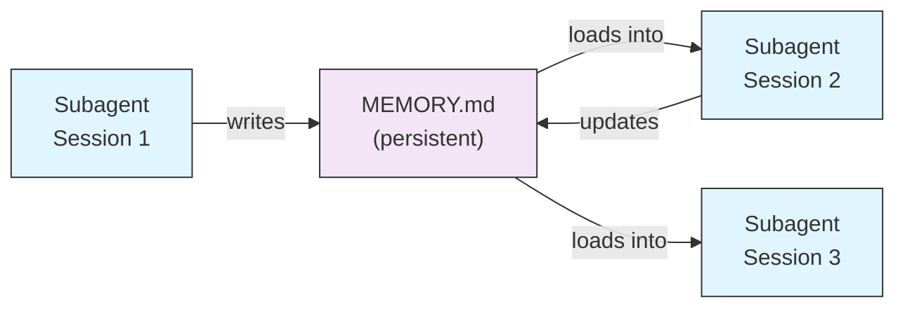
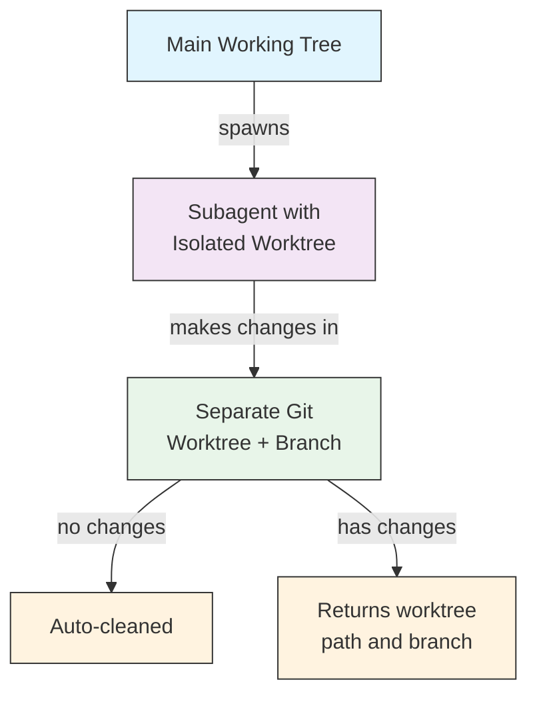
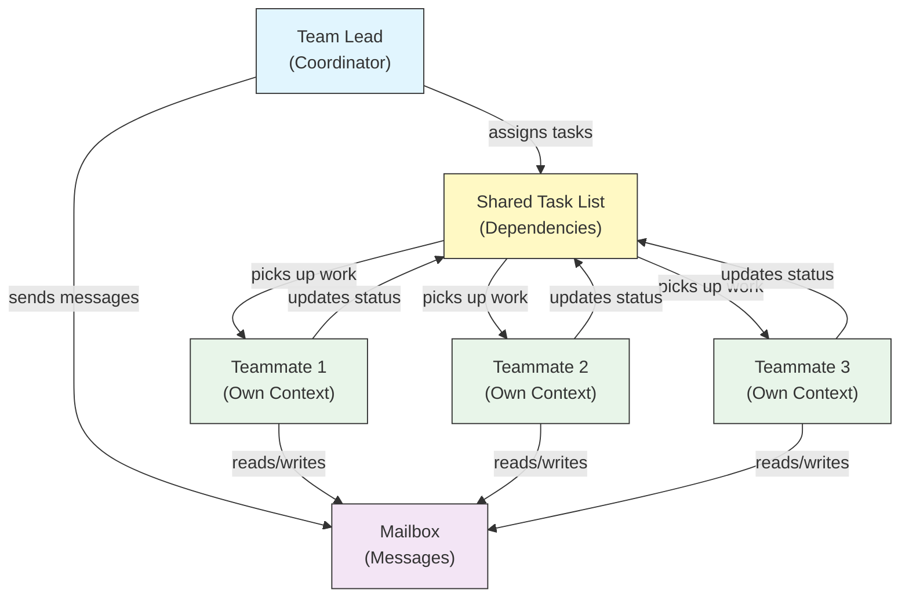
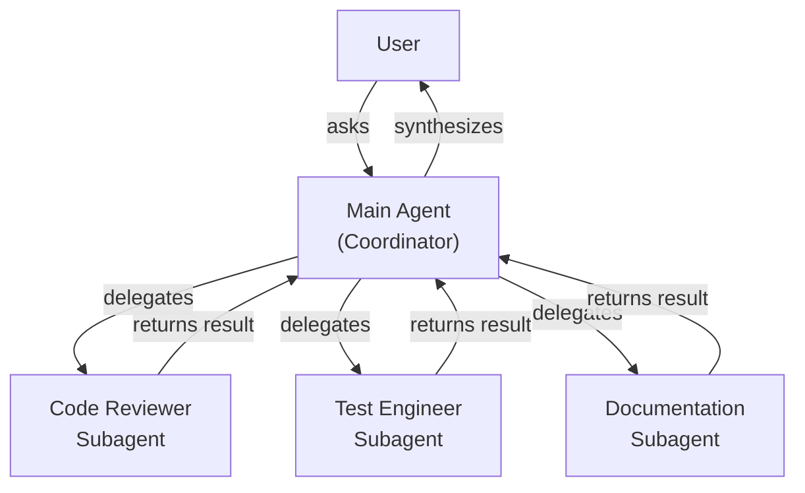
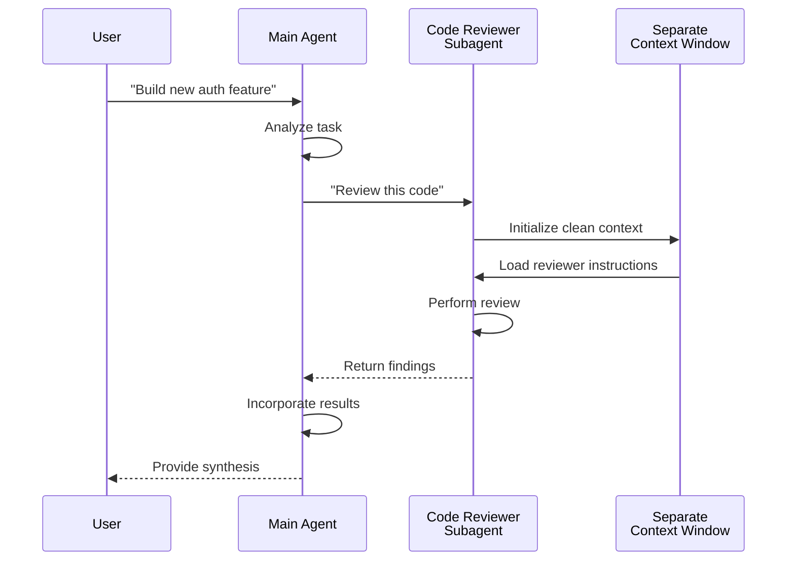
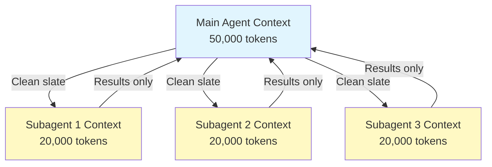
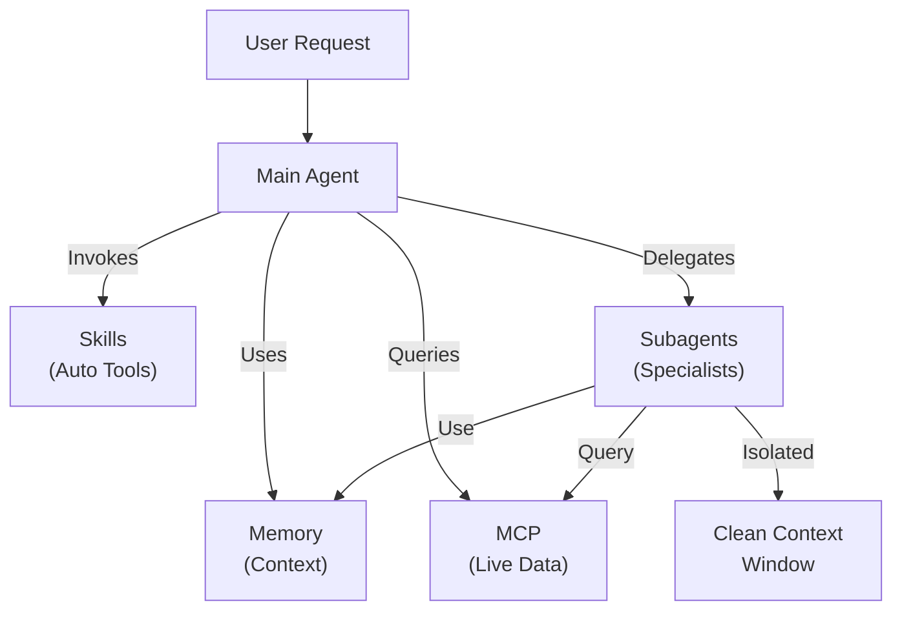

<!-- i18n-source: 04-subagents/README.md -->
<!-- i18n-source-sha: 188f468 -->
<!-- i18n-status: translated -->
<!-- i18n-date: 2026-10-26 -->

<picture>
  <source media="(prefers-color-scheme: dark)" srcset="../resources/logos/claude-howto-logo-dark.svg">
  
</picture>

# 서브에이전트 - 완전 레퍼런스 가이드

서브에이전트는 Claude Code가 작업을 위임할 수 있는 특화된 AI 어시스턴트입니다. 각 서브에이전트는 고유한 목적을 가지며, 메인 대화와 분리된 자체 컨텍스트 창을 사용하고, 특정 도구와 사용자 정의 시스템 프롬프트로 구성할 수 있습니다.

## 목차

1. [개요](#개요)
2. [주요 이점](#주요-이점)
3. [파일 위치](#파일-위치)
4. [구성](#구성)
5. [내장 서브에이전트](#내장-서브에이전트)
6. [서브에이전트 관리](#서브에이전트-관리)
7. [서브에이전트 사용](#서브에이전트-사용)
8. [재개 가능한 에이전트](#재개-가능한-에이전트)
9. [서브에이전트 체이닝](#서브에이전트-체이닝)
10. [서브에이전트의 영구 메모리](#서브에이전트의-영구-메모리)
11. [백그라운드 서브에이전트](#백그라운드-서브에이전트)
12. [워크트리 격리](#워크트리-격리)
13. [포크된 서브에이전트](#포크된-서브에이전트)
14. [생성 가능한 서브에이전트 제한](#생성-가능한-서브에이전트-제한)
15. [`claude agents` CLI 명령](#claude-agents-cli-명령)
16. [에이전트 팀 (실험적)](#에이전트-팀-실험적)
17. [플러그인 서브에이전트 보안](#플러그인-서브에이전트-보안)
18. [아키텍처](#아키텍처)
19. [컨텍스트 관리](#컨텍스트-관리)
20. [서브에이전트를 사용할 때](#서브에이전트를-사용할-때)
21. [모범 사례](#모범-사례)
22. [이 폴더의 예제 서브에이전트](#이-폴더의-예제-서브에이전트)
23. [설치 안내](#설치-안내)
24. [파일 구조](#파일-구조)
25. [관련 개념](#관련-개념)
26. [관측성](#관측성)
27. [추가 리소스](#추가-리소스)

---

## 개요

서브에이전트는 다음 방식으로 Claude Code에서 위임된 작업 실행을 가능하게 합니다.

- 별도 컨텍스트 창을 가진 **격리된 AI 어시스턴트** 생성
- 전문성을 위한 **사용자 정의 시스템 프롬프트** 제공
- 기능을 제한하는 **도구 접근 제어** 적용
- 복잡한 작업으로 인한 **컨텍스트 오염** 방지
- 여러 특화 작업의 **병렬 실행** 지원

각 서브에이전트는 빈 상태로 독립적으로 동작하며, 해당 작업에 필요한 특정 컨텍스트만 받은 뒤 결과를 메인 에이전트에 반환해 종합하게 합니다.

**빠른 시작**: Claude에게 서브에이전트 생성을 요청하거나("보안을 리뷰하는 서브에이전트를 만들어줘"), `.claude/agents/<name>.md` 파일을 직접 추가하세요. 아래 [서브에이전트 관리](#서브에이전트-관리)를 참고합니다.

> **참고**: v2.1.198부터 `/agents` 명령은 더 이상 대화형 생성 마법사를 열지 않습니다. Claude에게 요청하거나 `.claude/agents/` 파일을 직접 편집해 서브에이전트를 생성·관리합니다.

---

## 주요 이점

| 이점 | 설명 |
|---------|-------------|
| **컨텍스트 보존** | 별도 컨텍스트에서 동작해 메인 대화의 오염을 방지합니다 |
| **특화된 전문성** | 특정 도메인에 맞게 조정되어 성공률이 높습니다 |
| **재사용성** | 여러 프로젝트에서 사용하고 팀과 공유할 수 있습니다 |
| **유연한 권한** | 서브에이전트 유형마다 다른 도구 접근 수준을 부여합니다 |
| **확장성** | 여러 에이전트가 서로 다른 측면을 동시에 처리합니다 |

---

## 파일 위치

서브에이전트 파일은 범위가 다른 여러 위치에 저장할 수 있습니다.

| 우선순위 | 유형 | 위치 | 범위 |
|----------|------|----------|-------|
| 1 (최상위) | **관리형** | 관리형 설정 | 조직 전체 |
| 2 | **CLI 정의** | `--agents` 플래그 (JSON) | 세션 한정 |
| 3 | **프로젝트 서브에이전트** | `.claude/agents/` | 현재 프로젝트 |
| 4 | **사용자 서브에이전트** | `~/.claude/agents/` | 모든 프로젝트 |
| 5 (최하위) | **플러그인 에이전트** | 플러그인 `agents/` 디렉터리 | 플러그인 경유 |

이름이 중복되면 우선순위가 높은 소스가 우선합니다.

> **중첩 `.claude/` 우선순위 (v2.1.178)**: 동일한 에이전트 이름이 여러 중첩 `.claude/agents/` 디렉터리에 정의되어 있을 때(예: 패키지별 `.claude/` 폴더가 있는 모노레포), **현재 작업 디렉터리에 가장 가까운 정의가 우선**합니다. 동일한 최근접 우선 규칙이 중첩된 워크플로와 출력 스타일 정의에도 적용됩니다.

---

## 구성

### 파일 형식

서브에이전트는 YAML 프론트매터와 그 뒤에 오는 마크다운 시스템 프롬프트로 정의합니다.

```yaml
---
name: your-sub-agent-name
description: Description of when this subagent should be invoked
tools: tool1, tool2, tool3  # Optional - inherits all tools if omitted
disallowedTools: tool4  # Optional - explicitly disallowed tools
model: sonnet  # Optional - sonnet, opus, haiku, or inherit
permissionMode: default  # Optional - permission mode
maxTurns: 20  # Optional - limit agentic turns
skills: skill1, skill2  # Optional - skills to preload into context
mcpServers: server1  # Optional - MCP servers to make available
memory: user  # Optional - persistent memory scope (user, project, local)
background: false  # Optional - run as background task
effort: high  # Optional - reasoning effort (low, medium, high, xhigh, max)
isolation: worktree  # Optional - git worktree isolation
initialPrompt: "Start by analyzing the codebase"  # Optional - auto-submitted first turn
experimental:  # Optional - experimental settings block
  cacheTtl: "1h"  # Cache TTL for this subagent: "5m" or "1h" (v2.1.248+)
hooks:  # Optional - component-scoped hooks
  PreToolUse:
    - matcher: "Bash"
      hooks:
        - type: command
          command: "./scripts/security-check.sh"
---

Your subagent's system prompt goes here. This can be multiple paragraphs
and should clearly define the subagent's role, capabilities, and approach
to solving problems.
```

### 구성 필드

| 필드 | 필수 | 설명 |
|-------|----------|-------------|
| `name` | 예 | 고유 식별자(소문자와 하이픈). 조회 시 정규화됩니다(대소문자·구분자 무시 — 아래 참조). 단, v2.1.218부터 `:`가 포함된 이름은 **거부**됩니다. `:`는 플러그인 네임스페이스용으로 예약되어 있습니다 |
| `description` | 예 | 목적에 대한 자연어 설명. 자동 호출을 유도하려면 "use PROACTIVELY"를 포함합니다 |
| `tools` | 아니오 | 특정 도구의 쉼표 구분 목록. 생략하면 모든 도구를 상속합니다. 에이전트가 `claude --agent`로 메인 스레드로 실행될 때 생성 가능한 서브에이전트를 제한하는 `Agent(agent_name)` 문법을 지원합니다. 서브에이전트 내부에서는 유형 목록이 무시됩니다. MCP: `mcp__<server>__*`는 서버 전체를 부여합니다(v2.1.299+: 해당 서버 이름과 정확히 일치하는 경우만). |
| `disallowedTools` | 아니오 | 서브에이전트가 사용하면 안 되는 도구의 쉼표 구분 목록 |
| `model` | 아니오 | 사용할 모델: `sonnet`, `opus`, `haiku`, 전체 모델 ID 또는 `inherit`. 기본값은 설정된 서브에이전트 모델입니다 |
| `permissionMode` | 아니오 | `default`(수동 모드, v2.1.200부터 `manual`을 별칭으로 허용), `acceptEdits`, `dontAsk`, `bypassPermissions`, `plan`, `auto`. v2.1.212부터 Task 도구의 `mode` 호출 매개변수는 지원 중단되어 무시됩니다. 여기서 재정의하지 않으면 서브에이전트는 기본적으로 상위 세션의 권한 모드를 상속합니다. 상위가 `bypassPermissions`, `acceptEdits`, `auto`로 실행되면 서브에이전트의 `permissionMode`는 무시됩니다 |
| `maxTurns` | 아니오 | 서브에이전트가 수행할 수 있는 최대 에이전틱 턴 수 |
| `skills` | 아니오 | 미리 로드할 스킬의 쉼표 구분 목록. 시작 시 전체 스킬 내용을 서브에이전트 컨텍스트에 주입합니다. **v2.1.133+:** 서브에이전트는 Skill 도구를 통해 프로젝트·사용자·플러그인 스킬도 검색합니다. 메인 세션과 동일한 카탈로그이며, 더 이상 자체 내장 세트로 제한되지 않습니다. 최대 32개 스킬이 각각 한 번씩 미리 로드되고, Skill 도구가 있는 서브에이전트는 나머지도 여전히 호출할 수 있습니다(v2.1.295). |
| `mcpServers` | 아니오 | 서브에이전트에 제공할 MCP 서버 |
| `hooks` | 아니오 | 이 서브에이전트가 활성화된 동안에만 실행되는 훅. 모든 훅 이벤트를 지원하며, 가장 흔한 것은 `PreToolUse`, `PostToolUse`, `Stop`(`SubagentStop`으로 실행)입니다 |
| `memory` | 아니오 | 영구 메모리 디렉터리 범위: `user`, `project`, `local` |
| `background` | 아니오 | 서브에이전트는 이미 기본적으로 백그라운드에서 실행됩니다(v2.1.198). v2.1.302부터 데스크톱 앱과 VS Code도 메인 대화의 서브에이전트를 항상 백그라운드에서 실행합니다. `claude -p`, Agent SDK, 데스크톱 앱, VS Code에서 서브에이전트가 수행하는 자체 Agent 호출은 기본적으로 포그라운드에서 실행됩니다. `true`로 설정하면 항상 백그라운드로 *강제*하고 인라인 실행을 막습니다 |
| `effort` | 아니오 | 추론 노력 수준: `low`, `medium`, `high`, `xhigh`, `max`. 세션 노력 수준을 재정의하며, 사용 가능한 수준은 모델에 따라 다릅니다. Claude가 Agent 도구를 호출할 때 `effort` 값을 전달할 수도 있습니다(v2.1.292). |
| `isolation` | 아니오 | `worktree`로 설정하면 서브에이전트에 전용 git 워크트리를 부여합니다 |
| `initialPrompt` | 아니오 | 서브에이전트가 메인 에이전트로 실행될 때 자동 제출되는 첫 턴 |
| `color` | 아니오 | 작업 목록과 트랜스크립트에서 서브에이전트의 표시 색상. `red`, `blue`, `green`, `yellow`, `purple`, `orange`, `pink`, `cyan`을 사용할 수 있습니다 |
| `experimental` | 아니오 | 실험적 설정 블록(v2.1.248+). `experimental.cacheTtl`은 이 서브에이전트의 캐시 TTL을 설정합니다 — `"5m"` 또는 `"1h"` |
| `omitClaudeMd` | 아니오 | `true`로 설정하면 사용자·프로젝트·로컬 CLAUDE.md 파일 없이 서브에이전트를 실행합니다(v2.1.271+). 관리형 정책 파일은 계속 로드되지만 관리형 서브에이전트는 예외입니다. `--agent` 또는 `agent` 설정으로 에이전트가 메인 세션 에이전트로 실행될 때는 무시됩니다. `--agents` JSON에서도 허용됩니다 |
| `autoCompactWindow` | 아니오 | 메인 대화의 창보다 이른 시점에 이 서브에이전트의 컨텍스트를 자동 압축합니다(v2.1.296+; `--agents` JSON에서도 허용) |

#### 서브에이전트 모델 환경변수

두 개의 환경변수가 서브에이전트가 실행되는 모델에 영향을 줍니다.

| 변수 | 버전 | 설명 |
|----------|---------|-------------|
| `CLAUDE_CODE_SUBAGENT_MODEL` | — | 서브에이전트에 사용되는 모델을 설정합니다 |
| `CLAUDE_CODE_SUBAGENT_MODEL_FORCE` | v2.1.257+ | `1`로 설정하면 서브에이전트 프론트매터의 `model:`보다 서브에이전트 모델을 강제합니다 |

> **v2.1.251에서 우선순위 변경**: 해당 릴리스 이전에는 `CLAUDE_CODE_SUBAGENT_MODEL`이 먼저 적용되어 `model: inherit`을 포함한 에이전트 프론트매터를 재정의했습니다. v2.1.251부터는 서브에이전트 자체의 `model:` 프론트매터가 우선합니다. 환경변수가 다시 프론트매터를 재정의하도록 하려면(예: 전체 평가 실행을 하나의 모델로 고정) `CLAUDE_CODE_SUBAGENT_MODEL_FORCE=1`(v2.1.257+)을 설정하세요.

### 메인 스레드 에이전트 프론트매터 반영 (v2.1.117+/v2.1.119+)

에이전트가 메인 스레드 에이전트로(`claude --agent <name>` 또는 `--print` 모드) 호출되면 다음 프론트매터 필드가 반영됩니다.

| 필드 | 버전 | 비고 |
|-------|---------|-------|
| `mcpServers` | v2.1.117+ | `claude --agent <name>`로 메인 스레드 에이전트로 호출될 때 로드됩니다 |
| `permissionMode` | v2.1.119+ | `--agent <name>`을 통한 내장 에이전트에 반영됩니다 |
| `tools` / `disallowedTools` | v2.1.119+ | `--print` 모드(비대화형/스크립트 사용)에서 반영됩니다 |

**예제 — `mcpServers`와 `permissionMode`가 있는 에이전트:**

```yaml
---
name: secure-researcher
description: Research agent with scoped MCP access and restricted permissions
permissionMode: acceptEdits
mcpServers:
  notion:
    type: http
    url: https://mcp.notion.com/mcp
  github:
    type: http
    url: https://api.githubcopilot.com/mcp/
    headers:
      Authorization: "Bearer ${GITHUB_PERSONAL_ACCESS_TOKEN}"
tools: Read, Grep, Glob
---

You are a research agent. You may query Notion and GitHub through the
configured MCP servers, and read local files, but you cannot write or
execute commands outside of accepted edits.
```

다음과 같이 실행합니다.

```bash
claude --agent secure-researcher
```

### 도구 구성 옵션

**옵션 1: 모든 도구 상속(필드 생략)**

```yaml
---
name: full-access-agent
description: Agent with all available tools
---
```

**옵션 2: 개별 도구 지정**

```yaml
---
name: limited-agent
description: Agent with specific tools only
tools: Read, Grep, Glob, Bash
---
```

> **Glob/Grep 관련 참고 (v2.1.113+)**: 네이티브 macOS/Linux 빌드에서 Glob과 Grep은 별도 도구가 아니라 Bash 도구를 통해 `bfs`/`ugrep`으로 제공됩니다. Windows와 npm-JS 빌드는 여전히 독립 도구로 노출합니다. 작성자는 `allowedTools`에 Glob/Grep을 계속 참조할 수 있으며, 백엔드 치환은 투명하게 처리됩니다.

**옵션 3: 조건부 도구 접근**

```yaml
---
name: conditional-agent
description: Agent with filtered tool access
tools: Read, Bash(npm:*), Bash(test:*)
---
```

### CLI 기반 구성

단일 세션에 대해 `--agents` 플래그와 JSON 형식으로 서브에이전트를 정의합니다.

```bash
claude --agents '{
  "code-reviewer": {
    "description": "Expert code reviewer. Use proactively after code changes.",
    "prompt": "You are a senior code reviewer. Focus on code quality, security, and best practices.",
    "tools": ["Read", "Grep", "Glob", "Bash"],
    "model": "sonnet"
  }
}'
```

**`--agents` 플래그의 JSON 형식:**

```json
{
  "agent-name": {
    "description": "Required: when to invoke this agent",
    "prompt": "Required: system prompt for the agent",
    "tools": ["Optional", "array", "of", "tools"],
    "model": "optional: sonnet|opus|haiku"
  }
}
```

> **참고**: v2.1.243부터 `--agents`는 잘못된 JSON이나 잘못된 에이전트 정의를 조용히 무시하지 않고 명확한 오류와 함께 종료됩니다. `--mcp-config`의 동작과 같습니다.

**에이전트 정의 우선순위:**

에이전트 정의는 다음 우선순위 순서로 로드됩니다(첫 번째 일치가 우선).
1. **관리형** - 관리형 설정(조직 전체)
2. **CLI 정의** - `--agents` 플래그(세션 한정, JSON)
3. **프로젝트 수준** - `.claude/agents/` (현재 프로젝트)
4. **사용자 수준** - `~/.claude/agents/` (모든 프로젝트)
5. **플러그인 수준** - 플러그인 `agents/` 디렉터리

이를 통해 CLI 정의가 단일 세션에 대해 프로젝트·사용자·플러그인 정의를 재정의할 수 있습니다. 관리형 정의는 여전히 우선합니다.

---

## 내장 서브에이전트

Claude Code에는 항상 사용 가능한 여러 내장 서브에이전트가 포함되어 있습니다.

| 에이전트 | 모델 | 목적 |
|-------|-------|---------|
| **general-purpose** | 상속 | 복잡한 다단계 작업 |
| **Plan** | 상속 | 플랜 모드용 리서치 |
| **Explore** | 상속 (Opus로 상한) | 읽기 전용 코드베이스 탐색 (quick/medium/very thorough) |
| **claude** | 상속 | 더 특화된 에이전트에 맞지 않는 작업을 위한 포괄 에이전트. 서브에이전트가 사용할 수 있는 모든 도구를 가집니다. 디스패치된 백그라운드 세션의 기본 에이전트이기도 합니다 |
| **statusline-setup** | Sonnet | `/statusline`으로 상태 표시줄을 구성할 때 실행됩니다 |
| **claude-code-guide** | Haiku | Claude Code 기능에 대한 질문에 답합니다 |

### 범용 서브에이전트

| 속성 | 값 |
|----------|-------|
| **모델** | 상위에서 상속 |
| **도구** | 모든 도구 |
| **목적** | 복잡한 리서치 작업, 다단계 작업, 코드 수정 |

**사용 시점**: 탐색과 수정이 모두 필요하고 복잡한 추론이 요구되는 작업.

### Plan 서브에이전트

| 속성 | 값 |
|----------|-------|
| **모델** | 상위에서 상속 |
| **도구** | Read, Glob, Grep, Bash |
| **목적** | 플랜 모드에서 코드베이스를 조사하는 데 자동으로 사용됩니다 |

**사용 시점**: Claude가 계획을 제시하기 전에 코드베이스를 이해해야 할 때.

### Explore 서브에이전트

| 속성 | 값 |
|----------|-------|
| **모델** | 세션 모델을 상속하며 Opus로 상한(v2.1.198). 빠르고 저렴하게 유지하려면 `model: haiku`로 설정합니다 |
| **모드** | 엄격한 읽기 전용 |
| **도구** | Glob, Grep, Read, Bash (읽기 전용 명령만) |
| **목적** | 빠른 코드베이스 검색 및 분석 |

**사용 시점**: 변경 없이 코드를 검색하거나 이해할 때.

**철저도 수준** - 탐색 깊이를 지정합니다.
- **"quick"** - 최소한의 탐색으로 빠르게 검색합니다. 특정 패턴을 찾을 때 적합합니다
- **"medium"** - 중간 수준의 탐색으로 속도와 철저함의 균형을 맞춥니다. 기본 접근 방식입니다
- **"very thorough"** - 여러 위치와 명명 규칙을 아우르는 종합 분석입니다. 시간이 더 걸릴 수 있습니다

### Claude 서브에이전트

| 속성 | 값 |
|----------|-------|
| **모델** | 상위에서 상속 |
| **도구** | 서브에이전트가 사용할 수 있는 모든 도구 |
| **목적** | 더 특화된 에이전트에 맞지 않는 작업을 위한 포괄 에이전트 |

**사용 시점**: 작업이 더 특화된 내장 에이전트에 해당하지 않을 때. 디스패치된 백그라운드 세션의 기본 에이전트이기도 하며, 어떤 권한 모드로 시작하는지는 해당 세션이 어떻게 시작되었는지에 따라 달라집니다.

### 상태 표시줄 설정 서브에이전트

| 속성 | 값 |
|----------|-------|
| **모델** | Sonnet |
| **도구** | Read, Write, Bash |
| **목적** | Claude Code 상태 표시줄 표시를 구성합니다 |

**사용 시점**: 상태 표시줄을 설정하거나 사용자 정의할 때.

### Claude Code 가이드 서브에이전트 (`claude-code-guide`)

| 속성 | 값 |
|----------|-------|
| **모델** | Haiku (빠르고 지연이 낮음) |
| **도구** | 읽기 전용 |
| **목적** | Claude Code 기능과 사용법에 대한 질문에 답합니다 |

**사용 시점**: 사용자가 Claude Code의 동작 방식이나 특정 기능 사용법을 물을 때.

---

## 서브에이전트 관리

### Claude에게 요청 (권장)

서브에이전트를 생성하거나 관리하는 가장 간단한 방법은 Claude에게 직접 요청하는 것입니다.

```text
Create a subagent that reviews code for security vulnerabilities.
```

Claude가 적절한 프론트매터(도구, 모델, 설명)를 선택해 `.claude/agents/<name>.md` 파일을 작성합니다. 이후 파일을 직접 다듬거나 Claude에게 수정을 요청할 수 있습니다.

> **참고**: `/agents` 명령은 더 이상 대화형 생성 마법사를 열지 않습니다(v2.1.198에서 제거). 이제 Claude에게 요청하거나 `.claude/agents/` 파일을 직접 편집하도록 안내합니다.

### 파일 직접 관리

```bash
# Create a project subagent
mkdir -p .claude/agents
cat > .claude/agents/test-runner.md << 'EOF'
---
name: test-runner
description: Use proactively to run tests and fix failures
---

You are a test automation expert. When you see code changes, proactively
run the appropriate tests. If tests fail, analyze the failures and fix
them while preserving the original test intent.
EOF

# Create a user subagent (available in all projects)
mkdir -p ~/.claude/agents
```

---

## 서브에이전트 사용

### 자동 위임

Claude는 다음을 기준으로 작업을 사전에 위임합니다.
- 요청에 담긴 작업 설명
- 서브에이전트 구성의 `description` 필드
- 현재 컨텍스트와 사용 가능한 도구

사전 사용을 유도하려면 `description` 필드에 "use PROACTIVELY" 또는 "MUST BE USED"를 포함하세요.

```yaml
---
name: code-reviewer
description: Expert code review specialist. Use PROACTIVELY after writing or modifying code.
---
```

### 명시적 호출

특정 서브에이전트를 명시적으로 요청할 수 있습니다.

```
> Use the test-runner subagent to fix failing tests
> Have the code-reviewer subagent look at my recent changes
> Ask the debugger subagent to investigate this error
```

> **대소문자·구분자 무시 `subagent_type` 매칭 (v2.1.140)**: `subagent_type`(`Agent` 도구 호출 또는 `--agent` 플래그)은 대소문자를 구분하지 않고 구분자 스타일도 무시합니다 — `code-reviewer`, `Code Reviewer`, `code_reviewer`는 모두 동일한 에이전트로 해석됩니다. 대소문자 차이 때문에 조용히 기본 에이전트로 폴백되던 오래된 함정이 사라졌습니다.

### @-멘션 호출

특정 서브에이전트 호출을 보장하려면 `@` 접두사를 사용합니다(자동 위임 휴리스틱을 우회).

```
> @"code-reviewer (agent)" review the auth module
```

### 세션 전체 에이전트

특정 에이전트를 메인 에이전트로 사용해 세션 전체를 실행합니다.

```bash
# Via CLI flag
claude --agent code-reviewer

# Via settings.json
{
  "agent": "code-reviewer"
}
```

### 사용 가능한 에이전트 목록

구성된 서브에이전트를 보려면 Claude에게 묻거나 `.claude/agents/`와 `~/.claude/agents/`를 살펴보세요. (`claude agents`는 별개입니다. 백그라운드 세션의 에이전트 뷰를 엽니다 — [CLI](../10-cli/README.md#에이전트-뷰-claude-agents-v21139) 참고.)

---

## 재개 가능한 에이전트

서브에이전트는 전체 컨텍스트를 보존한 채 이전 대화를 이어갈 수 있습니다.

```bash
# Initial invocation
> Use the code-analyzer agent to start reviewing the authentication module
# Returns agentId: "abc123"

# Resume the agent later
> Resume agent abc123 and now analyze the authorization logic as well
```

**사용 사례**:
- 여러 세션에 걸친 장기 리서치
- 컨텍스트 손실 없는 반복 개선
- 컨텍스트를 유지하는 다단계 워크플로

---

## 서브에이전트 체이닝

여러 서브에이전트를 순차적으로 실행합니다.

```bash
> First use the code-analyzer subagent to find performance issues,
  then use the optimizer subagent to fix them
```

한 서브에이전트의 출력이 다른 서브에이전트로 이어지는 복잡한 워크플로를 가능하게 합니다.

---

## 서브에이전트의 영구 메모리

`memory` 필드는 대화를 넘어 유지되는 영구 디렉터리를 서브에이전트에 부여합니다. 이를 통해 서브에이전트는 시간이 지나며 노트·발견 사항·컨텍스트를 축적하고 세션 간에 유지할 수 있습니다.

### 메모리 범위

| 범위 | 디렉터리 | 사용 사례 |
|-------|-----------|----------|
| `user` | `~/.claude/agent-memory/<name>/` | 모든 프로젝트에 걸친 개인 노트와 선호 |
| `project` | `.claude/agent-memory/<name>/` | 팀과 공유하는 프로젝트별 지식 |
| `local` | `.claude/agent-memory-local/<name>/` | 버전 관리에 커밋하지 않는 로컬 프로젝트 지식 |

### 동작 방식

- 메모리 디렉터리에 있는 `MEMORY.md`의 처음 200줄이 서브에이전트 시스템 프롬프트에 자동으로 로드됩니다
- 서브에이전트가 메모리 파일을 관리할 수 있도록 `Read`, `Write`, `Edit` 도구가 자동으로 활성화됩니다
- 서브에이전트는 필요에 따라 메모리 디렉터리에 추가 파일을 만들 수 있습니다

### 예제 구성

```yaml
---
name: researcher
description: Research assistant that keeps findings in persistent memory across sessions
memory: user
---

You are a research assistant. Use your memory directory to store findings,
track progress across sessions, and build up knowledge over time.

Check your MEMORY.md file at the start of each session to recall previous context.
```



---

## 백그라운드 서브에이전트

서브에이전트는 기본적으로 백그라운드에서 실행됩니다(v2.1.198). v2.1.302부터 데스크톱 앱과 VS Code도 메인 대화의 서브에이전트를 항상 백그라운드에서 실행합니다. `claude -p`, Agent SDK, 데스크톱 앱, VS Code에서 서브에이전트가 수행하는 자체 Agent 호출은 기본적으로 포그라운드에서 실행됩니다. 서브에이전트가 실행되는 동안 Claude는 메인 대화 작업을 계속하고 완료되면 알림을 받으므로, 서브에이전트의 반환을 기다리지 않고 다음 작업을 이어갈 수 있습니다.

### 구성

백그라운드가 이미 기본값이므로, 프론트매터의 `background: true`는 서브에이전트를 항상 백그라운드에서 실행하도록 *강제*하고 인라인 실행을 막습니다.

```yaml
---
name: long-runner
background: true
description: Performs long-running analysis tasks in the background
---
```

### 키보드 단축키

| 단축키 | 동작 |
|----------|--------|
| `Ctrl+B` | 현재 실행 중인 서브에이전트 작업을 백그라운드로 전환 |
| `Ctrl+X` `Ctrl+K` | 실행 중인 모든 백그라운드 서브에이전트 중지(3초 안에 두 번 눌러 확인; `Ctrl+F`를 대체) |

### 백그라운드 작업 비활성화

환경변수를 설정해 백그라운드 작업 지원을 완전히 끕니다.

```bash
export CLAUDE_CODE_DISABLE_BACKGROUND_TASKS=1
```

---

## 워크트리 격리

`isolation: worktree` 설정은 서브에이전트에 전용 git 워크트리를 부여해, 메인 작업 트리에 영향을 주지 않고 독립적으로 변경할 수 있게 합니다.

### 구성

```yaml
---
name: feature-builder
isolation: worktree
description: Implements features in an isolated git worktree
tools: Read, Write, Edit, Bash, Grep, Glob
---
```

### 동작 방식



- 서브에이전트는 별도 브랜치의 자체 git 워크트리에서 동작합니다
- 서브에이전트가 아무 변경도 하지 않으면 워크트리는 자동으로 정리됩니다
- 변경이 있으면 워크트리 경로와 브랜치 이름이 메인 에이전트에 반환되어 검토나 병합에 쓰입니다

---

## 포크된 서브에이전트

포크된 서브에이전트는 빈 상태로 시작하는 대신, 포크 시점의 상위 대화 전체(시스템 프롬프트, 도구, 모델, 메시지 이력, 프롬프트 캐시)를 상속합니다. 지금까지의 작업을 잃지 않고 대안 경로를 탐색할 때 유용합니다.

> **사용 가능 버전**: v2.1.117에서 GA. **v2.1.232부터 대화형 세션에서 포크 모드가 기본 활성화**됩니다 — 자사 빌드가 아니어도 모든 빌드에 적용됩니다. v2.1.302부터는 비대화형 모드(`claude -p`), Agent SDK, 데스크톱 앱, VS Code에서도 기본 활성화됩니다. `claude mcp serve`는 포크 서브에이전트를 제공하지 않습니다. v2.1.232 이전의 Claude Code이거나 기본적으로 꺼져 있는 환경에서 켜려면 `CLAUDE_CODE_FORK_SUBAGENT=1`을 설정하세요.

> **포크 모드 서브에이전트는 백그라운드에서 실행됩니다.** 포크 모드가 켜져 있는 곳(대화형 세션의 기본값)에서 Claude Code는 포크·비포크 서브에이전트 모두를 백그라운드에서 실행합니다.

### 구성

포크는 에이전트 파일에 정의하지 않습니다. Claude가 `subagent_type: "fork"`로 Agent 도구를 통해 시작하거나, `/subtask <task>`(v2.1.212+)로 직접 시작합니다.

```text
/subtask Explore an alternative implementation path and report the trade-offs
```

포크는 추가 포크를 생성할 수 없습니다. 포크를 차단하려면 거부 규칙 `Agent(fork)`를 추가하세요.

```json
{
  "permissions": {
    "deny": ["Agent(fork)"]
  }
}
```

> **참고**: `context: fork`는 **스킬** 프론트매터 필드이며([스킬](../03-skills/README.md) 참고), 서브에이전트 필드가 아닙니다. Claude Code는 에이전트 정의에서 인식하지 못하는 필드를 조용히 무시합니다.

### 포크 모드 명시적 활성화

`CLAUDE_CODE_FORK_SUBAGENT=0`을 설정하면 모든 곳에서 포크 모드가 꺼집니다. v2.1.302 이전 버전에서는 `1`로 설정해 `claude -p`와 Agent SDK에서 포크를 켭니다.

```bash
export CLAUDE_CODE_FORK_SUBAGENT=0
claude
```

### 포크 vs 클린 컨텍스트 사용 시점

| 시나리오 | 포크 (`subagent_type: "fork"`) | 클린 컨텍스트 (기본) |
|----------|-----------------|-------------------------|
| 대안 구현 탐색 | 예 | 아니오 (컨텍스트를 잃게 됨) |
| 기존 컨텍스트를 활용한 장기 리서치 | 예 | 아니오 |
| 독립적인 특화 작업 | 아니오 | 예 |
| 컨텍스트 오염 방지 | 아니오 | 예 |

---

## 생성 가능한 서브에이전트 제한

`claude --agent`로 메인 스레드에서 실행되는 에이전트가 생성할 수 있는 서브에이전트는 `tools` 필드의 `Agent(agent_type)` 문법으로 제어할 수 있습니다. 위임을 허용할 서브에이전트를 허용 목록으로 지정하는 방법입니다. 서브에이전트 정의에서는 괄호 안의 유형 목록이 무시됩니다.

> **참고**: v2.1.63에서 `Task` 도구의 이름이 `Agent`로 바뀌었습니다. 기존 `Task(...)` 참조도 별칭으로 계속 동작합니다.

### 예제

```yaml
---
name: coordinator
description: Coordinates work between specialized agents
tools: Agent(worker, researcher), Read, Bash
---

You are a coordinator agent. You can delegate work to the "worker" and
"researcher" subagents only. Use Read and Bash for your own exploration.
```

이 예제에서 `claude --agent coordinator`를 실행하면 메인 스레드는 `worker`와 `researcher` 서브에이전트만 생성할 수 있습니다. 다른 곳에 정의되어 있더라도 다른 서브에이전트는 생성할 수 없습니다. `coordinator`가 서브에이전트로 실행되면 유형 목록은 무시됩니다.

---

## `claude agents` CLI 명령

`claude agents`는 **에이전트 뷰**(v2.1.139+)를 엽니다. 상태별로 묶인 백그라운드 세션의 전체 화면 목록입니다. 구성된 서브에이전트 정의를 나열하지는 않으며, 세션 상태를 스크립트로 다루려면 `claude agents --json`을 사용합니다.

```bash
claude agents
claude agents --json
```

구성된 서브에이전트는 `.claude/agents/`(프로젝트)와 `~/.claude/agents/`(사용자)에 있습니다.

---

## 에이전트 팀 (실험적)

에이전트 팀은 복잡한 작업을 함께 수행하는 여러 Claude Code 인스턴스를 조정합니다. 위임된 하위 작업을 실행하고 결과를 반환하는 서브에이전트와 달리, 팀원은 자체 컨텍스트 창으로 독립적으로 작업하며 공유 메일박스 시스템을 통해 서로 직접 메시지를 주고받을 수 있습니다.

> **공식 문서**: [code.claude.com/docs/en/agent-teams](https://code.claude.com/docs/en/agent-teams)

> **참고**: 에이전트 팀은 실험적이며 기본적으로 비활성화되어 있습니다. Claude Code v2.1.32+가 필요합니다. 사용 전에 활성화하세요.

### 서브에이전트 vs 에이전트 팀

| 측면 | 서브에이전트 | 에이전트 팀 |
|--------|-----------|-------------|
| **위임 모델** | 상위가 하위 작업을 위임하고 결과를 기다림 | 팀 리드가 작업을 조정하고 팀원이 독립적으로 실행 |
| **컨텍스트** | 하위 작업마다 새 컨텍스트, 결과는 정제되어 반환 | 각 팀원이 자체 영구 컨텍스트 창 유지 |
| **조정** | 상위가 관리하는 순차 또는 병렬 | 종속성 자동 관리가 있는 공유 작업 목록 |
| **통신** | 결과는 상위로만 반환(에이전트 간 메시징 없음) | 팀원이 메일박스를 통해 직접 메시지 교환 |
| **세션 재개** | 지원 | 인프로세스 팀원은 지원하지 않음 |
| **적합한 용도** | 집중적이고 잘 정의된 하위 작업 | 에이전트 간 통신과 병렬 실행이 필요한 복잡한 작업 |

### 에이전트 팀 활성화

환경변수를 설정하거나 `settings.json`에 추가합니다.

```bash
export CLAUDE_CODE_EXPERIMENTAL_AGENT_TEAMS=1
```

또는 `settings.json`에서:

```json
{
  "env": {
    "CLAUDE_CODE_EXPERIMENTAL_AGENT_TEAMS": "1"
  }
}
```

### 팀 시작하기

활성화한 뒤 프롬프트에서 팀원과 함께 작업하도록 Claude에게 요청합니다.

```
User: Build the authentication module. Use a team — one teammate for the API endpoints,
      one for the database schema, and one for the test suite.
```

Claude가 팀을 만들고 작업을 할당하며 자동으로 조정합니다.

### 표시 모드

팀원 활동의 표시 방식을 제어합니다.

| 모드 | 플래그 | 설명 |
|------|------|-------------|
| **자동** | `--teammate-mode auto` | 터미널에 가장 적합한 표시 모드를 자동으로 선택합니다 |
| **인프로세스** (기본) | `--teammate-mode in-process` | 현재 터미널에 팀원 출력을 인라인으로 표시합니다 |
| **분할 창** | `--teammate-mode tmux` | 각 팀원을 별도 tmux 또는 iTerm2 창에서 엽니다 |
| **iTerm2** | `--teammate-mode iterm2` | (v2.1.186+) 전용 iTerm2 창에 팀원을 생성합니다. `it2` CLI가 필요하며, 찾을 수 없으면 자동 모드가 경고합니다 |

```bash
claude --teammate-mode tmux
```

`settings.json`에서도 표시 모드를 설정할 수 있습니다.

```json
{
  "teammateMode": "tmux"
}
```

> **참고**: 분할 창 모드는 tmux 또는 iTerm2가 필요합니다. VS Code 터미널, Windows Terminal, Ghostty에서는 사용할 수 없습니다.

### 탐색

팀원 사이를 이동하려면 에이전트 패널에서 위·아래 화살표 키를 누르고 Enter를 누르거나(인프로세스 모드), 팀원의 창을 클릭합니다(분할 창 모드).

### 팀 구성

팀 구성은 `~/.claude/teams/{team-name}/config.json`에 저장됩니다.

### 팀원 모델 선택

v2.1.234부터 "Default teammate model" `/config` 설정이 제거되었습니다. 이제 생성 호출에서 다른 모델을 명시하지 않으면 팀원은 기본적으로 팀 리드의 모델을 상속합니다.

### 아키텍처



**주요 구성 요소**:

- **팀 리드**: 팀을 만들고 작업을 할당하며 조정하는 메인 Claude Code 세션
- **공유 작업 목록**: 종속성을 자동으로 추적하는 동기화된 작업 목록
- **메일박스**: 팀원이 상태를 공유하고 조정하는 에이전트 간 메시징 시스템
- **팀원**: 각자 자체 컨텍스트 창을 가진 독립적인 Claude Code 인스턴스

### 작업 할당과 메시징

팀 리드는 작업을 나눠 팀원에게 할당합니다. 공유 작업 목록이 처리하는 것은 다음과 같습니다.

- **자동 종속성 관리** — 작업은 종속 작업이 완료될 때까지 대기합니다
- **상태 추적** — 팀원이 작업하면서 작업 상태를 갱신합니다
- **에이전트 간 메시징** — 팀원이 조정을 위해 메일박스로 메시지를 보냅니다(예: "데이터베이스 스키마가 준비되었으니 쿼리 작성 시작 가능")

### 계획 승인 워크플로

복잡한 작업의 경우 팀 리드는 팀원이 작업을 시작하기 전에 실행 계획을 만듭니다. 사용자가 계획을 검토하고 승인해, 코드를 변경하기 전에 팀의 접근 방식이 기대와 일치하는지 확인합니다.

### 팀용 훅 이벤트

에이전트 팀은 두 가지 [훅 이벤트](../06-hooks/)를 추가로 도입합니다.

| 이벤트 | 발생 시점 | 사용 사례 |
|-------|-----------|----------|
| `TeammateIdle` | 팀원이 현재 작업을 끝내고 대기 작업이 없을 때 | 알림 발생, 후속 작업 할당 |
| `TaskCompleted` | 공유 작업 목록의 작업이 완료로 표시될 때 | 검증 실행, 대시보드 갱신, 종속 작업 연결 |

### 모범 사례

- **팀 규모**: 최적의 조정을 위해 3~5명의 팀원을 유지하세요
- **작업 크기**: 각 5~15분이 걸리는 작업으로 나누세요 — 병렬화하기에 충분히 작고, 의미 있기에 충분히 큽니다
- **파일 충돌 회피**: 서로 다른 팀원에게 서로 다른 파일이나 디렉터리를 할당해 병합 충돌을 방지하세요
- **단순하게 시작**: 첫 팀에는 인프로세스 모드를 사용하고, 익숙해지면 분할 창으로 전환하세요
- **명확한 작업 설명**: 팀원이 독립적으로 작업할 수 있도록 구체적이고 실행 가능한 작업 설명을 제공하세요

### 제한 사항

- **실험적**: 기능 동작이 향후 릴리스에서 바뀔 수 있습니다
- **세션 재개 불가**: 인프로세스 팀원은 세션이 끝난 뒤 재개할 수 없습니다
- **세션당 하나의 팀**: 중첩 팀이나 단일 세션의 여러 팀을 만들 수 없습니다
- **고정된 리더십**: 팀 리드 역할을 팀원에게 넘길 수 없습니다
- **분할 창 제약**: tmux/iTerm2가 필요하며, VS Code 터미널, Windows Terminal, Ghostty에서는 사용할 수 없습니다
- **세션 간 팀 불가**: 팀원은 현재 세션 안에만 존재합니다

> **경고**: 에이전트 팀은 실험적입니다. 중요하지 않은 작업으로 먼저 테스트하고, 팀원 조정에서 예상치 못한 동작이 있는지 관찰하세요.

---

## 플러그인 서브에이전트 보안

플러그인이 제공하는 서브에이전트는 보안을 위해 프론트매터 기능이 제한됩니다. 플러그인 서브에이전트 정의에서는 다음 필드가 **허용되지 않습니다**.

- `hooks` - 라이프사이클 훅을 정의할 수 없습니다
- `mcpServers` - MCP 서버를 구성할 수 없습니다
- `permissionMode` - 권한 설정을 재정의할 수 없습니다

이를 통해 플러그인이 권한을 상승시키거나 서브에이전트 훅을 통해 임의 명령을 실행하는 것을 막습니다.

### 서브에이전트 출력 스캔 (v2.1.210+)

v2.1.210부터 Claude Code는 각 서브에이전트의 최종 보고서에서 하네스 자체의 출력 형식을 흉내 내는 텍스트를 스캔합니다. 가짜 `<system-reminder>` 형태 태그, 조작된 `Human:`/`Assistant:` 턴, 권한 우회 플래그나 설정 파일 경로 언급 등이 대상입니다. 이는 악성 웹 페이지를 가져온 서브에이전트가 상위 세션을 조작하려는 가짜 제어 토큰을 담아 보내는 등, 서브에이전트 출력에 실린 프롬프트 인젝션을 방어합니다.

스캔이 무언가를 표시하면 Claude Code는 이를 무력화합니다 — 백슬래시나 `[harness: subagent output matched instruction-shaped pattern(s): ...]` 같은 인라인 표식을 삽입하고 무엇이 스캔을 유발했는지 명시합니다 — 그리고 상위 세션은 표시된 텍스트를 따를 지시가 아니라 전달할 발견 사항으로 취급해야 합니다. 스캔은 기본 활성이며 문서화된 옵트아웃은 없습니다. 스캔은 표시하는 쪽으로 기울어 있습니다. 실제 플래그 이름(예: `--dangerously-skip-permissions`)을 그대로 인용한 정상적인 서브에이전트 보고서도 악의가 없는데 표식이 붙을 수 있습니다 — 놓친 인젝션보다 오탐이 낫다는 판단입니다.

### 서브에이전트 동시성 및 깊이 제한

> **세션당 생성 상한은 사라졌습니다.** Claude Code는 v2.1.212부터 세션당 서브에이전트 생성을 200개로 제한했지만, **v2.1.224에서 그 상한이 제거**되었습니다 — 장기 세션도 새 에이전트를 거부하지 않으며, 공식 서브에이전트 레퍼런스도 이제 Claude가 세션 동안 생성할 수 있는 서브에이전트 총수에 제한이 없다고 분명히 밝힙니다. 이를 재정의하던 `CLAUDE_CODE_MAX_SUBAGENTS_PER_SESSION` 변수도 함께 사라졌습니다.

서브에이전트 팬아웃에 대한 두 가지 제한은 여전히 적용되며, 둘 다 환경변수로 설정합니다.

- `CLAUDE_CODE_MAX_CONCURRENT_SUBAGENTS` (v2.1.217) - 동시에 실행되는 서브에이전트의 최대 수. 기본값: 20.
- `CLAUDE_CODE_MAX_SUBAGENT_SPAWN_DEPTH` (v2.1.217) - 서브에이전트가 자체 서브에이전트를 생성할 때의 최대 **중첩 깊이**. **v2.1.219부터 기본값 3**(v2.1.217–v2.1.218에서는 1). `1`로 설정하면 중첩이 비활성화됩니다([주요 동작](#주요-동작) 참고).

```bash
export CLAUDE_CODE_MAX_CONCURRENT_SUBAGENTS=20
export CLAUDE_CODE_MAX_SUBAGENT_SPAWN_DEPTH=5
```

---

## 아키텍처

### 상위 수준 아키텍처



### 서브에이전트 수명 주기



---

## 컨텍스트 관리



### 핵심 사항

- 각 서브에이전트는 메인 대화 이력이 없는 **새 컨텍스트 창**을 받습니다
- 서브에이전트의 특정 작업에 **관련 컨텍스트만** 전달됩니다
- 결과는 메인 에이전트로 **정제되어** 반환됩니다
- 이를 통해 장기 프로젝트에서 **컨텍스트 토큰 고갈**을 방지합니다

### 성능 고려 사항

- **컨텍스트 효율** - 에이전트가 메인 컨텍스트를 보존해 더 긴 세션이 가능합니다
- **지연** - 서브에이전트는 빈 상태로 시작하므로 초기 컨텍스트를 수집하는 데 지연이 추가될 수 있습니다

### 주요 동작

- **기본적으로 중첩 생성 활성화, 깊이 3 (v2.1.219)** - 서브에이전트는 메인 대화 아래 최대 3계층까지 자체 서브에이전트를 생성할 수 있습니다. 한도를 바꾸려면 `CLAUDE_CODE_MAX_SUBAGENT_SPAWN_DEPTH`를 설정하고, 중첩을 끄려면 `1`로 설정하세요. 깊이 한도에 도달하면 Claude Code는 포크를 제외한 모든 서브에이전트에서 `Agent` 도구를 제공하지 않습니다. (이력: v2.1.172–v2.1.216은 기본 5계층까지 중첩되며 변경 수단이 없었고, v2.1.217은 깊이 1의 옵트인으로 바꿨으며, v2.1.219가 기본값을 3으로 설정했습니다.) 메인 스레드 에이전트(`claude --agent`)가 생성할 수 있는 서브에이전트를 제어하려면 `Agent(agent_type)` 제한 문법을 사용하세요([생성 가능한 서브에이전트 제한](#생성-가능한-서브에이전트-제한) 참고). 서브에이전트 내부에서는 유형 목록이 무시됩니다
- **백그라운드 권한** - 백그라운드 서브에이전트가 사전 승인되지 않은 권한을 필요로 하면 프롬프트가 메인 세션에 표시되고, 요청한 서브에이전트 이름이 함께 나옵니다
- **백그라운드 전환** - `Ctrl+B`를 눌러 현재 실행 중인 작업을 백그라운드로 전환합니다
- **트랜스크립트** - 서브에이전트 트랜스크립트는 `~/.claude/projects/{project}/{sessionId}/subagents/agent-{agentId}.jsonl`에 저장됩니다
- **자동 압축** - 서브에이전트 컨텍스트는 용량의 약 95%에서 자동 압축됩니다(`CLAUDE_AUTOCOMPACT_PCT_OVERRIDE` 환경변수로 재정의)
- **확장 사고 상속 (v2.1.198)** - 서브에이전트와 컨텍스트 압축이 이제 세션의 확장 사고 설정을 상속합니다(이전에는 항상 비활성이었음). 서브에이전트별 사고 필드는 없습니다

### 추가 제어

- **내장 Explore/Plan 에이전트 비활성화** - `CLAUDE_CODE_DISABLE_EXPLORE_PLAN_AGENTS=1`을 설정하면 내장 Explore와 Plan 에이전트가 제거됩니다(v2.1.198)
- **모든 서브에이전트 프롬프트에 추가** - 비대화형/`--print` 모드에서 `--append-subagent-system-prompt "<text>"`는 모든 서브에이전트의 시스템 프롬프트에 텍스트를 덧붙입니다(v2.1.205)
- **파일에서 추가** - `--append-subagent-system-prompt-file ./subagent-rules.txt`는 같은 추가 텍스트를 파일에서 읽습니다. 명령줄로 전달하기에 너무 긴 프롬프트에 사용합니다. 역시 `-p` 전용이며 `--append-subagent-system-prompt`와 함께 쓸 수 없습니다(v2.1.261)

---

## 서브에이전트를 사용할 때

| 시나리오 | 서브에이전트 사용 | 이유 |
|----------|--------------|-----|
| 단계가 많은 복잡한 기능 | 예 | 관심사 분리, 컨텍스트 오염 방지 |
| 빠른 코드 리뷰 | 아니오 | 불필요한 오버헤드 |
| 병렬 작업 실행 | 예 | 각 서브에이전트가 자체 컨텍스트를 가짐 |
| 특화된 전문성이 필요 | 예 | 사용자 정의 시스템 프롬프트 |
| 장시간 분석 | 예 | 메인 컨텍스트 고갈 방지 |
| 단일 작업 | 아니오 | 불필요한 지연 추가 |

---

## 모범 사례

### 설계 원칙

**권장:**
- Claude가 생성한 에이전트로 시작 - Claude로 초기 서브에이전트를 생성한 뒤 반복해 맞춤화합니다
- 집중된 서브에이전트 설계 - 모든 것을 처리하는 하나보다 단일하고 명확한 책임을 가집니다
- 상세한 프롬프트 작성 - 구체적 지시, 예시, 제약을 포함합니다
- 도구 접근 제한 - 서브에이전트 목적에 필요한 도구만 부여합니다
- 버전 관리 - 팀 협업을 위해 프로젝트 서브에이전트를 버전 관리에 포함합니다

**비권장:**
- 동일한 역할의 중복 서브에이전트 생성
- 서브에이전트에 불필요한 도구 접근 부여
- 단순한 단일 단계 작업에 서브에이전트 사용
- 하나의 서브에이전트 프롬프트에 여러 관심사 혼합
- 필요한 컨텍스트 전달 누락

### 시스템 프롬프트 모범 사례

1. **역할을 구체적으로**
   ```
   You are an expert code reviewer specializing in [specific areas]
   ```

2. **우선순위를 명확히 정의**
   ```
   Review priorities (in order):
   1. Security Issues
   2. Performance Problems
   3. Code Quality
   ```

3. **출력 형식 지정**
   ```
   For each issue provide: Severity, Category, Location, Description, Fix, Impact
   ```

4. **실행 단계 포함**
   ```
   When invoked:
   1. Run git diff to see recent changes
   2. Focus on modified files
   3. Begin review immediately
   ```

### 도구 접근 전략

1. **제한적으로 시작**: 필수 도구만으로 시작합니다
2. **필요할 때만 확장**: 요구 사항에 따라 도구를 추가합니다
3. **가능하면 읽기 전용**: 분석 에이전트에는 Read/Grep을 사용합니다
4. **샌드박스 실행**: Bash 명령을 특정 패턴으로 제한합니다

---

## 이 폴더의 예제 서브에이전트

이 폴더에는 바로 사용할 수 있는 예제 서브에이전트가 있습니다.

### 1. 코드 리뷰어 (`code-reviewer.md`)

**목적**: 포괄적인 코드 품질 및 유지보수성 분석

**도구**: Read, Grep, Glob, Bash

**전문 분야**:
- 보안 취약점 탐지
- 성능 최적화 지점 식별
- 코드 유지보수성 평가
- 테스트 커버리지 분석

**사용 시점**: 품질과 보안에 초점을 둔 자동 코드 리뷰가 필요할 때

---

### 2. 테스트 엔지니어 (`test-engineer.md`)

**목적**: 테스트 전략, 커버리지 분석, 자동화 테스트

**도구**: Read, Write, Bash, Grep

**전문 분야**:
- 단위 테스트 작성
- 통합 테스트 설계
- 엣지 케이스 식별
- 커버리지 분석 (목표 80% 이상)

**사용 시점**: 포괄적인 테스트 스위트 작성이나 커버리지 분석이 필요할 때

---

### 3. 문서 작성자 (`documentation-writer.md`)

**목적**: 기술 문서, API 문서, 사용자 가이드

**도구**: Read, Write, Grep

**전문 분야**:
- API 엔드포인트 문서화
- 사용자 가이드 작성
- 아키텍처 문서화
- 코드 주석 개선

**사용 시점**: 프로젝트 문서를 작성하거나 갱신할 때

---

### 4. 보안 리뷰어 (`secure-reviewer.md`)

**목적**: 최소 권한으로 수행하는 보안 중심 코드 리뷰

**도구**: Read, Grep

**전문 분야**:
- 보안 취약점 탐지
- 인증/인가 문제
- 데이터 노출 위험
- 인젝션 공격 식별

**사용 시점**: 수정 권한 없이 보안 감사가 필요할 때

---

### 5. 구현 에이전트 (`implementation-agent.md`)

**목적**: 기능 개발을 위한 전체 구현 기능

**도구**: Read, Write, Edit, Bash, Grep, Glob

**전문 분야**:
- 기능 구현
- 코드 생성
- 빌드 및 테스트 실행
- 코드베이스 수정

**사용 시점**: 기능을 처음부터 끝까지 구현할 서브에이전트가 필요할 때

---

### 6. 디버거 (`debugger.md`)

**목적**: 오류, 테스트 실패, 예기치 않은 동작을 다루는 디버깅 전문가

**도구**: Read, Edit, Bash, Grep, Glob

**전문 분야**:
- 근본 원인 분석
- 오류 조사
- 테스트 실패 해결
- 최소 수정 구현

**사용 시점**: 버그, 오류, 예기치 않은 동작을 만났을 때

---

### 7. 데이터 과학자 (`data-scientist.md`)

**목적**: SQL 쿼리와 데이터 인사이트를 다루는 데이터 분석 전문가

**도구**: Bash, Read, Write

**전문 분야**:
- SQL 쿼리 최적화
- BigQuery 작업
- 데이터 분석 및 시각화
- 통계적 인사이트

**사용 시점**: 데이터 분석, SQL 쿼리, BigQuery 작업이 필요할 때

---

### 8. 클린 코드 리뷰어 (`clean-code-reviewer.md`)

**목적**: 클린 코드 원칙에 따른 가독성 및 유지보수성 리뷰

**도구**: Read, Grep, Glob, Bash

**전문 분야**:
- 명명, 함수 길이, 인자 개수
- 중복과 죽은 코드
- 주석 품질과 의도
- 영리함보다 구조적 명료성

**사용 시점**: 정확성 리뷰와 별개로 스타일과 유지보수성 점검이 필요할 때

---

### 9. 성능 최적화 도구 (`performance-optimizer.md`)

**목적**: 성능 병목 식별 및 개선

**도구**: Read, Edit, Bash, Grep, Glob

**전문 분야**:
- 알고리즘 복잡도와 핫 패스
- 메모리 할당과 누수
- 캐싱과 쿼리 최적화
- 동시성과 I/O 병목

**사용 시점**: 코드가 측정 가능할 만큼 느리고 표적화된 최적화가 필요할 때

---

## 설치 안내

### 방법 1: Claude에게 요청 (권장)

원하는 서브에이전트를 설명하고 Claude가 파일을 만들게 합니다.

```text
Create a project-level subagent that runs tests and fixes failures.
Give it access to Bash, Read, Edit, and Grep.
```

Claude가 적절한 프론트매터와 함께 `.claude/agents/<name>.md`를 작성합니다. 생성된 파일을 검토한 뒤 사용하세요. (`/agents` 대화형 생성 마법사는 v2.1.198에서 제거되었습니다 — 대신 Claude에게 요청하거나 파일을 직접 편집하세요.)

### 방법 2: 프로젝트로 복사

에이전트 파일을 프로젝트의 `.claude/agents/` 디렉터리로 복사합니다.

```bash
# Navigate to your project
cd /path/to/your/project

# Create agents directory if it doesn't exist
mkdir -p .claude/agents

# Copy all agent files from this folder
cp /path/to/04-subagents/*.md .claude/agents/

# Remove the README (not needed in .claude/agents)
rm .claude/agents/README.md
```

### 방법 3: 사용자 디렉터리로 복사

모든 프로젝트에서 사용할 에이전트의 경우:

```bash
# Create user agents directory
mkdir -p ~/.claude/agents

# Copy agents
cp /path/to/04-subagents/code-reviewer.md ~/.claude/agents/
cp /path/to/04-subagents/debugger.md ~/.claude/agents/
# ... copy others as needed
```

### 확인

설치 후 디렉터리를 나열해 에이전트가 인식되는지 확인합니다.

```bash
ls .claude/agents/
```

현재 세션에서 사용 가능한 서브에이전트를 Claude에게 물어볼 수도 있으며, 위임할 수 있는 내장·사용자 정의 에이전트를 알려줍니다.

---

## 파일 구조

```
project/
├── .claude/
│   └── agents/
│       ├── code-reviewer.md
│       ├── test-engineer.md
│       ├── documentation-writer.md
│       ├── secure-reviewer.md
│       ├── implementation-agent.md
│       ├── debugger.md
│       ├── data-scientist.md
│       ├── clean-code-reviewer.md
│       └── performance-optimizer.md
└── ...
```

---

## 관련 개념

### 관련 기능

- **[슬래시 커맨드](../01-slash-commands/)** - 사용자가 호출하는 빠른 단축 기능
- **[메모리](../02-memory/)** - 세션 간 유지되는 영구 컨텍스트
- **[스킬](../03-skills/)** - 재사용 가능한 자율 기능
- **[MCP 프로토콜](../05-mcp/)** - 실시간 외부 데이터 접근
- **[훅](../06-hooks/)** - 이벤트 기반 셸 명령 자동화
- **[플러그인](../07-plugins/)** - 묶음형 확장 패키지

### 다른 기능과의 비교

| 기능 | 사용자 호출 | 자동 호출 | 영구 | 외부 접근 | 격리된 컨텍스트 |
|---------|--------------|--------------|-----------|------------------|------------------|
| **슬래시 커맨드** | 예 | 아니오 | 아니오 | 아니오 | 아니오 |
| **서브에이전트** | 예 | 예 | 아니오 | 아니오 | 예 |
| **메모리** | 자동 | 자동 | 예 | 아니오 | 아니오 |
| **MCP** | 자동 | 예 | 아니오 | 예 | 아니오 |
| **스킬** | 예 | 예 | 아니오 | 아니오 | 아니오 |

### 통합 패턴



---

## 관측성

> **v2.1.139에서 추가되었습니다.**

서브에이전트에서 발생한 API 요청에는 두 개의 추가 HTTP 헤더가 붙어, 트레이스와 로그를 디스패치한 세션으로 역추적할 수 있습니다.

| 헤더 | 설명 |
|--------|-------------|
| `x-claude-code-agent-id` | 요청을 보내는 서브에이전트의 UUID. |
| `x-claude-code-parent-agent-id` | 이 서브에이전트를 디스패치한 에이전트(메인 에이전트 또는 체인 상위의 서브에이전트)의 UUID. |

같은 식별자가 `claude_code.llm_request` OpenTelemetry 스팬에 `claude.code.agent.id` 및 `claude.code.agent.parent_id` 속성으로 노출됩니다. 다음 용도로 활용하세요.

- API 비용을 상위 세션 대신 특정 서브에이전트 유형에 귀속
- 사후에 에이전트 호출 체인 재구성(parent_id가 트리를 형성)
- 폭주 서브에이전트 경보(예: 하나의 `agent.id`가 세션 비용의 50% 초과)

엔드투엔드 익스포터 설정은 [고급 기능 → 텔레메트리](../09-advanced-features/README.md)의 OpenTelemetry 섹션을 참고하세요.

## 추가 리소스

- [공식 서브에이전트 문서](https://code.claude.com/docs/en/sub-agents)
- [CLI 레퍼런스](https://code.claude.com/docs/en/cli-reference) - `--agents` 플래그와 기타 CLI 옵션
- [플러그인 가이드](../07-plugins/) - 에이전트를 다른 기능과 함께 묶을 때
- [스킬 가이드](../03-skills/) - 자동 호출 기능
- [메모리 가이드](../02-memory/) - 영구 컨텍스트
- [훅 가이드](../06-hooks/) - 이벤트 기반 자동화

---

**최종 업데이트**: 2026년 10월 18일
**Claude Code 버전**: 2.1.302
**출처**:
- https://code.claude.com/docs/en/sub-agents
- https://github.com/anthropics/claude-code/blob/main/CHANGELOG.md
- https://code.claude.com/docs/en/cli-reference
- https://code.claude.com/docs/en/agent-teams
- https://code.claude.com/docs/en/changelog#2-1-172
- https://code.claude.com/docs/en/changelog
- https://github.com/anthropics/claude-code/releases/tag/v2.1.117
- https://github.com/anthropics/claude-code/releases/tag/v2.1.131
- https://github.com/anthropics/claude-code/releases/tag/v2.1.138
- https://github.com/anthropics/claude-code/releases/tag/v2.1.139
- https://github.com/anthropics/claude-code/releases/tag/v2.1.140
- https://code.claude.com/docs/en/model-config
- https://code.claude.com/docs/en/interactive-mode
- https://github.com/anthropics/claude-code/releases/tag/v2.1.296
- https://code.claude.com/docs/en/hooks
- https://code.claude.com/docs/en/agent-view
- https://code.claude.com/docs/en/sub-agents#permission-modes
- https://code.claude.com/docs/en/sub-agents#available-tools
- https://code.claude.com/docs/en/mcp
- https://code.claude.com/docs/en/changelog#2-1-302
**호환 모델**: Claude Fable 5, Claude Opus 5, Claude Sonnet 5, Claude Sonnet 4.6, Claude Opus 4.8, Claude Haiku 4.5
