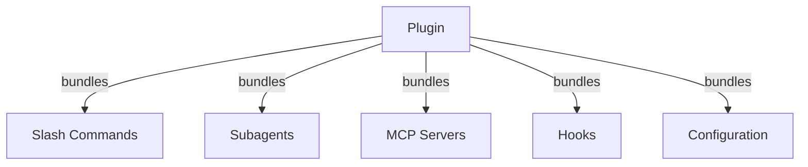
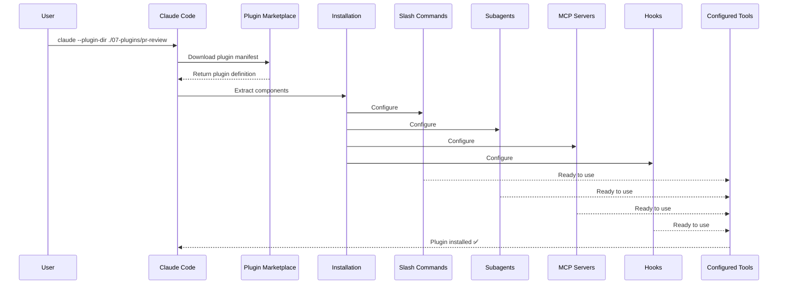
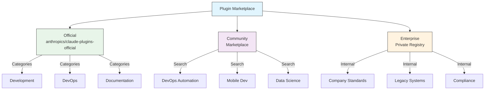
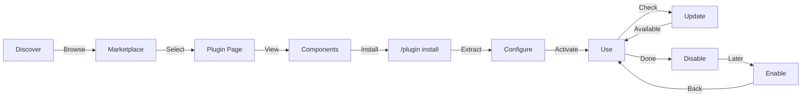
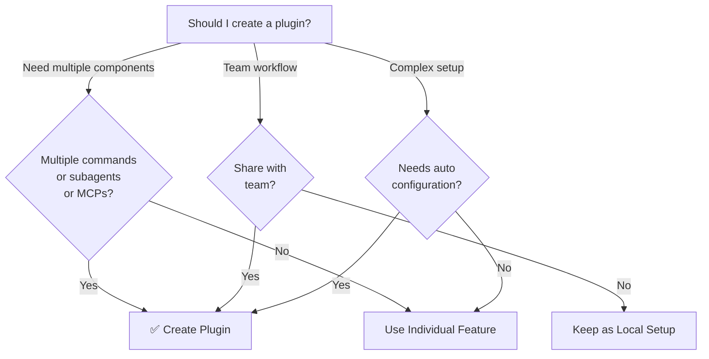

<!-- i18n-source: 07-plugins/README.md -->
<!-- i18n-source-sha: 188f468 -->
<!-- i18n-status: translated -->
<!-- i18n-date: 2026-10-26 -->

<picture>
  <source media="(prefers-color-scheme: dark)" srcset="../resources/logos/claude-howto-logo-dark.svg">
  
</picture>

# Claude Code 플러그인

이 폴더에는 여러 Claude Code 기능을 하나의 일관된 설치 가능 패키지로 묶은 완성형 플러그인 예제가 들어 있습니다.

## 개요

Claude Code 플러그인은 슬래시 커맨드, 서브에이전트, MCP 서버, 훅 같은 커스터마이징을 한 번의 명령으로 설치하는 묶음입니다. 여러 기능을 일관성 있고 공유 가능한 패키지로 결합한, 가장 상위 수준의 확장 메커니즘입니다.

## 플러그인 아키텍처



## 플러그인 로딩 과정



> **마켓플레이스 불필요 (v2.1.157+)**: 이제 `.claude/skills` 디렉터리에 둔 플러그인은 마켓플레이스 없이 자동으로 로드됩니다. `claude plugin init <name>`으로 새 플러그인의 뼈대를 만들면 `~/.claude/skills/<name>/`(사용자 전역)에 생성되고, 다음 세션에서 `<name>@skills-dir`로 자동 로드됩니다.

## 플러그인 유형 및 배포

| 유형 | 범위 | 공유 | 관리 주체 | 예시 |
|------|-------|--------|-----------|----------|
| 공식 | 전역 | 모든 사용자 | Anthropic | PR Review, Security Guidance |
| 커뮤니티 | 공개 | 모든 사용자 | 커뮤니티 | DevOps, Data Science |
| 조직 | 내부 | 팀 구성원 | 회사 | 내부 표준, 도구 |
| 개인 | 개인 | 단일 사용자 | 개발자 | 사용자 정의 워크플로 |

## 플러그인 정의 구조

플러그인 매니페스트는 `.claude-plugin/plugin.json`에 JSON 형식으로 작성합니다:

```json
{
  "name": "my-first-plugin",
  "description": "A greeting plugin",
  "version": "1.0.0",
  "author": {
    "name": "Your Name"
  },
  "homepage": "https://example.com",
  "repository": "https://github.com/user/repo",
  "license": "MIT"
}
```

이러한 식별 필드 외에도, 매니페스트는 기본 폴더가 아닌 위치에 있는 컴포넌트를 Claude Code에 지정할 수 있고, 탐색용 메타데이터와 의존성 메타데이터를 담을 수 있습니다:

| 필드 | 유형 | 설명 |
|-------|------|-------------|
| `workflows` | string \| array | 사용자 정의 [워크플로](https://code.claude.com/docs/en/workflows) 스크립트 파일 또는 디렉터리(기본 `workflows/`를 대체) |
| `outputStyles` | string \| array | 사용자 정의 출력 스타일 파일 또는 디렉터리(기본 `output-styles/`를 대체) |
| `lspServers` | string \| array \| object | 코드 인텔리전스용 LSP 서버 — 정의로 이동, 참조 찾기, 진단. 일반적으로 `"./.lsp.json"`. [LSP 서버 구성](#lsp-서버-구성) 참고 |
| `channels` | array | 메시지 주입용 채널 선언(Telegram, Slack, Discord 방식) |
| `dependencies` | array | 이 플러그인이 요구하는 다른 플러그인. 선택적으로 semver 버전 제약을 붙일 수 있습니다 |
| `keywords` | array | 마켓플레이스를 탐색하고 검색할 때 사용하는 검색 태그 |
| `metadata` | object | 권한 부여나 카탈로그 필드처럼 직접 정의한 데이터를 담는 자유 형식 객체 |
| `experimental.themes` | string \| array | 색상 테마 파일 또는 디렉터리(기본 `themes/`를 대체) |
| `experimental.monitors` | string \| array | 플러그인이 활성화되면 자동으로 시작되는 [백그라운드 모니터](#백그라운드-모니터-v21105) 구성 |

## 플러그인 구조 예시

```
my-plugin/
├── .claude-plugin/
│   └── plugin.json       # Manifest (name, description, version, author)
├── commands/             # Skills as Markdown files
│   ├── task-1.md
│   ├── task-2.md
│   └── workflows/
├── agents/               # Custom agent definitions
│   ├── specialist-1.md
│   ├── specialist-2.md
│   └── configs/
├── skills/               # Agent Skills with SKILL.md files
│   ├── skill-1/
│   │   └── SKILL.md
│   └── skill-2/
│       └── SKILL.md
├── hooks/                # Event handlers in hooks.json
│   └── hooks.json
├── .mcp.json             # MCP server configurations
├── .lsp.json             # LSP server configurations for code intelligence
├── bin/                  # Executables added to Bash tool's PATH while plugin is enabled (the PowerShell tool finds them too, v2.1.302)
├── settings.json         # Default settings applied when plugin is enabled (only the `agent` and `subagentStatusLine` keys take effect)
├── themes/               # Optional: ship custom Claude Code themes (v2.1.118+)
├── templates/
│   └── issue-template.md
├── scripts/
│   ├── helper-1.sh
│   └── helper-2.py
├── docs/
│   ├── README.md
│   └── USAGE.md
└── tests/
    └── plugin.test.js
```

> **참고**: `commands/`는 **레거시**입니다. 공식 지침은 *"새 플러그인에는 `skills/`를 사용하세요."*입니다. 기존 `commands/` 디렉터리는 계속 동작하며(이 모듈의 예제 플러그인 세 개도 이를 포함합니다), 새 플러그인은 평면 Markdown 커맨드 파일 대신 기능을 `skills/` 아래 `SKILL.md` 디렉터리로 두는 것이 좋습니다.

### LSP 서버 구성

플러그인은 실시간 코드 인텔리전스를 위한 LSP(Language Server Protocol) 지원을 포함할 수 있습니다. LSP 서버는 작업하는 동안 진단, 코드 탐색, 심볼 정보를 제공합니다.

**구성 위치**:
- 플러그인 루트 디렉터리의 `.lsp.json` 파일
- `plugin.json`의 `lspServers` 키 — 공식 매니페스트 필드명입니다. 문자열, 배열, 객체를 받습니다. 문자열이나 배열은 LSP 구성 파일 또는 디렉터리를 가리키고(예: `"./.lsp.json"`), 객체는 서버를 인라인으로 선언합니다.

#### 필드 레퍼런스

| 필드 | 필수 | 설명 |
|-------|----------|-------------|
| `command` | 예 | LSP 서버 바이너리(PATH에 있어야 함) |
| `extensionToLanguage` | 예 | 파일 확장자를 언어 ID에 매핑 |
| `args` | 아니요 | 서버 실행 인자 |
| `transport` | 아니요 | 통신 방식: `stdio`(기본) 또는 `socket` |
| `env` | 아니요 | 서버 프로세스용 환경변수 |
| `initializationOptions` | 아니요 | LSP 초기화 시 전달되는 옵션 |
| `settings` | 아니요 | 서버에 전달되는 워크스페이스 구성 |
| `workspaceFolder` | 아니요 | 워크스페이스 폴더 경로 재정의 |
| `startupTimeout` | 아니요 | 서버 시작을 기다리는 최대 시간(ms) |
| `shutdownTimeout` | 아니요 | 정상 종료에 허용되는 최대 시간(ms) |
| `restartOnCrash` | 아니요 | 서버가 비정상 종료되면 자동 재시작 |
| `maxRestarts` | 아니요 | 포기하기 전 최대 재시작 시도 횟수 |

#### 구성 예시

**Go (gopls)**:

```json
{
  "go": {
    "command": "gopls",
    "args": ["serve"],
    "extensionToLanguage": {
      ".go": "go"
    }
  }
}
```

**Python (pyright)**:

```json
{
  "python": {
    "command": "pyright-langserver",
    "args": ["--stdio"],
    "extensionToLanguage": {
      ".py": "python",
      ".pyi": "python"
    }
  }
}
```

**TypeScript**:

```json
{
  "typescript": {
    "command": "typescript-language-server",
    "args": ["--stdio"],
    "extensionToLanguage": {
      ".ts": "typescript",
      ".tsx": "typescriptreact",
      ".js": "javascript",
      ".jsx": "javascriptreact"
    }
  }
}
```

#### 사용 가능한 LSP 플러그인

공식 마켓플레이스에는 미리 구성된 LSP 플러그인이 있습니다:

| 플러그인 | 언어 | 서버 바이너리 | 설치 명령 |
|--------|----------|---------------|----------------|
| `pyright-lsp` | Python | `pyright-langserver` | `pip install pyright` |
| `typescript-lsp` | TypeScript/JavaScript | `typescript-language-server` | `npm install -g typescript-language-server typescript` |
| `rust-analyzer-lsp` | Rust | `rust-analyzer` | `rustup component add rust-analyzer`로 설치 |

#### LSP 기능

구성하면 LSP 서버가 다음을 제공합니다:

- **즉시 진단** — 편집 직후 오류와 경고가 표시됩니다
- **코드 탐색** — 정의로 이동, 참조 찾기, 구현 찾기
- **호버 정보** — 호버 시 타입 시그니처와 문서 표시
- **심볼 목록** — 현재 파일이나 워크스페이스의 심볼 탐색

### `PATH`의 `bin/` 디렉터리

플러그인이 활성화되면 해당 플러그인의 `bin/` 디렉터리가 세션의 `PATH`에 추가됩니다. 위치는 사용자 자신의 `PATH` 항목 뒤이므로 플러그인이 `git`, `ls` 같은 시스템 명령을 가로챌 수 없습니다. 이곳에 포함된 실행 파일은 경로를 지정하지 않고 이름만으로 Bash 도구에서 바로 호출할 수 있습니다(PowerShell 도구도 찾을 수 있습니다, v2.1.302).

```bash
# In a plugin layout:
my-plugin/
├── .claude-plugin/
│   └── plugin.json
└── bin/
    └── my-tool          # executable file (chmod +x)

# Inside a Claude Code session with the plugin enabled:
$ my-tool --help
```

같은 플러그인 안의 훅, 스킬, 커맨드가 셸로 호출할 CLI 헬퍼에 사용하세요. 플러그인 저장소에서 파일에 실행 권한을 표시하고(`chmod +x`) — git이 이 비트를 보존합니다.

## 플러그인 옵션 (v2.1.83+)

플러그인은 매니페스트에서 `userConfig`로 사용자가 구성할 수 있는 옵션을 선언할 수 있습니다. `sensitive: true`로 표시된 값은 평문 설정 파일이 아니라 시스템 키체인에 저장됩니다:

```json
{
  "name": "my-plugin",
  "version": "1.0.0",
  "userConfig": {
    "apiKey": {
      "type": "string",
      "title": "API key",
      "description": "API key for the service",
      "sensitive": true
    },
    "region": {
      "type": "string",
      "title": "Region",
      "description": "Deployment region",
      "default": "us-east-1"
    }
  }
}
```

## 영구 플러그인 데이터 (`${CLAUDE_PLUGIN_DATA}`) (v2.1.78+)

플러그인은 `${CLAUDE_PLUGIN_DATA}` 환경변수로 영구 상태 디렉터리에 접근할 수 있습니다. 이 디렉터리는 플러그인마다 고유하고 세션이 바뀌어도 유지되므로 캐시, 데이터베이스, 기타 영구 상태에 적합합니다:

```json
{
  "hooks": {
    "PostToolUse": [
      {
        "matcher": "*",
        "hooks": [
          {
            "type": "command",
            "command": "node \"${CLAUDE_PLUGIN_ROOT}\"/scripts/track-usage.js \"${CLAUDE_PLUGIN_DATA}\"/usage.json"
          }
        ]
      }
    ]
  }
}
```

디렉터리(`~/.claude/plugins/data/<id>/`)는 처음 참조될 때 생성되고 플러그인 업데이트 후에도 유지됩니다. 플러그인이 설치된 마지막 위치에서 플러그인을 제거하면 삭제됩니다(`--keep-data`를 전달하지 않은 경우).

### 백그라운드 모니터 (v2.1.105)

플러그인은 세션이 시작될 때 또는 플러그인의 스킬이 처음 실행될 때 시작되는 백그라운드 모니터를 등록할 수 있습니다. `plugin.json`의 `experimental.monitors`(또는 `monitors/monitors.json`)에 선언하세요:

```json
{
  "name": "my-plugin",
  "version": "1.0.0",
  "experimental": {
    "monitors": [
      {
        "name": "app-log",
        "command": "tail -f /var/log/app.log",
        "description": "Application log errors",
        "when": "always"
      }
    ]
  }
}
```

`name`, `command`, `description`은 필수입니다. `when`은 다음 값을 받습니다:
- `"always"`(기본값) — 세션 시작 시와 플러그인 재로드 시 시작
- `"on-skill-invoke:<skill>"` — 해당 스킬이 처음 실행될 때 시작

알 수 없는 키는 거부되며 플러그인이 로드되지 않습니다. 최상위 `monitors` 키는 여전히 로드되지만 `claude plugin validate`가 경고합니다.

모니터는 내부적으로 동일한 Monitor 도구를 사용하며, stdout 라인을 Claude가 반응할 수 있는 이벤트로 스트리밍합니다.

## 설정 파일 인라인 플러그인 (`source: 'settings'`) (v2.1.80+)

플러그인은 `source: 'settings'` 필드를 사용해 설정 파일에 마켓플레이스 항목으로 인라인 정의할 수 있습니다. 이렇게 하면 별도의 저장소나 마켓플레이스 없이 플러그인 정의를 직접 넣을 수 있습니다. `extraKnownMarketplaces.<name>.source` 아래에 선언하며, `name`은 마켓플레이스 키와 일치해야 하고 해당 플러그인들은 GitHub나 npm 같은 외부 소스를 참조해야 합니다(상대 경로는 거부됩니다):

```json
{
  "extraKnownMarketplaces": {
    "inline-tools": {
      "source": {
        "source": "settings",
        "name": "inline-tools",
        "plugins": [
          {
            "name": "quick-lint",
            "source": {
              "source": "github",
              "repo": "my-org/quick-lint"
            }
          }
        ]
      }
    }
  }
}
```

## 모드(Mods) (v2.1.287+)

모드(mod)는 Claude Code의 겉모습과 동작을 바꾸는 플러그인입니다. 코드는 JavaScript 또는 TypeScript 훅 모듈, 즉 도구 호출, 프롬프트 제출, 인터페이스의 일부 그리기 같은 일이 발생할 때 Claude Code가 호출하는 이벤트 핸들러입니다. 각 핸들러는 이벤트를 관찰하거나, 다시 쓰거나, 직접 응답할 수 있습니다. 모드는 다른 플러그인과 똑같이 설치하고(`/plugin install <plugin>@<marketplace>`), 스킬·MCP 서버와 함께 같은 플러그인에 포함할 수 있으며, 사용자의 권한으로 실행됩니다. 따라서 신뢰하는 작성자와 마켓플레이스의 모드만 설치하세요. 모드는 Claude Code CLI(v2.1.287+), Claude Desktop 앱의 Code 탭, VS Code 확장에서 동작합니다.

| 모드가 할 수 있는 일 | 예시 |
|-------------------|---------|
| 프롬프트 위에 밴드와 패널 그리기 | 트랜스크립트 옆 패널이나 프롬프트 위 밴드에 탭, 버튼, 텍스트 필드 배치 |
| 커맨드 추가 | Claude 턴 없이 곧바로 지정한 함수를 실행하는 `/command`. Claude가 작업 중일 때도 동작 |
| 도구 호출 보호·변경 | 사용자에게 질문하는 동안 도구 호출을 보류하거나, 거부하거나, 도구를 실행하지 않고 대신 응답 |
| 이벤트에 반응 | 도구 호출, 프롬프트, 턴을 추적합니다. 모드의 훅은 변수를 공유하므로 하나가 도구 호출 수를 세고 다른 하나가 그 수를 스피너 옆에 표시할 수 있습니다 |
| mods API 호출 | 모델 호출, 파일 읽기·쓰기, 프로세스 시작, 네트워크 요청(훅은 mods API를 통해서만 이런 작업을 할 수 있습니다) |

모드를 만들려면 Claude Code 세션에서 원하는 것을 설명하세요. Claude는 내장 `plugin-authoring` 스킬을 기반으로 작업하고(`/plugin-authoring`을 직접 실행해도 됩니다), 모드를 작성하며, 세션에 핫 리로드를 켜 두면 모드를 변경한 각 턴이 끝날 때 다시 로드합니다. `claude plugin validate`는 모드를 실행하지 않고 검사합니다. 관리자는 관리형 설정으로 모드 실행 여부와 실행할 모드를 정합니다. 예를 들어 `allowManagedModsOnly`를 설정하면 조직의 모드와 Claude Code에 내장된 모드만 훅을 실행할 수 있습니다.

> **참고**: v2.1.299–2.1.300에서 `Text` props `size`, `weight`, `mono`, `tabular`, `dir`(RTL)이 추가되었고(`bold`는 `weight`로 대체되어 폐기 예정), `Box` 간격 단계 `xs`–`xl`, 프롬프트 `virtualText`, `$.ui.view({ agentId })`, `prompt.change` 훅이 추가되었습니다. v2.1.301에서는 여러 줄 필드를 위한 `Input` `rows`가 추가되었습니다(Enter는 제출, Shift+Enter는 줄바꿈).

> **참고**: 공식 [모드 개요](https://code.claude.com/docs/en/plugins/mods/overview), [모드 만들기](https://code.claude.com/docs/en/plugins/mods/create), [모드 레퍼런스](https://code.claude.com/docs/en/plugins/mods/reference)를 참고하세요.

## 플러그인 설정

플러그인은 기본 구성을 제공하기 위해 `settings.json` 파일을 포함할 수 있습니다. `agent`와 `subagentStatusLine` 두 키만 적용되고 나머지 키는 무시됩니다. `agent`는 플러그인 에이전트 중 하나의 이름을 받아 그 에이전트를 메인 스레드로 실행합니다:

```json
{
  "agent": "specialist-1"
}
```

플러그인이 `settings.json`을 포함하면 설치 시 기본값이 적용됩니다. 사용자는 자신의 프로젝트 또는 사용자 구성에서 이 설정을 재정의할 수 있습니다.

## 단독 사용과 플러그인 방식 비교

| 방식 | 커맨드 이름 | 구성 | 적합한 용도 |
|----------|---------------|---|---|
| **단독** | `/hello` | `CLAUDE.md`에 수동 설정 | 개인용, 프로젝트 특화 |
| **플러그인** | `/plugin-name:hello` | `plugin.json`으로 자동화 | 공유, 배포, 팀 사용 |

간단한 개인 워크플로에는 **단독 슬래시 커맨드**를 사용하세요. 여러 기능을 묶거나, 팀과 공유하거나, 배포용으로 게시하려면 **플러그인**을 사용하세요.

> **공백 호출 (v2.1.136+)**: 플러그인 슬래시 커맨드는 공백으로도 동작합니다. `/myplugin review`는 정규 형식인 `/myplugin:review`로 해석됩니다. 어느 형식이든 괜찮지만, 콜론 형식이 정규이며 스크립트에서는 이 형식을 권장합니다.

> **`skills/` 탐색 (v2.1.136+)**: 이제 `plugin.json`의 `skills` 항목이 플러그인의 기본 `skills/` 디렉터리를 가리지 않습니다. 두 곳에 선언된 스킬은 병합되므로 `plugin.json`에 몇 개의 대표 스킬만 나열해도 나머지가 사라지지 않습니다.

> **루트 `SKILL.md` 플러그인 (v2.1.142+)**: 최상위에 `SKILL.md`가 있고 **`skills/` 하위 디렉터리가 없는** 플러그인은 그 자체로 단일 스킬로 노출됩니다. 즉 플러그인*이* 스킬입니다. 이는 추가 패턴이며 `skills/` 디렉터리나 `plugin.json`의 `skills` 항목을 대체하지 않습니다. 디렉터리 구조가 이점을 주지 않는 작은 단일 스킬 플러그인에 사용하세요.

## 실전 예제

### 예제 1: PR 리뷰 플러그인

**파일:** `.claude-plugin/plugin.json`

```json
{
  "name": "pr-review",
  "version": "1.0.0",
  "description": "Complete PR review workflow with security, testing, and docs",
  "author": {
    "name": "Anthropic"
  },
  "repository": "https://github.com/your-org/pr-review",
  "license": "MIT"
}
```

**파일:** `commands/review-pr.md`

```markdown
---
name: Review PR
description: Start comprehensive PR review with security and testing checks
---

# PR Review

This command initiates a complete pull request review including:

1. Security analysis
2. Test coverage verification
3. Documentation updates
4. Code quality checks
5. Performance impact assessment
```

**파일:** `agents/security-reviewer.md`

```yaml
---
name: security-reviewer
description: Security-focused code review
tools: Read, Grep, Bash
---

# Security Reviewer

Specializes in finding security vulnerabilities:
- Authentication/authorization issues
- Data exposure
- Injection attacks
- Secure configuration
```

**설치:**

```bash
claude --plugin-dir ./07-plugins/pr-review

# Result:
# ✅ 3 slash commands installed
# ✅ 3 subagents configured
# ✅ 2 MCP servers connected
# ✅ 4 hooks registered
# ✅ Ready to use!
```

### 예제 2: DevOps 플러그인

**구성 요소:**

```
devops-automation/
├── commands/
│   ├── deploy.md
│   ├── rollback.md
│   ├── status.md
│   └── incident.md
├── agents/
│   ├── deployment-specialist.md
│   ├── incident-commander.md
│   └── alert-analyzer.md
├── mcp/
│   └── kubernetes-config.json
├── hooks/
│   ├── pre-deploy.js
│   └── post-deploy.js
└── scripts/
    ├── deploy.sh
    ├── rollback.sh
    └── health-check.sh
```

### 예제 3: 문서화 플러그인

**포함된 구성 요소:**

```
documentation/
├── commands/
│   ├── generate-api-docs.md
│   ├── generate-readme.md
│   ├── sync-docs.md
│   └── validate-docs.md
├── agents/
│   ├── api-documenter.md
│   ├── code-commentator.md
│   └── example-generator.md
├── mcp/
│   └── github-docs-config.json
└── templates/
    ├── api-endpoint.md
    ├── function-docs.md
    └── adr-template.md
```

## 플러그인 마켓플레이스

Anthropic이 관리하는 공식 플러그인 디렉터리는 `anthropics/claude-plugins-official`이며, 첫 대화형 실행 시 자동으로 등록됩니다. 엔터프라이즈 관리자는 내부 배포용 비공개 플러그인 마켓플레이스도 만들 수 있습니다.

**커뮤니티 마켓플레이스** `anthropics/claude-plugins-community`도 있습니다. Anthropic의 자동 검증과 안전성 심사를 통과한 서드파티 플러그인을 호스팅하며, 카탈로그의 각 항목은 특정 커밋 SHA에 고정되어 있습니다. 공식 마켓플레이스와 달리 직접 추가해야 합니다:

```bash
/plugin marketplace add anthropics/claude-plugins-community

# Then install from it using the claude-community marketplace name
/plugin install <plugin-name>@claude-community
```



### 마켓플레이스 구성

엔터프라이즈 및 고급 사용자는 설정으로 마켓플레이스 동작을 제어할 수 있습니다:

| 설정 | 설명 |
|---------|-------------|
| `extraKnownMarketplaces` | 기본값 외에 추가 마켓플레이스 소스를 추가 |
| `strictKnownMarketplaces` | 사용자가 추가할 수 있는 마켓플레이스를 제어(관리형 전용) |
| `blockedMarketplaces` | 관리자가 관리하는 마켓플레이스 차단 목록(v2.1.119부터 `hostPattern` / `pathPattern` 정규식 필드 지원) |
| `enabledPlugins` (`false`로 설정) | 특정 플러그인 차단: 관리형 설정의 `"enabledPlugins": { "<plugin>@<marketplace>": false }`는 모든 범위에서 설치를 차단하고 마켓플레이스에서도 숨깁니다 |

> **친화적인 별칭 (v2.1.232)**: `additionalMarketplaces`는
> `extraKnownMarketplaces`의 별칭으로, `allowedMarketplaces`는 `strictKnownMarketplaces`의 별칭으로 허용됩니다.
> 공식 설정 레퍼런스는 둘 다
> [Marketplace key aliases](https://code.claude.com/docs/en/settings-reference#marketplace-key-aliases) 항목에 정리해 두었습니다.
> 이전 버전은 별칭을 무시하므로 정규 키를 계속 사용해도 안전합니다.

> **소유자 와일드카드 (v2.1.223+)**: `"owner/*"` 항목은 한 GitHub 소유자 아래의 모든 마켓플레이스
> 저장소를 허용하거나 차단합니다. **`strictKnownMarketplaces`와 `blockedMarketplaces`에서만 허용됩니다.**
> `github` 소스가 나타나는 다른 모든 곳(`extraKnownMarketplaces`와 `/plugin marketplace add` 포함)에서는
> `repo` 값이 단일 저장소를 지정해야 합니다.

> **강제 적용** (v2.1.117+): `blockedMarketplaces`와 `strictKnownMarketplaces`는 최초 추가 시점만이 아니라 모든 플러그인 수명 주기 이벤트(설치, 업데이트, 새로고침, 자동 업데이트)에서 적용됩니다. `strictKnownMarketplaces`는 관리형 전용입니다.

host/path 정규식을 사용한 `blockedMarketplaces` 예시(v2.1.119):

```json
{
  "blockedMarketplaces": [
    { "source": "hostPattern", "hostPattern": "^evil\\.example\\.com$" },
    { "source": "pathPattern", "pathPattern": "^/opt/approved/" }
  ]
}
```

#### 마켓플레이스 `headersHelper` (v2.1.238)

`url` 마켓플레이스 또는 개별 카탈로그 항목은 카탈로그와 동일 출처 아카이브를 가져올 때 사용할 HTTP 헤더를 발급하는 `headersHelper` 명령을 지정할 수 있습니다. 토큰 발급 서비스 뒤에 있는 비공개 마켓플레이스가 구성에 정적 비밀을 두지 않고 인증하는 방식입니다.

**카탈로그 항목의** 헬퍼는 설치 또는 업데이트 시에만, 그리고 실행할 명령이 사용자에게 표시된 뒤에만 실행됩니다. `claude plugin install`과 `claude plugin update`는 실행 전에 `[y/N]`을 묻습니다. 자동화에서는 `-y`를 전달해 확인 없이 수락하세요.

### 추가 마켓플레이스 기능

- **마켓플레이스 검색창 (v2.1.172)**: `/plugin`에서 마켓플레이스의 플러그인을 탐색할 때 검색창으로 이름이나 키워드 기준 필터링을 할 수 있습니다. 전체 목록을 스크롤하기 느린 대형 마켓플레이스에서 유용합니다.
- **기본 git 타임아웃**: 대형 플러그인 저장소를 위해 30초에서 120초로 늘어났습니다
- **사용자 정의 npm 레지스트리**: 플러그인이 의존성 해석을 위해 사용자 정의 npm 레지스트리 URL을 지정할 수 있습니다
- **버전 고정**: 재현 가능한 환경을 위해 플러그인을 특정 버전에 고정할 수 있습니다
- **탐색 창의 예상 컨텍스트 비용 (v2.1.143)**: `/plugin` 마켓플레이스 브라우저는 플러그인별 예상 턴당 컨텍스트 토큰 비용, 즉 항상 로드되는 스킬·훅·MCP 서버 디스크립터의 합계를 표시합니다. 설치 전에 플러그인 도입 규모를 가늠하는 데 사용하세요. 설치 후에도 [`claude plugin details <name>`](#claude-plugin-details-name-v21139)으로 같은 예상치를 확인할 수 있습니다.

비용 열이 포함된 탐색 행 예시:

```text
NAME              VERSION   AUTHOR     CTX/TURN   DESCRIPTION
code-reviewer     1.2.0     anthropic  +1,420     Multi-agent PR review
devops-toolkit    0.4.1     acme       +3,180     SRE playbooks, on-call helpers
docs-helper       0.9.0     community  +610       Doc-style guide enforcement
```

### 마켓플레이스 정의 스키마

플러그인 마켓플레이스는 `.claude-plugin/marketplace.json`에 정의합니다:

```json
{
  "name": "my-team-plugins",
  "owner": { "name": "my-org" },
  "plugins": [
    {
      "name": "code-standards",
      "source": "./plugins/code-standards",
      "description": "Enforce team coding standards",
      "version": "1.2.0",
      "author": { "name": "platform-team" }
    },
    {
      "name": "deploy-helper",
      "source": {
        "source": "github",
        "repo": "my-org/deploy-helper",
        "ref": "v2.0.0"
      },
      "description": "Deployment automation workflows"
    }
  ]
}
```

| 필드 | 필수 | 설명 |
|-------|----------|-------------|
| `name` | 예 | kebab-case 마켓플레이스 이름 |
| `owner` | 예 | 마켓플레이스를 유지 관리하는 조직 또는 사용자: `name`이 필수인 객체(`email`, `url`은 선택) |
| `plugins` | 예 | 플러그인 항목 배열 |
| `plugins[].name` | 예 | 플러그인 이름(kebab-case) |
| `plugins[].source` | 예 | 플러그인 소스(경로 문자열 또는 소스 객체) |
| `plugins[].description` | 아니요 | 간단한 플러그인 설명 |
| `plugins[].version` | 아니요 | 시맨틱 버전 문자열 |
| `plugins[].author` | 아니요 | 플러그인 작성자: `name`이 필수인 객체(`email`, `url`은 선택) |
| `renames` | 아니요 | 항목별이 아닌 최상위 마켓플레이스 필드: 이전 플러그인 `name`을 현재 이름(제거된 경우 `null`)에 매핑해 사용자가 자동으로 이전하도록 합니다 (v2.1.193) |
| `plugins[].displayName` | 아니요 | UI에 표시되는 사람이 읽을 수 있는 이름. 조회에는 사용되지 않습니다 (v2.1.143) |
| `plugins[].defaultEnabled` | 아니요 | `false`이면 사용자가 옵트인할 때까지 플러그인이 비활성 상태로 설치됩니다 (v2.1.154) |

### 플러그인 소스 유형

플러그인은 여러 위치에서 가져올 수 있습니다:

| 소스 | 문법 | 예시 |
|--------|--------|---------|
| **상대 경로** | 문자열 경로 | `"./plugins/my-plugin"` |
| **GitHub** | `{ "source": "github", "repo": "owner/repo" }` | `{ "source": "github", "repo": "acme/lint-plugin", "ref": "v1.0" }` |
| **Git URL** | `{ "source": "url", "url": "..." }` | `{ "source": "url", "url": "https://git.internal/plugin.git" }` |
| **Git 하위 디렉터리** | `{ "source": "git-subdir", "url": "...", "path": "..." }` | `{ "source": "git-subdir", "url": "https://github.com/org/monorepo.git", "path": "packages/plugin" }` |
| **npm** | `{ "source": "npm", "package": "..." }` | `{ "source": "npm", "package": "@acme/claude-plugin", "version": "^2.0" }` |
| **아카이브** (v2.1.224+) | `{ "source": "archive", "url": "..." }` | `{ "source": "archive", "url": "https://cdn.example.com/lint-plugin-1.2.0.zip", "sha256": "…" }` |
| **커맨드** (v2.1.229+) | `{ "source": "command", "command": "..." }` | `{ "source": "command", "command": "acme-plugin-resolver --print-dir" }` |

GitHub 및 git 소스는 버전 고정을 위한 선택 필드 `ref`(브랜치/태그)와 `sha`(커밋 해시)를 지원합니다.

**소스 이름만 사용하기와 `metadata.pluginRoot` (v2.1.239)**: 이제 마켓플레이스의 `metadata.pluginRoot`가 적용됩니다. 카탈로그에서 소스 이름만 적은 플러그인은 해당 루트 아래 디렉터리로 해석되므로, 항목마다 전체 상대 경로를 적지 않아도 됩니다.

**claude.ai에서 동기화된 스킬 (v2.1.239)**: claude.ai에서 내려온 플러그인은 `name@synced`로 나타납니다. `claude plugin enable <name>@synced`와 `claude plugin disable <name>@synced`에서 그렇게 지정하세요. 동기화된 플러그인은 같은 이름의 설치된 플러그인을 절대 덮어쓰지 않습니다. 둘은 공존하며 `@synced` 접미사로 구분됩니다.

#### `archive` 소스 (v2.1.224+)

HTTPS로 zip에서 플러그인을 설치합니다. git clone도, npm install도 필요 없습니다.

```json
{
  "source": "archive",
  "url": "https://cdn.example.com/lint-plugin-1.2.0.zip",
  "sha256": "3b1f0c2e9a7d4f5b8c6e1a2d3f4b5c6d7e8f9a0b1c2d3e4f5a6b7c8d9e0f1a2b"
}
```

| 필드 | 필수 | 비고 |
|-------|----------|-------|
| `url` | 예 | **HTTPS 전용.** `http://`, 루프백, 링크 로컬, 클라우드 메타데이터 호스트는 거부되며 **모든 리디렉션 홉**에서 다시 검사합니다. 따라서 리디렉션으로 차단된 호스트에 접근할 수 없습니다 |
| `sha256` | 아니요 | 64자리 16진수. 값이 다르면 `Plugin archive integrity check failed`와 함께 설치가 실패합니다 |

아카이브 크기 상한은 **256 MiB**입니다. 직접 빌드하지 않은 아카이브에는 `sha256`을 고정하세요. 이 값이 없으면 URL을 통제하는 쪽이 세션에서 실행되는 코드를 통제하게 됩니다.

#### `command` 소스 (v2.1.229+)

로컬에 설치된 도구가 플러그인 위치를 결정하게 합니다. 내부 패키지 관리자가 이미 플러그인을 가져오고 배치하는 방법을 알고 있을 때 유용합니다.

```json
{
  "source": "command",
  "command": "acme-plugin-resolver --print-dir",
  "timeout": 60,
  "mode": "copy"
}
```

규약은 엄격합니다. **명령은 stdout에 정확히 한 줄만 출력하고 코드 0으로 종료해야 합니다.** 그 줄은 완전한 플러그인을 담은 디렉터리의 절대 경로입니다.

| 필드 | 필수 | 기본값 | 비고 |
|-------|----------|---------|-------|
| `command` | 예 | — | 실행할 명령 |
| `timeout` | 아니요 | `60`(초) | 최대 600 |
| `mode` | 아니요 | `"copy"` | `"copy"`는 디렉터리를 스냅샷으로 복사하고, `"link"`는 심볼릭 링크하므로 편집이 바로 반영됩니다 |

명령은 세션마다 다시 해석되며 결과는 재시작 없이 적용됩니다. 조직은 `disableCommandPluginSources`로 이 소스 유형을 완전히 차단할 수 있습니다.

예약된 마켓플레이스 이름에 `first-party-plugins`와 `healthcare`가 포함되었습니다(v2.1.205). 이 이름은 공식 용도로 보류되며 사용자 정의 마켓플레이스가 사용할 수 없습니다.

### 배포 방법

**GitHub(권장)**:

```bash
# Users add your marketplace
/plugin marketplace add owner/repo-name
```

**기타 git 서비스**(전체 URL 필요):

```bash
/plugin marketplace add https://gitlab.com/org/marketplace-repo.git
```

`gitlab.com` 저장소 URL만 사용하는 형식(중첩 하위 그룹 포함)은 `github.com` URL과 같은 방식으로 클론됩니다(v2.1.232). **스킴은 필수입니다.** v2.1.196부터 `gitlab.example.com/team/plugins`처럼 스킴이 없는 형식은 잘못된 `owner/repo` 축약으로 거부되므로 `https://gitlab.com/company/plugins.git` 전체 형식을 사용하세요. v2.1.232는 GitLab 토큰 계열 비밀값 마스킹을 추가했고, `glab` CLI에 `gh`가 이미 갖고 있던 샌드박스와 자격 증명 경로 보호를 적용했습니다.

**비공개 저장소**: git 자격 증명 헬퍼나 환경변수 토큰으로 지원됩니다. 사용자는 저장소에 대한 읽기 권한이 있어야 합니다.

**디렉터리 제출**: 더 넓은 배포를 위해 [claude.ai/directory/manage](https://claude.ai/directory/manage) 개발자 포털에서 Anthropic 디렉터리에 플러그인을 제출하세요. Anthropic 공식 마켓플레이스인 `claude-plugins-official`은 디렉터리 포털을 통한 제출을 받지 않습니다.

### 마켓플레이스 관리

```bash
# Marketplace CLI commands
claude plugin marketplace add <source>       # Add marketplace (GitHub, URL, local)
claude plugin marketplace update [name]      # Refresh catalog index
claude plugin marketplace remove <name>      # Remove marketplace
claude plugin marketplace list               # List configured marketplaces
```

> **중요**: `marketplace update`는 플러그인 카탈로그(설치 가능한 항목)만 새로고침합니다. 설치된 플러그인은 업데이트하지 **않습니다**. 특정 설치된 플러그인을 업데이트하려면 `plugin update <name>`을 사용하세요.

### 스트릭트 모드

마켓플레이스 정의와 로컬 `plugin.json` 파일의 상호작용 방식을 제어합니다:

| 설정 | 동작 |
|---------|----------|
| `strict: true`(기본값) | 로컬 `plugin.json`이 우선이며 마켓플레이스 항목은 이를 보완합니다 |
| `strict: false` | 마켓플레이스 항목이 플러그인 정의 전체입니다 |

`strictKnownMarketplaces`를 사용한 **조직 제한**:

| 값 | 효과 |
|-------|--------|
| 설정하지 않음 | 제한 없음 — 사용자가 어떤 마켓플레이스든 추가할 수 있습니다 |
| 빈 배열 `[]` | 잠금 — 어떤 마켓플레이스도 허용되지 않습니다 |
| 소스 객체 배열 | 허용 목록 — 일치하는 마켓플레이스만 추가할 수 있습니다 |

```json
{
  "strictKnownMarketplaces": [
    { "source": "github", "repo": "my-org/*" },
    { "source": "github", "repo": "trusted-vendor/*" }
  ]
}
```

> **경고**: `strictKnownMarketplaces`와 함께 스트릭트 모드를 사용하면 사용자는 허용 목록에 있는 마켓플레이스의 플러그인만 설치할 수 있습니다. 통제된 플러그인 배포가 필요한 엔터프라이즈 환경에 유용합니다.

## 플러그인 설치 및 수명 주기



## 플러그인 기능 비교

| 기능 | 슬래시 커맨드 | 스킬 | 서브에이전트 | 플러그인 |
|---------|---------------|-------|----------|--------|
| **설치** | 수동 복사 | 수동 복사 | 수동 구성 | 명령 하나 |
| **설정 시간** | 5분 | 10분 | 15분 | 2분 |
| **묶음** | 단일 파일 | 단일 파일 | 단일 파일 | 여러 개 |
| **버전 관리** | 수동 | 수동 | 수동 | 자동 |
| **팀 공유** | 파일 복사 | 파일 복사 | 파일 복사 | 설치 ID |
| **업데이트** | 수동 | 수동 | 수동 | 자동 제공 |
| **의존성** | 없음 | 없음 | 없음 | 포함 가능 |
| **마켓플레이스** | 아니요 | 아니요 | 아니요 | 예 |
| **배포** | 저장소 | 저장소 | 저장소 | 마켓플레이스 |

## 플러그인 CLI 커맨드

모든 플러그인 작업은 CLI 커맨드로 사용할 수 있습니다:

```bash
claude plugin install <name>@<marketplace>   # Install from a marketplace
claude plugin uninstall <name>               # Remove a plugin
claude plugin update <name>                  # Update installed plugin to latest version
claude plugin list                           # List installed plugins
claude plugin enable <name>                  # Enable a disabled plugin
claude plugin disable <name>                 # Disable a plugin
claude plugin validate <path>                # Validate the plugin structure at <path>
claude plugin tag [path]                     # Create a {name}--v{version} release git tag (v2.1.118+)
claude plugin prune                          # Remove orphaned auto-installed plugin dependencies (v2.1.121+)
claude plugin uninstall <name> --prune       # Uninstall and cascade-clean orphaned dependencies (v2.1.121+)
claude plugin details <name>                 # Show inventory + projected per-turn token cost (v2.1.139+)
claude plugin configure <name>@<marketplace> # Show a plugin's options and which are unset; save values from stdin with --values-stdin (v2.1.285+)
claude plugin init <name>                    # Scaffold a new plugin (alias: claude plugin new)
```

**별칭**: `init`에 `claude plugin new`, `uninstall`에 `remove` / `rm`, `list`에 `ls`, `prune`에 `autoremove`.

**알아 둘 만한 플래그:**

| 커맨드 | 플래그 | 용도 |
|---------|------|---------|
| `plugin init` | `--with <components...>` | 특정 컴포넌트 폴더 생성: `skills`, `agents`, `hooks`, `mcp`, `lsp`, `output-style`, `channel` |
| `plugin init` | `-f`, `--force` | 기존 `.claude-plugin/` 디렉터리 덮어쓰기 |
| `plugin install` | `--config <key=value>` | 설치 시 `userConfig` 옵션 설정. v2.1.285부터 `<server>.<key>=<value>`는 번들된 `.mcpb` MCP 서버 자체 설정을 지정하므로 `/plugin` → Configure를 거치지 않고 서버가 시작됩니다 |
| `plugin install` | `-y`, `--yes` | 확인 프롬프트 없이 명령 수락 |
| `plugin list` | `--available` | 마켓플레이스에서 사용 가능한 플러그인도 함께 표시(`--json` 필요) |
| `plugin tag` | `--push` | 태그 생성 후 원격에 푸시 |
| `plugin tag` | `--dry-run` | 태그를 만들지 않고 어떤 태그가 생성될지 출력 |
| `plugin validate` | `--strict` | 경고를 오류로 처리 |
| `plugin validate` | `--json` | 기계 판독 가능한 검증 보고서 출력 (v2.1.259+) |

`claude plugin validate`는 `.mcp.json` 항목도 검사하며(v2.1.281+), `outputStyles`, `themes`, `monitors`, `lspServers` 경로가 없거나 플러그인 디렉터리 밖을 가리키면 실패합니다(v2.1.283+).

예: `claude plugin tag ./my-plugin`은 버전 문자열이 아니라 플러그인 **경로**를 받습니다. `plugin.json`에서 도출한 `{name}--v{version}` git 태그를 만들고, `plugin.json`과 상위 마켓플레이스 항목이 일치하는지 검증합니다. 배포용 플러그인 릴리스를 끊는 권장 방법입니다.

`claude plugin prune`은 자체 의존성을 끌어온 마켓플레이스 플러그인을 설치하거나 제거한 뒤 유용합니다. 부모 플러그인이 그사이 제거된 자동 설치 플러그인을 정리합니다. `plugin uninstall --prune`은 같은 연쇄 정리를 한 단계로 수행합니다.

> **의존성 강제 (v2.1.143)**: 다른 활성화된 플러그인이 대상에 의존하고 있으면 `claude plugin disable <name>`은 **거부**합니다(의존성 그래프가 깨지기 때문). `claude plugin enable <name>`은 확인 프롬프트 한 번 후 **전이 의존성을 강제 활성화**하므로 각각을 따로 활성화할 필요가 없습니다. 의존 대상이 나중에 제거된 의존성을 정리하려면 `claude plugin prune`을 사용하세요.

### `claude plugin details <name>` (v2.1.139+)

`claude plugin details <name>`은 플러그인의 전체 컴포넌트 목록(스킬, 훅, MCP 서버, LSP 서버, 백그라운드 모니터, 슬래시 커맨드)과 **예상 턴당(및 호출당) 토큰 비용**을 출력합니다. 특히 컨텍스트가 제한된 모델에서 플러그인을 도입하기 전에 규모를 가늠하는 데 사용하세요.

출력 예시(축약):

```text
plugin: code-reviewer (1.2.0)
skills:        3      hooks: 2      mcp: 1      lsp: 0      monitors: 0
commands:      /review, /security-review
projected ctx: +1,420 tokens per turn  ·  +9,800 tokens per /review invocation
```

LSP 서버는 v2.1.142에서 details 패널에 추가되었습니다. [플러그인 마켓플레이스](#플러그인-마켓플레이스)에서 다룬 마켓플레이스 탐색 창의 예상 컨텍스트 비용(v2.1.143)도 참고하세요.

### `claude plugin eval` (v2.1.269+)

`claude plugin eval`은 플러그인의 평가 스위트를 실행하고 점수가 매겨진 재현 가능한 결과를 보고하므로, 스킬이나 에이전트에 가한 변경이 실제로 개선이었는지 판단할 수 있습니다. 결과는 JSON과 HTML 보고서로 반환됩니다. v2.1.283부터 git이 설치된 환경에서는 git 2.31 이상이 필요합니다.

```bash
claude plugin eval            # Run the plugin's eval suite
claude plugin eval --help     # Full option list
```

`--disallow-tools <tools…>`와 케이스별 `disallowed_tools` 필드는 Agent 같은 내장 도구가 평가 실행에 개입하지 않게 합니다(v2.1.299).

### `--json`을 사용한 기계 판독 출력 (v2.1.268+)

`--json`은 `install`, `uninstall`, `update`, `enable`, `disable`에서 사용할 수 있어 CI에서 플러그인 관리를 스크립트로 자동화할 수 있습니다. `claude plugin list --json`의 각 행은 `errorDetails`와 `noteDetails`도 담으므로, 실패한 플러그인이 별도 명령 없이 원인을 설명합니다.

```bash
claude plugin install my-plugin@my-marketplace --json
claude plugin list --json
```

### `--accept-command`로 정확한 명령 수락 (v2.1.271+)

`install`과 `update`의 `--accept-command <sha256>`은 이전 `--json` 실행이 표시한 바로 그 명령을 수락합니다. 무조건 `-y`를 쓰는 대신 사용하세요.

```bash
claude plugin install my-plugin@my-marketplace --accept-command <sha256>
```

### 추가하지 않은 마켓플레이스에서 설치 (v2.1.275+)

세션에서는 `/plugin install <plugin> --marketplace <source>`로 마켓플레이스를 인라인 지정할 수 있고, 설치 전에 추가할지 물어봅니다. 따라서 마켓플레이스를 찾아 추가하는 과정이 더 이상 별도 단계가 아닙니다. 셸에서는 `claude plugin install <plugin> --marketplace <source>`가 같은 일을 합니다(v2.1.292+). 필요하면 `claude plugin marketplace add`와 동일한 정책 검사를 거쳐 마켓플레이스를 추가한 뒤 플러그인을 설치합니다.

```bash
/plugin install code-review --marketplace anthropics/claude-code
claude plugin install code-review --marketplace anthropics/claude-code   # same, from your shell (v2.1.292+)
```

## 설치 방법

### 마켓플레이스에서

```bash
/plugin install plugin-name
# or from CLI:
claude plugin install plugin-name@marketplace-name
```

**바로 적용되나요?** **v2.1.221**부터는 대개 그렇습니다. 설치 요약의 마지막 줄을 읽어 보세요:

| 설치 요약 메시지 | 의미 |
|---|---|
| `Plugin is now active.` | Claude Code가 설치 과정에서 플러그인을 활성화했습니다. 더 할 일이 없습니다. |
| `Run /reload-plugins to activate.` | 플러그인은 설치되었지만 아직 활성 상태가 아닙니다. 활성화하면 프롬프트 캐시가 무효화되었을 수 있거나, 활성화 시도가 실패한 경우입니다. |

v2.1.221 이전에는 `/reload-plugins`를 실행하거나 재시작하기 전까지 현재 세션에 설치가 적용되지 않았으므로, 오래된 안내서는 그 단계를 무조건 필요한 것으로 설명합니다.

### 활성화 / 비활성화 (범위 자동 감지)

```bash
/plugin enable plugin-name
/plugin disable plugin-name
```

`/plugin` 인터페이스는 사용하지 않는 플러그인을 표시해 정리할 수 있게 합니다(v2.1.187+). 플러그인의 `plugin.json` `name`이 마켓플레이스 항목 이름과 달라도 활성화/비활성화가 동작합니다(v2.1.195+).

### 설치된 플러그인 나열 (v2.1.163)

현재 세션에서 어떤 플러그인이 활성 상태인지 확인합니다:

```bash
/plugin list             # all installed plugins
/plugin list --enabled   # only enabled plugins
/plugin list --disabled  # only disabled plugins
```

### 로컬 플러그인(개발용)

```bash
# CLI flag for local testing (repeatable for multiple plugins)
claude --plugin-dir ./path/to/plugin
claude --plugin-dir ./plugin-a --plugin-dir ./plugin-b

# --plugin-dir also accepts a .zip archive path (v2.1.128+)
claude --plugin-dir ./my-plugin.zip

# Fetch a plugin .zip archive from a URL for the current session (v2.1.129+, repeatable)
claude --plugin-url https://example.com/releases/my-plugin-0.3.0.zip
```

### Git 저장소에서

```bash
/plugin marketplace add username/repo                    # Add the GitHub repo as a marketplace
/plugin install plugin-name@marketplace-name             # Then install a plugin from it
/plugin install plugin-name --marketplace username/repo  # Or both in one step (v2.1.275+)
```

## 자동 업데이트

Claude Code는 시작할 때 마켓플레이스와 설치된 플러그인을 자동으로 업데이트할 수 있습니다.

| 마켓플레이스 유형 | 자동 업데이트 기본값 | 전환 방법 |
|------------------|---------------------|---------------|
| 공식(`claude-plugins-official`) | ✅ 사용 | `/plugin` → Marketplaces → Select |
| 서드파티 / 로컬 | ❌ 사용 안 함 | 같은 UI 경로 |

자동 업데이트가 실행되면 Claude Code는:
1. 마켓플레이스 카탈로그를 새로고침합니다
2. 설치된 플러그인을 최신 버전으로 업데이트합니다
3. 플러그인별 결과를 보고합니다. Claude Code가 업데이트의 일부로 활성화한 경우 `Plugin is now active.`, 그렇지 않은 경우 `Run /reload-plugins to activate.`입니다

### 환경변수

| 변수 | 효과 |
|----------|--------|
| `DISABLE_AUTOUPDATER=1` | 모든 자동 업데이트 비활성화(Claude Code + 플러그인) |
| `DISABLE_AUTOUPDATER=1` + `FORCE_AUTOUPDATE_PLUGINS=1` | 플러그인 업데이트는 유지하고 Claude Code 업데이트만 비활성화 |
| `CLAUDE_CODE_PLUGIN_PREFER_HTTPS=1` | (v2.1.141+) SSH 원격을 사용할 수 있는 경우에도 `claude plugin install`이 GitHub 플러그인 소스를 SSH 대신 HTTPS로 클론하도록 강제합니다. SSH 키가 없는 CI 러너나 컨테이너에서 사용하세요. |

```bash
# Disable all auto-updates
export DISABLE_AUTOUPDATER=1

# Keep plugin auto-updates only
export DISABLE_AUTOUPDATER=1
export FORCE_AUTOUPDATE_PLUGINS=1

# CI runner without SSH keys — force HTTPS for plugin installs
export CLAUDE_CODE_PLUGIN_PREFER_HTTPS=1
claude plugin install code-review@claude-code-plugins
```

> **원격 세션 플러그인 로딩 (v2.1.179)**: v2.1.179에서 원격 세션의 플러그인 로딩 성능이 개선되어, 원격 세션에 연결할 때 플러그인을 더 빨리 사용할 수 있습니다.

## 플러그인을 만들어야 할 때



### 플러그인 사용 사례

| 사용 사례 | 권장 | 이유 |
|----------|-----------------|-----|
| **팀 온보딩** | ✅ 플러그인 사용 | 즉시 설정, 모든 구성 포함 |
| **프레임워크 설정** | ✅ 플러그인 사용 | 프레임워크별 커맨드를 함께 제공 |
| **엔터프라이즈 표준** | ✅ 플러그인 사용 | 중앙 배포, 버전 관리 |
| **간단한 작업 자동화** | ❌ 커맨드 사용 | 과도한 복잡도 |
| **단일 도메인 전문성** | ❌ 스킬 사용 | 너무 무겁습니다. 스킬을 사용하세요 |
| **특수 분석** | ❌ 서브에이전트 사용 | 직접 만들거나 스킬을 사용하세요 |
| **실시간 데이터 접근** | ❌ MCP 사용 | 단독으로 사용하고 묶지 마세요 |

## 플러그인 테스트

게시하기 전에 `--plugin-dir` CLI 플래그로 플러그인을 로컬에서 테스트하세요(여러 플러그인에 반복 지정 가능):

```bash
claude --plugin-dir ./my-plugin
claude --plugin-dir ./my-plugin --plugin-dir ./another-plugin

# --plugin-dir accepts .zip archives in addition to directories (v2.1.128+)
claude --plugin-dir ./my-plugin.zip

# --plugin-url fetches a plugin .zip from a URL for this session (v2.1.129+, repeatable)
claude --plugin-url https://example.com/releases/my-plugin-0.3.0.zip
```

플러그인을 로드한 상태로 Claude Code가 실행되며, 다음을 할 수 있습니다:
- 모든 슬래시 커맨드가 사용 가능한지 확인
- 서브에이전트와 에이전트가 올바르게 동작하는지 테스트
- MCP 서버가 제대로 연결되는지 확인
- 훅 실행 검증
- LSP 서버 구성 확인
- 구성 오류가 있는지 확인

## 핫 리로드

플러그인은 개발 중 핫 리로드를 지원합니다. 플러그인 파일을 수정하면 Claude Code가 변경을 자동으로 감지할 수 있습니다. 다음과 같이 강제로 다시 로드할 수도 있습니다:

```bash
/reload-plugins
```

세션을 재시작하지 않고 모든 플러그인 매니페스트, 커맨드, 에이전트, 스킬, 훅, MCP/LSP 구성을 다시 읽습니다.

## 플러그인 관리형 설정

관리자는 관리형 설정으로 조직 전체의 플러그인 동작을 제어할 수 있습니다:

| 설정 | 설명 |
|---------|-------------|
| `enabledPlugins` | 기본적으로 활성화되는 플러그인의 허용 목록 |
| `enabledPlugins` (`false`로 설정) | 플러그인 차단: 관리형 설정의 `"enabledPlugins": { "<plugin>@<marketplace>": false }`는 모든 범위에서 설치를 차단하고 마켓플레이스에서도 숨깁니다 |
| `extraKnownMarketplaces` | 기본값 외에 추가 마켓플레이스 소스를 추가 |
| `strictKnownMarketplaces` | 사용자가 추가할 수 있는 마켓플레이스 제한(관리형 전용, v2.1.117부터 모든 플러그인 수명 주기 이벤트에서 강제) |
| `blockedMarketplaces` | 마켓플레이스 차단 목록. v2.1.117부터 모든 플러그인 수명 주기 이벤트에서 강제되며, v2.1.119부터 `hostPattern` / `pathPattern` 정규식 필드를 지원합니다 |
| `allowedChannelPlugins` | 세션에 메시지를 푸시할 수 있는 [채널](https://code.claude.com/docs/en/channels) 플러그인의 허용 목록(항목은 `marketplace`와 `plugin`을 지정) |
| `disableCommandPluginSources` | 조직 전체에서 `command` 플러그인 소스 유형 차단 (v2.1.229+) |

> **친화적인 별칭 (v2.1.232)**: `additionalMarketplaces`는
> `extraKnownMarketplaces`의 별칭으로, `allowedMarketplaces`는 `strictKnownMarketplaces`의 별칭으로 허용됩니다.
> 공식 설정 레퍼런스는 둘 다
> [Marketplace key aliases](https://code.claude.com/docs/en/settings-reference#marketplace-key-aliases) 항목에 정리해 두었습니다.
> 이전 버전은 별칭을 무시하므로 정규 키를 계속 사용해도 안전합니다.

> **소유자 와일드카드 (v2.1.223+)**: `"owner/*"` 항목은 한 GitHub 소유자 아래의 모든 마켓플레이스
> 저장소를 허용하거나 차단합니다. **`strictKnownMarketplaces`와 `blockedMarketplaces`에서만 허용됩니다.**
> `github` 소스가 나타나는 다른 모든 곳(`extraKnownMarketplaces`와 `/plugin marketplace add` 포함)에서는
> `repo` 값이 단일 저장소를 지정해야 합니다.

이 설정은 관리형 구성 파일을 통해 조직 수준에 적용할 수 있으며 사용자 수준 설정보다 우선합니다.

## 플러그인 보안

플러그인 서브에이전트는 다음 프론트매터 키를 **무시**합니다(에이전트는 여전히 로드되지만 해당 키는 효과가 없습니다):

- `hooks` -- 서브에이전트는 이벤트 핸들러를 등록할 수 없습니다
- `mcpServers` -- 서브에이전트는 MCP 서버를 구성할 수 없습니다
- `permissionMode` -- 서브에이전트는 권한 모델을 재정의할 수 없습니다
- `initialPrompt` -- 플러그인 에이전트는 첫 프롬프트를 자동 제출할 수 없습니다

에이전트 파일은 스스로 훅이나 MCP 서버를 추가할 수 없습니다. 대신 플러그인 수준의 훅과 MCP 서버로 제공하세요.

## 플러그인 게시

**게시 단계:**

1. 모든 컴포넌트를 포함한 플러그인 구조를 만듭니다
2. `.claude-plugin/plugin.json` 매니페스트를 작성합니다
3. 문서를 담은 `README.md`를 작성합니다
4. `claude --plugin-dir ./my-plugin`으로 로컬 테스트합니다
5. `claude plugin tag ./my-plugin`으로 릴리스 태그를 만듭니다(v2.1.118+). 플러그인 **경로**를 받아 `plugin.json`에서 도출한 `{name}--v{version}` git 태그를 생성합니다
6. 플러그인 마켓플레이스에 제출합니다
7. 검토와 승인을 받습니다
8. 마켓플레이스에 게시됩니다
9. 사용자는 명령 하나로 설치할 수 있습니다

**제출 예시:**

````markdown
# PR Review Plugin

## Description
Complete PR review workflow with security, testing, and documentation checks.

## What's Included
- 3 slash commands for different review types
- 3 specialized subagents
- GitHub and CodeQL MCP integration
- Automated security scanning hooks

## Installation
```bash
claude --plugin-dir ./07-plugins/pr-review
```

## Features
✅ Security analysis
✅ Test coverage checking
✅ Documentation verification
✅ Code quality assessment
✅ Performance impact analysis

## Usage
```bash
/review-pr
/check-security
/check-tests
```

## Requirements
- Claude Code 2.1+
- GitHub access
- CodeQL (optional)
````

## 플러그인과 수동 구성 비교

**수동 설정(2시간 이상):**
- 슬래시 커맨드를 하나씩 설치
- 서브에이전트를 개별 생성
- MCP를 따로 구성
- 훅을 수동으로 설정
- 모든 것을 문서화
- 팀과 공유(올바르게 구성해 주길 바라는 수밖에 없음)

**플러그인 사용 시(2분):**

```bash
claude --plugin-dir ./07-plugins/pr-review
# ✅ Everything installed and configured
# ✅ Ready to use immediately
# ✅ Team can reproduce exact setup
```

## 모범 사례

### 해야 할 것 ✅
- 명확하고 설명적인 플러그인 이름을 사용하세요
- 충실한 README를 포함하세요
- 플러그인 버전을 제대로 관리하세요(semver)
- 모든 컴포넌트를 함께 테스트하세요
- 요구 사항을 명확히 문서화하세요
- 사용 예시를 제공하세요
- 오류 처리를 포함하세요
- 탐색에 적합한 태그를 붙이세요
- 하위 호환성을 유지하세요
- 플러그인은 목적에 집중하고 일관성을 유지하세요
- 충실한 테스트를 포함하세요
- 모든 의존성을 문서화하세요

### 하지 말아야 할 것 ❌
- 무관한 기능을 묶지 마세요
- 자격 증명을 하드코딩하지 마세요
- 테스트를 건너뛰지 마세요
- 문서화를 잊지 마세요
- 중복 플러그인을 만들지 마세요
- 버전 관리를 무시하지 마세요
- 컴포넌트 의존성을 지나치게 복잡하게 만들지 마세요
- 오류를 우아하게 처리하는 것을 잊지 마세요

## 설치 안내

### 마켓플레이스에서 설치

1. **사용 가능한 플러그인 탐색**(**Discover** 탭은 마켓플레이스의 플러그인을 나열하고, `/plugin list`는 설치된 플러그인만 표시합니다):
   ```bash
   /plugin
   ```

2. **플러그인 상세 보기:** **Discover** 탭에서 플러그인을 선택하면 상세 정보가 열립니다. (`claude plugin details plugin-name`은 플러그인이 이미 로드된 경우, 즉 설치되었거나 `--plugin-dir`로 전달된 경우에만 동작합니다.)

3. **플러그인 설치:**
   ```bash
   /plugin install plugin-name
   ```

### 로컬 경로에서 설치

```bash
# /plugin install needs name@marketplace; a path target reports "marketplace not found"
claude --plugin-dir ./path/to/plugin-directory
```

### GitHub에서 설치

```bash
/plugin marketplace add username/repo                    # Add the GitHub repo as a marketplace
/plugin install plugin-name@marketplace-name             # Then install a plugin from it
/plugin install plugin-name --marketplace username/repo  # Or both in one step (v2.1.275+)
```

### 설치된 플러그인 나열

```bash
/plugin list             # all installed plugins
/plugin list --enabled   # only enabled plugins
/plugin list --disabled  # only disabled plugins
```

### 플러그인 업데이트

CLI 형식을 사용하세요. [`plugin update`](https://code.claude.com/docs/en/plugins-reference)에 문서화된 형식이며, 업데이트가 있을 때 Claude Code가 안내하는 형식이기도 합니다:

```bash
claude plugin update plugin-name
```

### 플러그인 비활성화/활성화

```bash
# Temporarily disable
/plugin disable plugin-name

# Re-enable
/plugin enable plugin-name
```

### 플러그인 제거

```bash
/plugin uninstall plugin-name
```

## 관련 개념

다음 Claude Code 기능은 플러그인과 함께 동작합니다:

- **[슬래시 커맨드](../01-slash-commands/)** - 플러그인에 묶여 제공되는 개별 커맨드
- **[메모리](../02-memory/)** - 플러그인을 위한 영구 컨텍스트
- **[스킬](../03-skills/)** - 플러그인으로 감쌀 수 있는 도메인 전문성
- **[서브에이전트](../04-subagents/)** - 플러그인 컴포넌트로 포함되는 특화 에이전트
- **[MCP 서버](../05-mcp/)** - 플러그인에 묶여 제공되는 Model Context Protocol 통합
- **[훅](../06-hooks/)** - 플러그인 워크플로를 트리거하는 이벤트 핸들러

## 전체 예제 워크플로

### PR 리뷰 플러그인 전체 워크플로

```
1. User: /review-pr

2. Plugin executes:
   ├── pre-review.js hook validates git repo
   ├── GitHub MCP fetches PR data
   ├── security-reviewer subagent analyzes security
   ├── test-checker subagent verifies coverage
   └── performance-analyzer subagent checks performance

3. Results synthesized and presented:
   ✅ Security: No critical issues
   ⚠️  Testing: Coverage 65% (recommend 80%+)
   ✅ Performance: No significant impact
   📝 12 recommendations provided
```

## 문제 해결

### 플러그인이 설치되지 않는 경우
- Claude Code 버전 호환성 확인: `claude --version`
- JSON 검증기로 `plugin.json` 문법 확인
- 인터넷 연결 확인(원격 플러그인의 경우)
- 권한 확인: `ls -la plugin/`

### 컴포넌트가 로드되지 않는 경우
- `plugin.json`의 경로가 실제 디렉터리 구조와 일치하는지 확인
- 파일 권한 확인: `chmod +x scripts/`
- 컴포넌트 파일 문법 검토
- 컴포넌트 목록 확인: `claude plugin details plugin-name`

### MCP 연결 실패
- 환경변수가 올바르게 설정되었는지 확인
- MCP 서버 설치와 상태 확인
- `/mcp`로 MCP 서버 상태 확인
- `mcp/` 디렉터리의 MCP 구성 검토

### 설치 후 커맨드가 보이지 않는 경우
- 플러그인이 정상 설치되었는지 확인: `/plugin list`
- 플러그인이 활성화되었는지 확인: `/plugin list --enabled`
- 아직 활성 상태인지 확인 — [설치 방법](#설치-방법)의 설치 요약 안내를 참고하세요. `Plugin is now active.`는 추가 조치가 필요 없고, `Run /reload-plugins to activate.`는 해당 명령을 실행하라는 뜻입니다(재시작은 필요하지 않습니다)
- 기존 커맨드와 이름이 충돌하는지 확인

### 훅 실행 문제
- 훅 파일의 권한이 올바른지 확인
- 훅 문법과 이벤트 이름 확인
- 훅 로그에서 오류 상세 검토
- 가능하면 훅을 직접 테스트

## 추가 리소스

- [공식 플러그인 문서](https://code.claude.com/docs/en/plugins)
- [플러그인 탐색](https://code.claude.com/docs/en/discover-plugins)
- [플러그인 마켓플레이스](https://code.claude.com/docs/en/plugin-marketplaces)
- [플러그인 레퍼런스](https://code.claude.com/docs/en/plugins-reference)
- [MCP 서버 레퍼런스](https://modelcontextprotocol.io/)
- [서브에이전트 구성 가이드](../04-subagents/README.md)
- [훅 시스템 레퍼런스](../06-hooks/README.md)

---

**최종 업데이트**: 2026년 10월 18일
**Claude Code 버전**: 2.1.302
**출처**:
- https://code.claude.com/docs/en/plugins
- https://code.claude.com/docs/en/plugins-reference
- https://code.claude.com/docs/en/changelog#2-1-172
- https://code.claude.com/docs/en/changelog
- https://code.claude.com/docs/en/commands
- https://code.claude.com/docs/en/plugin-marketplaces
- https://code.claude.com/docs/en/discover-plugins.md
- https://github.com/anthropics/claude-code/releases/tag/v2.1.117
- https://github.com/anthropics/claude-code/releases/tag/v2.1.118
- https://github.com/anthropics/claude-code/releases/tag/v2.1.131
- https://github.com/anthropics/claude-code/releases/tag/v2.1.138
- https://github.com/anthropics/claude-code/releases/tag/v2.1.139
- https://github.com/anthropics/claude-code/releases/tag/v2.1.141
- https://github.com/anthropics/claude-code/releases/tag/v2.1.142
- https://github.com/anthropics/claude-code/releases/tag/v2.1.143
- https://code.claude.com/docs/en/cli-reference
- https://code.claude.com/docs/en/model-config
- https://github.com/anthropics/claude-code/blob/main/CHANGELOG.md
- https://code.claude.com/docs/en/plugins/cli-reference
- https://code.claude.com/docs/en/plugin-evals
- https://github.com/anthropics/claude-code/releases/tag/v2.1.281
- https://github.com/anthropics/claude-code/releases/tag/v2.1.283
- https://code.claude.com/docs/en/plugins/install
- https://github.com/anthropics/claude-code/releases/tag/v2.1.285
- https://code.claude.com/docs/en/plugins/mods/overview
- https://code.claude.com/docs/en/plugins/mods/create
- https://code.claude.com/docs/en/plugins/mods/reference
- https://github.com/anthropics/claude-code/releases/tag/v2.1.287
- https://github.com/anthropics/claude-code/releases/tag/v2.1.292
- https://code.claude.com/docs/en/plugins-reference#monitors
- https://code.claude.com/docs/en/changelog#2-1-299
- https://code.claude.com/docs/en/changelog#2-1-300
- https://code.claude.com/docs/en/plugins/manifest-reference
- https://code.claude.com/docs/en/plugins/marketplace-reference
- https://code.claude.com/docs/en/settings-reference
- https://code.claude.com/docs/en/plugins/components
- https://code.claude.com/docs/en/plugins/publish
- https://code.claude.com/docs/en/plugins/overview
- https://code.claude.com/docs/en/changelog#2-1-301
- https://code.claude.com/docs/en/changelog#2-1-302
**호환 모델**: Claude Fable 5, Claude Opus 5, Claude Sonnet 5, Claude Sonnet 4.6, Claude Opus 4.8, Claude Haiku 4.5
