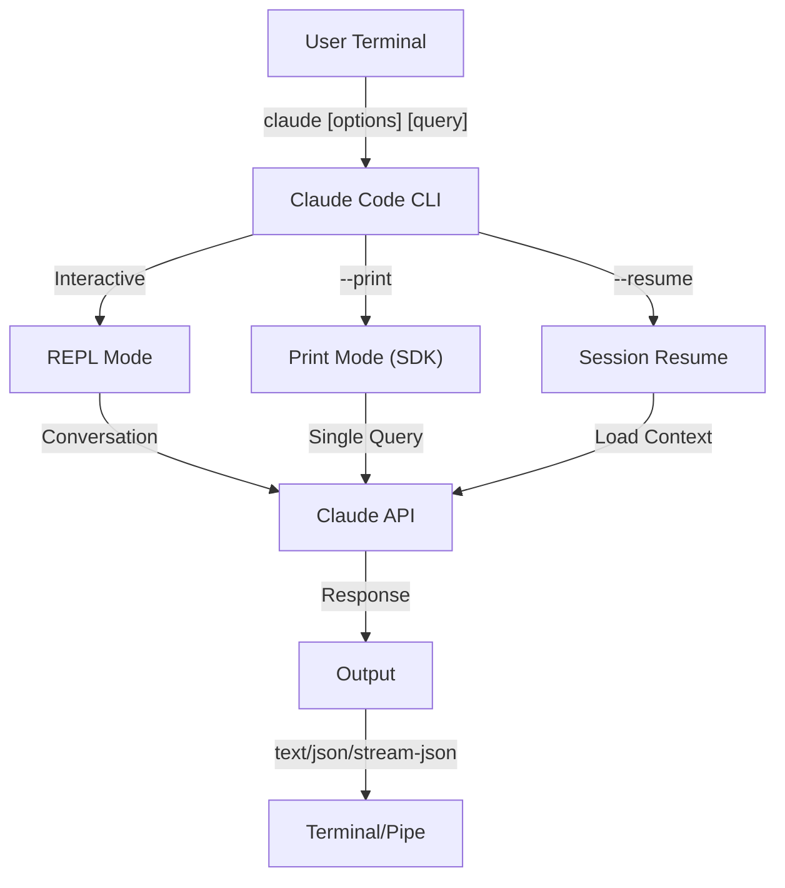
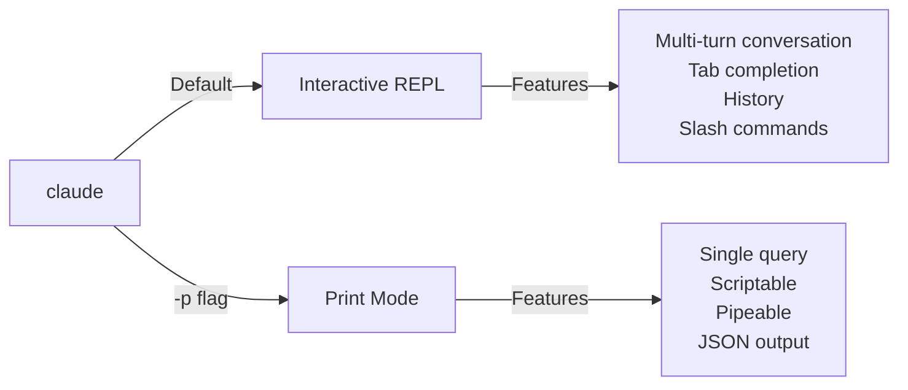

<!-- i18n-source: 10-cli/README.md -->
<!-- i18n-source-sha: 188f468 -->
<!-- i18n-status: translated -->
<!-- i18n-date: 2026-10-26 -->

<picture>
  <source media="(prefers-color-scheme: dark)" srcset="../resources/logos/claude-howto-logo-dark.svg">
  
</picture>

# CLI 레퍼런스

## 개요

Claude Code CLI(Command Line Interface)는 Claude Code와 상호작용하는 기본 수단입니다. 쿼리 실행, 세션 관리, 모델 구성, 그리고 Claude를 개발 워크플로에 통합하기 위한 강력한 옵션을 제공합니다.

## 아키텍처



## 런타임과 패키징

**v2.1.113**부터 Claude Code CLI는 선택적 npm 의존성을 통해 **플랫폼별 네이티브 바이너리**(macOS, Linux, Windows)를 실행합니다. 바이너리는 설치 시점에 OS와 아키텍처에 맞춰 선택되며, 예전의 번들 JavaScript 런타임은 더 이상 macOS나 Linux의 기본값이 아닙니다.

**권장 설치 방법**은 네이티브 인스톨러입니다(`curl -fsSL https://claude.ai/install.sh | bash`, Windows에서는 `irm https://claude.ai/install.ps1 | iex`). 공식 README에서 npm 설치는 더 이상 권장되지 않으므로 네이티브 인스톨러, Homebrew(`brew install --cask claude-code`), WinGet(`winget install Anthropic.ClaudeCode`)을 우선하세요. 참고로 `npm install -g @anthropic-ai/claude-code`(Node.js 22 이상)도 플랫폼별 선택적 의존성을 통해 동일한 네이티브 바이너리를 설치합니다.

**다운로드 호스트**(v2.1.116+): 네이티브 바이너리 아티팩트는 `https://downloads.claude.ai/claude-code-releases`에서 제공됩니다.

> **기업/프록시 사용자**: 네트워크에 명시적 허용 목록이 필요하다면 프록시 이그레스 규칙에 `downloads.claude.ai`(및 `https://downloads.claude.ai/claude-code-releases`)를 추가하세요. 이전에 `storage.googleapis.com`이나 npm 레지스트리만 허용하던 환경은 이를 갱신해야 하며, 그렇지 않으면 `claude update`와 최초 설치가 실패합니다.

예전 JavaScript 번들은 Windows와 해당 번들에 고정한 환경을 위해 여전히 빌드됩니다. 그런 설치에서는 Glob과 Grep이 여전히 일급 도구로 제공됩니다([도구와 권한 관리](#도구와-권한-관리)의 Glob/Grep 각주 참고).

## CLI 명령어

| 명령어 | 설명 | 예시 |
|---------|-------------|---------|
| `claude` | 대화형 REPL 시작 | `claude` |
| `claude "query"` | 초기 프롬프트와 함께 REPL 시작 | `claude "explain this project"` |
| `claude -p "query"` | 프린트 모드 - 쿼리 후 종료 | `claude -p "explain this function"` |
| `cat file \| claude -p "query"` | 파이프로 전달된 내용 처리 | `cat logs.txt \| claude -p "explain"` |
| `claude -c` | 가장 최근 대화 이어가기 | `claude -c` |
| `claude -c -p "query"` | 프린트 모드로 이어가기 | `claude -c -p "check for type errors"` |
| `claude -r "<session>" "query"` | ID 또는 이름으로 세션 재개 | `claude -r "auth-refactor" "finish this PR"` |
| `claude update` | 최신 버전으로 업데이트 | `claude update` |
| `/doctor` (slash command) | 설치, 구성, 플러그인 상태를 진단합니다. v2.1.116부터 Claude가 응답하는 **중에도** 열 수 있고, 상태 아이콘을 인라인으로 표시하며, `f` 키를 눌러 감지된 문제를 자동 수정할 수 있습니다. v2.1.178에서는 레이아웃이 평면 트리로 바뀌어 상태 아이콘과 강조된 명령이 더 명확해졌습니다 | REPL 안에서 `/doctor` 실행 |
| `claude mcp` | MCP 서버 구성(인증용 `login`/`logout` 포함, v2.1.186+) | [MCP 문서](../05-mcp/) 참고 |
| `claude mcp serve` | Claude Code를 MCP 서버로 실행 | `claude mcp serve` |
| `claude agents` | **에이전트 뷰** 열기(Research Preview, v2.1.139+) — 모든 Claude Code 세션을 상태와 함께 나열하는 다중 세션 관리자입니다. 아래 [에이전트 뷰](#에이전트-뷰-claude-agents-v21139)를 참고하세요. | `claude agents` |
| `claude auto-mode defaults` | 오토 모드 기본 규칙을 JSON으로 출력 | `claude auto-mode defaults` |
| `claude auto-mode reset` | 오토 모드 기본 구성을 복원합니다. 확인 프롬프트가 있으며 `--yes`로 건너뜁니다(v2.1.212). | `claude auto-mode reset --yes` |
| `claude remote-control` | Remote Control 서버 시작(서버 모드, 로컬 대화형 세션 없음, 여러 세션을 처리하며 `--capacity` 기본값 32) | `claude remote-control --name "My Project"` |
| `claude --remote-control [name]` | Remote Control을 켠 대화형 세션 시작(별칭 `--rc`) | `claude --rc` |
| `claude plugin` | 플러그인 관리(설치, 활성화, 비활성화) | `claude plugin install my-plugin` |
| `claude plugin init <name>` | `~/.claude/skills/<name>/`에 새 플러그인 스캐폴드 생성(사용자 전역) — 다음 세션에서 `<name>@skills-dir`로 자동 로드되며 마켓플레이스가 필요 없습니다(v2.1.157+) | `claude plugin init my-plugin` |
| `claude plugin tag [path]` | `[path]`의 플러그인에 `{name}--v{version}` 릴리스 git 태그를 만들고, `plugin.json`과 상위 마켓플레이스 항목이 일치하는지 검증합니다(v2.1.118+) | `claude plugin tag ./my-plugin` |
| `claude install [version]` | 특정 네이티브 바이너리 버전을 설치합니다. `stable`, `latest` 또는 명시적 버전 문자열을 받습니다. | `claude install 2.1.131` |
| `claude purge [path]` | 프로젝트의 로컬 Claude Code 상태를 모두 삭제합니다(트랜스크립트, 작업, 디버그 로그, 파일 편집 이력, 프롬프트 이력, `~/.claude.json` 항목). `[path]`를 생략하면 대화형 선택기가 열립니다. 플래그: `--dry-run` 미리보기, `-y/--yes` 확인 생략, `-i/--interactive` 항목별 확인, `--all` 모든 프로젝트(v2.1.126+) — v2.1.288에서 `claude project purge`에서 이름이 바뀌었고, 이전 이름도 계속 동작하며 안내 문구를 출력합니다 | `claude purge ~/work/repo --dry-run` |
| `claude plugin prune` | 고아가 된 자동 설치 플러그인 의존성을 제거합니다(상위 플러그인이 사라진 경우). `plugin uninstall --prune`도 대상을 제거한 뒤 같은 캐스케이드를 수행합니다(v2.1.121+) | `claude plugin prune` |
| `claude ultrareview [target]` | `/ultrareview`를 비대화형으로 실행합니다. 결과를 stdout으로 출력하고 성공 시 0, 실패 시 1로 종료합니다. `--json`은 원시 페이로드, `--timeout <minutes>`는 45분 기본값 재정의(v2.1.260부터), `--post` / `--no-post`는 결과를 PR에 다시 게시할지 제어합니다. **Claude Code v2.1.227 이상 필요** | `claude ultrareview 1234 --json --no-post` |
| `claude self-hosted-runner [setup\|doctor\|orchestrator]` | Claude Code 클라우드 세션을 사용자 머신이나 컨테이너에서 호스팅하는 러너를 시작합니다. `setup`은 안내식 운영자 워크스루, `doctor`는 배포된 러너 진단, `orchestrator`는 온디맨드 러너 생성입니다(이때 `--shutdown-drain-sec`, v2.1.299는 SIGTERM 시 진행 중인 폴과 스폰 훅을 마칠 시간을 줍니다). **Team 및 Enterprise 플랜, Claude Code v2.1.224 이상 필요.** Windows에서는 시작 시 `--base-dir`를 명시해야 합니다(v2.1.229) | `claude self-hosted-runner setup` |
| `claude auth login` | 로그인(`--email`, `--sso` 지원). v2.1.126부터 브라우저 콜백이 localhost에 닿지 못하는 환경(WSL2, SSH, 컨테이너)에서 터미널에 붙여넣은 OAuth 코드를 대체 수단으로 받습니다 | `claude auth login --email user@example.com` |
| `claude auth logout` | 현재 계정에서 로그아웃 | `claude auth logout` |
| `claude auth status` | 인증 상태 확인(로그인 상태면 종료 코드 0, 아니면 1) | `claude auth status` |

## 핵심 플래그

| 플래그 | 설명 | 예시 |
|------|-------------|---------|
| `-p, --print` | 대화형 모드 없이 응답 출력 | `claude -p "query"` |
| `-c, --continue` | 가장 최근 대화 불러오기 | `claude --continue` |
| `-r, --resume` | ID 또는 이름으로 특정 세션 재개 | `claude --resume auth-refactor` |
| `-v, --version` | 버전 번호 출력 | `claude -v` |
| `--system-prompt-snapshot off` | 매 요청마다 시스템 프롬프트를 새로 렌더링하고, 대화에 기록된 프롬프트를 재사용하지 않습니다. 프롬프트 문구를 반복 수정할 때 유용합니다(v2.1.257+) | `claude --system-prompt-snapshot off` |
| `-w, --worktree` | 격리된 git 워크트리에서 시작. v2.1.233부터 GitHub PR URL뿐 아니라 GitLab 머지 리퀘스트 URL도 받습니다 | `claude -w` |
| `-n, --name` | 세션 표시 이름 | `claude -n "auth-refactor"` |
| `--from-pr <url-or-number>` | 풀 리퀘스트/머지 리퀘스트에 연결된 세션 재개. v2.1.119부터 GitHub(클라우드 + Enterprise), GitLab MR, Bitbucket PR URL을 받습니다. 이전에는 GitHub.com만 지원했습니다 | `claude --from-pr 42` or `claude --from-pr https://gitlab.example.com/org/repo/-/merge_requests/17` |
| `--cloud [description\|session_id\|url]` | 설명과 함께 claude.ai에 클라우드 세션을 만들거나, 세션 ID 또는 claude.ai/code URL로 기존 세션에 연결합니다 | `claude --cloud "implement API"` |
| `--remote "task"` | **`--cloud`의 폐기된 별칭**이며 기존 세션 형식도 포함합니다. 대신 `--cloud`를 사용하세요 | `claude --remote "implement API"` |
| `--remote-control, --rc` | Remote Control을 켠 대화형 세션 | `claude --rc` |
| `--teleport [session]` | 웹 세션을 로컬에서 재개합니다. 인자 없이 쓰면 웹 세션 선택기가 열리고, 세션 ID를 넘기면 해당 세션을 바로 재개합니다. claude.ai 구독이 필요합니다 | `claude --teleport` |
| `--teammate-mode` | 에이전트 팀 표시 모드 | `claude --teammate-mode tmux` |
| `--bare` | 최소 모드(훅, 스킬, 플러그인, MCP, 자동 메모리, CLAUDE.md를 건너뜀) | `claude --bare` |
| `--safe-mode` | 모든 사용자 정의를 끈 상태로 시작해 구성 문제를 격리합니다(CLAUDE.md, 플러그인, 스킬, 훅, MCP). `CLAUDE_CODE_SAFE_MODE=1`도 동일합니다(v2.1.169) | `claude --safe-mode` |
| `--restricted` | 신뢰할 수 없거나 공유하는 용도로 세션을 잠급니다. 내장 명령·코드 실행 도구와 WebFetch를 제거하고, 사용자/프로젝트/로컬 설정을 무시하며, 파일 도구를 작업 디렉터리로 제한하고, `bypassPermissions`와 클라우드 세션을 거부합니다. `CLAUDE_CODE_RESTRICTED=1`도 동일합니다(v2.1.248+) | `claude --restricted -p "summarize this repo"` |
| `--permission-mode auto` | 자동 권한 모드로 시작합니다(제거된 `--enable-auto-mode` 플래그를 대체하며, 그 플래그는 v2.1.111에서 사라졌습니다) | `claude --permission-mode auto` |
| `--channels` | MCP 채널 플러그인 구독. 항목은 `plugin:<name>@<marketplace>` 형식으로 태그해야 하며, 이름만 쓰면 거부됩니다 | `claude --channels plugin:discord@my-marketplace` |
| `--chrome` / `--no-chrome` | Chrome 브라우저 통합 활성화/비활성화 | `claude --chrome` |
| `--effort` | 사고 에포트 수준 설정 | `claude --effort high` |
| `--desktop` | 현재 디렉터리의 세션을 Claude 데스크톱 앱에서 엽니다. `--continue` 또는 `--resume <id>`를 추가해 세션을 고릅니다(v2.1.285) | `claude --desktop --continue` |
| `--init` / `--init-only` | `--init`은 세션 전에 초기화(Setup) 훅을 실행하며 프린트 모드 전용입니다. `--init-only`는 Setup과 `SessionStart` 훅을 실행한 뒤 종료합니다 | `claude -p --init "query"` |
| `--maintenance` | 세션 전에 유지보수(Setup) 훅 실행(프린트 모드 전용) | `claude -p --maintenance "query"` |
| `--disable-slash-commands` | 모든 스킬과 슬래시 커맨드 비활성화 | `claude --disable-slash-commands` |
| `--no-session-persistence` | 세션 저장 비활성화(프린트 모드) | `claude -p --no-session-persistence "query"` |
| `--exclude-dynamic-system-prompt-sections` | 프롬프트 캐시 적중률을 높이기 위해 시스템 프롬프트에서 동적 섹션 제외 | `claude -p --exclude-dynamic-system-prompt-sections "query"` |

### 제한 모드 (`--restricted`, v2.1.248+)

`--restricted`(또는 `CLAUDE_CODE_RESTRICTED=1`)는 입력을 통제할 수 없는 사람을 대신해 `claude`를 실행할 때 씁니다. 공유 머신의 평가 하네스, 외부 기여자가 트리거한 CI 잡, 데모 장비 같은 경우입니다. 다음을 모두 적용합니다.

- **명령이나 코드를 실행하는 도구를 제거합니다** — Bash, PowerShell, REPL에 더해 WebFetch까지 제거합니다. 단, `--tools`로 명시한 경우는 예외입니다.
- **사용자·프로젝트·로컬 설정 파일을 무시합니다.** 관리 설정과 명시적 `--settings` 파일은 여전히 적용되므로, 관리자는 통제를 유지하면서 저장소에 커밋된 `.claude/settings.json`이 샌드박스를 넓히지 못하게 할 수 있습니다.
- **파일 도구를 작업 디렉터리로 제한합니다**, 따라서 읽기와 쓰기가 시작한 경로를 벗어날 수 없습니다.
- **`bypassPermissions`를 거부합니다**, 어떤 방식으로 요청하든 마찬가지입니다.
- **클라우드 세션 생성을 거부합니다**, 따라서 제한 실행이 작업을 머신 밖으로 밀어낼 수 없습니다.

```bash
# Evaluation harness: no shell, no network fetches, no settings inheritance
claude --restricted -p "summarize the architecture of this repo"

# Same lockdown, but deliberately re-enable one tool
claude --restricted --tools WebFetch -p "check the linked RFC"
```

> **참고**: `--restricted`는 `--permission-mode`보다 거친 잠금입니다. 권한을 묻는 대신 도구를 아예 제거하므로, 제한된 세션은 세션 내부에서 넓힐 수 없습니다.

### 대화형 모드와 프린트 모드



**대화형 모드**(기본):
```bash
# Start interactive session
claude

# Start with initial prompt
claude "explain the authentication flow"
```

**프린트 모드**(비대화형):
```bash
# Single query, then exit
claude -p "what does this function do?"

# Process file content
cat error.log | claude -p "explain this error"

# Chain with other tools
claude -p "list todos" | grep "URGENT"
```

## 모델과 구성

| 플래그 | 설명 | 예시 |
|------|-------------|---------|
| `--model` | 모델 설정(sonnet, opus, haiku 또는 전체 이름) | `claude --model opus` |
| `--fallback-model` | 기본 모델이 과부하되었거나 사용할 수 없을 때 자동 폴백. `fallbackModel` 설정으로 최대 3개까지 구성할 수 있습니다. v2.1.166부터 대화형 세션에도 적용됩니다(이전에는 프린트 모드 전용) | `claude -p --fallback-model sonnet "query"` |
| `--agent` | 세션에 사용할 에이전트 지정 | `claude --agent my-custom-agent` |
| `--agents` | JSON으로 커스텀 서브에이전트 정의 | [에이전트 구성](#에이전트-구성) 참고 |
| `--effort` | 에포트 수준 설정(low, medium, high, xhigh, max) | `claude --effort xhigh` |

### 모델 선택 예시

```bash
# Use Opus 5.5 for complex tasks
claude --model opus "design a caching strategy"

# Use Haiku for quick tasks (Haiku 5.5 on the Anthropic API since v2.1.293; Haiku 4.5 on Bedrock, Vertex, and Foundry)
claude --model haiku -p "format this JSON"

# Full model name
claude --model claude-sonnet-4-6 "review this code"

# With fallback for reliability
claude -p --model opus --fallback-model sonnet "analyze architecture"

# Use opusplan (Opus plans, Sonnet executes)
claude --model opusplan "design and implement the caching layer"
```

> **게이트웨이 모델 검색(v2.1.129+, 옵트인)**: `ANTHROPIC_BASE_URL`이 Anthropic 호환 게이트웨이를 가리킬 때 `CLAUDE_CODE_ENABLE_GATEWAY_MODEL_DISCOVERY=1`을 설정하면 게이트웨이의 `/v1/models` 엔드포인트에서 `/model` 목록을 채웁니다. 환경변수가 없으면 `/model`은 내장 정적 목록으로 되돌아갑니다. 검색 호출이 사용자가 권한을 갖지 못한 모델까지 노출할 수 있어 옵트인 방식입니다(v2.1.129에서 변경). v2.1.126에서는 암묵적으로 동작했으나 그 동작은 되돌려졌습니다.

> **커스텀 베이스 URL에서의 1M 컨텍스트(v2.1.285)**: `ANTHROPIC_BASE_URL`이 커스텀 엔드포인트를 가리키는 세션은 이제 1M 컨텍스트 창을 가진 모델(Opus 4.7+, Sonnet 5+, Fable)에서 해당 창을 사용합니다. 게이트웨이가 200K에서 끊긴다면 `/autocompact 200k`를 실행하세요.

> **타사 제공자에서 기본 1M 컨텍스트(v2.1.287)**: Opus 4.7+와 Fable은 이제 Amazon Bedrock, Google Vertex AI, Microsoft Foundry, Claude 앱 게이트웨이에서 `[1m]` 접미사 없이 기본으로 1M 컨텍스트 창을 사용합니다. 200K로 유지하려면 `CLAUDE_CODE_DISABLE_1M_CONTEXT=1`을 설정하세요.

> **조직 기본 모델(v2.1.196)**: 조직 관리자가 기본 모델을 지정하면 `/model`에 "Org default"(또는 "Role default")로 표시됩니다.

## 시스템 프롬프트 커스터마이징

| 플래그 | 설명 | 예시 |
|------|-------------|---------|
| `--system-prompt` | 기본 프롬프트 전체 교체 | `claude --system-prompt "You are a Python expert"` |
| `--system-prompt-file` | 파일에서 프롬프트를 불러와 기본 프롬프트 교체 | `claude -p --system-prompt-file ./prompt.txt "query"` |
| `--append-system-prompt` | 기본 프롬프트에 덧붙이기 | `claude --append-system-prompt "Always use TypeScript"` |
| `--append-subagent-system-prompt` | 모든 서브에이전트의 시스템 프롬프트에 텍스트 추가(비대화형) | `claude -p --append-subagent-system-prompt "Cite sources" "query"` |
| `--append-subagent-system-prompt-file` | (v2.1.261) 명령줄로 넘기기엔 너무 긴 프롬프트를 위해 추가할 텍스트를 파일에서 불러옵니다. 비대화형 전용이며 `--append-subagent-system-prompt`와 **함께 쓸 수 없습니다** | `claude -p --append-subagent-system-prompt-file ./subagent-rules.txt "query"` |

### 시스템 프롬프트 예시

```bash
# Complete custom persona
claude --system-prompt "You are a senior security engineer. Focus on vulnerabilities."

# Append specific instructions
claude --append-system-prompt "Always include unit tests with code examples"

# Load complex prompt from file
claude -p --system-prompt-file ./prompts/code-reviewer.txt "review main.py"
```

### 시스템 프롬프트 플래그 비교

| 플래그 | 동작 | 대화형 | 프린트 |
|------|----------|-------------|-------|
| `--system-prompt` | 기본 시스템 프롬프트 전체 교체 | ✅ | ✅ |
| `--system-prompt-file` | 파일의 프롬프트로 교체 | ✅ | ✅ |
| `--append-system-prompt` | 기본 시스템 프롬프트에 덧붙이기 | ✅ | ✅ |

**모든 시스템 프롬프트 플래그는 대화형 모드와 프린트 모드 모두에서 동작합니다(파일 형식은 v2.1.69부터). `--system-prompt`와 `--system-prompt-file`은 기본 프롬프트를 교체하고, append 계열 플래그는 기본 프롬프트에 덧붙입니다.**

## 도구와 권한 관리

| 플래그 | 설명 | 예시 |
|------|-------------|---------|
| `--tools` | 사용 가능한 내장 도구 제한 | `claude -p --tools "Bash,Edit,Read" "query"` |
| `--allowedTools` | 프롬프트 없이 실행되는 도구 | `"Bash(git log:*)" "Read"` |
| `--disallowedTools` | 컨텍스트에서 제거되는 도구 | `"Bash(rm:*)" "Edit"` |
| `--dangerously-skip-permissions` | 모든 권한 프롬프트 건너뛰기 | `claude --dangerously-skip-permissions` |
| `--permission-mode` | 지정한 권한 모드로 시작 | `claude --permission-mode auto` |
| `--permission-prompt-tool` | 권한 처리를 담당할 MCP 도구 | `claude -p --permission-prompt-tool mcp_auth "query"` |
| `--permission-prompts` | (v2.1.259) 프린트 모드에서 권한 프롬프트에 응답할 주체. 기본값 `host`는 Agent SDK 호스트나 `--permission-prompt-tool` 도구로 보내고, 응답할 수 있는 주체가 없을 때 `none`을 지정하면 Claude Code가 대신 거부합니다 | `claude -p --permission-prompts none "query"` |

> **v2.1.111 업데이트**: `--enable-auto-mode`가 제거되었고, 오토 모드는 이제 기본적으로 `Shift+Tab` 순환에 포함됩니다. 오토 모드로 바로 시작하려면 `--permission-mode auto`를 사용하세요.

> **Glob / Grep 각주(v2.1.113+)**: 네이티브 macOS/Linux 빌드에서 `Glob`과 `Grep`은 별도 일급 도구가 아니라 Bash 도구를 통해 호출되는 내장 `bfs`·`ugrep` 바이너리로 제공됩니다. Windows와 npm 번들(JS) 설치에서는 여전히 독립 도구로 노출됩니다. 서브에이전트의 `allowedTools` / `disallowedTools` 목록에서는 백엔드 치환이 투명하게 처리되므로, 모든 플랫폼에서 구성에 `Glob` / `Grep`을 계속 적어도 됩니다.

> **PowerShell 자동 승인(v2.1.119)**: PowerShell 도구 명령은 Bash 명령과 똑같은 방식으로 권한 모드에서 자동 승인될 수 있습니다. 이미 `Bash(...)` 규칙에 쓰던 매처 문법을 그대로 써서 PowerShell 권한 범위를 지정하세요. 예: `PowerShell(Get-ChildItem:*)`.

> **재개 시 `--permission-mode` 적용(v2.1.132+)**: `claude -p --continue --permission-mode plan`(그리고 `--resume`)이 이제 플래그를 존중합니다. 이전 버전은 세션을 재개할 때 `--permission-mode`를 조용히 버려서, 플래그를 다시 넘기지 않고 재개한 플랜 모드 세션이 조용히 권한이 낮아지곤 했는데, 이 문제가 수정되었습니다.

> **권한 강화(v2.1.214)**: 데몬 리다이렉트 플래그(예: `--url`, `--connection`, `--identity`)를 쓰는 Docker/Podman 명령은 이제 자동 실행되지 않고 권한 프롬프트를 요구합니다. `-m`/`--magic-file`이나 `-f`/`--files-from`을 쓰는 `file` 명령도 권한이 필요합니다. 10,000자를 넘는 Bash 명령은 허용 규칙과 무관하게 항상 권한을 묻습니다.

### 권한 예시

```bash
# Read-only mode for code review
claude --permission-mode plan "review this codebase"

# Restrict to safe tools only
claude --tools "Read,Grep,Glob" -p "find all TODO comments"

# Allow specific git commands without prompts
claude --allowedTools "Bash(git status:*)" "Bash(git log:*)"

# Block dangerous operations
claude --disallowedTools "Bash(rm -rf:*)" "Bash(git push --force:*)"
```

> **매개변수 매칭 `Tool(param:value)`(v2.1.178)**: 권한 규칙은 `Tool`(모든 사용) 또는 `Tool(specifier)` 형식을 따릅니다. v2.1.178부터 specifier가 명령이나 경로 패턴뿐 아니라 도구의 입력 **매개변수**까지 매칭할 수 있습니다. `Tool(param:value)` 형식에 와일드카드를 지원합니다. 이는 `Bash(...)` 명령 접두사(예: `Bash(npm run test *)`)와 `Read(...)` 경로 글롭(예: `Read(./.env.*)`)에 이미 쓰던 매칭을 일반화한 것으로, 다른 도구도 인자 기준으로 범위를 좁힐 수 있습니다. 도구마다 정확한 매개변수 이름이 다르므로 규칙을 쓰기 전에 [권한 레퍼런스](https://code.claude.com/docs/en/settings)에서 도구별 최신 예시 문자열을 확인하세요.

## 출력과 형식

| 플래그 | 설명 | 옵션 | 예시 |
|------|-------------|---------|---------|
| `--output-format` | 출력 형식 지정(프린트 모드) | `text`, `json`, `stream-json` | `claude -p --output-format json "query"` |
| `--input-format` | 입력 형식 지정(프린트 모드) | `text`, `stream-json` | `claude -p --input-format stream-json` |
| `--verbose` | 상세 로깅 활성화 | | `claude --verbose` |
| `--include-partial-messages` | 스트리밍 이벤트 포함 | `stream-json` 필요 | `claude -p --output-format stream-json --include-partial-messages "query"` |
| `--forward-subagent-text` | 서브에이전트 텍스트 출력을 스트림으로 전달합니다. v2.1.219부터 깊이 2 이상에서 생성된 서브에이전트도 전달되며, 생성한 `Agent` `tool_use` id로 구분됩니다(`CLAUDE_CODE_MAX_SUBAGENT_SPAWN_DEPTH`로 기본 활성화된 중첩을 관찰하는 방법입니다) | `stream-json` 필요 | `claude -p --output-format stream-json --forward-subagent-text "query"` |
| `--json-schema` | 스키마에 맞는 검증된 JSON 받기 | | `claude -p --json-schema '{"type":"object"}' "query"` |
| `--max-budget-usd` | 프린트 모드의 최대 지출액. v2.1.217부터 한도에 도달하면 실행 중인 백그라운드 서브에이전트도 중단하고 새 스폰을 거부합니다(이전에는 백그라운드 에이전트가 한도를 넘겨 계속 실행되었습니다) | | `claude -p --max-budget-usd 5.00 "query"` |

### 출력 형식 예시

```bash
# Plain text (default)
claude -p "explain this code"

# JSON for programmatic use
claude -p --output-format json "list all functions in main.py"

# Streaming JSON for real-time processing
claude -p --output-format stream-json "generate a long report"

# Structured output with schema validation
claude -p --json-schema '{"type":"object","properties":{"bugs":{"type":"array"}}}' \
  "find bugs in this code and return as JSON"
```

## 워크스페이스와 디렉터리

| 플래그 | 설명 | 예시 |
|------|-------------|---------|
| `--add-dir` | 추가 작업 디렉터리 추가 | `claude --add-dir ../apps ../lib` |
| `--setting-sources` | 쉼표로 구분된 설정 소스 | `claude --setting-sources user,project` |

> **`/config` 지속성(v2.1.119)**: `/config` 명령으로 대화형에서 바꾼 값이 이제 `~/.claude/settings.json`에 기록되고 일반 우선순위 체인(정책 → 로컬 → 프로젝트 → 사용자)에 참여합니다. v2.1.119 이전에는 일부 `/config` 변경이 세션에만 적용되었습니다. 전체 우선순위는 [메모리와 설정](../02-memory/README.md)을 참고하세요.
| `--settings` | 파일 또는 JSON에서 설정 불러오기. 파일 크기는 2 MiB 이하여야 합니다(v2.1.214) | `claude --settings ./settings.json` |
| `--plugin-dir` | 디렉터리에서 플러그인 불러오기(반복 가능). v2.1.265부터 **플러그인 폴더**도 받습니다. 매니페스트가 있는 하위 폴더가 모두 로드되고, 세션 실행 중 추가·삭제된 하위 항목도 반영됩니다 | `claude --plugin-dir ./my-plugin` |

### 다중 디렉터리 예시

```bash
# Work across multiple project directories
claude --add-dir ../frontend ../backend ../shared "find all API endpoints"

# Load custom settings
claude --settings '{"model":"opus","verbose":true}' "complex task"
```

## MCP 구성

| 플래그 | 설명 | 예시 |
|------|-------------|---------|
| `--mcp-config` | JSON에서 MCP 서버 불러오기 | `claude --mcp-config ./mcp.json` |
| `--strict-mcp-config` | 지정한 MCP 구성만 사용 | `claude --strict-mcp-config --mcp-config ./mcp.json` |
| `--channels` | MCP 채널 플러그인 구독. 항목은 `plugin:<name>@<marketplace>` 형식으로 태그해야 하며, 이름만 쓰면 거부됩니다 | `claude --channels plugin:discord@my-marketplace` |

### MCP 예시

```bash
# Load GitHub MCP server
claude --mcp-config ./github-mcp.json "list open PRs"

# Strict mode - only specified servers
claude --strict-mcp-config --mcp-config ./production-mcp.json "deploy to staging"
```

## 세션 관리

| 플래그 | 설명 | 예시 |
|------|-------------|---------|
| `--session-id` | 특정 세션 ID 사용(UUID) | `claude --session-id "550e8400-..."` |
| `--fork-session` | 재개할 때 새 세션 생성 | `claude --resume abc123 --fork-session` |

### 세션 예시

```bash
# Continue last conversation
claude -c

# Resume named session
claude -r "feature-auth" "continue implementing login"

# Fork session for experimentation
claude --resume feature-auth --fork-session "try alternative approach"

# Use specific session ID
claude --session-id "550e8400-e29b-41d4-a716-446655440000" "continue"
```

> **v2.1.299**: 종료 시 출력되는 재개 명령이 세션을 ID로 표시합니다.

### 세션 포크

실험을 위해 기존 세션에서 브랜치를 만듭니다.

```bash
# Fork a session to try a different approach
claude --resume abc123 --fork-session "try alternative implementation"

# Fork with a custom message
claude -r "feature-auth" --fork-session "test with different architecture"
```

**사용 사례:**
- 원래 세션을 잃지 않고 대체 구현 시도
- 서로 다른 접근을 병렬로 실험
- 잘 된 작업에서 변형용 브랜치 생성
- 메인 세션에 영향 없이 호환성 깨는 변경 테스트

원래 세션은 그대로 남고, 포크는 독립된 새 세션이 됩니다.

### 프로젝트 상태 정리 (v2.1.126+)

`claude purge`는 프로젝트의 로컬 Claude Code 상태를 모두 삭제합니다. 트랜스크립트, 작업 목록, 디버그 로그, 파일 편집 이력, 프롬프트 이력 라인, 그리고 해당 프로젝트의 `~/.claude.json` 항목입니다. v2.1.288 이전에는 `claude project purge`라 불렀고, 그 이름도 계속 동작하며 안내 문구를 출력합니다. 먼저 `--dry-run`으로 삭제 대상을 확인하세요. `--all`은 머신의 모든 프로젝트를 순회합니다.

```bash
# Preview what would be deleted (safe)
claude purge ~/work/repo --dry-run

# Delete state for a specific project, no prompts
claude purge ~/work/repo --yes

# Walk every project interactively
claude purge --all --interactive
```

## 고급 기능

| 플래그 | 설명 | 예시 |
|------|-------------|---------|
| `--chrome` | Chrome 브라우저 통합 활성화 | `claude --chrome` |
| `--no-chrome` | Chrome 브라우저 통합 비활성화 | `claude --no-chrome` |
| `--ide` | IDE가 있으면 자동 연결 | `claude --ide` |
| `--max-turns` | 에이전트 턴 수 제한(비대화형) | `claude -p --max-turns 3 "query"` |
| `--debug` | 필터와 함께 디버그 모드 활성화(필터는 `=` 형식에서만 적용됩니다) | `claude --debug=api,mcp` |
| `--enable-lsp-logging` | 상세 LSP 로깅 활성화 | `claude --enable-lsp-logging` |
| `--betas` | API 요청용 베타 헤더 | `claude --betas interleaved-thinking` |
| `--plugin-dir` | 디렉터리에서 플러그인 불러오기(반복 가능). v2.1.265부터 **플러그인 폴더**도 받습니다. 매니페스트가 있는 하위 폴더가 모두 로드되고, 세션 실행 중 추가·삭제된 하위 항목도 반영됩니다 | `claude --plugin-dir ./my-plugin` |
| `--effort` | 사고 에포트 수준 설정 | `claude --effort high` |
| `--bare` | 최소 모드(훅, 스킬, 플러그인, MCP, 자동 메모리, CLAUDE.md를 건너뜀) | `claude --bare` |
| `--channels` | MCP 채널 플러그인 구독(`plugin:<name>@<marketplace>` 태그) | `claude --channels plugin:discord@my-marketplace` |
| `--tmux` | 워크트리용 tmux 세션 생성(`--worktree` 필요) | `claude --worktree feature-x --tmux` |
| `--fork-session` | 재개할 때 새 세션 ID 생성 | `claude --resume abc --fork-session` |
| `--max-budget-usd` | 최대 지출액(프린트 모드). 한도에 도달하면 백그라운드 서브에이전트도 중단합니다(v2.1.217) | `claude -p --max-budget-usd 5.00 "query"` |
| `--json-schema` | 검증된 JSON 출력 | `claude -p --json-schema '{"type":"object"}' "q"` |
| `--ax-screen-reader` | 스크린 리더용 텍스트 렌더링 모드(v2.1.208) | `claude --ax-screen-reader` |

### 플랫폼과 테마 참고 사항 (v2.1.112)

- **Windows의 PowerShell 도구**: Windows에서 전용 PowerShell 도구가 순차 배포 중이며 환경변수로 제어할 수 있습니다.
- **Auto(터미널과 일치) 테마**: 새 "Auto (match terminal)" 테마는 Claude Code의 밝기/어두움 모습을 터미널과 동기화합니다.
- **조용해진 권한 프롬프트**: 읽기 전용 `Bash` 호출과 `Glob` 패턴은 더 이상 권한 프롬프트를 유발하지 않습니다.

### 고급 예시

```bash
# Limit autonomous actions
claude -p --max-turns 5 "refactor this module"

# Debug API calls
claude --debug=api "test query"

# Enable IDE integration
claude --ide "help me with this file"
```

## 에이전트 구성

`--agents` 플래그는 세션에 쓸 커스텀 서브에이전트를 정의하는 JSON 객체를 받습니다.

**v2.1.243**부터 `--agents`는 잘못된 JSON이나 잘못된 에이전트 정의를 조용히 무시하지 않고 명확한 오류와 함께 종료합니다. `--mcp-config`가 이미 그렇게 동작하던 방식과 같습니다.

### 에이전트 JSON 형식

```json
{
  "agent-name": {
    "description": "Required: when to invoke this agent",
    "prompt": "Required: system prompt for the agent",
    "tools": ["Optional", "array", "of", "tools"],
    "model": "optional: sonnet|opus|haiku"
  }
}
```

**필수 필드:**
- `description` - 이 에이전트를 언제 사용할지에 대한 자연어 설명
- `prompt` - 에이전트의 역할과 동작을 정의하는 시스템 프롬프트

**선택 필드:**
- `tools` - 사용 가능한 도구 배열(생략하면 전부 상속)
  - 형식: `["Read", "Grep", "Glob", "Bash"]`
- `model` - 사용할 모델: `sonnet`, `opus`, `haiku`

### 전체 에이전트 예시

```json
{
  "code-reviewer": {
    "description": "Expert code reviewer. Use proactively after code changes.",
    "prompt": "You are a senior code reviewer. Focus on code quality, security, and best practices.",
    "tools": ["Read", "Grep", "Glob", "Bash"],
    "model": "sonnet"
  },
  "debugger": {
    "description": "Debugging specialist for errors and test failures.",
    "prompt": "You are an expert debugger. Analyze errors, identify root causes, and provide fixes.",
    "tools": ["Read", "Edit", "Bash", "Grep"],
    "model": "opus"
  },
  "documenter": {
    "description": "Documentation specialist for generating guides.",
    "prompt": "You are a technical writer. Create clear, comprehensive documentation.",
    "tools": ["Read", "Write"],
    "model": "haiku"
  }
}
```

### 에이전트 명령 예시

```bash
# Define custom agents inline
claude --agents '{
  "security-auditor": {
    "description": "Security specialist for vulnerability analysis",
    "prompt": "You are a security expert. Find vulnerabilities and suggest fixes.",
    "tools": ["Read", "Grep", "Glob"],
    "model": "opus"
  }
}' "audit this codebase for security issues"

# Load agents from file
claude --agents "$(cat ~/.claude/agents.json)" "review the auth module"

# Combine with other flags
claude -p --agents "$(cat agents.json)" --model sonnet "analyze performance"
```

### 에이전트 우선순위

에이전트 정의가 여러 개 있으면 다음 우선순위로 로드됩니다.
1. **CLI 정의**(`--agents` 플래그) - 세션 한정
2. **프로젝트 수준**(`.claude/agents/`) - 현재 프로젝트
3. **사용자 수준**(`~/.claude/agents/`) - 모든 프로젝트

CLI 정의 에이전트는 해당 세션에서 프로젝트·사용자 에이전트를 모두 덮어씁니다. 이름이 충돌하면 프로젝트 수준 에이전트가 사용자 수준을 덮어씁니다. 플러그인 수준 에이전트까지 포함한 전체 우선순위 표는 [레슨 04 — 서브에이전트](../04-subagents/README.md#파일-위치)를 참고하세요.

### 에이전트 뷰 (`claude agents`, v2.1.139+)

> **Research Preview** — 일상 사용에는 충분히 안정적이지만 변경될 수 있는 기능입니다.

`claude agents`는 **에이전트 뷰**를 엽니다. 머신의 모든 Claude Code 세션과 현재 상태(`running`, `blocked on you`, `done`)를 한 목록으로 보여주는 다중 세션 관리자입니다. 백그라운드 에이전트나 예약 작업, `--bg`로 시작한 세션을 다룰 때 여러 터미널 탭을 오가던 방식을 대체합니다.

```bash
# Open the Agent View
claude agents
```

뷰에서 세션을 디스패치할 때(`claude --bg <prompt>` 포함) `claude` 자체에 넘기던 것과 같은 구성 플래그를 넘길 수 있습니다. 에이전트 뷰 디스패치 경로를 위해 추가된 플래그는 다음과 같습니다.

| 플래그 | 도입 | 설명 |
|------|-------|-------------|
| `--cwd <path>` | v2.1.141 | 세션 목록(또는 새 세션)을 특정 작업 디렉터리로 범위 지정 |
| `--add-dir <path>` | v2.1.142 | 디스패치된 세션의 워크스페이스에 디렉터리 추가 |
| `--settings <path>` | v2.1.142 | 디스패치된 세션에 특정 `settings.json` 사용 |
| `--mcp-config <path>` | v2.1.142 | 디스패치된 세션에 특정 MCP 구성 사용 |
| `--plugin-dir <path>` | v2.1.142 | 디스패치된 세션에 특정 플러그인 디렉터리 사용 |
| `--permission-mode <mode>` | v2.1.142 | 디스패치된 세션의 권한 모드 설정(`plan`, `acceptEdits`, `auto` 등) |
| `--model <model>` | v2.1.142 | 디스패치된 세션에 모델 고정 |
| `--effort <level>` | v2.1.142 | 에포트 수준 고정(`low`/`medium`/`high`/`xhigh`/`max`) |
| `--dangerously-skip-permissions` | v2.1.142 | 권한 프롬프트 없이 디스패치된 세션 실행(샌드박스에서만 사용) |
| `--json` | v2.1.145 | 에이전트 목록을 스크립팅용 기계 판독 JSON으로 출력(상태 표시줄, 세션 선택기, tmux-resurrect 통합) |

작업을 끝냈지만 백그라운드 셸을 열어둔 세션은 "Working"에서 "Completed"로 이동합니다(v2.1.141 수정). 연결된 에이전트 세션 안에서는 `Shift+Tab`이 오토 모드를 포함한 권한 모드를 순환합니다(v2.1.143).

**GitLab 머지 리퀘스트(v2.1.233)** — 에이전트 뷰는 GitHub PR URL과 함께 GitLab MR URL도 인식하고, 머지 리퀘스트를 `!N`으로 표시합니다(GitHub 풀 리퀘스트는 `#N` 유지). 같은 릴리스에서 `--worktree`도 GitLab MR URL을 받도록 바뀌었습니다.

**세션 고정** — `claude agents`에서 세션에 `Ctrl+T`를 누르면 고정됩니다(v2.1.147). 고정된 백그라운드 세션은 유휴 상태에서도 살아 있고, Claude Code 업데이트를 적용하기 위해 제자리에서 재시작되며, 메모리 압박 시에는 고정되지 않은 세션을 먼저 정리한 뒤에야 정리됩니다. (이 `Ctrl+T`는 에이전트 뷰 범위이며, 메인 세션에서는 작업 목록 보기를 토글합니다.)

**새 세션 기본값(v2.1.299)** — 에이전트 뷰에서 `/effort`와 `/fast`는 새 세션이 시작할 값을 설정하고, 인자 없는 `/model`, `/effort`, `/fast`는 선택기를 엽니다.

---

## 활용도 높은 사용 사례

### 1. CI/CD 통합

CI/CD 파이프라인에서 Claude Code를 자동 코드 리뷰, 테스트, 문서화에 활용하세요.

**GitHub Actions 예시:**

```yaml
name: AI Code Review

on: [pull_request]

jobs:
  review:
    runs-on: ubuntu-latest
    steps:
      - uses: actions/checkout@v4

      - name: Install Claude Code
        run: npm install -g @anthropic-ai/claude-code

      - name: Run Code Review
        env:
          ANTHROPIC_API_KEY: ${{ secrets.ANTHROPIC_API_KEY }}
        run: |
          claude -p --output-format json \
            --max-turns 1 \
            "Review the changes in this PR for:
            - Security vulnerabilities
            - Performance issues
            - Code quality
            Output as JSON with 'issues' array" > review.json

      - name: Post Review Comment
        uses: actions/github-script@v7
        with:
          script: |
            const fs = require('fs');
            const review = JSON.parse(fs.readFileSync('review.json', 'utf8'));
            // Process and post review comments
```

**Jenkins 파이프라인:**

```groovy
pipeline {
    agent any
    stages {
        stage('AI Review') {
            steps {
                sh '''
                    claude -p --output-format json \
                      --max-turns 3 \
                      "Analyze test coverage and suggest missing tests" \
                      > coverage-analysis.json
                '''
            }
        }
    }
}
```

**헤드리스 `ultrareview`(v2.1.227+ 필요):**

```yaml
# .github/workflows/ultrareview.yml
- name: Claude ultrareview
  run: claude ultrareview ${{ github.event.pull_request.number }} --json --no-post > review.json
```

`claude ultrareview`는 리뷰가 깨끗하면 0, 발견 사항이 보고되면 1로 종료하므로 PR 게이트로 그대로 쓸 수 있습니다. `--timeout <minutes>`로 45분 기본값을 재정의할 수 있습니다(v2.1.260부터). `--post`는 완료된 발견 사항을 풀 리퀘스트에 게시하고, `--no-post`는 stdout에만 남깁니다. 이후 CI 단계에서 보고서를 직접 포맷할 때는 `--no-post`를 쓰세요.

### 2. 스크립트 파이핑

파일, 로그, 데이터를 Claude로 처리해 분석합니다.

**로그 분석:**

```bash
# Analyze error logs
tail -1000 /var/log/app/error.log | claude -p "summarize these errors and suggest fixes"

# Find patterns in access logs
cat access.log | claude -p "identify suspicious access patterns"

# Analyze git history
git log --oneline -50 | claude -p "summarize recent development activity"
```

**코드 처리:**

```bash
# Review a specific file
cat src/auth.ts | claude -p "review this authentication code for security issues"

# Generate documentation
cat src/api/*.ts | claude -p "generate API documentation in markdown"

# Find TODOs and prioritize
grep -r "TODO" src/ | claude -p "prioritize these TODOs by importance"
```

### 3. 다중 세션 워크플로

여러 대화 스레드로 복잡한 프로젝트를 관리합니다.

```bash
# Start a feature branch session
claude -r "feature-auth" "let's implement user authentication"

# Later, continue the session
claude -r "feature-auth" "add password reset functionality"

# Fork to try an alternative approach
claude --resume feature-auth --fork-session "try OAuth instead"

# Switch between different feature sessions
claude -r "feature-payments" "continue with Stripe integration"
```

### 4. 커스텀 에이전트 구성

팀 워크플로에 맞는 전문화된 에이전트를 정의합니다.

```bash
# Save agents config to file
cat > ~/.claude/agents.json << 'EOF'
{
  "reviewer": {
    "description": "Code reviewer for PR reviews",
    "prompt": "Review code for quality, security, and maintainability.",
    "model": "opus"
  },
  "documenter": {
    "description": "Documentation specialist",
    "prompt": "Generate clear, comprehensive documentation.",
    "model": "sonnet"
  },
  "refactorer": {
    "description": "Code refactoring expert",
    "prompt": "Suggest and implement clean code refactoring.",
    "tools": ["Read", "Edit", "Glob"]
  }
}
EOF

# Use agents in session
claude --agents "$(cat ~/.claude/agents.json)" "review the auth module"
```

### 5. 배치 처리

일관된 설정으로 여러 쿼리를 처리합니다.

```bash
# Process multiple files
for file in src/*.ts; do
  echo "Processing $file..."
  claude -p --model haiku "summarize this file: $(cat $file)" >> summaries.md
done

# Batch code review
find src -name "*.py" -exec sh -c '
  echo "## $1" >> review.md
  cat "$1" | claude -p "brief code review" >> review.md
' _ {} \;

# Generate tests for all modules
for module in $(ls src/modules/); do
  claude -p "generate unit tests for src/modules/$module" > "tests/$module.test.ts"
done
```

### 6. 보안을 고려한 개발

안전한 운영을 위해 권한 제어를 사용합니다.

```bash
# Read-only security audit
claude --permission-mode plan \
  --tools "Read,Grep,Glob" \
  "audit this codebase for security vulnerabilities"

# Block dangerous commands
claude --disallowedTools "Bash(rm:*)" "Bash(curl:*)" "Bash(wget:*)" \
  "help me clean up this project"

# Restricted automation
claude -p --max-turns 2 \
  --allowedTools "Read" "Glob" \
  "find all hardcoded credentials"
```

### 7. JSON API 통합

`jq` 파싱과 함께 Claude를 도구용 프로그래머블 API로 사용합니다.

```bash
# Get structured analysis
claude -p --output-format json \
  --json-schema '{"type":"object","properties":{"functions":{"type":"array"},"complexity":{"type":"string"}}}' \
  "analyze main.py and return function list with complexity rating"

# Integrate with jq for processing (schema output lands in .structured_output)
claude -p --output-format json \
  --json-schema '{"type":"object","properties":{"endpoints":{"type":"array"}}}' \
  "list all API endpoints" | jq '.structured_output.endpoints[]'

# Use in scripts
RESULT=$(claude -p --output-format json \
  --json-schema '{"type":"object","properties":{"secure":{"type":"boolean"},"issues":{"type":"array"}},"required":["secure","issues"]}' \
  "is this code secure?" < code.py)
if echo "$RESULT" | jq -e '.structured_output.secure == false' > /dev/null; then
  echo "Security issues found!"
  echo "$RESULT" | jq '.structured_output.issues[]'
fi
```

### jq 파싱 예시

`jq`로 Claude의 JSON 출력을 파싱해 처리합니다. 응답 텍스트는 `.result`에 있고, `--json-schema`를 쓰면 검증된 객체가 `.structured_output`에 있습니다(아래 `$SCHEMA`는 각 필터가 읽는 필드를 정의한 스키마를 뜻합니다).

```bash
# Extract the response text
claude -p --output-format json "analyze this code" | jq -r '.result'

# Filter array elements
claude -p --output-format json --json-schema "$SCHEMA" "list issues" | jq -r '.structured_output.issues[] | select(.severity=="high")'

# Extract multiple fields
claude -p --output-format json --json-schema "$SCHEMA" "describe the project" | jq -r '.structured_output | {name, version, description}'

# Convert to CSV
claude -p --output-format json --json-schema "$SCHEMA" "list functions" | jq -r '.structured_output.functions[] | [.name, .lineCount] | @csv'

# Conditional processing
claude -p --output-format json --json-schema "$SCHEMA" "check security" | jq 'if (.structured_output.vulnerabilities | length) > 0 then "UNSAFE" else "SAFE" end'

# Extract nested values
claude -p --output-format json --json-schema "$SCHEMA" "analyze performance" | jq '.structured_output.metrics.cpu.usage'

# Process entire array
claude -p --output-format json --json-schema "$SCHEMA" "find todos" | jq '.structured_output.todos | length'

# Transform output
claude -p --output-format json --json-schema "$SCHEMA" "list improvements" | jq '.structured_output.improvements | map({title: .title, priority: .priority})'
```

---

## 모델

Claude Code는 성능이 다른 여러 모델을 지원합니다.

| 모델 | ID | 컨텍스트 창 | 비고 |
|-------|-----|----------------|-------|
| Opus 5.5 | `claude-opus-5-5` | 1M tokens | v2.1.280부터 Pro, Max, Team, Enterprise, Anthropic API, AWS의 Claude Platform, Amazon Bedrock, Google Cloud의 Agent Platform에서 기본 모델이자 기본 Opus 모델입니다(Pro와 Team Standard는 이전에 Sonnet 5를 기본으로 사용). Microsoft Foundry에서는 여전히 `opus`가 Opus 4.6으로, `default`가 Sonnet 4.5로 해석됩니다. 적응형 에포트 수준 `low → max`, 기본 에포트 `medium`, 사고를 끌 수 없습니다. v2.1.280 이상 필요 |
| Sonnet 5.5 | `claude-sonnet-5-5` | 1M tokens | v2.1.284부터 Anthropic API의 기본 Sonnet 모델입니다(해당 환경에서 `sonnet` 별칭이 이것으로 해석됩니다). 적응형 에포트 수준 `low → max`, 기본 에포트 `medium`, 사고를 끌 수 없으며 빠른 모드에서는 사용할 수 없습니다. v2.1.284 이상 필요 |
| Haiku 5.5 | `claude-haiku-5-5` | 1M tokens | v2.1.293부터 Anthropic API의 기본 Haiku 모델입니다(해당 환경에서 `haiku` 별칭이 이것으로 해석되며, Bedrock, Vertex, Foundry, AWS의 Claude Platform은 여전히 `haiku`를 Haiku 4.5로 해석합니다). 적응형 에포트 수준 `low → max`, 기본 에포트 `medium`, 사고를 끌 수 없습니다. v2.1.293 이상 필요 |
| Sonnet 5 | `claude-sonnet-5` | 1M tokens | v2.1.197부터 v2.1.280까지 Pro / Team Standard 좌석의 기본 모델이었고, v2.1.280에 해당 플랜이 Opus 5.5로 이동했습니다. 네이티브 1M 토큰 컨텍스트 창 |
| Opus 5 | `claude-opus-5` | 1M tokens | v2.1.219부터 v2.1.280까지 기본 Opus 모델이었습니다(현재는 Opus 5.5). 여전히 선택 가능하며 적응형 에포트 수준 `low → max`, 기본 에포트 `high` |
| Opus 4.8 | `claude-opus-4-8` | 1M tokens | 이전 플래그십 Opus로 여전히 선택 가능합니다. 적응형 에포트 수준 `low → max`, 기본 에포트 `high`(v2.1.154) |
| Sonnet 4.6 | `claude-sonnet-4-6` | 1M tokens | 속도와 성능의 균형. v2.1.117에서 Pro/Max 구독자의 기본 에포트가 `medium`에서 `high`로 올라갔습니다 |
| Haiku 4.5 | `claude-haiku-4-5` | 200K tokens | 이전 Haiku. Bedrock, Vertex, Foundry, AWS의 Claude Platform에서 여전히 `haiku` 별칭입니다. 에포트 수준 없음 |
| Fable 5.1 | `claude-fable-5-1` | — | 현재 Fable 모델이며 `fable` 별칭이 이것으로 해석됩니다(v2.1.257) |
| Fable 5 | `claude-fable-5` | — | Mythos급 모델로, 일반 사용이 가능하도록 안전하게 조정되었습니다(v2.1.170) |

> **참고**: Sonnet 4.5는 2026년 11월 30일 Claude API, AWS의 Claude Platform, Microsoft Foundry에서 은퇴합니다. `default`와 `sonnet`이 여전히 Sonnet 4.5로 해석되는 Foundry에서는 더 새로운 모델을 명시적으로 지정하세요.

### 모델 선택

```bash
# Use short names
claude --model opus "complex architectural review"
claude --model sonnet "implement this feature"
claude --model haiku -p "format this JSON"

# Use opusplan alias (Opus plans, Sonnet executes)
claude --model opusplan "design and implement the API"

# Toggle fast mode during session
/fast
```

> **Fable 5.1과 `fable` 별칭(v2.1.257)**: Fable 5.1(`claude-fable-5-1`)은 **v2.1.257**에 포함되었고, `fable` 별칭은 이제 Fable 5가 아니라 Fable 5.1로 해석됩니다. 공식 모델 구성 페이지는 Fable 5.1이 "Claude Code v2.1.255 이상 필요"라고 하지만 2.1.255는 공개된 적이 없습니다. 사용자가 실제로 설치할 수 있는 첫 릴리스가 v2.1.257입니다. Claude 앱 게이트웨이에서는 `fable`과 `best`가 여전히 **Fable 5**로 해석되므로, 그 환경에서는 `/model`에서 5.1을 직접 고르세요. 조직에서 최신 Fable 모델을 쓸 수 없다면 `fable`과 `best`는 이전 Fable 모델로 한 번 재시도합니다(v2.1.301).

> **빠른 모드는 Opus 5.5, Opus 5, Opus 4.8에서 동작(v2.1.280)**: v2.1.219부터 `/fast`는 **Opus 5와 Opus 4.8**에 적용되며 Opus 4.7은 빠른 모드에서 제외되었습니다. Opus 5의 빠른 모드는 100만 토큰당 $10/$50으로 과금됩니다. 빠른 모드는 v2.1.154에 Opus 4.8로 처음 옮겨졌고(표준 요율의 약 2배로 출력 속도 약 2.5배), 그 전에 v2.1.142에서 Opus 4.6에서 Opus 4.7로 바뀐 바 있습니다. `CLAUDE_CODE_OPUS_4_6_FAST_MODE_OVERRIDE` 환경변수는 **v2.1.154에서 폐기되고 2026-06-01에 제거되었습니다**. 빠른 모드는 더 이상 Opus 4.6에서 쓸 수 없으므로 Opus 5나 Opus 4.8을 선택하세요. **v2.1.280부터 빠른 모드는 Opus 5.5가 기본**이며(100만 토큰당 $8/$40), Opus 5와 Opus 4.8은 $10/$50으로 계속 지원됩니다.

### 에포트 수준 (Opus 5 / Sonnet 5 / Opus 4.8 / Opus 4.7)

Opus 5, Sonnet 5, Opus 4.8, Opus 4.7은 에포트 수준을 갖는 적응형 추론을 지원하며, 가벼운 것부터 무거운 순으로 `low`(○), `medium`(◐), `high`(●), `xhigh`, `max`입니다. Opus 5.5, Sonnet 5.5, Haiku 5.5도 다섯 수준을 모두 지원합니다. **기본값**은 Opus 5.5(v2.1.280부터 기본 모델), Sonnet 5.5, Haiku 5.5에서 `medium`, Opus 5, Sonnet 5, Opus 4.8(v2.1.154부터), Opus 4.6, Sonnet 4.6에서 `high`, Opus 4.7에서 `xhigh`입니다. `xhigh`는 Opus 5.5, Sonnet 5.5, Haiku 5.5, Opus 5, Sonnet 5, Opus 4.8, Opus 4.7에서 쓸 수 있고, `max`는 Opus 5.5, Sonnet 5.5, Haiku 5.5, Opus 5, Sonnet 5, Opus 4.8/4.7/4.6 및 Sonnet 4.6(세션 한정)에서 동작합니다. Haiku 4.5에는 에포트 수준이 없습니다. Opus 4.6 / Sonnet 4.6에서 Pro/Max 구독자의 기본 에포트는 v2.1.117에서 `medium`에서 `high`로 올라갔습니다.

```bash
# Set effort level via CLI flag
claude --effort high "complex review"

# Set effort level via slash command
/effort high

# Set effort level via environment variable
export CLAUDE_CODE_EFFORT_LEVEL=high   # low, medium, high, xhigh (Opus 5.5, Sonnet 5.5, Haiku 5.5, Opus 5, Sonnet 5, Opus 4.8/4.7), or max — default is high on Opus 5
```

프롬프트의 "ultrathink" 키워드는 깊은 추론을 활성화합니다. `/effort` 슬라이더에는 **Ultracode** 토글도 있습니다(Tab 또는 `/effort ultracode [on|off]`). 이것은 모델 에포트 수준이 **아니며**, 세션이 실행되는 에포트 수준에서 Claude가 동적 워크플로를 조율하게 하는 기능입니다. v2.1.284부터는 `xhigh`를 강제하지 않고 수준을 바꿔도 유지됩니다. `--effort ultracode`와 Agent SDK의 `effortLevel: "ultracode"`는 여전히 `xhigh`를 설정합니다.

---

## 주요 환경변수

| 변수 | 설명 |
|----------|-------------|
| `ANTHROPIC_API_KEY` | 인증용 API 키 |
| `ANTHROPIC_MODEL` | 기본 모델 재정의 |
| `ANTHROPIC_DEFAULT_MODEL` | (v2.1.236) 새 세션이 시작할 모델을 설정합니다. 모델을 고정하는 `ANTHROPIC_MODEL`과 달리 `/model`에서 고른 값이 이 값을 덮어쓰고 **재시작 후에도 유지**됩니다. 이 대비가 변수의 존재 이유입니다. |
| `ANTHROPIC_CUSTOM_MODEL_OPTION` | API용 커스텀 모델 옵션 |
| `ANTHROPIC_DEFAULT_OPUS_MODEL` | 기본 Opus 모델 ID 재정의 |
| `ANTHROPIC_DEFAULT_SONNET_MODEL` | 기본 Sonnet 모델 ID 재정의 |
| `ANTHROPIC_DEFAULT_HAIKU_MODEL` | 기본 Haiku 모델 ID 재정의 |
| `MAX_THINKING_TOKENS` | 확장 사고 토큰 예산 설정 |
| `CLAUDE_CODE_EFFORT_LEVEL` | 에포트 수준 설정(`low`/`medium`/`high`/`xhigh`/`max`) — 기본값은 Opus 5.5, Sonnet 5.5, Haiku 5.5에서 `medium`, Opus 5, Sonnet 5, Opus 4.8에서 `high`(Opus 4.7은 `xhigh`). `xhigh`는 Opus 5.5, Sonnet 5.5, Haiku 5.5, Opus 5, Sonnet 5, Opus 4.8/4.7이 필요하고, `max`는 Opus 5.5, Sonnet 5.5, Haiku 5.5, Opus 5, Sonnet 5, Opus 4.8/4.7/4.6 및 Sonnet 4.6에서 동작합니다 |
| `CLAUDE_CODE_SIMPLE` | 최소 모드. `--bare` 플래그로 설정됩니다 |
| `CLAUDE_CODE_SAFE_MODE` | `1`로 설정하면 모든 사용자 정의를 끈 상태로 시작합니다(CLAUDE.md, 플러그인, 스킬, 훅, MCP). 구성 문제 격리를 위한 `--safe-mode`의 환경변수 형태입니다(v2.1.169) |
| `CLAUDE_CODE_DISABLE_BUNDLED_SKILLS` | `1`로 설정하면 번들 스킬, 워크플로, 커맨드를 모델에서 숨깁니다(v2.1.169) |
| `CLAUDE_CODE_DISABLE_AUTO_MEMORY` | `1`로 설정하면 자동 메모리를 끕니다(자동 메모리 파일을 만들거나 불러오지 않음) |
| `CLAUDE_CODE_DISABLE_BACKGROUND_TASKS` | 백그라운드 작업 실행 비활성화 |
| `CLAUDE_CODE_DISABLE_CRON` | 예약/cron 작업 비활성화 |
| `CLAUDE_CODE_DISABLE_GIT_INSTRUCTIONS` | git 관련 지시 비활성화 |
| `CLAUDE_CODE_DISABLE_TERMINAL_TITLE` | 터미널 제목 업데이트 비활성화 |
| `CLAUDE_CODE_DISABLE_1M_CONTEXT` | 1M 토큰 컨텍스트 창 비활성화 |
| `CLAUDE_CODE_DISABLE_MOUSE_CLICKS` | 전체 화면 모드에서 마우스 클릭/드래그/호버 비활성화. 휠 스크롤은 계속 동작합니다(v2.1.195+) |
| `CLAUDE_CODE_DISABLE_NONSTREAMING_FALLBACK` | 비스트리밍 폴백 비활성화 |
| `CLAUDE_CODE_ENABLE_TASKS` | 작업 도구가 기본이며, `0`으로 설정하면 레거시 `TodoWrite` 도구로 되돌립니다 |
| `CLAUDE_CODE_TASK_LIST_ID` | 세션 간에 공유되는 이름 있는 작업 디렉터리 |
| `CLAUDE_CODE_ENABLE_PROMPT_SUGGESTION` | 프롬프트 제안 토글(`true`/`false`) |
| `CLAUDE_CODE_EXPERIMENTAL_AGENT_TEAMS` | 실험적 에이전트 팀 활성화 |
| `CLAUDE_CODE_NEW_INIT` | 새 초기화 흐름 사용 |
| `CLAUDE_CODE_SUBAGENT_MODEL` | 서브에이전트 실행에 쓸 모델 |
| `CLAUDE_CODE_PLUGIN_SEED_DIR` | 플러그인 시드 파일 디렉터리 |
| `CLAUDE_CODE_SUBPROCESS_ENV_SCRUB` | 서브프로세스에서 제거할 환경변수 |
| `CLAUDE_AUTOCOMPACT_PCT_OVERRIDE` | 자동 압축 비율 재정의 |
| `CLAUDE_STREAM_IDLE_TIMEOUT_MS` | 스트림 유휴 타임아웃(밀리초) |
| `SLASH_COMMAND_TOOL_CHAR_BUDGET` | 슬래시 커맨드 도구의 문자 예산 |
| `ENABLE_TOOL_SEARCH` | 도구 검색 기능 활성화 |
| `MAX_MCP_OUTPUT_TOKENS` | MCP 도구 출력의 최대 토큰 |
| `CLAUDE_CODE_PERFORCE_MODE` | `1`로 설정하면 Perforce 모드를 켜고 파일을 기본적으로 읽기 전용으로 취급합니다(Perforce/P4 버전 관리 워크플로용)(v2.1.98 추가) |
| `DISABLE_UPDATES` | 수동 `claude update`를 포함한 모든 업데이트 경로를 차단합니다. 백그라운드 자동 업데이터만 막는 `DISABLE_AUTOUPDATER`보다 엄격합니다(v2.1.118+) |
| `CLAUDE_CODE_HIDE_CWD` | `1`로 설정하면 시작 로고에서 현재 작업 디렉터리를 숨깁니다(프라이버시/화면 공유 용도)(v2.1.119+) |
| `CLAUDE_CODE_FORK_SUBAGENT` | `0`으로 설정하면 포크 서브에이전트를 끕니다. v2.1.302부터 터미널, `claude -p`, Agent SDK, 데스크톱 앱, VS Code에서 기본 활성화되며, v2.1.302 이전에는 `claude -p`와 Agent SDK에서 `1`로 켰습니다. |
| `CLAUDE_CODE_DISABLE_ALTERNATE_SCREEN` | `1`로 설정하면 전체 화면 대체 화면 렌더러를 쓰지 않고 세션이 일반 터미널 스크롤백에 남습니다. 트랜스크립트를 로그로 파이프하거나 `script(1)`과 함께 쓸 때 유용합니다(v2.1.132+). |
| `CLAUDE_CODE_SESSION_ID` | Claude Code가 실행하는 모든 Bash 도구 서브프로세스에 설정되며, 훅 입력 JSON의 `session_id`와 같습니다. bash 로그를 훅 텔레메트리와 연계할 때 사용하세요(v2.1.132+). |
| `CLAUDE_CODE_ENABLE_FEEDBACK_SURVEY_FOR_OTEL` | `1`로 설정하면 OpenTelemetry 데이터를 수집하는 조직에서 Anthropic의 세션 품질 설문을 다시 켭니다. OTEL 배포에서는 기본적으로 꺼져 있습니다(v2.1.136+). |
| `OTEL_LOG_TOOL_DETAILS` | `1`로 설정하면 OpenTelemetry 이벤트에서 커스텀 및 MCP 명령 이름의 마스킹을 해제합니다(v2.1.117+). 마스킹이 여전히 기본값입니다. `tool_decision` 이벤트에 `classifier_category`도 추가합니다(v2.1.301). |
| `CLAUDE_CODE_OTEL_CONTENT_MAX_LENGTH` | OpenTelemetry 콘텐츠 속성에 적용되는 잘림 한도(기본 60 KB)를 구성합니다(v2.1.214) |
| `FORCE_HYPERLINK` | `0`으로 설정하면 바닥글의 클릭 가능한 PR 배지 하이퍼링크를 쓰지 않습니다. 이제 터미널 지원을 자동 감지하지 못해도 렌더링됩니다(v2.1.217) |
| `ANTHROPIC_BEDROCK_SERVICE_TIER` | Bedrock 서비스 티어 선택: `default`, `flex`, `priority`(v2.1.122+) |
| `AI_AGENT` | 외부 CLI(예: `gh`)가 트래픽을 Claude Code로 귀속시킬 수 있도록 서브프로세스에 자동 설정됩니다(v2.1.120+) |
| `CLAUDE_CODE_FORCE_SYNC_OUTPUT` | `1`로 설정하면 자동 감지가 놓치는 터미널(예: Emacs `eat`)에서 동기 출력을 강제합니다(v2.1.129+) |
| `CLAUDE_CODE_PACKAGE_MANAGER_AUTO_UPDATE` | `1`로 설정하면 Homebrew/WinGet 설치의 백그라운드 업그레이드를 켭니다(보통 자동 업데이트되지 않음)(v2.1.129+) |
| `CLAUDE_CODE_ENABLE_GATEWAY_MODEL_DISCOVERY` | `ANTHROPIC_BASE_URL`이 설정된 경우 `1`로 게이트웨이 `/v1/models` 검색을 옵트인합니다. 없으면 `/model`은 내장 정적 목록을 보여줍니다(v2.1.129+) |
| `CLAUDE_CODE_DISABLE_STRUCTURED_OUTPUTS` | `1`로 설정하면 구조화 출력의 `output_config.format` 필드와 짝이 되는 `anthropic-beta` 값을 보내지 않습니다. 업스트림이 이를 거부하는 LLM 게이트웨이용입니다. `CLAUDE_CODE_DISABLE_EXPERIMENTAL_BETAS`가 끄는 다른 사전 릴리스 기능들은 그대로 둡니다(v2.1.288) |
| `CLAUDE_CODE_ENABLE_AUTO_MODE` | Bedrock, Vertex, Foundry의 오토 모드용 레거시 옵트인(v2.1.158–v2.1.206). v2.1.207부터 해당 제공자에서 Sonnet 5, Opus 4.7/4.8, Fable 5(Opus 5는 v2.1.219 추가)에 오토 모드가 기본 제공되므로, 이 변수는 호환성을 위해 받아들여질 뿐 효과가 없습니다 |
| `CLAUDE_CODE_MAX_WEB_SEARCHES_PER_SESSION` | 세션당 WebSearch 도구 호출 상한으로, 폭주하는 검색 루프를 막습니다. 기본 200(v2.1.212). v2.1.290부터 대화형 세션에서는 예산이 시간에 따라 다시 채워집니다(`CLAUDE_CODE_WEB_SEARCH_REFILLS_PER_HOUR` 참고) |
| `CLAUDE_CODE_WEB_SEARCH_REFILLS_PER_HOUR` | 세션의 WebSearch 예산이 다시 채워지는 속도(시간당 호출 수). 대화형 세션 기본값 `100`, 비대화형(`-p`) 세션은 `0`(재충전 없음). 숫자만 써야 합니다(v2.1.290) |
| `CLAUDE_CODE_MAX_CONCURRENT_SUBAGENTS` | 동시 실행 서브에이전트 상한. 기본 20(v2.1.217) |
| `CLAUDE_CODE_MAX_SUBAGENT_SPAWN_DEPTH` | 중첩 서브에이전트 스폰 깊이를 제어합니다. v2.1.219부터 기본값은 **3단계**이며(이전 1), `1`로 설정하면 중첩을 완전히 끕니다 |
| `CLAUDE_CODE_MCP_AUTO_BACKGROUND_MS` | 장시간 실행되는 MCP 도구 호출이 자동으로 백그라운드로 전환되기까지의 임계값(밀리초). 기본 120000(2분)(v2.1.212) |
| `CLAUDE_AX_SCREEN_READER` | `1`로 설정하면 텍스트 스크린 리더 렌더링 모드를 켭니다. `--ax-screen-reader` 또는 설정의 `"axScreenReader": true`와 같은 효과입니다(v2.1.208) |
| `CLAUDE_CLIENT_PRESENCE_FILE` | 머신 앞에 있을 때 모바일 푸시 알림을 억제하려면 마커 파일을 가리킵니다(v2.1.181+). 이름은 `CLAUDE_CODE_CLIENT_PRESENCE_FILE`이 아니라 `CLAUDE_CLIENT_PRESENCE_FILE`입니다. |
| `CLAUDE_CODE_MAX_RETRIES` | API 재시도 최대 횟수. v2.1.186부터 15로 상한이 있습니다. |
| `CLAUDE_CODE_RETRY_WATCHDOG` | 무인 세션에 권장되는 재시도 제어로, `CLAUDE_CODE_MAX_RETRIES`를 올리는 대안입니다(v2.1.186+). |
| `CLAUDE_CODE_RETRY_WATCHDOG_MAX_WAIT_MS` | `CLAUDE_CODE_RETRY_WATCHDOG`가 설정된 경우 각 API 요청이 `429`와 `529` 오류를 기다리는 최대 시간(밀리초)입니다. 이 시간을 다 쓰면 다음 같은 오류에서 요청이 종료됩니다. 양의 정수를 숫자로만 씁니다(예: 30분은 `1800000`). 설정하지 않으면 제한이 없습니다(v2.1.295) |
| `CLAUDE_CODE_RETRY_WATCHDOG_MAX_USAGE_LIMIT_WAIT_MS` | 무인 재시도 모드(`CLAUDE_CODE_RETRY_WATCHDOG`)가 기다리는 사용량 한도 리셋의 최장 시간입니다. 리셋이 더 늦은 한도에 걸린 요청은 기다리지 않고 종료됩니다(v2.1.301) |
| `CLAUDE_CODE_OVERLOADED_RETRY_BASE_DELAY_MS` | `529` 과부하 오류로 거부된 요청을 자동 재시도할 때 쓰는 지수 백오프의 시작 지연(밀리초, 기본 500 대체). 500~32000 범위의 정수를 숫자로만 씁니다. `CLAUDE_CODE_RETRY_WATCHDOG=1`이거나 빠른 모드에서는 효과가 없습니다(v2.1.292) |
| `CLAUDE_ENABLE_STREAM_WATCHDOG` | 스트리밍 유휴 워치독(5분간 스트림 이벤트가 없으면 중단/재시도)이 모든 제공자에서 기본 활성화되어 있습니다. `0`으로 설정하면 끕니다(v2.1.196). |
| `CLAUDE_CODE_MCP_TOOL_IDLE_TIMEOUT` | 응답 없이 멈춘 원격 MCP 도구 호출의 5분 유휴 중단을 재정의합니다(v2.1.187+). |
| `CLAUDE_CODE_OPUS_4_6_FAST_MODE_OVERRIDE` | **제거됨(v2.1.160부터 무효).** 이전에는 빠른 모드(`/fast`)를 Opus 4.6에 고정했습니다. `/fast`는 **Opus 5.5(v2.1.280부터 기본), Opus 5, Opus 4.8**에만 적용되며, Opus 4.6과 Opus 4.7은 더 이상 빠른 모드 대상이 아닙니다. |
| `CLAUDE_CODE_MCP_STARTUP_WAIT_MS` | 첫 비대화형 턴이 아직 연결 중인 MCP 서버를 기다리는 최대 시간을 제한합니다. `0`이면 기다리지 않습니다(v2.1.274). 단 v2.1.284부터 첫 턴은 `--allowedTools`나 `mcp_tool` 훅이 지정한 서버에 대해 최대 2초는 기다립니다 |
| `MCP_PROTOCOL_NEGOTIATION` | v2 MCP 클라이언트 런타임에서만, Claude Code가 MCP 프로토콜 개정 2026-07-28을 서버에 탐지할지 여부를 정합니다. `auto`는 HTTP, claude.ai 커넥터, stdio 서버를 탐지하고 `legacy`는 탐지하지 않습니다. 다른 값은 디버그 로그에 경고와 함께 무시됩니다(v2.1.221) |
| `CLAUDE_CODE_DISABLE_WEB_FETCH` | WebFetch 도구를 끕니다(v2.1.285) |
| `CLAUDE_CODE_NONSTREAMING_TIMEOUT_RETRIES` | 타임아웃된 비스트리밍 폴백 요청을 다시 보내는 횟수를 제한합니다(v2.1.285) |
| `CLAUDE_CODE_WEBFETCH_DEADLINE_MS` | v2.1.268에 도입된 WebFetch의 300초 마감 시간을 재정의합니다. `0`으로 설정하면 마감이 없습니다(v2.1.268) |
| `CLAUDE_CODE_WORKFLOW_MAX_CONCURRENT_AGENTS` | Workflow 도구의 실행당 동시 에이전트 한도를 올립니다. 1~256을 받습니다(v2.1.269) |
| `CLAUDE_CODE_AUTO_MODE_SERVER` | `0`으로 설정하면 서버 측 검토 대신 Claude Code 자체 오토 모드 분류기 요청을 사용합니다. Bedrock, Vertex, Foundry, 게이트웨이에서는 v2.1.278부터, 직접 Anthropic API 연결에서는 v2.1.281부터 해당하며(이 경우 로컬 분류기가 사용량에 포함되고 `1`이 옵트인입니다) |
| `CLAUDE_CODE_AUTO_MODE_MODEL` | 클라이언트 측 오토 모드 분류기가 쓰는 모델. 서버 측 오토 모드의 모델은 바꾸지 않습니다(v2.1.302) |
| `CLAUDE_CODE_DISABLE_DANGEROUS_RM_TIMEOUT` | `1`로 설정하면 `--dangerously-skip-permissions`와 오토 모드에서 위험한 `rm` 프롬프트에 걸리는 2분 타임아웃을 끕니다. 이 타임아웃은 그렇지 않으면 재작성 힌트와 함께 명령을 거부해 무인 세션이 멈추지 않게 합니다(v2.1.281) |
| `CLAUDE_CODE_DISABLE_FILE_MENTIONS` | `1`로 설정하면 파일과 디렉터리의 `@` 멘션 확장을 멈춥니다. Claude는 언급된 경로를 파일 도구로 읽으라는 안내와 함께 받습니다. 프로젝트 및 로컬 설정에서는 무시됩니다(v2.1.299) |
| `CLAUDE_CODE_IDLE_COMPACT_MIN_TOKENS` | 유휴 압축이 적용되는 컨텍스트 크기(토큰, 기본 `200000`, `100000` 미만 값은 `100000`으로 올림). `"idleCompaction": false` 또는 `/config`의 `Idle compaction` 행에서 끌 수 있습니다(v2.1.302). v2.1.299에 추가되었고 v2.1.290 이상이 필요합니다 |
| `CLAUDE_CODE_GZIP_REQUEST_BODIES` | `0`으로 설정하면 `api.anthropic.com`으로 보내는 큰 API·텔레메트리·아티팩트 게시 요청 본문의 gzip 압축을 끕니다. 프록시 뒤이거나 클라이언트 인증서, `NODE_EXTRA_CA_CERTS`를 쓰는 경우 압축은 자동으로 생략됩니다. Claude Code가 감지하지 못하는 TLS 검사 프록시가 압축 요청을 잘못 처리한다면 `0`을 쓰세요. v2.1.300부터는 텔레메트리가 꺼져 있어도 압축이 적용됩니다(v2.1.300) |
| `CLAUDE_CODE_ARTIFACT_PUBLISH_EDITS` | `0`으로 설정하면 Claude가 아티팩트 게시의 일부로 파일에 작은 변경을 적용하지 않습니다. 대신 파일 도구로 편집하고 게시는 별도 단계로 수행합니다(v2.1.300) |
| `CLAUDE_CODE_ENABLE_TODO_TOOLS` | `1`로 설정하면 todo/작업 추적 도구(`TaskCreate`/`Get`/`Update`/`List`, `TodoWrite`)를 복원합니다. 이 도구들은 Claude 3.x 모델, Opus 4~4.7, Sonnet 4~4.6, Haiku 4.5에서만 기본 제공됩니다(v2.1.268) |
| `CLAUDE_CODE_WEBFETCH_CACHE_TTL_MS` | WebFetch가 가져온 URL을 캐시하는 시간. 기본 15분(v2.1.233) |
| `CLAUDE_CODE_TOOL_MEMORY_LIMIT` | Linux 전용: Bash 명령에 적용되는 메모리 cgroup을 옵트인합니다(v2.1.233) |
| `ANTHROPIC_BEDROCK_REGION_PREFIX` | 특정 Bedrock 교차 리전 추론 프로파일을 선호합니다(v2.1.224) |
| `CLAUDE_CODE_DISABLE_UNKNOWN_MODEL_WINDOW_ENFORCEMENT` | `1`로 설정하면 인식되지 않는 모델 ID에서 v2.1.223 이전의 자동 압축 동작을 복원합니다(v2.1.223) |
| `CLAUDE_CODE_WORKFLOW_PREFIX_STAGGER_MS` | `0`으로 설정하면 동적 워크플로 팬아웃에서 접두사 스태거링을 끕니다(v2.1.229) |
| `CLAUDE_CODE_USER_DIALOG_TIMEOUT_MS` | `dialogExpiry` 설정을 재정의합니다(v2.1.224) |
| `CLAUDE_CODE_PROJECT_DIR_NAME` | Claude Code가 프로젝트 경로에서 만들어내는 프로젝트별 트랜스크립트 디렉터리 이름을 재정의합니다(v2.1.234) |

> **이 여덟 행은 변경 로그에서 가져왔습니다.** CLI 레퍼런스 페이지에는 전용
> 환경변수 섹션이 없어서, 레퍼런스 페이지가 아니라 v2.1.221–v2.1.234
> 변경 로그 항목에서 문서화했습니다.

> **v2.1.223에서 `CLAUDE_CODE_DISABLE_1M_CONTEXT` 확대**: 이제 고정된 모델 ID 목록이 아니라, 네이티브 1M 토큰 창을 가진 **모든** Claude 모델을 자동 압축으로 200K까지 제한합니다.

> **Vertex AI에서 `ENABLE_TOOL_SEARCH`(v2.1.119+)**: 도구 검색은 **Google Cloud Vertex AI 배포에서 기본 비활성화**입니다. Vertex에서 도구 검색을 쓰려면 `export ENABLE_TOOL_SEARCH=true`로 명시적으로 옵트인해야 합니다. 직접 Anthropic API에서는 기본 활성화 상태로 유지됩니다.

> **프로젝트 설정의 OpenTelemetry 변수(v2.1.282)**: 프로젝트 및 로컬 설정은 내보내기를 켜거나 엔드포인트를 지정하거나 콘텐츠를 캡처하는 OpenTelemetry 변수(예: `CLAUDE_CODE_ENABLE_TELEMETRY`, `OTEL_LOG_*`)를 무시합니다.

---

## settings.json 키

이 키들은 플래그나 환경변수로 넘기지 않고 `settings.json` 파일(사용자 범위는 `~/.claude/settings.json`, 프로젝트 범위는 `.claude/settings.json`)에 둡니다. 아래 표는 최근 추가된 UI/UX 키 일부를 다룹니다. 관리 설정 `enforceAvailableModels` 키는 [고급 기능 → 관리 설정](../09-advanced-features/README.md#사용-가능한-관리형-설정)을 참고하세요.

| 키 | 설명 |
|-----|-------------|
| `respondToBashCommands` | (v2.1.186) `!` bash 명령의 출력에 자동 응답합니다. 기본값 `true`. 컨텍스트 전용(v2.1.186 이전) 동작을 원하면 `false`로 설정하세요. [고급 기능 → Bash 모드](../09-advanced-features/README.md#bash-모드)를 참고하세요. |
| `wheelScrollAccelerationEnabled` | (v2.1.174) `false`로 설정하면 전체 화면 렌더러에서 마우스 휠 스크롤 가속을 끕니다. 휠을 빠르게 돌릴 때 지나치게 넘어가는 경우 유용합니다. |
| `footerLinksRegexes` | (v2.1.176) 매칭된 링크를 바닥글 행에 배지로 렌더링하는 정규식 배열입니다. 사용자 또는 관리 설정에서 구성할 수 있습니다. |
| `language` | Claude의 선호 응답 언어와 음성 받아쓰기 언어를 설정합니다(예: `"french"`, `"japanese"`). **v2.1.176**부터 자동 생성되는 세션 제목의 언어도 고정합니다. |
| `sandbox.filesystem.disabled` | (v2.1.216) 네트워크 이그레스 제어를 유지한 채 파일시스템 샌드박싱을 건너뜁니다. 파일 샌드박싱이 도구를 깨뜨리지만 네트워크 정책은 계속 강제해야 하는 워크플로용입니다. |
| `emojiCompletionEnabled` | (v2.1.217) 프롬프트 입력에서 이모지 단축 코드 자동 완성을 켭니다(예: `:heart:`를 입력하면 ❤️ 삽입). `false`로 설정하면 끕니다. |
| `workflowSizeGuideline` | (v2.1.219) 어떤 설정 파일에서든 권고용 동적 워크플로 크기 가이드라인을 설정합니다. 이 가이드라인은 Claude가 목표로 삼는 권고치이며 강제 상한이 아닙니다. 기본값은 medium(에이전트 10개 미만 목표)이고, Pro 플랜 로그인 시에는 small(v2.1.271+)이며, 다른 크기나 무제한도 선택할 수 있습니다. 이 키가 설정되어 있으면 `/config`에서 "Dynamic workflow size" 행이 숨겨집니다. 강제 동시성 한도인 `CLAUDE_CODE_MAX_CONCURRENT_SUBAGENTS`와는 다릅니다. |
| `spellcheck` | (v2.1.235) `PATH`에 있는 `aspell`, `hunspell`, `ispell` 중 하나를 그 순서로 사용해 프롬프트 입력의 철자 오류에 밑줄을 긋습니다. 객체 값이며(`{"enabled": true, "language": "en_GB"}`) 기본은 꺼져 있습니다. **사용자 설정, `--settings` 플래그, 관리 설정에서만 읽습니다**: 프로젝트 `.claude/settings.json`이나 `.claude/settings.local.json`의 `spellcheck` 블록은 무시됩니다. [고급 기능 → 사용자별 추가 설정](../09-advanced-features/README.md#사용자별-추가-설정)도 참고하세요. |
| `modelPicker` | (v2.1.243) `/model` 선택기가 어떤 모델을 어떤 순서와 라벨로 나열할지 고릅니다. 설정 계층 간에 병합되지 않고 **교체**되는 몇 안 되는 설정 중 하나입니다. |
| `promptCacheTtl` | (v2.1.243) 메인 대화의 프롬프트 캐시 수명을 고릅니다. |
| `subagentPromptCacheTtl` | (v2.1.243) 서브에이전트와 메인 대화 외 요청에 대해 같은 선택을 합니다. |
| `modelPricing` | (v2.1.243) **관리 설정.** 조직의 계약 요율을 제공해 `/cost`, 상태 표시줄, 텔레메트리가 정가 대신 그 값을 보고하게 합니다. |
| `availableModelsMatch` | (v2.1.283) **관리 설정.** `"exact"`이면 `availableModels` 항목이 지정한 모델 버전만 허용하므로, 새 릴리스는 목록에 올리기 전까지 차단됩니다. |
| `deniedModels` | (v2.1.283) **관리 설정.** `availableModels`가 허용하더라도 특정 모델을 차단합니다. |
| `keybindingFlavor` | **v2.1.261부터 폐기되었고 효과가 없습니다.** 프롬프트의 단어 편집 키는 Bash와 마찬가지로 항상 readline 규칙을 따릅니다. `Ctrl+W`는 공백까지 지우고, `Alt+F`와 `Alt+D`는 단어 끝에서 멈추며, 문장부호가 단어를 구분합니다. Claude Code는 여전히 이 키를 받아들이므로 이 값을 설정한 설정 파일도 유효합니다. (v2.1.238–v2.1.260에서는 `"classic"`과 `"readline"` 중 하나를 골랐습니다.) |
| `bashOutputMaxChars` | (v2.1.261) **성공한** Bash 또는 PowerShell 명령 출력 중 Claude가 인라인으로 받는 문자 수(최대 128K). 한도를 넘으면 Claude Code가 출력을 파일로 저장하고 Claude는 짧은 미리보기와 경로를 받습니다. 이 값을 설정하면 Claude Code는 `BASH_MAX_OUTPUT_LENGTH`를 무시합니다. |
| `taskOutputMaxChars` | (v2.1.261) **v2.1.278에서 대체되어 효과가 없습니다.** 이전에는 `TaskOutput` 도구로 읽을 때 **백그라운드 작업** 출력 중 Claude가 인라인으로 받는 문자 수를 제한했습니다. v2.1.278에서 `TaskOutput` 도구가 제거되어(이제 Claude는 `Read`로 백그라운드 작업 출력 파일을 읽습니다) 이 키와 `TASK_MAX_OUTPUT_LENGTH`는 모두 무효입니다. Claude Code는 여전히 이 키를 받아들이므로 이 값을 설정한 설정 파일도 유효합니다. |
| `maxEffortLevel` | (v2.1.267) Bedrock, Vertex, Foundry를 포함한 모든 제공자에서 Claude Code가 쓸 수 있는 에포트 수준의 상한을 정합니다. 최상위에 두거나 `modelSettings` 아래에서 모델별로 설정할 수 있습니다. 사용자는 여전히 더 낮은 수준을 고를 수 있습니다. |
| `bashEditDiffEnabled` | (v2.1.269) Bash 도구 결과에 명령이 바꾼 파일의 diff가 포함됩니다. |
| `syncClaudeAiSkills` / `syncClaudeAiPlugins` | (v2.1.275) 둘 중 하나를 `false`로 설정하면 claude.ai 계정에서 활성화한 스킬이나 플러그인을 터미널 세션으로 동기화하지 않습니다. |
| `attribution` | (v2.1.281) `"attribution": false`로 설정하면 모든 커밋과 PR 귀속 표시를 숨깁니다. 이전 CLI 버전은 이 키가 든 설정 파일을 건너뛰므로, 버전 간에 공유하는 파일에서는 객체 형식을 유지하세요. |
| `maxProseWidth` | (v2.1.282) 넓은 터미널에서 Claude 산문의 폭을 제한합니다. 표와 코드 블록은 전체 폭을 유지합니다. |
| `idleCompaction` | (v2.1.290) 자리를 비운 긴 대화를 프롬프트 캐시가 만료되기 직전에 압축해, 다음 메시지가 전체 대화 대신 요약을 보내도록 합니다. 1시간 캐시 TTL을 쓰는 대화형 세션에서 컨텍스트가 200K 토큰(`CLAUDE_CODE_IDLE_COMPACT_MIN_TOKENS`)에 도달하고 약 54분이 지나면 기본 활성화됩니다. `false`로 끄거나 `/config`의 `Idle compaction` 행에서 끌 수 있으며(v2.1.302), `DISABLE_AUTO_COMPACT`도 이 기능을 끕니다. |

```json
{
  "wheelScrollAccelerationEnabled": false,
  "language": "french",
  "footerLinksRegexes": ["https://jira\\.example\\.com/.*"]
}
```

---

## 빠른 참조

### 가장 많이 쓰는 명령어

```bash
# Interactive session
claude

# Quick question
claude -p "how do I..."

# Continue conversation
claude -c

# Process a file
cat file.py | claude -p "review this"

# JSON output for scripts
claude -p --output-format json "query"
```

### 플래그 조합

| 사용 사례 | 명령어 |
|----------|---------|
| 빠른 코드 리뷰 | `cat file \| claude -p "review"` |
| 구조화된 출력 | `claude -p --output-format json "query"` |
| 안전한 탐색 | `claude --permission-mode plan` |
| 안전 장치를 갖춘 자율 실행 | `claude --permission-mode auto` |
| CI/CD 통합 | `claude -p --max-turns 3 --output-format json` |
| 작업 재개 | `claude -r "session-name"` |
| 커스텀 모델 | `claude --model opus "complex task"` |
| 최소 모드 | `claude --bare "quick query"` |
| 예산 상한 실행 | `claude -p --max-budget-usd 2.00 "analyze code"` |

---

## 문제 해결

### 명령을 찾을 수 없음

**문제:** `claude: command not found`

**해결 방법:**
- Claude Code 설치: `curl -fsSL https://claude.ai/install.sh | bash`(네이티브, 권장) 또는 `npm install -g @anthropic-ai/claude-code`
- PATH에 `~/.local/bin`(네이티브 설치) 또는 npm의 전역 bin 디렉터리가 포함되어 있는지 확인
- `claude doctor` 실행

### API 키 문제

**문제:** 인증 실패

**해결 방법:**
- API 키 설정: `export ANTHROPIC_API_KEY=your-key`
- 키가 유효하고 크레딧이 충분한지 확인
- 요청한 모델에 대한 키 권한 확인

### 세션을 찾을 수 없음

**문제:** 세션을 재개할 수 없음

**해결 방법:**
- 사용 가능한 세션을 나열해 올바른 이름/ID 찾기
- 세션은 일정 기간 비활성 상태면 만료될 수 있음
- `-c`로 가장 최근 세션 이어가기

### 출력 형식 문제

**문제:** JSON 출력이 잘못된 형식

**해결 방법:**
- `--json-schema`로 구조 강제
- 프롬프트에 명시적 JSON 지시 추가
- `--output-format json` 사용(프롬프트에서 JSON을 요청하는 것만으로는 부족)

### 권한 거부

**문제:** 도구 실행 차단됨

**해결 방법:**
- `--permission-mode` 설정 확인
- `--allowedTools`와 `--disallowedTools` 플래그 검토
- 자동화에는 `--dangerously-skip-permissions` 사용(주의 필요)

---

## 추가 자료

- **[공식 CLI 레퍼런스](https://code.claude.com/docs/en/cli-reference)** - 전체 명령 레퍼런스
- **[헤드리스 모드 문서](https://code.claude.com/docs/en/headless)** - 자동화 실행
- **[슬래시 커맨드](../01-slash-commands/)** - Claude 내부의 커스텀 단축키
- **[메모리 가이드](../02-memory/)** - CLAUDE.md를 통한 영속 컨텍스트
- **[MCP 프로토콜](../05-mcp/)** - 외부 도구 통합
- **[고급 기능](../09-advanced-features/)** - 플랜 모드, 확장 사고
- **[서브에이전트 가이드](../04-subagents/)** - 위임된 작업 실행

---

*[Claude How To](../) 가이드 시리즈의 일부입니다*

---

**최종 업데이트**: 2026년 10월 18일
**Claude Code 버전**: 2.1.302
**출처**:
- https://raw.githubusercontent.com/anthropics/claude-code/main/CHANGELOG.md
- https://code.claude.com/docs/en/workflows#set-a-size-guideline
- https://code.claude.com/docs/en/tools-reference#task-tool-availability
- https://code.claude.com/docs/en/cli-reference
- https://code.claude.com/docs/en/env-vars
- https://code.claude.com/docs/en/changelog#2-1-174
- https://code.claude.com/docs/en/changelog#2-1-176
- https://code.claude.com/docs/en/changelog
- https://code.claude.com/docs/en/settings
- https://github.com/anthropics/claude-code/blob/main/CHANGELOG.md
- https://code.claude.com/docs/en/troubleshooting
- https://code.claude.com/docs/en/commands
- https://code.claude.com/docs/en/model-config
- https://platform.claude.com/docs/en/about-claude/models/overview
- https://www.anthropic.com/news/claude-opus-4-8
- https://github.com/anthropics/claude-code/releases/tag/v2.1.117
- https://github.com/anthropics/claude-code/releases/tag/v2.1.139
- https://github.com/anthropics/claude-code/releases/tag/v2.1.142
- https://github.com/anthropics/claude-code/releases/tag/v2.1.154
- https://code.claude.com/docs/en/plugins
- https://code.claude.com/docs/en/overview
- https://code.claude.com/docs/en/sub-agents
- https://code.claude.com/docs/en/headless
- https://code.claude.com/docs/en/cli-reference.md
- https://code.claude.com/docs/en/settings.md
- https://code.claude.com/docs/en/settings-reference
- https://code.claude.com/docs/en/fast-mode
- https://github.com/anthropics/claude-code/releases/tag/v2.1.281
- https://github.com/anthropics/claude-code/releases/tag/v2.1.282
- https://github.com/anthropics/claude-code/releases/tag/v2.1.283
- https://code.claude.com/docs/en/settings-reference#ultracode
- https://github.com/anthropics/claude-code/releases/tag/v2.1.284
- https://github.com/anthropics/claude-code/releases/tag/v2.1.285
- https://code.claude.com/docs/en/permission-modes
- https://github.com/anthropics/claude-code/releases/tag/v2.1.287
- https://github.com/anthropics/claude-code/releases/tag/v2.1.288
- https://github.com/anthropics/claude-code/releases/tag/v2.1.290
- https://github.com/anthropics/claude-code/releases/tag/v2.1.293
- https://code.claude.com/docs/en/cli-reference#cli-commands
- https://code.claude.com/docs/en/remote-control
- https://code.claude.com/docs/en/setup
- https://code.claude.com/docs/en/troubleshoot-install#command-not-found-claude-after-installation
- https://code.claude.com/docs/en/self-hosted-environments-reference
- https://code.claude.com/docs/en/settings-reference#idlecompaction
- https://code.claude.com/docs/en/prompt-caching#compacting-the-conversation
- https://code.claude.com/docs/en/agent-view
- https://code.claude.com/docs/en/changelog#2-1-299
- https://code.claude.com/docs/en/changelog#2-1-300
- https://code.claude.com/docs/en/changelog#2-1-301
- https://code.claude.com/docs/en/changelog#2-1-302
- https://github.com/anthropics/claude-code
- https://platform.claude.com/docs/en/about-claude/model-deprecations
**호환 모델**: Claude Fable 5, Claude Opus 5, Claude Sonnet 5, Claude Sonnet 4.6, Claude Opus 4.8, Claude Haiku 4.5
