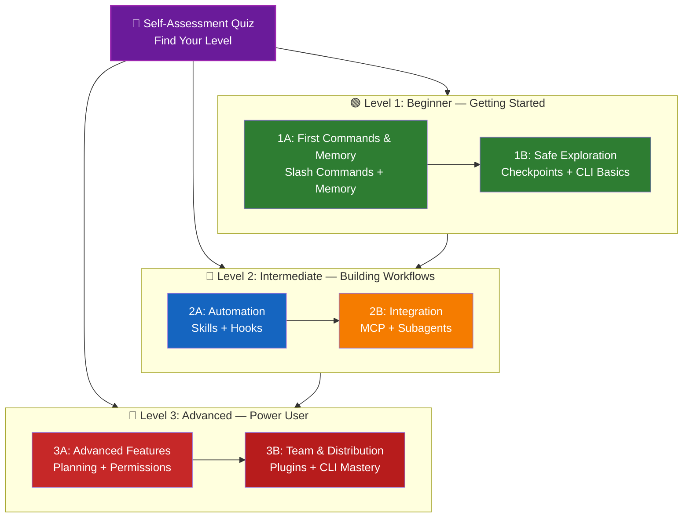

<!-- i18n-source: LEARNING-ROADMAP.md -->
<!-- i18n-source-sha: 188f468 -->
<!-- i18n-status: translated -->
<!-- i18n-date: 2026-10-26 -->

<picture>
  <source media="(prefers-color-scheme: dark)" srcset="resources/logos/claude-howto-logo-dark.svg">
  
</picture>

# 📚 Claude Code 학습 로드맵

**Claude Code가 처음인가요?** 이 가이드는 Claude Code의 기능을 자기 속도에 맞춰 익히도록 돕습니다. 완전한 초보자든 경험이 많은 개발자든, 아래 자기 평가 퀴즈부터 시작해 자신에게 맞는 경로를 찾으세요.

---

## 🧭 Find Your Level

모두가 같은 지점에서 출발하지는 않습니다. 아래 간단한 자기 평가로 자신에게 맞는 진입점을 찾으세요.

**다음 질문에 솔직하게 답해 보세요:**

- [ ] Claude Code를 실행해 대화를 나눠 본 적이 있다 (`claude`)
- [ ] CLAUDE.md 파일을 만들거나 편집한 적이 있다
- [ ] 기본 슬래시 커맨드를 3개 이상 사용해 봤다 (예: /help, /compact, /model)
- [ ] 커스텀 슬래시 커맨드나 스킬(SKILL.md)을 만든 적이 있다
- [ ] MCP 서버를 설정한 적이 있다 (예: GitHub, 데이터베이스)
- [ ] ~/.claude/settings.json에 훅을 설정한 적이 있다
- [ ] 커스텀 서브에이전트를 만들거나 사용한 적이 있다 (.claude/agents/)
- [ ] 스크립팅이나 CI/CD에 프린트 모드(`claude -p`)를 사용한 적이 있다

**내 레벨:**

| 점검 개수 | 레벨 | 시작 지점 | 완료 시간 |
|--------|-------|----------|------------------|
| 0-2 | **레벨 1: 초급** — 시작하기 | [마일스톤 1A](#마일스톤-1a-첫-명령어와-메모리) | 약 3시간 |
| 3-5 | **레벨 2: 중급** — 워크플로 구축 | [마일스톤 2A](#마일스톤-2a-자동화-스킬--훅) | 약 5시간 |
| 6-8 | **레벨 3: 고급** — 파워 유저 & 팀 리드 | [마일스톤 3A](#마일스톤-3a-고급-기능) | 약 5시간 |

> **팁**: 확신이 서지 않으면 한 레벨 낮은 곳에서 시작하세요. 기초 개념을 놓치는 것보다 익숙한 내용을 빠르게 복습하는 편이 낫습니다.

> **대화형 버전**: Claude Code에서 `/self-assessment`를 실행하면 10개 기능 영역 전반의 숙련도를 점수화하고 개인 맞춤 학습 경로를 만들어 주는 대화형 퀴즈를 진행합니다.

---

## 🎯 학습 철학

이 저장소의 폴더 번호는 세 가지 핵심 원칙에 따라 **권장 학습 순서**로 매겨져 있습니다:

1. **의존성** - 기초 개념이 먼저 옵니다
2. **복잡도** - 쉬운 기능을 고급 기능보다 먼저 배치합니다
3. **사용 빈도** - 가장 자주 쓰는 기능을 앞쪽에서 가르칩니다

이 방식은 탄탄한 기초를 쌓는 동시에 즉각적인 생산성 이점을 얻게 해 줍니다.

---

## 🗺️ 학습 경로



**색상 범례:**
- 💜 보라: 자기 평가 퀴즈
- 🟢 초록: 레벨 1 — 초급 경로
- 🔵 파랑 / 🟡 금색: 레벨 2 — 중급 경로
- 🔴 빨강: 레벨 3 — 고급 경로

---

## 📊 전체 로드맵 표

| 단계 | 기능 | 복잡도 | 시간 | 레벨 | 의존성 | 배울 이유 | 핵심 이점 |
|------|---------|-----------|------|-------|--------------|----------------|--------------|
| **1** | [슬래시 커맨드](01-slash-commands/) | ⭐ 초급 | 30분 | 레벨 1 | 없음 | 빠른 생산성 확보 (기본 커맨드 60여 개 + 번들 스킬) | 즉시 자동화, 팀 표준 |
| **2** | [메모리](02-memory/) | ⭐⭐ 초급+ | 45분 | 레벨 1 | 없음 | 모든 기능에 필수 | 지속되는 컨텍스트, 선호 설정 |
| **3** | [체크포인트](08-checkpoints/) | ⭐⭐ 중급 | 45분 | 레벨 1 | 세션 관리 | 안전한 탐색 | 실험, 복원 |
| **4** | [CLI 기초](10-cli/) | ⭐⭐ 초급+ | 30분 | 레벨 1 | 없음 | CLI 핵심 사용법 | 대화형 모드와 프린트 모드 |
| **5** | [스킬](03-skills/) | ⭐⭐ 중급 | 1시간 | 레벨 2 | 슬래시 커맨드 | 자동 전문성 | 재사용 가능한 역량, 일관성 |
| **6** | [훅](06-hooks/) | ⭐⭐ 중급 | 1시간 | 레벨 2 | 도구, 커맨드 | 워크플로 자동화 (33개 이벤트, 5가지 유형) | 검증, 품질 게이트 |
| **7** | [MCP](05-mcp/) | ⭐⭐⭐ 중급+ | 1시간 | 레벨 2 | 설정 | 실시간 데이터 접근 | 실시간 연동, API |
| **8** | [서브에이전트](04-subagents/) | ⭐⭐⭐ 중급+ | 1.5시간 | 레벨 2 | 메모리, 커맨드 | 복잡한 작업 처리 (Explore, Plan 포함 기본 제공 6종) | 위임, 특화 전문성 |
| **9** | [고급 기능](09-advanced-features/) | ⭐⭐⭐⭐⭐ 고급 | 2-3시간 | 레벨 3 | 앞의 모든 항목 | 파워 유저 도구 | 플래닝, 오토 모드, 채널, 음성 받아쓰기, 권한 |
| **10** | [플러그인](07-plugins/) | ⭐⭐⭐⭐ 고급 | 2시간 | 레벨 3 | 앞의 모든 항목 | 완성형 솔루션 | 팀 온보딩, 배포 |
| **11** | [CLI 마스터](10-cli/) | ⭐⭐⭐ 고급 | 1시간 | 레벨 3 | 권장: 앞의 모든 항목 | 명령줄 사용법 완전 정복 | 스크립팅, CI/CD, 자동화 |

**총 학습 시간**: 약 11-13시간 (또는 자신의 레벨로 바로 뛰어들어 시간을 아낄 수 있습니다)

---

## 🟢 레벨 1: 초급 — 시작하기

**대상**: 퀴즈 점검이 0-2개인 사용자
**시간**: 약 3시간
**초점**: 즉각적인 생산성, 기본 개념 이해
**결과**: 일상에서 편하게 쓰는 사용자, 레벨 2를 시작할 준비 완료

### 마일스톤 1A: 첫 명령어와 메모리

**주제**: 슬래시 커맨드 + 메모리
**시간**: 1-2시간
**복잡도**: ⭐ 초급
**목표**: 커스텀 커맨드와 지속되는 컨텍스트로 즉시 생산성을 높입니다

#### 달성 목표
✅ 반복 작업을 위한 커스텀 슬래시 커맨드를 만듭니다
✅ 팀 표준을 담은 프로젝트 메모리를 설정합니다
✅ 개인 선호를 설정합니다
✅ Claude가 컨텍스트를 자동으로 불러오는 방식을 이해합니다

#### 실습

```bash
# Exercise 1: Install your first slash command
mkdir -p .claude/commands
cp 01-slash-commands/optimize.md .claude/commands/

# Exercise 2: Create project memory
cp 02-memory/project-CLAUDE.md ./CLAUDE.md

# Exercise 3: Try it out
# In Claude Code, type: /optimize
```

#### 성공 기준
- [ ] `/optimize` 커맨드를 성공적으로 실행했다
- [ ] Claude가 CLAUDE.md의 프로젝트 표준을 기억한다
- [ ] 슬래시 커맨드와 메모리를 언제 써야 하는지 이해한다

#### 다음 단계
익숙해지면 다음을 읽으세요:
- [01-slash-commands/README.md](01-slash-commands/README.md)
- [02-memory/README.md](02-memory/README.md)

> **이해도 점검**: Claude Code에서 `/lesson-quiz slash-commands` 또는 `/lesson-quiz memory`를 실행해 배운 내용을 확인하세요.

---

### 마일스톤 1B: 안전한 탐색

**주제**: 체크포인트 + CLI 기초
**시간**: 1시간
**복잡도**: ⭐⭐ 초급+
**목표**: 안전하게 실험하는 방법과 CLI 핵심 명령 사용법을 익힙니다

#### 달성 목표
✅ 안전한 실험을 위한 체크포인트를 만들고 복원합니다
✅ 대화형 모드와 프린트 모드의 차이를 이해합니다
✅ 기본 CLI 플래그와 옵션을 사용합니다
✅ 파이프로 파일을 처리합니다

#### 실습

```bash
# Exercise 1: Try checkpoint workflow
# In Claude Code:
# Make some experimental changes, then press Esc+Esc or use /rewind
# Select the checkpoint before your experiment
# Choose "Restore code and conversation" to go back

# Exercise 2: Interactive vs Print mode
claude "explain this project"           # Interactive mode
claude -p "explain this function"       # Print mode (non-interactive)

# Exercise 3: Process file content via piping
cat error.log | claude -p "explain this error"
```

#### 성공 기준
- [ ] 체크포인트를 만들고 되돌려 봤다
- [ ] 대화형 모드와 프린트 모드를 모두 사용해 봤다
- [ ] 파일을 Claude에 파이프로 넘겨 분석시켰다
- [ ] 안전한 실험에 체크포인트를 언제 쓸지 이해한다

#### 다음 단계
- 읽기: [08-checkpoints/README.md](08-checkpoints/README.md)
- 읽기: [10-cli/README.md](10-cli/README.md)
- **레벨 2 준비 완료!** [마일스톤 2A](#마일스톤-2a-자동화-스킬--훅)로 진행하세요

> **이해도 점검**: `/lesson-quiz checkpoints` 또는 `/lesson-quiz cli`를 실행해 레벨 2로 갈 준비가 되었는지 확인하세요.

---

## 🔵 레벨 2: 중급 — 워크플로 구축

**대상**: 퀴즈 점검이 3-5개인 사용자
**시간**: 약 5시간
**초점**: 자동화, 통합, 작업 위임
**결과**: 자동화된 워크플로와 외부 통합, 레벨 3을 시작할 준비 완료

### 사전 요구 사항 점검

레벨 2를 시작하기 전에 다음 레벨 1 개념에 익숙한지 확인하세요:

- [ ] 슬래시 커맨드를 만들고 사용할 수 있다 ([01-slash-commands/](01-slash-commands/))
- [ ] CLAUDE.md로 프로젝트 메모리를 설정했다 ([02-memory/](02-memory/))
- [ ] 체크포인트를 만들고 복원하는 방법을 안다 ([08-checkpoints/](08-checkpoints/))
- [ ] 명령줄에서 `claude`와 `claude -p`를 사용할 수 있다 ([10-cli/](10-cli/))

> **부족한 부분이 있나요?** 계속하기 전에 위에 링크된 튜토리얼을 복습하세요.

---

### 마일스톤 2A: 자동화 (스킬 + 훅)

**주제**: 스킬 + 훅
**시간**: 2-3시간
**복잡도**: ⭐⭐ 중급
**목표**: 자주 쓰는 워크플로와 품질 점검을 자동화합니다

#### 달성 목표
✅ YAML 프론트매터(`effort`, `shell` 필드 포함)로 특화 역량을 자동 호출합니다
✅ 33개 훅 이벤트 전반에 걸친 이벤트 기반 자동화를 설정합니다
✅ 5가지 훅 유형(command, http, mcp_tool, prompt, agent)을 모두 사용합니다
✅ 코드 품질 표준을 강제합니다
✅ 내 워크플로에 맞는 커스텀 훅을 만듭니다

#### 실습

```bash
# Exercise 1: Install a skill
cp -r 03-skills/code-review-specialist ~/.claude/skills/

# Exercise 2: Set up hooks
mkdir -p ~/.claude/hooks
cp 06-hooks/pre-tool-check.sh ~/.claude/hooks/
chmod +x ~/.claude/hooks/pre-tool-check.sh

# Exercise 3: Configure hooks in settings
# Add to ~/.claude/settings.json:
{
  "hooks": {
    "PreToolUse": [
      {
        "matcher": "Bash",
        "hooks": [
          {
            "type": "command",
            "command": "~/.claude/hooks/pre-tool-check.sh"
          }
        ]
      }
    ]
  }
}
```

#### 성공 기준
- [ ] 코드 리뷰 스킬이 필요할 때 자동으로 호출된다
- [ ] PreToolUse 훅이 도구 실행 전에 동작한다
- [ ] 스킬 자동 호출과 훅 이벤트 트리거의 차이를 이해한다

#### 다음 단계
- 직접 커스텀 스킬을 만들어 보세요
- 워크플로에 필요한 훅을 추가로 설정하세요
- 읽기: [03-skills/README.md](03-skills/README.md)
- 읽기: [06-hooks/README.md](06-hooks/README.md)

> **이해도 점검**: 다음으로 넘어가기 전에 `/lesson-quiz skills` 또는 `/lesson-quiz hooks`를 실행해 이해도를 확인하세요.

---

### 마일스톤 2B: 통합 (MCP + 서브에이전트)

**주제**: MCP + 서브에이전트
**시간**: 2-3시간
**복잡도**: ⭐⭐⭐ 중급+
**목표**: 외부 서비스를 연동하고 복잡한 작업을 위임합니다

#### 달성 목표
✅ GitHub, 데이터베이스 등에서 실시간 데이터에 접근합니다
✅ 특화된 AI 에이전트에게 작업을 위임합니다
✅ MCP와 서브에이전트를 언제 나눠 쓸지 이해합니다
✅ 통합된 워크플로를 만듭니다

#### 실습

```bash
# Exercise 1: Set up GitHub MCP
claude mcp add --transport http github https://api.githubcopilot.com/mcp/ --header "Authorization: Bearer YOUR_GITHUB_PAT"

# Exercise 2: Test MCP integration
# In Claude Code: /mcp__github__list_prs

# Exercise 3: Install subagents
mkdir -p .claude/agents
cp 04-subagents/*.md .claude/agents/
```

#### 통합 실습
다음 전체 워크플로를 시도해 보세요:
1. MCP로 GitHub PR을 가져옵니다
2. Claude가 code-reviewer 서브에이전트에게 리뷰를 위임하게 합니다
3. 훅으로 테스트를 자동 실행합니다

#### 성공 기준
- [ ] MCP로 GitHub 데이터를 성공적으로 조회했다
- [ ] Claude가 복잡한 작업을 서브에이전트에게 위임한다
- [ ] MCP와 서브에이전트의 차이를 이해한다
- [ ] 하나의 워크플로에서 MCP + 서브에이전트 + 훅을 조합했다

#### 다음 단계
- 추가 MCP 서버를 설정하세요 (데이터베이스, Slack 등)
- 내 도메인에 맞는 커스텀 서브에이전트를 만드세요
- 읽기: [05-mcp/README.md](05-mcp/README.md)
- 읽기: [04-subagents/README.md](04-subagents/README.md)
- **레벨 3 준비 완료!** [마일스톤 3A](#마일스톤-3a-고급-기능)로 진행하세요

> **이해도 점검**: `/lesson-quiz mcp` 또는 `/lesson-quiz subagents`를 실행해 레벨 3으로 갈 준비가 되었는지 확인하세요.

---

## 🔴 레벨 3: 고급 — 파워 유저 & 팀 리드

**대상**: 퀴즈 점검이 6-8개인 사용자
**시간**: 약 5시간
**초점**: 팀 도구, CI/CD, 엔터프라이즈 기능, 플러그인 개발
**결과**: 파워 유저, 팀 워크플로와 CI/CD를 구축할 수 있는 수준

### 사전 요구 사항 점검

레벨 3을 시작하기 전에 다음 레벨 2 개념에 익숙한지 확인하세요:

- [ ] 자동 호출되는 스킬을 만들고 사용할 수 있다 ([03-skills/](03-skills/))
- [ ] 이벤트 기반 자동화를 위한 훅을 설정했다 ([06-hooks/](06-hooks/))
- [ ] 외부 데이터를 위해 MCP 서버를 설정할 수 있다 ([05-mcp/](05-mcp/))
- [ ] 작업 위임을 위해 서브에이전트를 사용하는 방법을 안다 ([04-subagents/](04-subagents/))

> **부족한 부분이 있나요?** 계속하기 전에 위에 링크된 튜토리얼을 복습하세요.

---

### 마일스톤 3A: 고급 기능

**주제**: 고급 기능 (플래닝, 권한, 확장 사고, 오토 모드, 채널, 음성 받아쓰기, 원격/데스크톱/웹)
**시간**: 2-3시간
**복잡도**: ⭐⭐⭐⭐⭐ 고급
**목표**: 고급 워크플로와 파워 유저 도구를 완전히 익힙니다

#### 달성 목표
✅ 복잡한 기능을 위한 플래닝 모드
✅ 6가지 모드의 세밀한 권한 제어 (manual — 이전의 default, acceptEdits, plan, auto, dontAsk, bypassPermissions)
✅ Alt+T / Option+T 토글로 확장 사고 전환
✅ 백그라운드 작업 관리
✅ 학습된 선호를 담는 오토 메모리
✅ 백그라운드 안전 분류기가 붙은 오토 모드
✅ 이벤트(CI 결과, 채팅 메시지, 웹훅)를 실행 중인 세션으로 밀어 넣는 채널
✅ 핸즈프리 상호작용을 위한 음성 받아쓰기
✅ 원격 제어(정식 제공 — 내 머신이 Claude 앱에 기기 카드로 나타납니다), 데스크톱 앱, 웹 세션
✅ 멀티 에이전트 협업을 위한 에이전트 팀

#### 실습

```bash
# Exercise 1: Use planning mode
/plan Implement user authentication system

# Exercise 2: Try permission modes (6 available: manual [formerly default], acceptEdits, plan, auto, dontAsk, bypassPermissions)
claude --permission-mode plan "analyze this codebase"
claude --permission-mode acceptEdits "refactor the auth module"
claude --permission-mode auto "implement the feature"

# Exercise 3: Enable extended thinking
# Press Alt+T (Option+T on macOS) during a session to toggle

# Exercise 4: Advanced checkpoint workflow
# 1. Create checkpoint "Clean state"
# 2. Use planning mode to design a feature
# 3. Implement with subagent delegation
# 4. Run tests in background
# 5. If tests fail, rewind to checkpoint
# 6. Try alternative approach

# Exercise 5: Try auto mode (background safety classifier)
claude --permission-mode auto "implement user settings page"

# Exercise 6: Enable agent teams
export CLAUDE_CODE_EXPERIMENTAL_AGENT_TEAMS=1
# Ask Claude: "Implement feature X using a team approach"

# Exercise 7: Scheduled tasks
/loop 5m /check-status
# Tasks are session-scoped; for persistent scheduling use Routines or Desktop scheduled tasks

# Exercise 8: Channels (research preview)
# A channel is an MCP server that pushes events into your running session

# Exercise 9: Voice Dictation
# Use voice input for hands-free interaction with Claude Code
```

#### 성공 기준
- [ ] 복잡한 기능에 플래닝 모드를 사용했다
- [ ] 권한 모드(plan, acceptEdits, auto, dontAsk)를 설정했다
- [ ] Alt+T / Option+T로 확장 사고를 전환했다
- [ ] 백그라운드 안전 분류기가 붙은 오토 모드를 사용했다
- [ ] 긴 작업에 백그라운드 작업을 사용했다
- [ ] 외부 이벤트를 세션으로 밀어 넣는 채널을 살펴봤다
- [ ] 핸즈프리 입력을 위해 음성 받아쓰기를 시도했다
- [ ] 원격 제어, 데스크톱 앱, 웹 세션을 이해한다
- [ ] 다른 세션이 유휴 상태가 될 때 알림을 받도록 크로스 세션 `SendMessage`에 `notify_when_idle`을 사용했다
- [ ] 협업 작업에 에이전트 팀을 활성화해 사용했다
- [ ] 반복 작업이나 예약 모니터링에 `/loop`를 사용했다

#### 다음 단계
- 읽기: [09-advanced-features/README.md](09-advanced-features/README.md)

> **이해도 점검**: `/lesson-quiz advanced`를 실행해 파워 유저 기능 숙달도를 확인하세요.

---

### 마일스톤 3B: 팀 & 배포 (플러그인 + CLI 마스터)

**주제**: 플러그인 + CLI 마스터 + CI/CD
**시간**: 2-3시간
**복잡도**: ⭐⭐⭐⭐ 고급
**목표**: 팀 도구를 만들고, 플러그인을 제작하며, CI/CD 연동을 완전히 익힙니다

#### 달성 목표
✅ 완성형 번들 플러그인을 설치하고 직접 만듭니다
✅ 스크립팅과 자동화를 위한 CLI를 완전히 익힙니다
✅ `claude -p`로 CI/CD 연동을 설정합니다
✅ 자동화 파이프라인을 위한 JSON 출력
✅ 세션 관리와 배치 처리

#### 실습

```bash
# Exercise 1: Install a complete plugin
claude --plugin-dir ./07-plugins/pr-review  # from the repo root

# Exercise 2: Print mode for CI/CD
claude -p "Run all tests and generate report"

# Exercise 3: JSON output for scripts
claude -p --output-format json "list all functions"

# Exercise 4: Session management and resumption
claude -r "feature-auth" "continue implementation"

# Exercise 5: CI/CD integration with constraints
claude -p --max-turns 3 --output-format json "review code"

# Exercise 6: Batch processing
for file in *.md; do
  claude -p --output-format json "summarize this: $(cat $file)" > ${file%.md}.summary.json
done
```

#### CI/CD 연동 실습
간단한 CI/CD 스크립트를 만들어 보세요:
1. `claude -p`로 변경된 파일을 리뷰합니다
2. 결과를 JSON으로 출력합니다
3. `jq`로 특정 이슈를 처리합니다
4. GitHub Actions 워크플로에 통합합니다

#### 성공 기준
- [ ] 플러그인을 설치하고 사용했다
- [ ] 팀을 위한 플러그인을 만들거나 수정했다
- [ ] CI/CD에서 프린트 모드(`claude -p`)를 사용했다
- [ ] 스크립팅용 JSON 출력을 생성했다
- [ ] 이전 세션을 성공적으로 재개했다
- [ ] 배치 처리 스크립트를 만들었다
- [ ] Claude를 CI/CD 워크플로에 통합했다

#### CLI의 실제 활용 사례
- **코드 리뷰 자동화**: CI/CD 파이프라인에서 코드 리뷰를 실행합니다
- **로그 분석**: 오류 로그와 시스템 출력을 분석합니다
- **문서 생성**: 문서를 배치로 생성합니다
- **테스트 인사이트**: 테스트 실패를 분석합니다
- **성능 분석**: 성능 지표를 검토합니다
- **데이터 처리**: 데이터 파일을 변환하고 분석합니다

#### 다음 단계
- 읽기: [07-plugins/README.md](07-plugins/README.md)
- 읽기: [10-cli/README.md](10-cli/README.md)
- 팀 전체가 쓰는 CLI 단축 명령과 플러그인을 만드세요
- 배치 처리 스크립트를 설정하세요

> **이해도 점검**: `/lesson-quiz plugins` 또는 `/lesson-quiz cli`를 실행해 숙달도를 확인하세요.

---

## 🧪 실력 점검

이 저장소에는 Claude Code에서 언제든 이해도를 평가할 수 있는 대화형 스킬 두 가지가 들어 있습니다:

| 스킬 | 명령 | 용도 |
|-------|---------|---------|
| **자기 평가** | `/self-assessment` | 10개 기능 전반의 종합 숙련도를 평가합니다. 빠른 모드(2분) 또는 심층 모드(5분)를 골라 개인 맞춤 스킬 프로필과 학습 경로를 받으세요. |
| **레슨 퀴즈** | `/lesson-quiz [lesson]` | 특정 레슨에 대한 이해도를 10개 문항으로 점검합니다. 레슨 전(사전 점검), 진행 중(진행 점검), 이후(숙달 확인)에 활용하세요. |

**예시:**
```
/self-assessment                  # Find your overall level
/lesson-quiz hooks                # Quiz on Lesson 06: Hooks
/lesson-quiz 03                   # Quiz on Lesson 03: Skills
/lesson-quiz advanced-features    # Quiz on Lesson 09
```

---

## ⚡ 빠른 시작 경로

### 15분밖에 없을 때
**목표**: 첫 성과를 내기

1. 슬래시 커맨드 하나를 복사합니다: `cp 01-slash-commands/optimize.md .claude/commands/`
2. Claude Code에서 실행합니다: `/optimize`
3. 읽기: [01-slash-commands/README.md](01-slash-commands/README.md)

**결과**: 동작하는 슬래시 커맨드 하나와 기본 개념을 갖게 됩니다

---

### 1시간이 있을 때
**목표**: 필수 생산성 도구를 갖추기

1. **슬래시 커맨드** (15분): `/optimize`와 `/pr`을 복사해 테스트합니다
2. **프로젝트 메모리** (15분): 프로젝트 표준을 담은 CLAUDE.md를 만듭니다
3. **스킬 설치** (15분): code-review-specialist 스킬을 설정합니다
4. **함께 사용해 보기** (15분): 두 요소가 어떻게 맞물리는지 확인합니다

**결과**: 커맨드·메모리·자동 스킬을 갖춘 기본 생산성 향상

---

### 주말이 있을 때
**목표**: 대부분의 기능에 능숙해지기

**토요일 오전** (3시간):
- 마일스톤 1A 완료: 슬래시 커맨드 + 메모리
- 마일스톤 1B 완료: 체크포인트 + CLI 기초

**토요일 오후** (3시간):
- 마일스톤 2A 완료: 스킬 + 훅
- 마일스톤 2B 완료: MCP + 서브에이전트

**일요일** (4시간):
- 마일스톤 3A 완료: 고급 기능
- 마일스톤 3B 완료: 플러그인 + CLI 마스터 + CI/CD
- 팀을 위한 커스텀 플러그인 제작

**결과**: 다른 사람을 가르치고 복잡한 워크플로를 자동화할 준비가 된 Claude Code 파워 유저

---

## 💡 학습 팁

### ✅ 권장

- **퀴즈를 먼저 풀어** 시작 지점을 찾으세요
- 각 마일스톤의 **실습을 끝까지 완료**하세요
- **단순하게 시작**하고 점차 복잡도를 높이세요
- 다음 기능으로 넘어가기 전에 **각 기능을 테스트**하세요
- 내 워크플로에 통하는 점을 **메모**하세요
- 고급 주제를 배울 때 **앞의 개념을 다시 참고**하세요
- 체크포인트로 **안전하게 실험**하세요
- 팀과 **지식을 공유**하세요

### ❌ 금지

- 상위 레벨로 뛰어들 때 **사전 요구 사항 점검을 건너뛰지 마세요**
- **모든 것을 한 번에 배우려 하지 마세요** - 벅찹니다
- **설정을 이해하지 않고 복사하지 마세요** - 디버깅 방법을 알 수 없습니다
- **테스트를 잊지 마세요** - 항상 기능이 동작하는지 확인하세요
- **마일스톤을 서두르지 마세요** - 이해할 시간을 충분히 가지세요
- **문서를 무시하지 마세요** - 각 README에 값진 세부 내용이 있습니다
- **혼자만 작업하지 마세요** - 팀 동료와 논의하세요

---

## 🎓 학습 스타일

### 시각형 학습자
- 각 README의 머메이드 다이어그램을 살펴보세요
- 명령 실행 흐름을 관찰하세요
- 나만의 워크플로 다이어그램을 그려 보세요
- 위의 시각적 학습 경로를 활용하세요

### 실습형 학습자
- 모든 실습을 빠짐없이 완료하세요
- 변형을 만들어 실험하세요
- 일부러 망가뜨렸다가 고쳐 보세요 (체크포인트를 활용하세요!)
- 나만의 예제를 만드세요

### 독서형 학습자
- 각 README를 꼼꼼히 읽으세요
- 코드 예제를 분석하세요
- 비교 표를 검토하세요
- 자료에 링크된 블로그 글을 읽으세요

### 협업형 학습자
- 페어 프로그래밍 세션을 잡으세요
- 팀 동료에게 개념을 가르쳐 보세요
- Claude Code 커뮤니티 논의에 참여하세요
- 나만의 설정을 공유하세요

---

## 📈 진행 상황 추적

아래 체크리스트로 레벨별 진행 상황을 추적하세요. 언제든 `/self-assessment`를 실행해 갱신된 스킬 프로필을 받고, 각 튜토리얼을 마친 뒤 `/lesson-quiz [lesson]`으로 이해도를 확인하세요.

### 🟢 레벨 1: 초급
- [ ] [01-slash-commands](01-slash-commands/) 완료
- [ ] [02-memory](02-memory/) 완료
- [ ] 첫 커스텀 슬래시 커맨드 작성
- [ ] 프로젝트 메모리 설정
- [ ] **마일스톤 1A 달성**
- [ ] [08-checkpoints](08-checkpoints/) 완료
- [ ] [10-cli](10-cli/) 기초 완료
- [ ] 체크포인트를 만들고 되돌려 보기
- [ ] 대화형 모드와 프린트 모드 사용
- [ ] **마일스톤 1B 달성**

### 🔵 레벨 2: 중급
- [ ] [03-skills](03-skills/) 완료
- [ ] [06-hooks](06-hooks/) 완료
- [ ] 첫 스킬 설치
- [ ] PreToolUse 훅 설정
- [ ] **마일스톤 2A 달성**
- [ ] [05-mcp](05-mcp/) 완료
- [ ] [04-subagents](04-subagents/) 완료
- [ ] GitHub MCP 연결
- [ ] 커스텀 서브에이전트 작성
- [ ] 하나의 워크플로에서 통합 요소 조합
- [ ] **마일스톤 2B 달성**

### 🔴 레벨 3: 고급
- [ ] [09-advanced-features](09-advanced-features/) 완료
- [ ] 플래닝 모드 성공적으로 사용
- [ ] 권한 모드 설정 (auto 포함 6가지 모드)
- [ ] 안전 분류기가 붙은 오토 모드 사용
- [ ] 확장 사고 토글 사용
- [ ] 채널과 음성 받아쓰기 살펴보기
- [ ] **마일스톤 3A 달성**
- [ ] [07-plugins](07-plugins/) 완료
- [ ] [10-cli](10-cli/) 고급 사용법 완료
- [ ] 프린트 모드(`claude -p`) CI/CD 설정
- [ ] 자동화용 JSON 출력 생성
- [ ] Claude를 CI/CD 파이프라인에 통합
- [ ] 팀 플러그인 제작
- [ ] **마일스톤 3B 달성**

---

## 🆘 흔한 학습 난관

### 난관 1: "개념이 한꺼번에 너무 많다"
**해결**: 한 번에 마일스톤 하나에 집중하세요. 다음으로 넘어가기 전에 모든 실습을 완료하세요.

### 난관 2: "언제 어떤 기능을 써야 할지 모르겠다"
**해결**: 메인 README의 [사용 사례 매트릭스](README.md#use-case-matrix)를 참고하세요.

### 난관 3: "설정이 동작하지 않는다"
**해결**: [문제 해결](README.md#troubleshooting) 섹션을 확인하고 파일 위치를 점검하세요.

### 난관 4: "개념이 서로 겹치는 것 같다"
**해결**: [기능 비교](README.md#feature-comparison) 표를 검토해 차이를 이해하세요.

### 난관 5: "모든 것을 기억하기 어렵다"
**해결**: 나만의 치트 시트를 만드세요. 체크포인트로 안전하게 실험하세요.

### 난관 6: "경험은 있지만 어디서 시작할지 모르겠다"
**해결**: 위의 [자기 평가 퀴즈](#-find-your-level)를 푸세요. 자신의 레벨로 건너뛰고 사전 요구 사항 점검으로 부족한 부분을 찾으세요.

---

## 🎯 완료 후 다음 단계

모든 마일스톤을 마쳤다면:

1. **팀 문서 작성** - 팀의 Claude Code 설정을 문서화합니다
2. **커스텀 플러그인 제작** - 최신 매니페스트 필드(`workflows`, `channels`, `dependencies`)를 포함해 팀 워크플로를 패키징합니다
3. **`/design` 사용해 보기** - HTML을 직접 쓰는 대신 디자인 캔버스에서 UI 목업, 화면 흐름, 랜딩 페이지를 스케치합니다 (v2.1.265+)
4. **원격 제어 살펴보기** - 휴대폰, 브라우저, Claude 앱에서 로컬 Claude Code 세션을 이어가거나, Claude 앱의 기기 카드로 휴대폰에서 세션을 시작합니다
5. **웹 세션 사용해 보기** - 브라우저 기반 인터페이스로 Claude Code를 사용해 원격 개발을 합니다
6. **데스크톱 앱 활용** - 네이티브 데스크톱 애플리케이션에서 Claude Code 기능을 사용합니다
7. **오토 모드 사용** - 백그라운드 안전 분류기와 함께 Claude가 자율적으로 작업하게 합니다
8. **오토 메모리 활용** - 시간이 지나면서 Claude가 내 선호를 자동으로 학습하게 합니다
9. **에이전트 팀 설정** - 복잡하고 다면적인 작업에서 여러 에이전트를 조율합니다
10. **채널 사용** - 이벤트(CI 결과, 채팅 메시지, 웹훅)를 실행 중인 세션으로 밀어 넣는 MCP 서버를 연결합니다
11. **음성 받아쓰기 사용해 보기** - 핸즈프리 음성 입력으로 Claude Code와 상호작용합니다
12. **예약 작업 사용** - `/loop`와 cron 도구로 반복 점검을 자동화합니다
13. **예제 기여** - 커뮤니티와 공유합니다
14. **다른 사람 멘토링** - 팀 동료의 학습을 돕습니다
15. **워크플로 최적화** - 사용 패턴을 바탕으로 계속 개선합니다
16. **최신 정보 유지** - Claude Code 릴리스와 새 기능을 따라갑니다

---

## 📚 추가 자료

### 공식 문서
- [Claude Code 문서](https://code.claude.com/docs/en/overview)
- [Anthropic 문서](https://docs.anthropic.com)
- [MCP 프로토콜 명세](https://modelcontextprotocol.io)

### 블로그 글
- [Discovering Claude Code Slash Commands](https://medium.com/@luongnv89/discovering-claude-code-slash-commands-cdc17f0dfb29)

### 커뮤니티
- [Anthropic Cookbook](https://github.com/anthropics/anthropic-cookbook)
- [MCP Servers 저장소](https://github.com/modelcontextprotocol/servers)

---

## 💬 피드백 및 지원

- **문제를 발견했나요?** 저장소에 이슈를 남겨 주세요
- **제안이 있나요?** PR을 보내 주세요
- **도움이 필요하신가요?** 문서를 확인하거나 커뮤니티에 물어보세요

---

**최종 업데이트**: 2026년 10월 18일
**Claude Code 버전**: 2.1.302
**출처**:
- https://code.claude.com/docs/en/overview
- https://code.claude.com/docs/en/hooks
- https://code.claude.com/docs/en/permission-modes
- https://github.com/anthropics/claude-code/releases/tag/v2.1.144
- https://github.com/anthropics/claude-code/releases/tag/v2.1.145
- https://code.claude.com/docs/en/model-config
- https://code.claude.com/docs/en/agent-teams
- https://code.claude.com/docs/en/mcp
- https://code.claude.com/docs/en/plugins/install
- https://code.claude.com/docs/en/channels
- https://code.claude.com/docs/en/remote-control
- https://code.claude.com/docs/en/scheduled-tasks
- https://code.claude.com/docs/en/commands
- https://code.claude.com/docs/en/sub-agents
**호환 모델**: Claude Fable 5.1, Claude Fable 5, Claude Opus 5, Claude Sonnet 5, Claude Sonnet 4.6, Claude Opus 4.8, Claude Haiku 4.5
**관리**: Claude How-To 기여자
**라이선스**: 교육 목적, 자유롭게 사용 및 수정 가능

---

[← 메인 README로 돌아가기](README.md)
