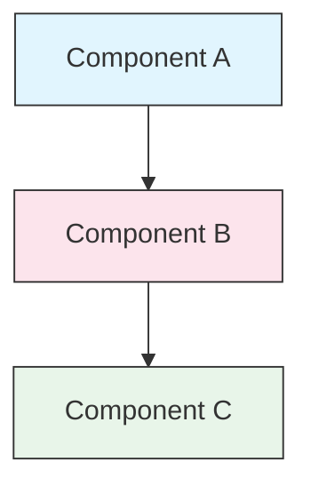

<!-- i18n-source: STYLE_GUIDE.md -->
<!-- i18n-source-sha: 188f468 -->
<!-- i18n-status: translated -->
<!-- i18n-date: 2026-10-26 -->

<picture>
  <source media="(prefers-color-scheme: dark)" srcset="resources/logos/claude-howto-logo-dark.svg">
  
</picture>

# 스타일 가이드

> Claude How To에 기여할 때 따르는 관례와 서식 규칙입니다. 이 가이드를 따르면 콘텐츠가 일관되고 전문적이며 유지보수하기 쉬운 상태로 유지됩니다.

---

## 목차

- [파일 및 폴더 이름 규칙](#파일-및-폴더-이름-규칙)
- [문서 구조](#문서-구조)
- [제목](#제목)
- [텍스트 서식](#텍스트-서식)
- [목록](#목록)
- [표](#표)
- [코드 블록](#코드-블록)
- [링크 및 상호 참조](#링크-및-상호-참조)
- [다이어그램](#다이어그램)
- [이모지 사용](#이모지-사용)
- [YAML 프론트매터](#yaml-프론트매터)
- [이미지 및 미디어](#이미지-및-미디어)
- [어조와 문체](#어조와-문체)
- [커밋 메시지](#커밋-메시지)
- [작성자 체크리스트](#작성자-체크리스트)

---

## 파일 및 폴더 이름 규칙

### 레슨 폴더

레슨 폴더는 **두 자리 숫자 접두사** 뒤에 **케밥 케이스** 설명자를 붙입니다:

```
01-slash-commands/
02-memory/
03-skills/
04-subagents/
05-mcp/
```

숫자는 초급에서 고급으로 이어지는 학습 경로 순서를 반영합니다.

### 파일 이름

| 유형 | 관례 | 예 |
|------|-----------|----------|
| **레슨 README** | `README.md` | `01-slash-commands/README.md` |
| **기능 파일** | 케밥 케이스 `.md` | `code-reviewer.md`, `generate-api-docs.md` |
| **셸 스크립트** | 케밥 케이스 `.sh` | `format-code.sh`, `validate-input.sh` |
| **설정 파일** | 표준 이름 | `.mcp.json`, `settings.json` |
| **메모리 파일** | 스코프 접두사 | `project-CLAUDE.md`, `personal-CLAUDE.md` |
| **최상위 문서** | 대문자 `.md` | `CATALOG.md`, `QUICK_REFERENCE.md`, `CONTRIBUTING.md` |
| **이미지 자산** | 케밥 케이스 | `pr-slash-command.png`, `claude-howto-logo.svg` |

### 규칙

- 모든 파일·폴더 이름에는 **소문자**를 씁니다(`README.md`, `CATALOG.md` 같은 최상위 문서는 예외)
- 단어 구분자로 **하이픈**(`-`)을 쓰고, 밑줄이나 공백은 절대 쓰지 않습니다
- 이름은 설명적이되 간결하게 유지합니다

---

## 문서 구조

### 루트 README

루트 `README.md`는 다음 순서를 따릅니다:

1. 로고(다크/라이트 변형을 가진 `<picture>` 요소)
2. H1 제목
3. 도입 인용구(한 줄짜리 가치 제안)
4. 비교 표가 있는 "Why This Guide?" 섹션
5. 수평선(`---`)
6. 목차
7. 기능 카탈로그
8. 빠른 탐색
9. 학습 경로
10. 기능 섹션
11. 시작하기
12. 모범 사례 / 문제 해결
13. 기여하기 / 라이선스

### 레슨 README

각 레슨 `README.md`는 다음 순서를 따릅니다:

1. H1 제목(예: `# Slash Commands`)
2. 간단한 개요 문단
3. 빠른 참조 표(선택)
4. 아키텍처 다이어그램(Mermaid)
5. 상세 섹션(H2)
6. 실습 예제(번호 매김, 4~6개)
7. 모범 사례(Do와 Don't 표)
8. 문제 해결
9. 관련 가이드 / 공식 문서
10. 문서 메타데이터 푸터

### 기능 및 예제 파일

개별 기능 파일(예: `optimize.md`, `pr.md`):

1. YAML 프론트매터(해당하는 경우)
2. H1 제목
3. 목적 / 설명
4. 사용 방법
5. 코드 예제
6. 커스터마이징 팁

### 섹션 구분선

문서의 주요 영역을 나눌 때 수평선(`---`)을 사용합니다:

```markdown
---

## New Major Section
```

도입 인용구 뒤와, 문서에서 논리적으로 구분되는 부분 사이에 배치합니다.

---

## 제목

### 계층

| 레벨 | 용도 | 예 |
|-------|-----|---------|
| `#` H1 | 페이지 제목(문서당 하나) | `# Slash Commands` |
| `##` H2 | 주요 섹션 | `## Best Practices` |
| `###` H3 | 하위 섹션 | `### Adding a Skill` |
| `####` H4 | 하위의 하위 섹션(드묾) | `#### Configuration Options` |

### 규칙

- **문서당 H1은 하나** — 페이지 제목만 씁니다
- **레벨을 건너뛰지 않습니다** — H2에서 H4로 바로 가지 않습니다
- **제목은 간결하게** — 2~5단어를 목표로 합니다
- **문장형 대소문자를 씁니다** — 첫 단어와 고유명사만 대문자로 표기합니다(예외: 기능명은 그대로)
- **이모지 접두사는 루트 README의 섹션 제목에만** 붙입니다([이모지 사용](#이모지-사용) 참고)

---

## 텍스트 서식

### 강조

| 스타일 | 사용 시점 | 예 |
|-------|------------|---------|
| **굵게**(`**text**`) | 핵심 용어, 표의 레이블, 중요한 개념 | `**Installation**:` |
| *기울임*(`*text*`) | 기술 용어의 첫 등장, 책·문서 제목 | `*frontmatter*` |
| `코드`(`` `text` ``) | 파일 이름, 명령어, 설정 값, 코드 참조 | `` `CLAUDE.md` `` |

### 주의 환기용 인용구

중요한 내용은 굵은 접두사가 붙은 인용구로 표시합니다:

```markdown
> **Note**: Custom slash commands have been merged into skills since v2.0.

> **Important**: Never commit API keys or credentials.

> **Tip**: Combine memory with skills for maximum effectiveness.
```

지원하는 콜아웃 유형은 **Note**, **Important**, **Tip**, **Warning**입니다.

### 문단

- 문단은 짧게 유지합니다(2~4문장)
- 문단 사이에 빈 줄을 넣습니다
- 핵심을 먼저 쓰고 맥락을 덧붙입니다
- "무엇"만이 아니라 "왜"를 설명합니다

---

## 목록

### 순서 없는 목록

대시(`-`)를 쓰고, 중첩에는 2칸 들여쓰기를 사용합니다:

```markdown
- First item
- Second item
  - Nested item
  - Another nested item
    - Deep nested (avoid going deeper than 3 levels)
- Third item
```

### 순서 있는 목록

순차 단계, 지시 사항, 순위 항목에는 번호 목록을 사용합니다:

```markdown
1. First step
2. Second step
   - Sub-point detail
   - Another sub-point
3. Third step
```

### 설명형 목록

키-값 형태 목록에는 굵은 레이블을 사용합니다:

```markdown
- **Performance bottlenecks** - identify O(n^2) operations, inefficient loops
- **Memory leaks** - find unreleased resources, circular references
- **Algorithm improvements** - suggest better algorithms or data structures
```

### 규칙

- 들여쓰기를 일관되게 유지합니다(레벨당 2칸)
- 목록 앞뒤에 빈 줄을 넣습니다
- 목록 항목의 구조를 평행하게 맞춥니다(모두 동사로 시작하거나, 모두 명사이거나)
- 3레벨보다 깊게 중첩하지 않습니다

---

## 표

### 표준 형식

```markdown
| Column 1 | Column 2 | Column 3 |
|----------|----------|----------|
| Data     | Data     | Data     |
```

### 자주 쓰는 표 패턴

**기능 비교(3~4열):**

```markdown
| Feature | Invocation | Persistence | Best For |
|---------|-----------|------------|----------|
| **Slash Commands** | Manual (`/cmd`) | Session only | Quick shortcuts |
| **Memory** | Auto-loaded | Cross-session | Long-term learning |
```

**Do와 Don't:**

```markdown
| Do | Don't |
|----|-------|
| Use descriptive names | Use vague names |
| Keep files focused | Overload a single file |
```

**빠른 참조:**

```markdown
| Aspect | Details |
|--------|---------|
| **Purpose** | Generate API documentation |
| **Scope** | Project-level |
| **Complexity** | Intermediate |
```

### 규칙

- 첫 열이 행 레이블일 때 **표 헤더를 굵게** 합니다
- 원문에서는 가독성을 위해 파이프를 정렬합니다(선택이지만 권장)
- 셀 내용은 간결하게 유지하고, 상세 내용은 링크로 넘깁니다
- 셀 안의 명령어와 파일 경로에는 `코드 서식`을 사용합니다

---

## 코드 블록

### 언어 태그

구문 강조를 위해 항상 언어 태그를 지정합니다:

| 언어 | 태그 | 용도 |
|----------|-----|---------|
| 셸 | `bash` | CLI 명령어, 스크립트 |
| Python | `python` | Python 코드 |
| JavaScript | `javascript` | JS 코드 |
| TypeScript | `typescript` | TS 코드 |
| JSON | `json` | 설정 파일 |
| YAML | `yaml` | 프론트매터, 설정 |
| Markdown | `markdown` | Markdown 예제 |
| SQL | `sql` | 데이터베이스 쿼리 |
| 일반 텍스트 | (태그 없음) | 예상 출력, 디렉터리 트리 |

### 작성 관례

```bash
# Comment explaining what the command does
claude mcp add notion --transport http https://mcp.notion.com/mcp
```

- 자명하지 않은 명령어 앞에는 **설명 주석 줄**을 넣습니다
- 모든 예제를 **복사해 바로 실행할 수 있게** 만듭니다
- 필요할 때는 **간단한 버전과 고급 버전을 모두** 보여 줍니다
- 이해에 도움이 될 때는 **예상 출력**을 포함합니다(태그 없는 코드 블록 사용)

### 설치 블록

설치 안내에는 이 패턴을 사용합니다:

```bash
# Copy files to your project
cp 01-slash-commands/*.md .claude/commands/
```

### 다단계 워크플로

```bash
# Step 1: Create the directory
mkdir -p .claude/commands

# Step 2: Copy the templates
cp 01-slash-commands/*.md .claude/commands/

# Step 3: Verify installation
ls .claude/commands/
```

---

## 링크 및 상호 참조

### 내부 링크(상대 경로)

모든 내부 링크에는 상대 경로를 사용합니다:

```markdown
[Slash Commands](01-slash-commands/)
[Skills Guide](03-skills/)
[Memory Architecture](02-memory/#memory-architecture)
```

레슨 폴더에서 루트나 형제 폴더로 돌아갈 때:

```markdown
[Back to main guide](../README.md)
[Related: Skills](../03-skills/)
```

### 외부 링크(절대 URL)

설명이 담긴 앵커 텍스트와 함께 전체 URL을 사용합니다:

```markdown
[Anthropic's official documentation](https://code.claude.com/docs/en/overview)
```

- 앵커 텍스트로 "click here"나 "this link"를 쓰지 않습니다
- 문맥 없이 읽어도 의미가 통하는 설명 텍스트를 씁니다

### 섹션 앵커

GitHub 스타일 앵커로 같은 문서 안의 섹션을 링크합니다:

```markdown
[Feature Catalog](#-feature-catalog)
[Best Practices](#best-practices)
```

### 관련 가이드 패턴

레슨 끝에는 관련 가이드 섹션을 둡니다:

```markdown
## Related Guides

- [Slash Commands](../01-slash-commands/) - Quick shortcuts
- [Memory](../02-memory/) - Persistent context
- [Skills](../03-skills/) - Reusable capabilities
```

---

## 다이어그램

### Mermaid

모든 다이어그램에는 Mermaid를 사용합니다. 지원하는 유형은 다음과 같습니다:

- `graph TB` / `graph LR` — 아키텍처, 계층, 흐름
- `sequenceDiagram` — 상호작용 흐름
- `timeline` — 시간순 나열

GitHub는 Mermaid를 기본으로 렌더링합니다. 웹사이트와 EPUB은 `scripts/vendor_assets.py`에 고정된 [Pele](https://github.com/obsidianmd/pele)로 같은 원본을 렌더링하고, `mermaid-syntax` pre-commit 훅이 동일한 번들로 모든 블록을 검증하므로, 훅을 통과한 블록은 어디서나 같게 렌더링됩니다.

### 스타일 관례

style 블록으로 일관된 색을 적용합니다:



**색상 팔레트:**

| 색 | 16진수 | 용도 |
|-------|-----|---------|
| 연한 파랑 | `#e1f5fe` | 기본 구성 요소, 입력 |
| 연한 분홍 | `#fce4ec` | 처리, 미들웨어 |
| 연한 초록 | `#e8f5e9` | 출력, 결과 |
| 연한 노랑 | `#fff9c4` | 설정, 선택 사항 |
| 연한 보라 | `#f3e5f5` | 사용자 대면, UI |

### 규칙

- 노드 레이블에는 `["Label text"]` 형식을 씁니다(특수 문자를 쓸 수 있습니다)
- 레이블 안의 줄바꿈에는 `<br/>`를 씁니다
- 레이블은 평문으로 유지하고, 번호가 붙은 레이블은 그대로 씁니다(`["1. Load file"]`, 마침표 앞에 백슬래시 없음)
- `%%{init}%%` 지시자나 Mermaid 테마에 의존하지 않습니다. 웹사이트가 자체 라이트·다크 팔레트를 적용합니다
- 다이어그램은 단순하게 유지합니다(노드 최대 10~12개)
- 접근성을 위해 다이어그램 아래에 짧은 설명을 붙입니다
- 계층에는 위에서 아래로(`TB`), 워크플로에는 왼쪽에서 오른쪽으로(`LR`)를 씁니다

---

## 이모지 사용

### 이모지를 쓰는 위치

이모지는 **아껴서, 목적이 있을 때만** 씁니다. 즉 특정 맥락에서만 사용합니다:

| 맥락 | 이모지 | 예 |
|---------|--------|---------|
| 루트 README 섹션 제목 | 카테고리 아이콘 | `## 📚 Learning Path` |
| 스킬 레벨 표시 | 색 원 | 🟢 초급, 🔵 중급, 🔴 고급 |
| Do와 Don't | 체크/엑스 표시 | ✅ 이렇게 합니다, ❌ 이렇게 하지 않습니다 |
| 복잡도 등급 | 별 | ⭐⭐⭐ |

### 표준 이모지 세트

| 이모지 | 의미 |
|-------|---------|
| 📚 | 학습, 가이드, 문서 |
| ⚡ | 시작하기, 빠른 참조 |
| 🎯 | 기능, 빠른 참조 |
| 🎓 | 학습 경로 |
| 📊 | 통계, 비교 |
| 🚀 | 설치, 빠른 명령어 |
| 🟢 | 초급 레벨 |
| 🔵 | 중급 레벨 |
| 🔴 | 고급 레벨 |
| ✅ | 권장 관행 |
| ❌ | 지양 / 안티패턴 |
| ⭐ | 복잡도 등급 단위 |

### 규칙

- 본문이나 문단에는 **절대 이모지를 쓰지 않습니다**
- 루트 README에서 **제목에만 이모지를 씁니다**(레슨 README에는 쓰지 않습니다)
- **장식용 이모지를 추가하지 않습니다** — 모든 이모지는 의미를 전달해야 합니다
- 이모지 사용은 위 표와 일관되게 유지합니다

---

## YAML 프론트매터

### 기능 파일(스킬, 커맨드, 에이전트)

```yaml
---
name: unique-identifier
description: What this feature does and when to use it
allowed-tools: Bash, Read, Grep
---
```

### 선택 필드

```yaml
---
name: my-feature
description: Brief description
argument-hint: "[file-path] [options]"
allowed-tools: Bash, Read, Grep, Write, Edit
model: opus                        # opus, sonnet, or haiku
disable-model-invocation: true     # User-only invocation
user-invocable: false              # Hidden from user menu
context: fork                      # Run in isolated subagent
agent: Explore                     # Agent type for context: fork
---
```

### 규칙

- 프론트매터는 파일 맨 위에 둡니다
- `name` 필드에는 **케밥 케이스**를 씁니다
- `description`은 한 문장으로 유지합니다
- 필요한 필드만 포함합니다

---

## 이미지 및 미디어

### 로고 패턴

로고로 시작하는 모든 문서는 다크/라이트 모드 지원을 위해 `<picture>` 요소를 사용합니다:

```html
<picture>
  <source media="(prefers-color-scheme: dark)" srcset="resources/logos/claude-howto-logo-dark.svg">
  
</picture>
```

### 스크린샷

- 관련 레슨 폴더에 저장합니다(예: `01-slash-commands/pr-slash-command.png`)
- 케밥 케이스 파일 이름을 사용합니다
- 설명이 담긴 alt 텍스트를 포함합니다
- 다이어그램에는 SVG를, 스크린샷에는 PNG를 우선합니다

### 규칙

- 이미지에는 항상 alt 텍스트를 제공합니다
- 이미지 파일 크기를 적절히 유지합니다(PNG는 500KB 미만)
- 이미지 참조에는 상대 경로를 사용합니다
- 이미지는 이를 참조하는 문서와 같은 디렉터리에 두거나, 공용 이미지는 `assets/`에 둡니다

---

## 어조와 문체

### 작성 스타일

- **전문적이되 친근하게** — 용어를 남발하지 않으면서 기술적으로 정확하게 씁니다
- **능동태** — "Create a file"이지 "A file should be created"가 아닙니다
- **직접적인 지시** — "Run this command"이지 "You might want to run this command"가 아닙니다
- **초보자 친화** — 독자가 Claude Code는 처음이지만 프로그래밍은 처음이 아니라고 가정합니다

### 콘텐츠 원칙

| 원칙 | 예 |
|-----------|---------|
| **보여 주기, 말하지 않기** | 추상적인 설명이 아니라 동작하는 예제를 제공합니다 |
| **점진적 복잡도** | 단순하게 시작하고 뒤 섹션에서 깊이를 더합니다 |
| **"왜"를 설명하기** | "Use memory for..."만 쓰지 말고 "...because..."까지 붙입니다 |
| **복사해 바로 실행** | 모든 코드 블록은 그대로 붙여 넣으면 동작해야 합니다 |
| **실제 상황 맥락** | 억지스러운 예가 아니라 실용적인 시나리오를 씁니다 |

### 용어 선택

- "Claude Code"를 씁니다("Claude CLI"나 "the tool"이 아닙니다)
- "skill"을 씁니다("custom command"는 폐기된 용어입니다)
- 번호가 붙은 섹션에는 "lesson" 또는 "guide"를 씁니다
- 개별 기능 파일에는 "example"을 씁니다

---

## 커밋 메시지

[Conventional Commits](https://www.conventionalcommits.org/)를 따릅니다:

```
type(scope): description
```

### 타입

| 타입 | 용도 |
|------|---------|
| `feat` | 새 기능, 예제, 가이드 |
| `fix` | 버그 수정, 오류 정정, 끊긴 링크 |
| `docs` | 문서 개선 |
| `refactor` | 동작을 바꾸지 않는 구조 개편 |
| `style` | 서식만 바꾸는 변경 |
| `test` | 테스트 추가 또는 변경 |
| `chore` | 빌드, 의존성, CI |

### 스코프

레슨 이름이나 파일 영역을 스코프로 씁니다:

```
feat(slash-commands): Add API documentation generator
docs(memory): Improve personal preferences example
fix(README): Correct table of contents link
docs(skills): Add comprehensive code review skill
```

---

## 문서 메타데이터 푸터

레슨 README는 메타데이터 블록으로 끝납니다:

```markdown
---
**Last Updated**: August 25, 2026
**Claude Code Version**: 2.1.245
**Compatible Models**: Claude Fable 5, Claude Opus 5, Claude Sonnet 5, Claude Sonnet 4.6, Claude Opus 4.8, Claude Haiku 4.5
```

- 여기 보인 값이 아니라 현재 동기화 실행에서 캡처된 버전을 사용합니다
- 월 + 일 + 연도 형식을 사용합니다(예: "May 20, 2026")
- 기능이 바뀌면 버전을 갱신합니다
- 호환되는 모델을 모두 나열합니다

---

## 작성자 체크리스트

콘텐츠를 제출하기 전에 다음을 확인합니다:

- [ ] 파일·폴더 이름이 케밥 케이스입니다
- [ ] 문서가 H1 제목으로 시작합니다(파일당 하나)
- [ ] 제목 계층이 올바릅니다(레벨 건너뛰 없음)
- [ ] 모든 코드 블록에 언어 태그가 있습니다
- [ ] 코드 예제가 복사해 바로 실행 가능합니다
- [ ] 내부 링크가 상대 경로를 사용합니다
- [ ] 외부 링크에 설명형 앵커 텍스트가 있습니다
- [ ] 표가 올바르게 서식화되어 있습니다
- [ ] 이모지가 표준 세트를 따릅니다(쓴다면)
- [ ] Mermaid 다이어그램이 표준 색상 팔레트를 사용합니다
- [ ] 민감한 정보(API 키, 자격 증명)가 없습니다
- [ ] YAML 프론트매터가 유효합니다(해당하는 경우)
- [ ] 이미지에 alt 텍스트가 있습니다
- [ ] 문단이 짧고 초점이 분명합니다
- [ ] 관련 가이드 섹션이 적절한 레슨을 링크합니다
- [ ] 커밋 메시지가 Conventional Commits 형식을 따릅니다

---

**최종 업데이트**: 2026년 8월 25일
**Claude Code 버전**: 2.1.245
**출처**:
- https://code.claude.com/docs/en/overview
- https://code.claude.com/docs/en/changelog
- https://code.claude.com/docs/en/model-config
- https://github.com/anthropics/claude-code/releases/tag/v2.1.154
**호환 모델**: Claude Fable 5, Claude Opus 5, Claude Sonnet 5, Claude Sonnet 4.6, Claude Opus 4.8, Claude Haiku 4.5
