<!-- i18n-source: claude_concepts_guide.md -->
<!-- i18n-source-sha: 188f468 -->
<!-- i18n-status: translated -->
<!-- i18n-date: 2026-10-26 -->

<picture>
  <source media="(prefers-color-scheme: dark)" srcset="../resources/logos/claude-howto-logo-dark.svg">
  
</picture>

# Claude 개념 완전 가이드

Claude Code의 기능들이 어떻게 동작하고 서로 어떻게 맞물리는지 개념적으로 훑어봅니다 — 아키텍처 다이어그램, 결정 표, 그리고 슬래시 커맨드·서브에이전트·메모리·MCP·스킬·플러그인·훅 등의 비교를 담았습니다.

> **이 가이드 사용법**: 이 문서는 *개념*을 다룹니다 — 각 기능이 무엇이고, 내부에서 어떻게 동작하며, 언제 꺼내 써야 하는지. **복사해 바로 쓰는 템플릿과 전체 레퍼런스는 번호가 붙은 모듈**(`01-` ~ `10-`)에 있고, 각 절이 해당 모듈로 링크합니다. 여기서 먼저 머릿속 모델을 세우고, 실제 설정은 모듈로 가서 하세요.

---

## 목차

1. [슬래시 커맨드](#슬래시-커맨드) — [모듈](01-slash-commands/)
2. [서브에이전트](#서브에이전트) — [모듈](04-subagents/)
3. [메모리](#메모리) — [모듈](02-memory/)
4. [MCP 프로토콜](#mcp-프로토콜) — [모듈](05-mcp/)
5. [에이전트 스킬](#에이전트-스킬) — [모듈](03-skills/)
6. [플러그인](#claude-code-플러그인) — [모듈](07-plugins/)
7. [비교와 통합](#비교와-통합)
8. [요약 표](#요약-표)
9. [빠른 시작 가이드](#빠른-시작-가이드)
10. [훅](#훅) — [모듈](06-hooks/)
11. [체크포인트와 되감기](#체크포인트와-되감기) — [모듈](08-checkpoints/)
12. [고급 기능](#고급-기능) — [모듈](09-advanced-features/)
13. [모델과 추론 에포트](#모델과-추론-에포트) — [모듈](10-cli/)
14. [리소스](#리소스)

---

## 슬래시 커맨드

### 개요

슬래시 커맨드는 Claude Code가 실행할 수 있는 Markdown 파일 형태로 저장된, 사용자가 직접 호출하는 단축키입니다. 자주 쓰는 프롬프트와 워크플로를 팀이 표준화할 수 있게 해 줍니다.

### 아키텍처

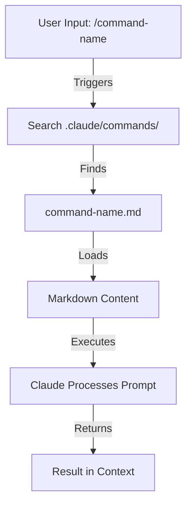

### 파일 구조

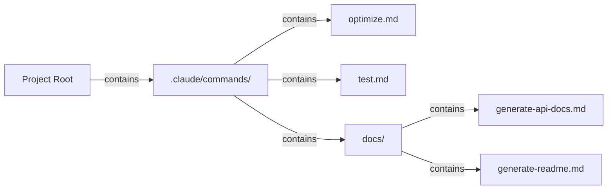

### 커맨드 배치 표

| 위치 | 범위 | 사용 가능 대상 | 사용 사례 | Git 추적 |
|----------|-------|--------------|----------|-------------|
| `.claude/commands/` | 프로젝트별 | 팀 구성원 | 팀 워크플로, 공유 표준 | ✅ 예 |
| `~/.claude/commands/` | 개인 | 개인 사용자 | 프로젝트를 넘나드는 개인 단축키 | ❌ 아니요 |
| 하위 디렉터리 | 네임스페이스 | 상위 디렉터리 기준 | 카테고리별 정리 | ✅ 예 |

### 기능과 지원 범위

| 기능 | 예시 | 지원 여부 |
|---------|---------|-----------|
| 셸 스크립트 실행 | `bash scripts/deploy.sh` | ✅ 예 |
| 파일 참조 | `@path/to/file.js` | ✅ 예 |
| Bash 연동 | `$(git log --oneline)` | ✅ 예 |
| 인자 전달 | `/pr --verbose` | ✅ 예 |
| MCP 커맨드 | `/mcp__github__list_prs` | ✅ 예 |

### 실전 예제

복사해 바로 쓰는 커맨드 템플릿 8종이 **[01-slash-commands/](01-slash-commands/)**에 있습니다 — `/optimize`, `/pr`, `/commit`, `/push-all`, `/generate-api-docs`, `/doc-refactor`, `/setup-ci-cd`, `/unit-test-expand`.

**[01-slash-commands/README.md](01-slash-commands/README.md)**에는 내장 커맨드 전체 레퍼런스(60개 이상)와 프론트매터 필드 표도 함께 있습니다.

### 커맨드 생명주기 다이어그램

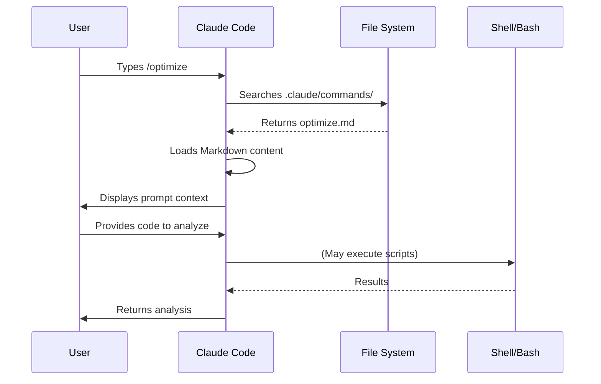

### 모범 사례

| ✅ 하세요 | ❌ 하지 마세요 |
|------|---------|
| 명확하고 행동 지향적인 이름을 쓴다 | 일회성 작업용 커맨드를 만든다 |
| description에 트리거 단어를 적어 둔다 | 커맨드 안에 복잡한 로직을 넣는다 |
| 커맨드는 한 가지 작업에 집중시킨다 | 중복되는 커맨드를 만든다 |
| 프로젝트 커맨드는 버전 관리한다 | 민감한 정보를 하드코딩한다 |
| 하위 디렉터리로 정리한다 | 커맨드를 길게 나열한다 |
| 단순하고 읽기 쉬운 프롬프트를 쓴다 | 축약되거나 난해한 표현을 쓴다 |

---

## 서브에이전트

### 개요

서브에이전트는 격리된 컨텍스트 창과 맞춤 시스템 프롬프트를 가진 특화 AI 어시스턴트입니다. 관심사를 깔끔하게 분리한 채로 작업을 위임해 실행할 수 있게 해 줍니다.

서브에이전트는 자체적으로 서브에이전트를 생성할 수 있으며, **중첩은 기본적으로 깊이 3까지 켜져 있습니다(v2.1.219)** — 따라서 계층이 아래에 보이는 메인 → 서브에이전트 한 단계로 제한되지 않습니다. 한도를 바꾸려면 `CLAUDE_CODE_MAX_SUBAGENT_SPAWN_DEPTH`를 설정하고, 중첩을 끄려면 `1`로 두세요. (이력: v2.1.172~v2.1.216은 기본 5계층 중첩이었고 바꿀 방법이 없었습니다. v2.1.217에서 중첩이 깊이 1의 옵트인 방식이 되었고, v2.1.219에서 기본값이 3이 되었습니다.)

### 아키텍처 다이어그램

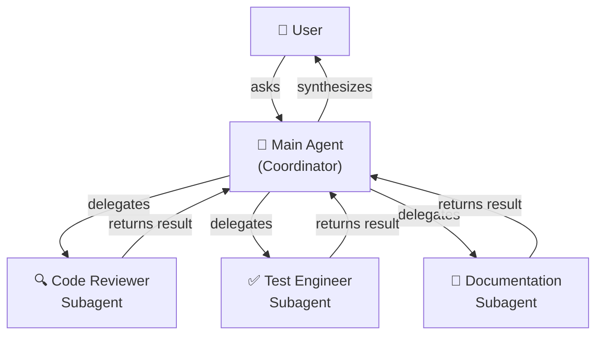

### 서브에이전트 생명주기

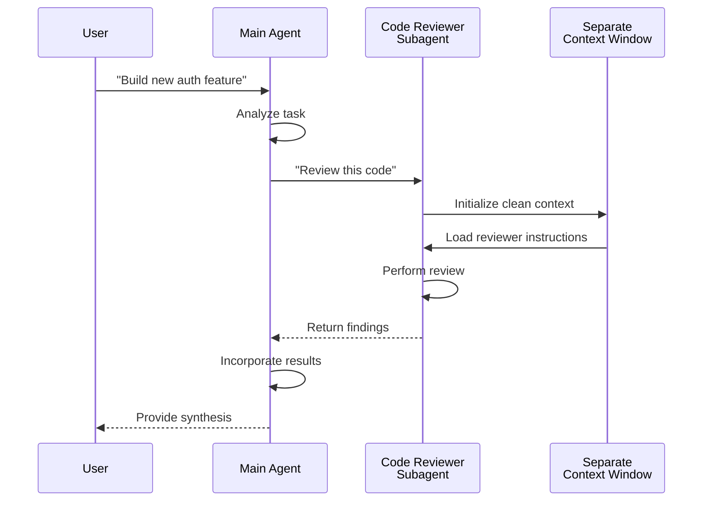

### 서브에이전트 설정 표

| 설정 | 타입 | 목적 | 예시 |
|---------------|------|---------|---------|
| `name` | String | 에이전트 식별자 | `code-reviewer` |
| `description` | String | 목적과 트리거 용어 | `Comprehensive code quality analysis` |
| `tools` | List/String | 허용할 도구 | `Read, Grep, Glob, Bash` |
| *(markdown 본문)* | Markdown | 시스템 프롬프트 / 행동 지침 | 사용자 정의 가이드라인 |

### 도구 접근 계층

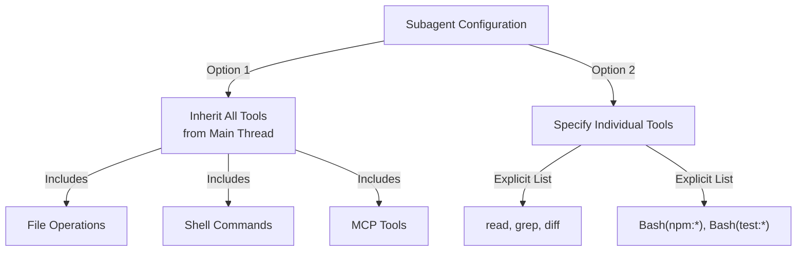

### 실전 예제

바로 쓸 수 있는 서브에이전트 정의 9종이 **[04-subagents/](04-subagents/)**에 있습니다 — `code-reviewer`, `clean-code-reviewer`, `secure-reviewer`, `test-engineer`, `documentation-writer`, `implementation-agent`, `performance-optimizer`, `debugger`, `data-scientist`.

**[04-subagents/README.md](04-subagents/README.md)**에는 프론트매터 전체 레퍼런스, 도구 접근 규칙, 중첩 한도, 에이전트 팀이 정리되어 있습니다.

### 서브에이전트 컨텍스트 관리

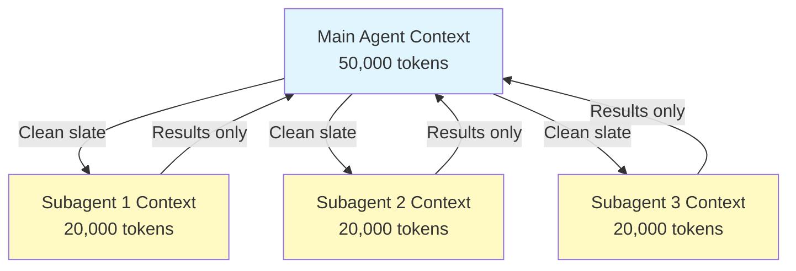

### 서브에이전트를 사용할 시점

| 시나리오 | 서브에이전트 사용 | 이유 |
|----------|--------------|-----|
| 단계가 많은 복잡한 기능 | ✅ 예 | 관심사 분리, 컨텍스트 오염 방지 |
| 간단한 코드 리뷰 | ❌ 아니요 | 불필요한 오버헤드 |
| 병렬 작업 실행 | ✅ 예 | 서브에이전트마다 자체 컨텍스트 보유 |
| 특화된 전문성이 필요할 때 | ✅ 예 | 맞춤 시스템 프롬프트 |
| 장시간 실행되는 분석 | ✅ 예 | 메인 컨텍스트 고갈 방지 |
| 단일 작업 | ❌ 아니요 | 불필요하게 지연 시간만 늘어남 |

### 에이전트 팀

에이전트 팀은 관련 작업을 수행하는 여러 에이전트를 조율합니다. 한 번에 서브에이전트 하나에 위임하는 대신, 에이전트 팀은 메인 에이전트가 여러 에이전트를 오케스트레이션해 협업하고, 중간 결과를 공유하며, 공동 목표를 향해 나아가게 합니다. 프런트엔드 에이전트·백엔드 에이전트·테스트 에이전트가 병렬로 움직이는 풀스택 기능 개발처럼 규모가 큰 작업에 유용합니다.

---

## 메모리

### 개요

메모리는 Claude가 세션과 대화를 넘어 컨텍스트를 유지하게 해 줍니다. 형태는 두 가지입니다. claude.ai의 자동 합성과, Claude Code의 파일 시스템 기반 CLAUDE.md입니다.

### 메모리 아키텍처

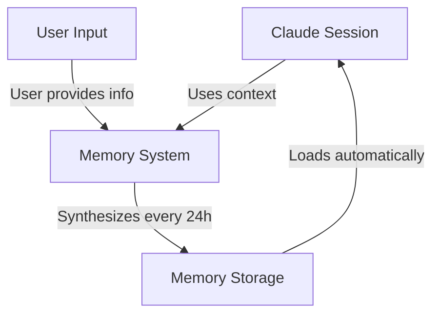

### Claude Code의 메모리 계층(7단계)

Claude Code는 7단계로 메모리를 로드합니다. CLAUDE.md 파일들은 서로를 덮어쓰지 않고 컨텍스트에 이어 붙으며, 관리형 → 사용자 → 프로젝트 → 로컬 순서로 로드됩니다(뒤에 오는 더 구체적인 파일이 마지막에 읽힙니다):

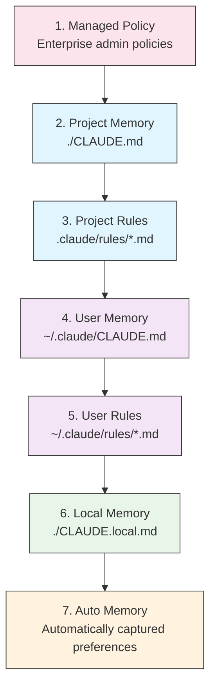

### 메모리 위치 표

| 단계 | 위치 | 범위 | 우선순위 | 공유 | 적합한 용도 |
|------|----------|-------|----------|--------|----------|
| 1. 관리형 정책 | 엔터프라이즈 관리자 | 조직 | 최상 | 조직 전체 사용자 | 규정 준수, 보안 정책 |
| 2. 프로젝트 | `./CLAUDE.md` | 프로젝트 | 높음 | 팀(Git) | 팀 표준, 아키텍처 |
| 3. 프로젝트 규칙 | `.claude/rules/*.md` | 프로젝트 | 높음 | 팀(Git) | 모듈형 프로젝트 관례 |
| 4. 사용자 | `~/.claude/CLAUDE.md` | 개인 | 보통 | 개인 | 개인 선호도 |
| 5. 사용자 규칙 | `~/.claude/rules/*.md` | 개인 | 보통 | 개인 | 개인 규칙 모듈 |
| 6. 로컬 | `./CLAUDE.local.md` | 로컬 | 낮음 | 공유 안 함 | 머신별 설정 |
| 7. 자동 메모리 | 자동 | 저장소별 | 가장 낮음 | 개인 | 학습된 선호도, 패턴 |

### 자동 메모리

자동 메모리는 세션 중에 관찰한 사용자 선호도와 패턴을 자동으로 수집합니다. Claude는 상호작용에서 학습해 다음을 기억합니다.

- 코딩 스타일 선호도
- 자주 하는 수정 사항
- 프레임워크와 도구 선택
- 소통 방식 선호도

자동 메모리는 백그라운드에서 동작하며 수동 설정이 필요 없습니다.

### 메모리 갱신 생명주기

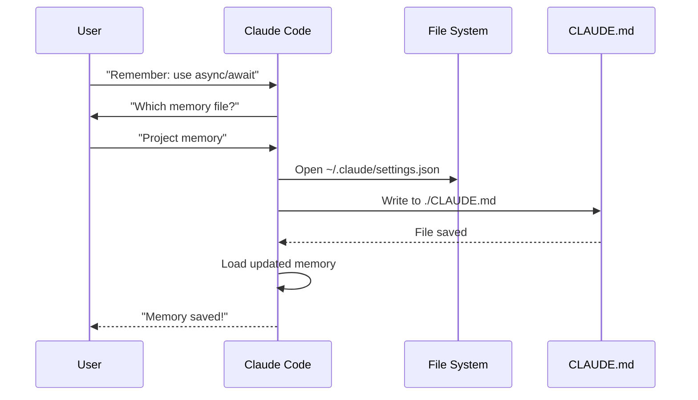

### 실전 예제

복사해 바로 쓰는 메모리 템플릿은 **[02-memory/](02-memory/)**에 있습니다:

- **`project-CLAUDE.md`** — `./CLAUDE.md`용 팀 전체 프로젝트 표준
- **`personal-CLAUDE.md`** — `~/.claude/CLAUDE.md`용 개인 선호도
- **`directory-api-CLAUDE.md`** — 하위 트리용 디렉터리 단위 표준

**[02-memory/README.md](02-memory/README.md)**에서는 전체 계층, import 문법, `.claude/rules/`, 자동 메모리, 그리고 CLAUDE.md를 200줄 이내로 유지하는 방법을 다룹니다.

### Claude Web/Desktop에서의 메모리

#### 메모리 합성 타임라인


### 자동 메모리 구성

자동 메모리는 Claude가 세션을 넘어 학습한 내용을 `~/.claude/projects/<project>/memory/`에 저장하며, `MEMORY.md`가 색인 역할을 합니다. 파일 배치, 로딩 한도, 활성화·비활성화 방법은 **[02-memory/README.md](02-memory/README.md)**를 보세요.

### 메모리 기능 비교

| 기능 | Claude Web/Desktop | Claude Code(CLAUDE.md) |
|---------|-------------------|------------------------|
| 자동 합성 | ✅ 24시간마다 | ❌ 수동 |
| 프로젝트 간 공유 | ✅ 공유됨 | ❌ 프로젝트별 |
| 팀 접근 | ✅ 공유 프로젝트 | ✅ Git 추적 |
| 검색 | ✅ 내장 | ✅ `/memory` 경유 |
| 편집 | ✅ 채팅 내에서 | ✅ 파일 직접 편집 |
| 가져오기/내보내기 | ✅ 지원 | ✅ 복사/붙여넣기 |
| 지속성 | ✅ 24시간 이상 | ✅ 무기한 |

---

## MCP 프로토콜

### 개요

MCP(Model Context Protocol)는 Claude가 외부 도구, API, 실시간 데이터 소스에 접근하는 표준화된 방식입니다. 메모리와 달리 MCP는 변화하는 데이터에 대한 라이브 접근을 제공합니다.

### MCP 아키텍처

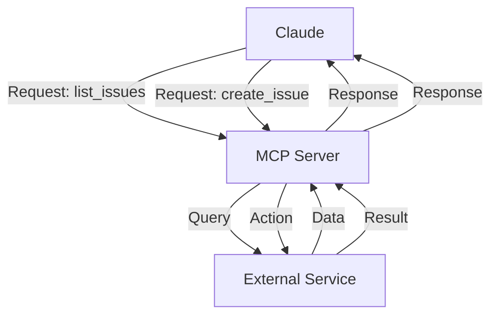

### MCP 생태계

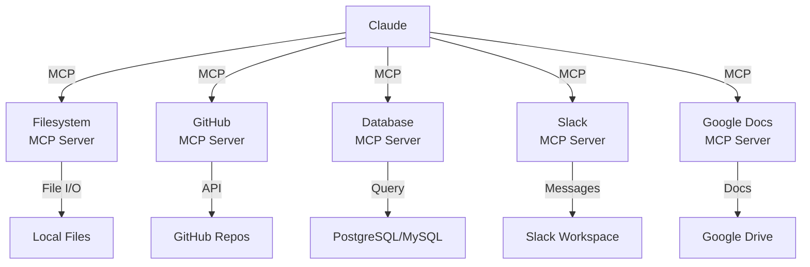

### MCP 설정 절차

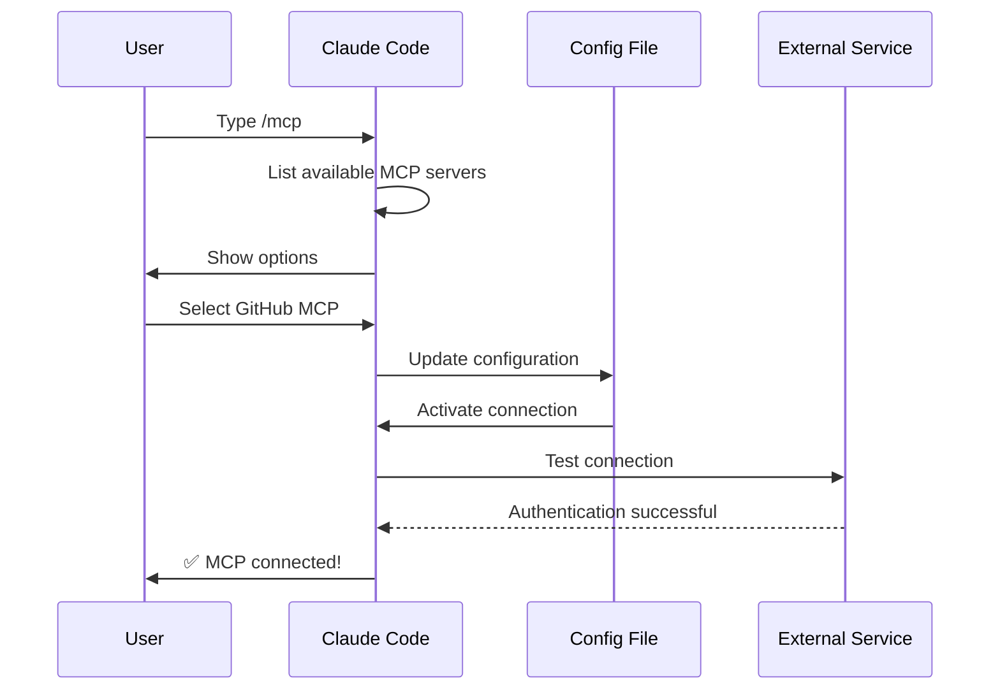

### 사용 가능한 MCP 서버 표

| MCP 서버 | 목적 | 주요 도구 | 인증 | 실시간 |
|------------|---------|--------------|------|-----------|
| **Filesystem** | 파일 작업 | read, write, delete | OS 권한 | ✅ 예 |
| **GitHub** | 저장소 관리 | list_prs, create_issue, push | OAuth | ✅ 예 |
| **Slack** | 팀 커뮤니케이션 | send_message, list_channels | 토큰 | ✅ 예 |
| **Database** | SQL 쿼리 | query, insert, update | 자격 증명 | ✅ 예 |
| **Google Docs** | 문서 접근 | read, write, share | OAuth | ✅ 예 |
| **Asana** | 프로젝트 관리 | create_task, update_status | API 키 | ✅ 예 |
| **Stripe** | 결제 데이터 | list_charges, create_invoice | API 키 | ✅ 예 |
| **Memory** | 영구 메모리 | store, retrieve, delete | 로컬 | ❌ 아니요 |

### 실전 예제

바로 쓸 수 있는 MCP 서버 설정은 **[05-mcp/](05-mcp/)**에 있습니다: `github-mcp.json`, `database-mcp.json`, `filesystem-mcp.json`, `multi-mcp.json`(서버 4개를 한 파일에).

**[05-mcp/README.md](05-mcp/README.md)**에서는 `claude mcp add` 전체 문법, 전송 방식, 스코프, OAuth, 엔터프라이즈 허용 목록을 다룹니다.

### MCP vs 메모리: 결정 매트릭스

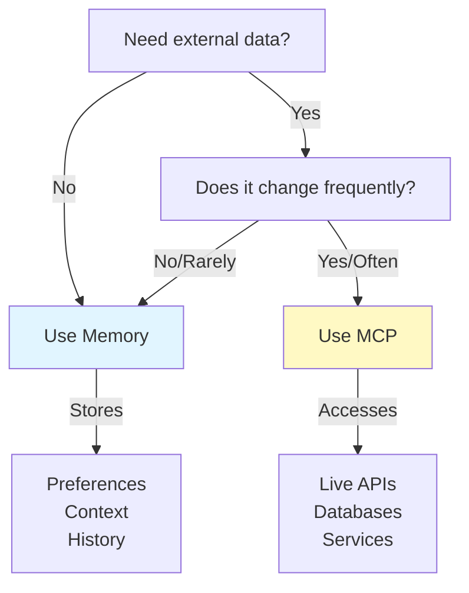

### 요청/응답 패턴

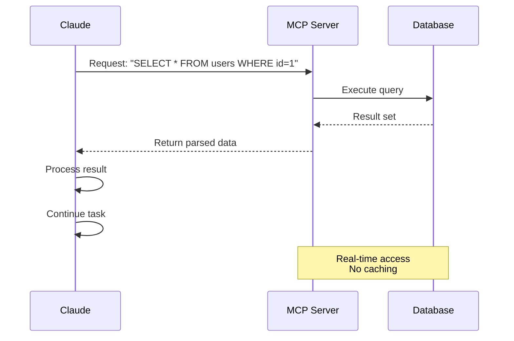

---

## 에이전트 스킬

### 개요

에이전트 스킬은 지침·스크립트·리소스를 담은 폴더 형태로 패키징된, 재사용 가능한 모델 호출형 기능입니다. Claude가 관련 스킬을 자동으로 감지해 사용합니다.

### 스킬 아키텍처

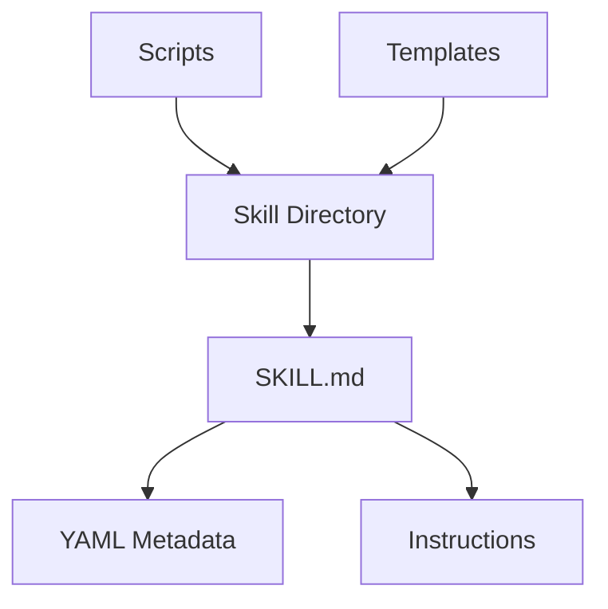

### 스킬 로딩 절차

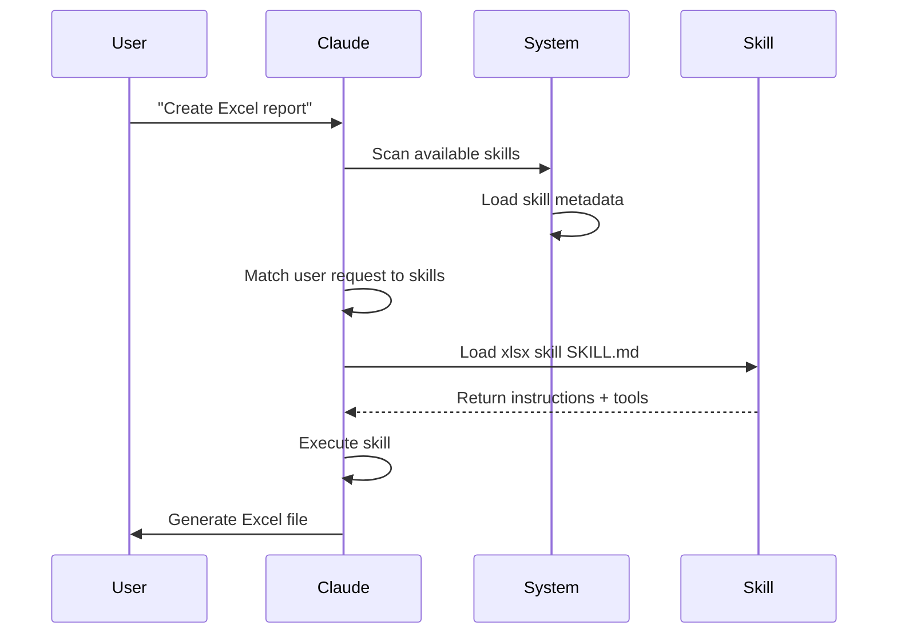

### 스킬 유형과 위치 표

| 유형 | 위치 | 범위 | 공유 | 동기화 | 적합한 용도 |
|------|----------|-------|--------|------|----------|
| 사전 제공 | 내장 | 전역 | 모든 사용자 | 자동 | 문서 생성 |
| 개인 | `~/.claude/skills/` | 개인 | 아니요 | 수동 | 개인 자동화 |
| 프로젝트 | `.claude/skills/` | 팀 | 예 | Git | 팀 표준 |
| 플러그인 | 플러그인 설치 경유 | 경우에 따라 | 설치에 따라 | 자동 | 통합 기능 |

### 사전 제공 스킬

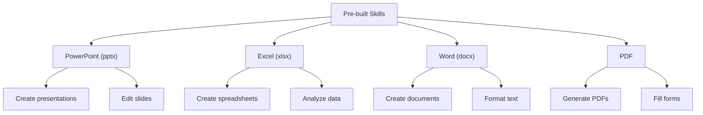

### 번들 스킬

Claude Code에는 별도 설치 없이 쓸 수 있는 번들 스킬이 포함되어 있습니다.

| 스킬 | 커맨드 | 목적 |
|-------|---------|---------|
| **Batch** | `/batch` | 여러 파일이나 항목에 걸쳐 작업을 실행합니다 |
| **Claude API** | `/claude-api` | 프로젝트 언어에 맞는 Claude API와 Managed Agents 레퍼런스를 로드합니다. 코드에서 `anthropic` 또는 `@anthropic-ai/sdk`를 import하면 자동으로 활성화됩니다 |
| **Code Review** | `/code-review` | 선택한 에포트 수준으로 현재 diff의 정확성 버그를 검토합니다. 품질·재사용 정리를 담당하는 `/simplify`와는 다른 스킬이며, v2.1.154에서 다시 분리되었습니다. v2.1.246부터는 어디서든 Claude가 스스로 시작할 수도 있습니다 |
| **Simplify** | `/simplify` | 품질·재사용·정리 검토 — v2.1.154부터 다시 `/code-review`와 구분됩니다 |
| **Debug** | `/debug` | 현재 세션의 디버그 로깅을 켜고, 세션 디버그 로그를 읽어 문제를 진단합니다 |
| **Fewer Permission Prompts** | `/fewer-permission-prompts` | 트랜스크립트를 스캔해 자주 쓰는 읽기 전용 도구에 대한 우선순위 허용 목록을 제안합니다 |
| **Loop** | `/loop` | 타이머로 반복 작업을 예약합니다 |
| **Run** | `/run` | 프로젝트 앱을 실행해 변경 사항을 검증합니다(v2.1.145+) |
| **Run Skill Generator** | `/run-skill-generator` | `/run`과 `/verify`가 앱을 빌드·실행·구동하는 방법을 알려 주는 프로젝트별 스킬을 작성합니다(v2.1.145+) |
| **Verify** | `/verify` | 변경 사항이 실제로 동작하는지 검증합니다(v2.1.145+). v2.1.215부터는 명시적으로 호출할 때만 동작합니다 |

이 번들 스킬은 항상 사용할 수 있고 설치나 설정이 필요 없습니다.

### 실전 예제

스크립트·템플릿·레퍼런스 파일까지 갖춘 완성형 스킬 6종이 **[03-skills/](03-skills/)**에 있습니다:

- **`code-review-specialist/`** — 리뷰 체크리스트, 발견 사항 템플릿, Python 메트릭 스크립트 2종
- **`refactor/`** — 코드 스멜 카탈로그, 리팩터링 카탈로그, 계획 템플릿, 분석 스크립트 2종
- **`doc-generator/`** — 소스에서 API 문서 생성
- **`blog-draft/`** — 버전 관리되는 출력 관례를 갖춘 개요·초안 템플릿
- **`brand-voice/`** — 어조 규칙과 메시지 템플릿(`user-invocable: false` 예시)
- **`claude-md/`** — CLAUDE.md 생성·갱신·감사

프론트매터 전체 레퍼런스와 점진적 공개 모델은 **[03-skills/README.md](03-skills/README.md)**를 보세요.

### 스킬 탐색과 호출

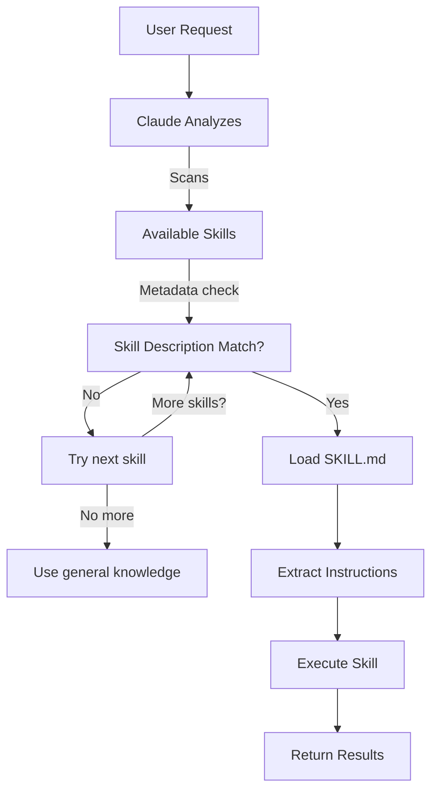

### 스킬과 다른 기능의 관계

```mermaid
graph TB
    A["Extending Claude"]
    B["Slash Commands"]
    C["Subagents"]
    D["Memory"]
    E["MCP"]
    F["Skills"]

    A --> B
    A --> C
    A --> D
    A --> E
    A --> F

    B -->|User-invoked| G["Quick shortcuts"]
    C -->|Auto-delegated| H["Isolated contexts"]
    D -->|Persistent| I["Cross-session context"]
    E -->|Real-time| J["External data access"]
    F -->|Auto-invoked| K["Autonomous execution"]
```

---

## Claude Code 플러그인

### 개요

Claude Code 플러그인은 커스터마이징(슬래시 커맨드, 서브에이전트, MCP 서버, 훅)을 묶어 한 번의 명령으로 설치하는 패키지입니다. 가장 상위 수준의 확장 수단이며, 여러 기능을 하나의 응집력 있고 공유 가능한 패키지로 결합합니다.

### 아키텍처

```mermaid
graph TB
    A["Plugin"]
    B["Slash Commands"]
    C["Subagents"]
    D["MCP Servers"]
    E["Hooks"]
    F["Configuration"]

    A -->|bundles| B
    A -->|bundles| C
    A -->|bundles| D
    A -->|bundles| E
    A -->|bundles| F
```

### 플러그인 로딩 절차

```mermaid
sequenceDiagram
    participant User
    participant Claude as Claude Code
    participant Plugin as Plugin Marketplace
    participant Install as Installation
    participant SlashCmds as Slash Commands
    participant Subagents
    participant MCPServers as MCP Servers
    participant Hooks
    participant Tools as Configured Tools

    User->>Claude: claude --plugin-dir ./07-plugins/pr-review
    Claude->>Plugin: Download plugin manifest
    Plugin-->>Claude: Return plugin definition
    Claude->>Install: Extract components
    Install->>SlashCmds: Configure
    Install->>Subagents: Configure
    Install->>MCPServers: Configure
    Install->>Hooks: Configure
    SlashCmds-->>Tools: Ready to use
    Subagents-->>Tools: Ready to use
    MCPServers-->>Tools: Ready to use
    Hooks-->>Tools: Ready to use
    Tools-->>Claude: Plugin installed ✅
```

### 플러그인 유형과 배포

| 유형 | 범위 | 공유 | 주체 | 예시 |
|------|-------|--------|-----------|----------|
| 공식 | 전역 | 모든 사용자 | Anthropic | PR Review, Security Guidance |
| 커뮤니티 | 공개 | 모든 사용자 | 커뮤니티 | DevOps, Data Science |
| 조직 | 내부 | 팀 구성원 | 회사 | 내부 표준, 도구 |
| 개인 | 개인 | 단일 사용자 | 개발자 | 맞춤 워크플로 |

### 플러그인 정의 구조

매니페스트는 `.claude-plugin/plugin.json`에 있는 JSON입니다. `name`만 필수이고, 인식되지 않는 최상위 키는 제거됩니다:

```json
{
  "name": "plugin-name",
  "version": "1.0.0",
  "description": "What this plugin does"
}
```

### 플러그인 구조

```
my-plugin/
├── .claude-plugin/
│   └── plugin.json
├── commands/
│   ├── task-1.md
│   ├── task-2.md
│   └── workflows/
├── agents/
│   ├── specialist-1.md
│   ├── specialist-2.md
│   └── configs/
├── skills/
│   └── skill-name/
│       └── SKILL.md
├── hooks/
│   └── hooks.json
├── .mcp.json
├── bin/
│   └── my-tool
├── .lsp.json
├── settings.json
├── templates/
│   └── issue-template.md
├── scripts/
│   ├── helper-1.sh
│   └── helper-2.py
├── docs/
│   ├── README.md
│   └── USAGE.md
└── tests/
    └── plugin.test.js
```

### 실전 예제

설치 가능한 완성형 플러그인 3종이 **[07-plugins/](07-plugins/)**에 있습니다:

- **`pr-review/`** — 리뷰 커맨드, 전문 에이전트 3종, GitHub MCP, 리뷰 전 훅
- **`documentation/`** — 문서 생성 커맨드, 에이전트 3종, 재사용 가능한 템플릿
- **`devops-automation/`** — 배포/롤백/상태/장애 대응 커맨드, 에이전트 3종, Kubernetes MCP, 셸 스크립트

각 플러그인에는 `.claude-plugin/plugin.json` 매니페스트와 디렉터리 구조가 함께 들어 있습니다.

### 플러그인 마켓플레이스

```mermaid
graph TB
    A["Plugin Marketplace"]
    B["Official<br/>Anthropic"]
    C["Community<br/>Marketplace"]
    D["Enterprise<br/>Registry"]

    A --> B
    A --> C
    A --> D

    B -->|Categories| B1["Development"]
    B -->|Categories| B2["DevOps"]
    B -->|Categories| B3["Documentation"]

    C -->|Search| C1["DevOps Automation"]
    C -->|Search| C2["Mobile Dev"]
    C -->|Search| C3["Data Science"]

    D -->|Internal| D1["Company Standards"]
    D -->|Internal| D2["Legacy Systems"]
    D -->|Internal| D3["Compliance"]
```

### 플러그인 설치와 생명주기

```mermaid
graph LR
    A["Discover"] -->|Browse| B["Marketplace"]
    B -->|Select| C["Plugin Page"]
    C -->|View| D["Components"]
    D -->|Install| E["/plugin install"]
    E -->|Extract| F["Configure"]
    F -->|Activate| G["Use"]
    G -->|Check| H["Update"]
    H -->|Available| G
    G -->|Done| I["Disable"]
    I -->|Later| J["Enable"]
    J -->|Back| G
```

### 플러그인 기능 비교

| 기능 | 슬래시 커맨드 | 스킬 | 서브에이전트 | 플러그인 |
|---------|---------------|-------|----------|--------|
| **설치** | 수동 복사 | 수동 복사 | 수동 설정 | 명령 한 번 |
| **설정 시간** | 5분 | 10분 | 15분 | 2분 |
| **번들링** | 단일 파일 | 단일 파일 | 단일 파일 | 여러 요소 |
| **버전 관리** | 수동 | 수동 | 수동 | 자동 |
| **팀 공유** | 파일 복사 | 파일 복사 | 파일 복사 | 설치 ID |
| **업데이트** | 수동 | 수동 | 수동 | 자동 제공 |
| **의존성** | 없음 | 없음 | 없음 | 포함 가능 |
| **마켓플레이스** | 없음 | 없음 | 없음 | 있음 |
| **배포** | 저장소 | 저장소 | 저장소 | 마켓플레이스 |

### 플러그인 사용 사례

| 사용 사례 | 권장 | 이유 |
|----------|-----------------|-----|
| **팀 온보딩** | ✅ 플러그인 사용 | 즉시 설정 완료, 모든 구성이 포함됨 |
| **프레임워크 설정** | ✅ 플러그인 사용 | 프레임워크별 커맨드를 묶어 제공 |
| **엔터프라이즈 표준** | ✅ 플러그인 사용 | 중앙 배포, 버전 관리 |
| **간단한 작업 자동화** | ❌ 커맨드 사용 | 과도한 복잡도 |
| **단일 도메인 전문성** | ❌ 스킬 사용 | 너무 무거움, 스킬이 적합 |
| **특화 분석** | ❌ 서브에이전트 사용 | 직접 만들거나 스킬 사용 |
| **실시간 데이터 접근** | ❌ MCP 사용 | 독립 실행이 맞음, 묶지 말 것 |

### 플러그인을 만들어야 할 시점

```mermaid
graph TD
    A["Should I create a plugin?"]
    A -->|Need multiple components| B{"Multiple commands<br/>or subagents<br/>or MCPs?"}
    B -->|Yes| C["✅ Create Plugin"]
    B -->|No| D["Use Individual Feature"]
    A -->|Team workflow| E{"Share with<br/>team?"}
    E -->|Yes| C
    E -->|No| F["Keep as Local Setup"]
    A -->|Complex setup| G{"Needs auto<br/>configuration?"}
    G -->|Yes| C
    G -->|No| D
```

### 플러그인 배포하기

**배포 단계:**

1. 모든 구성 요소를 갖춘 플러그인 구조를 만듭니다
2. `.claude-plugin/plugin.json` 매니페스트를 작성합니다
3. 문서를 담은 `README.md`를 작성합니다
4. `claude --plugin-dir ./my-plugin`으로 로컬에서 테스트합니다
5. 플러그인 마켓플레이스에 제출합니다
6. 리뷰와 승인을 받습니다
7. 마켓플레이스에 게시됩니다
8. 사용자는 명령 한 번으로 설치할 수 있습니다

### 플러그인 README 예시

**[07-plugins/](07-plugins/)**의 완성형 플러그인 3종을 참고하세요 — `pr-review/`, `documentation/`, `devops-automation/` 각각에 `README.md`, 매니페스트, 커맨드, 에이전트, MCP 설정이 모두 들어 있어 통째로 복사해 쓸 수 있습니다.

### 플러그인 vs 수동 설정

**수동 설정(2시간 이상):**
- 슬래시 커맨드를 하나씩 설치
- 서브에이전트를 개별 생성
- MCP를 따로 설정
- 훅을 수동으로 구성
- 모든 것을 문서화
- 팀에 공유(제대로 설정해 주길 바라며)

**플러그인 사용(2분):**
```bash
claude --plugin-dir ./07-plugins/pr-review
# ✅ Everything installed and configured
# ✅ Ready to use immediately
# ✅ Team can reproduce exact setup
```

---

## 비교와 통합

### 기능 비교 매트릭스

| 기능 | 호출 방식 | 지속성 | 범위 | 사용 사례 |
|---------|-----------|------------|-------|----------|
| **슬래시 커맨드** | 수동(`/cmd`) | 세션 한정 | 단일 커맨드 | 빠른 단축키 |
| **서브에이전트** | 자동 위임 | 격리된 컨텍스트 | 특화 작업 | 작업 분배 |
| **메모리** | 자동 로드 | 세션 간 유지 | 사용자/팀 컨텍스트 | 장기 학습 |
| **MCP 프로토콜** | 자동 질의 | 실시간 외부 | 라이브 데이터 접근 | 동적 정보 |
| **스킬** | 자동 호출 | 파일 시스템 기반 | 재사용 가능한 전문성 | 자동화된 워크플로 |

### 상호작용 타임라인

```mermaid
graph LR
    A["Session Start"] -->|Load| B["Memory (CLAUDE.md)"]
    B -->|Discover| C["Available Skills"]
    C -->|Register| D["Slash Commands"]
    D -->|Connect| E["MCP Servers"]
    E -->|Ready| F["User Interaction"]

    F -->|Type /cmd| G["Slash Command"]
    F -->|Request| H["Skill Auto-Invoke"]
    F -->|Query| I["MCP Data"]
    F -->|Complex task| J["Delegate to Subagent"]

    G -->|Uses| B
    H -->|Uses| B
    I -->|Uses| B
    J -->|Uses| B
```

### 실전 통합 예제: 고객 지원 자동화

#### 아키텍처

```mermaid
graph TB
    User["Customer Email"] -->|Receives| Router["Support Router"]

    Router -->|Analyze| Memory["Memory<br/>Customer history"]
    Router -->|Lookup| MCP1["MCP: Customer DB<br/>Previous tickets"]
    Router -->|Check| MCP2["MCP: Slack<br/>Team status"]

    Router -->|Route Complex| Sub1["Subagent: Tech Support<br/>Context: Technical issues"]
    Router -->|Route Simple| Sub2["Subagent: Billing<br/>Context: Payment issues"]
    Router -->|Route Urgent| Sub3["Subagent: Escalation<br/>Context: Priority handling"]

    Sub1 -->|Format| Skill1["Skill: Response Generator<br/>Brand voice maintained"]
    Sub2 -->|Format| Skill2["Skill: Response Generator"]
    Sub3 -->|Format| Skill3["Skill: Response Generator"]

    Skill1 -->|Generate| Output["Formatted Response"]
    Skill2 -->|Generate| Output
    Skill3 -->|Generate| Output

    Output -->|Post| MCP3["MCP: Slack<br/>Notify team"]
    Output -->|Send| Reply["Customer Reply"]
```

#### 요청 흐름

```markdown
## Customer Support Request Flow

### 1. Incoming Email
"I'm getting error 500 when trying to upload files. This is blocking my workflow!"

### 2. Memory Lookup
- Loads CLAUDE.md with support standards
- Checks customer history: VIP customer, 3rd incident this month

### 3. MCP Queries
- GitHub MCP: List open issues (finds related bug report)
- Database MCP: Check system status (no outages reported)
- Slack MCP: Check if engineering is aware

### 4. Skill Detection & Loading
- Request matches "Technical Support" skill
- Loads support response template from Skill

### 5. Subagent Delegation
- Routes to Tech Support Subagent
- Provides context: customer history, error details, known issues
- Subagent has full access to: read, bash, grep tools

### 6. Subagent Processing
Tech Support Subagent:
- Searches codebase for 500 error in file upload
- Finds recent change in commit 8f4a2c
- Creates workaround documentation

### 7. Skill Execution
Response Generator Skill:
- Uses Brand Voice guidelines
- Formats response with empathy
- Includes workaround steps
- Links to related documentation

### 8. MCP Output
- Posts update to #support Slack channel
- Tags engineering team
- Updates ticket in Jira MCP

### 9. Response
Customer receives:
- Empathetic acknowledgment
- Explanation of cause
- Immediate workaround
- Timeline for permanent fix
- Link to related issues
```

### 전체 기능 오케스트레이션

```mermaid
sequenceDiagram
    participant User
    participant Claude as Claude Code
    participant Memory as Memory<br/>CLAUDE.md
    participant MCP as MCP Servers
    participant Skills as Skills
    participant SubAgent as Subagents

    User->>Claude: Request: "Build auth system"
    Claude->>Memory: Load project standards
    Memory-->>Claude: Auth standards, team practices
    Claude->>MCP: Query GitHub for similar implementations
    MCP-->>Claude: Code examples, best practices
    Claude->>Skills: Detect matching Skills
    Skills-->>Claude: Security Review Skill + Testing Skill
    Claude->>SubAgent: Delegate implementation
    SubAgent->>SubAgent: Build feature
    Claude->>Skills: Apply Security Review Skill
    Skills-->>Claude: Security checklist results
    Claude->>SubAgent: Delegate testing
    SubAgent-->>Claude: Test results
    Claude->>User: Complete system delivered
```

### 각 기능을 사용할 시점

```mermaid
graph TD
    A["New Task"] --> B{Type of Task?}

    B -->|Repeated workflow| C["Slash Command"]
    B -->|Need real-time data| D["MCP Protocol"]
    B -->|Remember for next time| E["Memory"]
    B -->|Specialized subtask| F["Subagent"]
    B -->|Domain-specific work| G["Skill"]

    C --> C1["✅ Team shortcut"]
    D --> D1["✅ Live API access"]
    E --> E1["✅ Persistent context"]
    F --> F1["✅ Parallel execution"]
    G --> G1["✅ Auto-invoked expertise"]
```

### 선택 결정 트리

```mermaid
graph TD
    Start["Need to extend Claude?"]

    Start -->|Quick repeated task| A{"Manual or Auto?"}
    A -->|Manual| B["Slash Command"]
    A -->|Auto| C["Skill"]

    Start -->|Need external data| D{"Real-time?"}
    D -->|Yes| E["MCP Protocol"]
    D -->|No/Cross-session| F["Memory"]

    Start -->|Complex project| G{"Multiple roles?"}
    G -->|Yes| H["Subagents"]
    G -->|No| I["Skills + Memory"]

    Start -->|Long-term context| J["Memory"]
    Start -->|Team workflow| K["Slash Command +<br/>Memory"]
    Start -->|Full automation| L["Skills +<br/>Subagents +<br/>MCP"]
```

---

## 요약 표

| 항목 | 슬래시 커맨드 | 서브에이전트 | 메모리 | MCP | 스킬 | 플러그인 |
|--------|---|---|---|---|---|---|
| **설정 난이도** | 쉬움 | 보통 | 쉬움 | 보통 | 보통 | 쉬움 |
| **학습 곡선** | 낮음 | 보통 | 낮음 | 보통 | 보통 | 낮음 |
| **팀 이점** | 높음 | 높음 | 보통 | 높음 | 높음 | 매우 높음 |
| **자동화 수준** | 낮음 | 높음 | 보통 | 높음 | 높음 | 매우 높음 |
| **컨텍스트 관리** | 단일 세션 | 격리 | 지속 | 실시간 | 지속 | 모든 기능 |
| **유지보수 부담** | 낮음 | 보통 | 낮음 | 보통 | 보통 | 낮음 |
| **확장성** | 양호 | 우수 | 양호 | 우수 | 우수 | 우수 |
| **공유 용이성** | 보통 | 보통 | 양호 | 양호 | 양호 | 우수 |
| **버전 관리** | 수동 | 수동 | 수동 | 수동 | 수동 | 자동 |
| **설치** | 수동 복사 | 수동 설정 | 해당 없음 | 수동 설정 | 수동 복사 | 명령 한 번 |

---

## 빠른 시작 가이드

### 1주차: 단순하게 시작하기
- 자주 쓰는 작업용 슬래시 커맨드 2~3개를 만듭니다
- 설정에서 메모리를 활성화합니다
- 팀 표준을 CLAUDE.md에 기록합니다

### 2주차: 실시간 접근 추가하기
- MCP 하나를 설정합니다(GitHub 또는 Database)
- `/mcp`로 구성합니다
- 워크플로에서 라이브 데이터를 조회합니다

### 3주차: 작업 분배하기
- 특정 역할을 위한 첫 서브에이전트를 만듭니다
- Claude에게 만들어 달라고 하거나 `.claude/agents/<name>.md` 파일을 추가합니다(`/agents` 마법사는 제거되었습니다)
- 간단한 작업으로 위임을 테스트합니다

### 4주차: 모든 것을 자동화하기
- 반복 자동화를 위한 첫 스킬을 만듭니다
- 스킬 마켓플레이스를 쓰거나 직접 만듭니다
- 모든 기능을 결합해 전체 워크플로를 구성합니다

### 지속적으로
- 한 달에 한 번 메모리를 검토하고 갱신합니다
- 패턴이 보이면 새 스킬을 추가합니다
- MCP 쿼리를 최적화합니다
- 서브에이전트 프롬프트를 다듬습니다

---

## 훅

### 개요

훅은 Claude Code 이벤트에 반응해 자동으로 실행되는 이벤트 기반 셸 커맨드입니다. 수동 개입 없이 자동화·검증·맞춤 워크플로를 구현할 수 있습니다.

### 훅 이벤트

Claude Code는 다섯 가지 훅 타입(command, http, mcp_tool, prompt, agent)에 걸쳐 **33개의 훅 이벤트**를 지원합니다.

| 훅 이벤트 | 트리거 | 사용 사례 |
|------------|---------|-----------|
| **SessionStart** | 세션 시작/재개/clear/compact | 환경 설정, 초기화 |
| **Setup** | `--init-only`로 실행하거나, `-p`와 함께 `--init`/`--maintenance`를 쓸 때(일반 시작 시에는 해당 없음) | 도구 프로비저닝, 의존성 설치 |
| **InstructionsLoaded** | CLAUDE.md 또는 rules 파일이 로드될 때 | 검증, 변환, 보강 |
| **UserPromptSubmit** | 사용자가 프롬프트를 제출할 때 | 입력 검증, 프롬프트 필터링 |
| **UserPromptExpansion** | 입력한 슬래시 커맨드(스킬, 사용자 정의 커맨드, MCP 프롬프트)가 프롬프트로 확장될 때. 차단할 수 있음 | `/command` 직접 사용 차단 또는 기록, 스킬별 컨텍스트 추가 |
| **PreToolUse** | 도구가 실행되기 전 | 검증, 승인 게이트, 로깅 |
| **PermissionRequest** | 권한 대화상자가 표시될 때 | 자동 승인/거부 흐름 |
| **PermissionDenied** | 오토 모드가 도구 호출을 거부할 때(수동 거부 시에는 발생하지 않음) | 로깅, 분석, 정책 적용 |
| **PostToolUse** | 도구 실행이 성공한 후 | 자동 포맷, 알림, 정리 |
| **PostToolUseFailure** | 도구 실행이 실패할 때 | 오류 처리, 로깅 |
| **PostToolBatch** | 도구 사용 묶음이 끝난 후 | 집계 보고, 배치 검증 |
| **Notification** | 알림이 전송될 때 | 경보, 외부 연동 |
| **MessageDisplay** | 어시스턴트 메시지 텍스트가 표시되는 동안 | 표시되는 메시지 텍스트 변환 또는 숨김 |
| **SubagentStart** | 서브에이전트가 생성될 때 | 컨텍스트 주입, 초기화 |
| **SubagentStop** | 서브에이전트가 끝날 때 | 결과 검증, 로깅 |
| **Stop** | Claude가 응답을 마칠 때 | 요약 생성, 정리 작업 |
| **StopFailure** | API 오류로 턴이 끝날 때 | 오류 복구, 로깅 |
| **TeammateIdle** | 에이전트 팀 동료가 유휴 상태일 때 | 작업 분배, 조정 |
| **TaskCompleted** | 작업이 완료로 표시될 때. todo 도구가 활성화된 경우에만 발생 — 기본적으로 Claude 3.x 모델, Opus 4~4.7, Sonnet 4~4.6, Haiku 4.5에서만 사용할 수 있고, `CLAUDE_CODE_ENABLE_TODO_TOOLS=1`로 복원합니다(v2.1.233) | 작업 후 처리 |
| **TaskCreated** | TaskCreate로 작업이 생성될 때. todo 도구가 활성화된 경우에만 발생 — 기본적으로 Claude 3.x 모델, Opus 4~4.7, Sonnet 4~4.6, Haiku 4.5에서만 사용할 수 있고, `CLAUDE_CODE_ENABLE_TODO_TOOLS=1`로 복원합니다(v2.1.233) | 작업 추적, 로깅 |
| **ConfigChange** | 설정 파일이 변경될 때 | 검증, 전파 |
| **CwdChanged** | 작업 디렉터리가 변경될 때 | 디렉터리별 설정 |
| **DirectoryAdded** | `/add-dir` 또는 SDK `register_repo_root` 제어 요청으로 세션 중 새 작업 디렉터리가 등록될 때 | 새로 추가된 디렉터리용 도구 설정 |
| **FileChanged** | 감시 중인 파일이 변경될 때 | 파일 모니터링, 재빌드 트리거 |
| **PreCompact** | 컨텍스트 압축 전 | 상태 보존 |
| **PostCompact** | 압축이 완료된 후 | 압축 후 작업 |
| **PreModelSwitch** | 요청된 모델 전환이 적용되기 전 | 모델 변경 차단 또는 거부 |
| **PostModelSwitch** | 세션 모델이 변경된 후 | 모델 변경 기록 또는 대응 |
| **WorktreeCreate** | 워크트리를 만드는 중 | 기본 git worktree 생성을 대체하며, 워크트리 경로를 출력해야 함 |
| **WorktreeRemove** | 워크트리를 제거하는 중 | 정리, 리소스 해제 |
| **Elicitation** | MCP 서버가 사용자 입력을 요청할 때 | 입력 검증 |
| **ElicitationResult** | 사용자가 elicitation에 응답할 때 | 응답 처리 |
| **SessionEnd** | 세션이 종료될 때 | 정리, 최종 로깅 |

### 공통 훅

훅은 `~/.claude/settings.json`(사용자 수준) 또는 `.claude/settings.json`(프로젝트 수준)에 설정합니다:

```json
{
  "hooks": {
    "PostToolUse": [
      {
        "matcher": "Write",
        "hooks": [
          {
            "type": "command",
            "command": "jq -r '.tool_input.file_path' | xargs npx prettier --write"
          }
        ]
      }
    ],
    "PreToolUse": [
      {
        "matcher": "Edit",
        "hooks": [
          {
            "type": "command",
            "command": "jq -r '.tool_input.file_path' | xargs npx eslint"
          }
        ]
      }
    ]
  }
}
```

### 훅 환경변수

- 훅 입력은 JSON으로 stdin에 전달됩니다(`session_id`, `tool_name`, `tool_input.file_path` 등). `jq`로 읽으세요
- `$CLAUDE_CODE_SESSION_ID` - 현재 세션 식별자
- `$CLAUDE_PROJECT_DIR` - 프로젝트 디렉터리 경로

### 모범 사례

✅ **하세요:**
- 훅은 빠르게 유지하세요(1초 미만)
- 검증과 자동화에 훅을 사용하세요
- 오류를 우아하게 처리하세요
- 절대 경로를 사용하세요

❌ **하지 마세요:**
- 훅을 대화형으로 만드세요
- 장시간 실행되는 작업에 훅을 사용하세요
- 자격 증명을 하드코딩하세요

**참고**: 상세 예제는 [06-hooks/](06-hooks/)를 보세요

---

## 체크포인트와 되감기

### 개요

체크포인트를 사용하면 대화 상태를 저장하고 이전 시점으로 되감을 수 있어, 여러 접근 방식을 안전하게 실험하고 탐색할 수 있습니다.

### 핵심 개념

| 개념 | 설명 |
|---------|-------------|
| **체크포인트** | 메시지, 파일, 컨텍스트를 포함한 대화 상태의 스냅샷 |
| **되감기** | 이후 변경을 버리고 이전 체크포인트로 돌아가기 |
| **분기점** | 여러 접근 방식을 탐색하는 기준이 되는 체크포인트 |

### 체크포인트 접근

체크포인트는 사용자 프롬프트가 들어올 때마다 자동으로 생성됩니다. 되감으려면:

```bash
# Press Esc twice to open the checkpoint browser
Esc + Esc

# Or use the /rewind command
/rewind
```

체크포인트를 선택하면 여섯 가지 옵션 중에서 고릅니다:
1. **코드와 대화 복원** -- 둘 다 해당 시점으로 되돌립니다
2. **대화 복원** -- 메시지만 되감고 현재 코드는 유지합니다
3. **코드 복원** -- 파일만 되돌리고 대화는 유지합니다
4. **여기서부터 요약** -- 대화를 요약으로 압축합니다
5. **여기까지 요약** -- 이 시점 이전의 모든 내용을 요약으로 압축합니다
6. **취소** -- 그만둡니다

### 사용 사례

| 시나리오 | 워크플로 |
|----------|----------|
| **접근 방식 탐색** | 저장 → A 시도 → 저장 → 되감기 → B 시도 → 비교 |
| **안전한 리팩터링** | 저장 → 리팩터링 → 테스트 → 실패 시: 되감기 |
| **A/B 테스트** | 저장 → 설계 A → 저장 → 되감기 → 설계 B → 비교 |
| **실수 복구** | 문제 발견 → 마지막 정상 상태로 되감기 |

### 설정

체크포인트는 기본으로 켜져 있으며 `fileCheckpointingEnabled`로 제어합니다:

```json
{
  "fileCheckpointingEnabled": true
}
```

**참고**: 상세 예제는 [08-checkpoints/](08-checkpoints/)를 보세요

---

## 고급 기능

### 플랜 모드

코딩 전에 상세한 구현 계획을 세웁니다.

**활성화:**
```bash
/plan Implement user authentication system
```

**이점:**
- 시간 추정이 포함된 명확한 로드맵
- 리스크 평가
- 체계적인 작업 분해
- 검토와 수정의 기회

### 확장 사고

복잡한 문제를 위한 깊은 추론입니다.

**활성화:**
- 세션 중 `Alt+T`(macOS에서는 `Option+T`)로 토글합니다
- Opus 4.7+, Sonnet 5+, Haiku 5.5, Fable은 항상 적응형 추론을 사용하므로 고정된 `MAX_THINKING_TOKENS` 예산이 적용되지 않습니다. 깊이는 `/effort`로 제어하세요

```bash
# Control reasoning depth with the effort level
/effort high
```

**이점:**
- 트레이드오프에 대한 철저한 분석
- 더 나은 아키텍처 결정
- 엣지 케이스 고려
- 체계적인 평가

### 백그라운드 작업

대화를 막지 않고 오래 걸리는 작업을 실행합니다.

**사용법:**
```bash
User: Run tests in background

Claude: Started task bg-1234

/tasks               # View and manage background work (alias: /bashes)
```

### 권한 모드

Claude가 할 수 있는 일을 제어합니다.

| 모드 | 설명 | 사용 사례 |
|------|-------------|----------|
| **manual** | 민감한 작업에는 프롬프트가 뜨는 표준 권한(v2.1.200부터 Manual로 표시되며, 설정 값은 여전히 `default`이고 훅과 SDK는 이 값을 보고합니다) | 일반 개발 |
| **acceptEdits** | 확인 없이 파일 편집을 자동 승인 | 신뢰하는 편집 워크플로 |
| **plan** | 분석과 계획만 수행하고 파일은 수정하지 않음 | 코드 리뷰, 아키텍처 계획 |
| **auto** | 분류기가 안전한 작업은 승인하고 위험한 작업은 차단합니다. 연속 3회 또는 누적 20회 차단된 뒤에야 프롬프트가 돌아옵니다 | 안전을 갖춘 균형 잡힌 자율성 |
| **dontAsk** | 프롬프트가 뜰 작업은 자동 거부하고, 사전 승인된 도구와 읽기만 실행합니다 | 잠그고 쓰는 CI와 스크립트 |
| **bypassPermissions** | 안전 검사 없는 완전 무제한 접근 | CI/CD 파이프라인, 신뢰하는 스크립트 |

**사용법:**
```bash
claude --permission-mode plan          # Read-only analysis
claude --permission-mode acceptEdits   # Auto-accept edits
claude --permission-mode auto          # Auto-approve safe actions
claude --permission-mode dontAsk       # Pre-approved tools only; deny the rest
```

### 헤드리스 모드(프린트 모드)

`-p`(print) 플래그로 자동화와 CI/CD를 위해 대화형 입력 없이 Claude Code를 실행합니다.

**사용법:**
```bash
# Run specific task
claude -p "Run all tests"

# Pipe input for analysis
cat error.log | claude -p "explain this error"

# CI/CD integration (GitHub Actions)
- name: AI Code Review
  run: claude -p "Review PR changes and report issues"

# JSON output for scripting
claude -p --output-format json "list all functions in src/"
```

### 예약 작업

`/loop` 커맨드로 반복 일정에 맞춰 작업을 실행합니다.

**사용법:**
```bash
/loop every 30m "Run tests and report failures"
/loop every 2h "Check for dependency updates"
/loop every 1d "Generate daily summary of code changes"
```

예약 작업은 백그라운드에서 실행되며 완료되면 결과를 보고합니다. 지속적 모니터링, 주기적 점검, 자동 유지보수 워크플로에 유용합니다.

### Chrome 연동

Claude Code는 웹 자동화 작업을 위해 Chrome 브라우저와 연동할 수 있습니다. 이로써 개발 워크플로 안에서 바로 웹 페이지 탐색, 폼 채우기, 스크린샷 촬영, 웹사이트 데이터 추출 같은 작업이 가능합니다.

### 세션 관리

여러 작업 세션을 관리합니다.

**커맨드:**
```bash
/resume                # Resume a previous conversation
/rename "Feature"      # Name the current session
/fork                  # Fork into a new session
claude -c              # Continue most recent conversation
claude -r "Feature"    # Resume session by name/ID
```

### 대화형 기능

**키보드 단축키:**
- `Ctrl + R` - 명령 기록 검색
- `Tab` - 자동 완성
- `↑ / ↓` - 명령 기록
- `Ctrl + L` - 화면 지우기

**여러 줄 입력:** `\` + Enter, Option+Enter(macOS), Shift+Enter, Ctrl+J 중 하나로 새 줄을 시작합니다. `\end` 종료자는 없습니다.

### 설정

전체 설정 예시:

```json
{
  "alwaysThinkingEnabled": true,
  "showThinkingSummaries": true,
  "permissions": {
    "defaultMode": "manual"
  }
}
```

백그라운드 작업을 위한 `settings.json` 블록은 없습니다 — 이 기능은 `CLAUDE_CODE_DISABLE_BACKGROUND_TASKS` 환경변수로 제어하고, 동시 실행 수는 `CLAUDE_CODE_MAX_CONCURRENT_SUBAGENTS`(기본값 `20`)로 제어합니다.

**참고**: 종합 가이드는 [09-advanced-features/](09-advanced-features/)를 보세요

---

## 모델과 추론 에포트

Claude Code는 적응형 추론 에포트를 지원하며, 대상 모델은 다음과 같습니다.

| 모델 | 컨텍스트 창 | 에포트 수준 | 기본 에포트(Claude Code) |
|-------|----------------|---------------|------------------------------|
| Claude Opus 5.5 | 1M 토큰(네이티브) | `low`, `medium`, `high`, `xhigh`, `max` | `medium` — v2.1.280부터 기본 모델이자 기본 Opus 모델(Claude Code v2.1.280+ 필요) |
| Claude Sonnet 5.5 | 1M 토큰(네이티브) | `low`, `medium`, `high`, `xhigh`, `max` | `medium` — v2.1.284부터 Anthropic API의 기본 Sonnet 모델(Claude Code v2.1.284+ 필요) |
| Claude Haiku 5.5 | 1M 토큰(네이티브) | `low`, `medium`, `high`, `xhigh`, `max` | `medium` — v2.1.293부터 Anthropic API의 기본 Haiku 모델(Claude Code v2.1.293+ 필요) |
| Claude Opus 5 | 1M 토큰(네이티브) | `low`, `medium`, `high`, `xhigh`, `max` | `high` — v2.1.219부터 v2.1.280까지의 기본 Opus 모델(Claude Code v2.1.219+ 필요) |
| Claude Sonnet 5 | 1M 토큰(네이티브) | `low`, `medium`, `high`, `xhigh`, `max` | `high` — v2.1.197부터 v2.1.280까지 Pro/Team Standard의 기본 모델(현재는 Opus 5.5) |
| Claude Opus 4.8 | 1M 토큰(네이티브) | `low`, `medium`, `high`, `xhigh`, `max` | `high`(v2.1.154부터) |
| Claude Opus 4.7(레거시) | 1M 토큰(네이티브) | `low`, `medium`, `high`, `xhigh`, `max` | `xhigh`(Opus 4.7 출시 때부터, 2026-04-16) |
| Claude Sonnet 4.6 | 1M 토큰 | `low`, `medium`, `high`, `max` | Pro/Max 구독자는 `high`(v2.1.117에서 `medium`에서 상향) |
| Claude Haiku 4.5 | 200K 토큰 | — (에포트 미지원) | — |

> **참고**: `xhigh`는 Opus 5.5, Sonnet 5.5, Haiku 5.5, Opus 5, Sonnet 5, Opus 4.8, Opus 4.7에서 사용할 수 있고, `max`는 Opus 5.5, Sonnet 5.5, Haiku 5.5, Opus 5, Sonnet 5, Opus 4.8/4.7/4.6와 Sonnet 4.6에서 동작합니다(세션 한정). Haiku 4.5는 에포트 수준을 지원하지 않습니다.

> **참고**: v2.1.117은 Opus 4.7 세션이 `/context`를 네이티브 1M 창이 아닌 200K 기준으로 계산하던 버그를 수정했습니다. Opus 4.7에서 실제로 1M 컨텍스트를 쓰려면 v2.1.117 이상으로 업그레이드하세요. Opus 5와 Opus 4.8도 네이티브 1M 토큰 창을 갖습니다.

> **참고**: `/cost`와 `/stats`는 v2.1.118에서 `/usage`로 통합되었습니다. 이제 `/usage`가 비용/통계 등 탭을 갖춘 표준 커맨드이고, `/cost`와 `/stats`는 해당 탭을 여는 단축 별칭으로 남아 있습니다. v2.1.149부터 비용 화면은 지출을 카테고리별(스킬, 서브에이전트, 플러그인, MCP 서버별 비용)로도 나눠 보여 줍니다.

## 리소스

- [Claude Code 문서](https://code.claude.com/docs/en/overview)
- [Claude Code 변경 이력](https://code.claude.com/docs/en/changelog)
- [MCP GitHub 서버](https://github.com/modelcontextprotocol/servers)
- [Anthropic Cookbook](https://github.com/anthropics/anthropic-cookbook)

---
**최종 갱신**: 2026년 10월 18일
**Claude Code 버전**: 2.1.302
**출처**:
- https://code.claude.com/docs/en/plugins/manifest-reference
- https://code.claude.com/docs/en/plugins/create
- https://code.claude.com/docs/en/plugins/install
- https://code.claude.com/docs/en/settings-reference
- https://code.claude.com/docs/en/interactive-mode
- https://code.claude.com/docs/en/checkpointing
- https://code.claude.com/docs/en/memory
- https://code.claude.com/docs/en/skills
- https://code.claude.com/docs/en/tools-reference#task-tool-availability
- https://www.anthropic.com/news/claude-sonnet-5
- https://code.claude.com/docs/en/cli-reference
- https://code.claude.com/docs/en/model-config
- https://github.com/anthropics/claude-code/blob/main/CHANGELOG.md
- https://code.claude.com/docs/en/hooks
- https://code.claude.com/docs/en/sub-agents
- https://code.claude.com/docs/en/permission-modes
- https://code.claude.com/docs/en/commands
- https://code.claude.com/docs/en/remote-control
- https://code.claude.com/docs/en/hooks#userpromptexpansion
**호환 모델**: Claude Fable 5.1, Claude Fable 5, Claude Opus 5, Claude Sonnet 5, Claude Sonnet 4.6, Claude Opus 4.8, Claude Haiku 4.5
