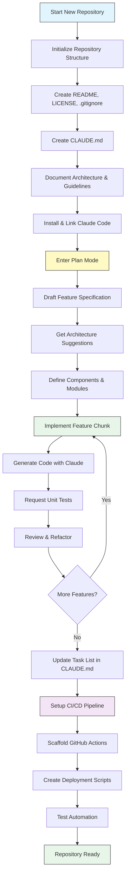
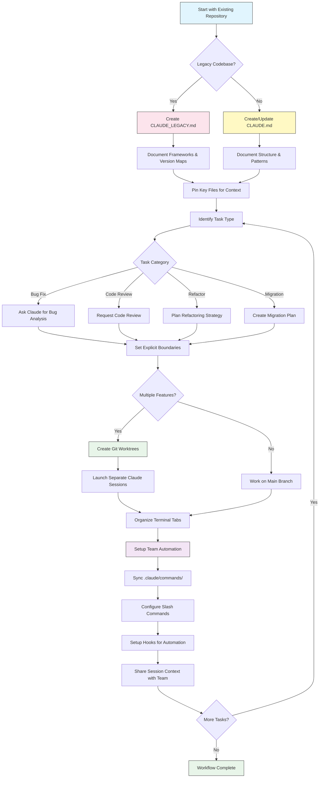

<!-- i18n-source: resources.md -->
<!-- i18n-source-sha: 188f468 -->
<!-- i18n-status: translated -->
<!-- i18n-date: 2026-10-26 -->

<picture>
  <source media="(prefers-color-scheme: dark)" srcset="resources/logos/claude-howto-logo-dark.svg">
  
</picture>

# 유용한 자료 모음

## 공식 문서

| 자료 | 설명 | 링크 |
|----------|-------------|------|
| Claude Code Docs | Claude Code 공식 문서 | [code.claude.com/docs/en/overview](https://code.claude.com/docs/en/overview) |
| Anthropic Docs | Anthropic 전체 문서 | [docs.anthropic.com](https://docs.anthropic.com) |
| MCP Protocol | Model Context Protocol 명세 | [modelcontextprotocol.io](https://modelcontextprotocol.io) |
| MCP Servers | 공식 MCP 서버 구현체 | [github.com/modelcontextprotocol/servers](https://github.com/modelcontextprotocol/servers) |
| Anthropic Cookbook | 코드 예제와 튜토리얼 | [github.com/anthropics/anthropic-cookbook](https://github.com/anthropics/anthropic-cookbook) |
| Claude Code Skills | 커뮤니티 스킬 저장소 | [github.com/anthropics/skills](https://github.com/anthropics/skills) |
| Agent Teams | 멀티 에이전트 조정과 협업 | [code.claude.com/docs/en/agent-teams](https://code.claude.com/docs/en/agent-teams) |
| Scheduled Tasks | /loop와 cron을 활용한 반복 작업 | [code.claude.com/docs/en/scheduled-tasks](https://code.claude.com/docs/en/scheduled-tasks) |
| Chrome Integration | 브라우저 자동화 | [code.claude.com/docs/en/chrome](https://code.claude.com/docs/en/chrome) |
| Keybindings | 키보드 단축키 사용자 지정 | [code.claude.com/docs/en/keybindings](https://code.claude.com/docs/en/keybindings) |
| Desktop App | 네이티브 데스크톱 애플리케이션 | [code.claude.com/docs/en/desktop](https://code.claude.com/docs/en/desktop) |
| Remote Control | 원격 세션 제어 | [code.claude.com/docs/en/remote-control](https://code.claude.com/docs/en/remote-control) |
| Auto Mode | 자동 권한 관리 | [code.claude.com/docs/en/permissions](https://code.claude.com/docs/en/permissions) |
| Channels | 다중 채널 커뮤니케이션 | [code.claude.com/docs/en/channels](https://code.claude.com/docs/en/channels) |
| Voice Dictation | Claude Code용 음성 입력 | [code.claude.com/docs/en/voice-dictation](https://code.claude.com/docs/en/voice-dictation) |
| Code Review | Claude GitHub App을 통한 관리형 PR 리뷰(Team 및 Enterprise) | [code.claude.com/docs/en/code-review](https://code.claude.com/docs/en/code-review) |

## Anthropic 엔지니어링 블로그

| 글 | 설명 | 링크 |
|---------|-------------|------|
| Code Execution with MCP | 코드 실행으로 MCP 컨텍스트 비대를 해결하는 방법 — 토큰 98.7% 절감 | [anthropic.com/engineering/code-execution-with-mcp](https://www.anthropic.com/engineering/code-execution-with-mcp) |

---

## 30분 만에 Claude Code 마스터하기

_영상_: https://www.youtube.com/watch?v=6eBSHbLKuN0

_**모든 팁**_
- **고급 기능과 단축키 살펴보기**
  - 릴리스 노트에서 Claude의 새로운 코드 편집·컨텍스트 기능을 정기적으로 확인합니다.
  - 채팅, 파일, 편집기 뷰를 빠르게 오갈 수 있는 키보드 단축키를 익힙니다.

- **효율적인 환경 설정**
  - 이름과 설명이 명확한 프로젝트별 세션을 만들어 쉽게 찾을 수 있게 합니다.
  - 가장 많이 쓰는 파일이나 폴더를 고정해 Claude가 언제든 접근할 수 있게 합니다.
  - GitHub, 주요 IDE 등 Claude 통합을 설정해 코딩 과정을 간소화합니다.

- **효과적인 코드베이스 Q&A**
  - 아키텍처, 디자인 패턴, 특정 모듈에 대해 Claude에게 구체적으로 질문합니다.
  - 질문에 파일과 줄 번호를 함께 제시합니다(예: "`app/models/user.py`의 로직은 무엇을 하나요?").
  - 큰 코드베이스라면 요약이나 매니페스트를 제공해 Claude가 초점을 맞추도록 돕습니다.
  - **예시 프롬프트**: _"src/auth/AuthService.ts:45-120에 구현된 인증 흐름을 설명해 주세요. src/middleware/auth.ts의 미들웨어와는 어떻게 연동되나요?"_

- **코드 편집과 리팩터링**
  - 인라인 주석이나 코드 블록 안의 요청으로 집중된 수정을 받습니다("이 함수를 명확하게 리팩터링해 주세요").
  - 수정 전후를 나란히 비교해 달라고 요청합니다.
  - 큰 수정 후에는 Claude가 테스트나 문서를 생성하도록 해 품질을 확보합니다.
  - **예시 프롬프트**: _"api/users.js의 getUserData 함수를 프로미스 대신 async/await를 쓰도록 리팩터링해 주세요. 수정 전후 비교를 보여주고, 리팩터링된 버전의 단위 테스트를 생성해 주세요."_

- **컨텍스트 관리**
  - 붙여넣는 코드와 컨텍스트는 현재 작업에 필요한 것만으로 제한합니다.
  - 구조화된 프롬프트("파일 A는 이렇고, 함수 B는 이렇습니다. 질문은 X입니다")를 쓰면 성능이 가장 좋습니다.
  - 프롬프트 창의 큰 파일은 제거하거나 접어 컨텍스트 한도를 넘지 않게 합니다.
  - **예시 프롬프트**: _"models/User.js의 User 모델과 utils/validation.js의 validateUser 함수가 있습니다. 질문은 하위 호환성을 유지하면서 이메일 검증을 추가하려면 어떻게 해야 하나요?"_

- **팀 도구 통합**
  - Claude 세션을 팀의 저장소와 문서에 연결합니다.
  - 내장 템플릿을 쓰거나 반복되는 엔지니어링 작업용 템플릿을 직접 만듭니다.
  - 세션 기록과 프롬프트를 팀원과 공유해 협업합니다.

- **성능 끌어올리기**
  - 목표가 분명한 지시를 줍니다(예: "이 클래스를 다섯 개 불릿으로 요약해 줘").
  - 불필요한 주석과 상용구를 컨텍스트 창에서 덜어냅니다.
  - 출력이 방향을 벗어나면 컨텍스트를 초기화하거나 질문을 다시 표현해 정렬을 맞춥니다.
  - **예시 프롬프트**: _"src/db/Manager.ts의 DatabaseManager 클래스를 다섯 개 불릿으로 요약해 주세요. 주요 책임과 핵심 메서드에 초점을 맞춰 주세요."_

- **실전 활용 예**
  - 디버깅: 오류와 스택 트레이스를 붙여넣고 가능한 원인과 수정 방법을 묻습니다.
  - 테스트 생성: 복잡한 로직에 속성 기반 테스트, 단위 테스트, 통합 테스트를 요청합니다.
  - 코드 리뷰: 위험한 변경, 엣지 케이스, 코드 스멜을 찾아 달라고 요청합니다.
  - **예시 프롬프트**:
    - _"이 오류가 납니다: 'TypeError: Cannot read property 'map' of undefined at line 42 in components/UserList.jsx'. 스택 트레이스와 관련 코드는 다음과 같습니다. 원인은 무엇이고 어떻게 고칠 수 있나요?"_
    - _"PaymentProcessor 클래스에 대한 포괄적인 단위 테스트를 생성해 주세요. 실패한 트랜잭션, 타임아웃, 잘못된 입력에 대한 엣지 케이스도 포함해 주세요."_
    - _"이 PR diff를 리뷰하고 잠재적 보안 문제, 성능 병목, 코드 스멜을 찾아 주세요."_

- **워크플로 자동화**
  - 포매팅, 정리, 반복적인 이름 변경 같은 반복 작업을 Claude 프롬프트로 스크립트화합니다.
  - 코드 diff를 바탕으로 PR 설명, 릴리스 노트, 문서 초안을 Claude가 작성하게 합니다.
  - **예시 프롬프트**: _"git diff를 바탕으로 변경 요약, 수정된 파일 목록, 테스트 절차, 잠재적 영향을 담은 상세한 PR 설명을 작성해 주세요. 2.3.0 버전 릴리스 노트도 생성해 주세요."_

**팁**: 최상의 결과를 얻으려면 이 방법들을 몇 가지 조합합니다. 중요한 파일을 고정하고 목표를 요약하는 것에서 시작해, 집중된 프롬프트와 Claude의 리팩터링 도구로 코드베이스와 자동화를 점진적으로 개선합니다.

**Claude Code 권장 워크플로**

### Claude Code 권장 워크플로

#### 새 저장소의 경우

1. **저장소 초기화와 Claude 연동**
   - README, LICENSE, .gitignore, 루트 설정 등 필수 구조로 새 저장소를 구성합니다.
   - 아키텍처, 상위 목표, 코딩 가이드라인을 기술한 `CLAUDE.md` 파일을 만듭니다.
   - Claude Code를 설치하고 저장소에 연결해 코드 제안, 테스트 스캐폴딩, 워크플로 자동화를 활용합니다.

2. **플랜 모드와 명세 활용**
   - 기능을 구현하기 전에 플랜 모드(`shift-tab` 또는 `/plan`)로 상세 명세를 작성합니다.
   - Claude에게 아키텍처 제안과 초기 프로젝트 레이아웃을 요청합니다.
   - 컴포넌트 개요, 주요 모듈, 책임을 묻는 명확한 목표 지향 프롬프트 순서를 유지합니다.

3. **반복 개발과 리뷰**
   - 핵심 기능을 작은 단위로 구현하며 코드 생성, 리팩터링, 문서화를 Claude에게 요청합니다.
   - 증분마다 단위 테스트와 예제를 요청합니다.
   - CLAUDE.md에 진행 중인 작업 목록을 유지합니다.

4. **CI/CD와 배포 자동화**
   - GitHub Actions, npm/yarn 스크립트, 배포 워크플로 스캐폴드를 Claude로 만듭니다.
   - CLAUDE.md를 갱신하고 해당 명령·스크립트를 요청해 파이프라인을 손쉽게 조정합니다.

#### 기존 저장소의 경우

1. **저장소와 컨텍스트 설정**
   - `CLAUDE.md`를 추가하거나 갱신해 저장소 구조, 코딩 패턴, 핵심 파일을 문서화합니다. 레거시 저장소라면 프레임워크, 버전 맵, 지침, 버그, 업그레이드 노트를 담은 `CLAUDE_LEGACY.md`를 사용합니다.
   - Claude가 컨텍스트로 쓸 주요 파일을 고정하거나 표시합니다.

2. **맥락 기반 코드 Q&A**
   - 특정 파일·함수를 지목해 코드 리뷰, 버그 설명, 리팩터링, 마이그레이션 계획을 요청합니다.
   - Claude에게 명확한 경계를 제시합니다(예: "이 파일만 수정" 또는 "새 의존성 추가 금지").

3. **브랜치, 워크트리, 멀티 세션 관리**
   - 기능이나 버그 수정을 격리하기 위해 여러 git 워크트리를 사용하고, 워크트리마다 별도 Claude 세션을 실행합니다.
   - 병렬 작업을 위해 터미널 탭·창을 브랜치나 기능 기준으로 정리합니다.

4. **팀 도구와 자동화**
   - `.claude/commands/`로 사용자 정의 커맨드를 동기화해 팀 전체의 일관성을 유지합니다.
   - Claude의 슬래시 커맨드나 훅으로 반복 작업, PR 생성, 코드 포매팅을 자동화합니다.
   - 팀원과 세션·컨텍스트를 공유해 함께 트러블슈팅하고 리뷰합니다.

**팁**:
- 새 기능이나 수정은 항상 명세와 플랜 모드 프롬프트로 시작합니다.
- 레거시·복잡한 저장소는 상세 지침을 CLAUDE.md/CLAUDE_LEGACY.md에 보관합니다.
- 지시는 명확하고 집중적으로 주고, 복잡한 작업은 여러 단계 계획으로 나눕니다.
- 세션을 주기적으로 정리하고 컨텍스트를 줄이며, 완료된 워크트리를 제거해 어수선함을 막습니다.

이 단계들은 새 코드베이스와 기존 코드베이스 모두에서 Claude Code로 매끄럽게 작업하기 위한 핵심 권장 사항을 담고 있습니다.

---

## 새로운 기능과 역량

### 주요 기능 자료

| 기능 | 설명 | 더 알아보기 |
|---------|-------------|------------|
| **자동 메모리** | Claude가 세션을 넘어 사용자의 선호를 자동으로 학습하고 기억합니다 | [메모리 가이드](02-memory/) |
| **원격 제어** | 휴대폰, 브라우저 또는 Claude 앱에서 로컬 Claude Code 세션을 이어서 진행합니다 | [고급 기능](09-advanced-features/) |
| **웹 세션** | 브라우저 기반 인터페이스로 원격 개발을 위해 Claude Code에 접속합니다 | [CLI 레퍼런스](10-cli/) |
| **데스크톱 앱** | 향상된 UI를 갖춘 Claude Code용 네이티브 데스크톱 애플리케이션 | [Claude Code 문서](https://code.claude.com/docs/en/desktop) |
| **확장 사고** | `Alt+T`/`Option+T`로 딥 리즈닝을 전환합니다. Opus 4.7+, Sonnet 5+, Haiku 5.5 및 Fable은 항상 적응형 추론을 사용하므로 고정된 `MAX_THINKING_TOKENS` 예산이 적용되지 않습니다(깊이는 `/effort`로 제어) | [고급 기능](09-advanced-features/) |
| **권한 모드** | 세밀한 제어: manual(이전의 default), acceptEdits, plan, auto, dontAsk, bypassPermissions | [고급 기능](09-advanced-features/) |
| **7계층 메모리** | Managed Policy, Project, Project Rules, User, User Rules, Local, Auto Memory | [메모리 가이드](02-memory/) |
| **훅 이벤트** | 33개 이벤트: PreToolUse, PostToolUse, PostToolUseFailure, Stop, StopFailure, SubagentStart, SubagentStop, Notification, Elicitation 등 | [훅 가이드](06-hooks/) |
| **에이전트 팀** | 여러 에이전트가 복잡한 작업을 함께 수행하도록 조정합니다 | [서브에이전트 가이드](04-subagents/) |
| **예약된 작업** | `/loop`와 cron 도구로 반복 작업을 설정합니다 | [고급 기능](09-advanced-features/) |
| **Chrome 통합** | Claude in Chrome 확장 프로그램으로 사용자의 Chrome에서 브라우저를 자동화합니다 | [고급 기능](09-advanced-features/) |
| **키보드 사용자 지정** | 코드 시퀀스를 포함한 키 바인딩을 사용자 지정합니다 | [고급 기능](09-advanced-features/) |
| **Monitor 도구** | 백그라운드 명령의 stdout 스트림을 지켜보고 폴링 대신 이벤트에 반응합니다(v2.1.98+) | [고급 기능](09-advanced-features/) |
| **/goal 모드** | 세션 수준의 완료 조건을 등록하고, 충족될 때까지 Claude가 계속 작업합니다(v2.1.139+) | [슬래시 커맨드](01-slash-commands/) |
| **claude agents (Agent View)** | 터미널에서 백그라운드 에이전트를 나열·조회·재개합니다. 기계가 읽을 수 있는 출력은 `--json`(v2.1.139+, `--json`은 v2.1.145에서 추가) | [code.claude.com/docs/en/agent-view](https://code.claude.com/docs/en/agent-view) |
| **/run, /verify, /run-skill-generator** | 프로젝트를 실행하고, 수정이 제대로 동작하는지 확인하며, 프로젝트별 실행·검증 스킬을 생성하는 번들 스킬입니다(v2.1.145+) | [스킬 가이드](03-skills/) |

---
**최종 업데이트**: 2026년 10월 18일
**Claude Code 버전**: 2.1.302
**출처**:
- https://code.claude.com/docs/en/overview
- https://code.claude.com/docs/en/changelog
- https://code.claude.com/docs/en/agent-view
- https://code.claude.com/docs/en/permission-modes
- https://github.com/anthropics/claude-code/releases/tag/v2.1.144
- https://github.com/anthropics/claude-code/releases/tag/v2.1.145
- https://code.claude.com/docs/en/model-config
- https://code.claude.com/docs/en/chrome
- https://code.claude.com/docs/en/remote-control
- https://code.claude.com/docs/en/code-review
**호환 모델**: Claude Fable 5, Claude Opus 5, Claude Sonnet 5, Claude Sonnet 4.6, Claude Opus 4.8, Claude Haiku 4.5
